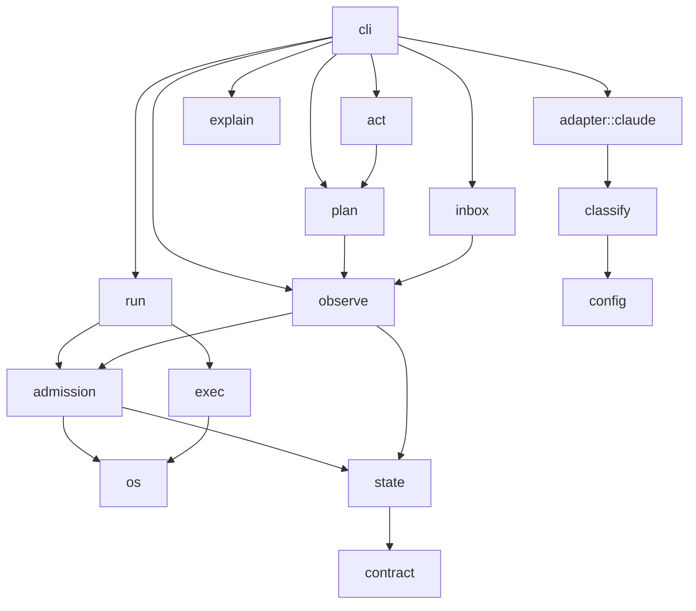
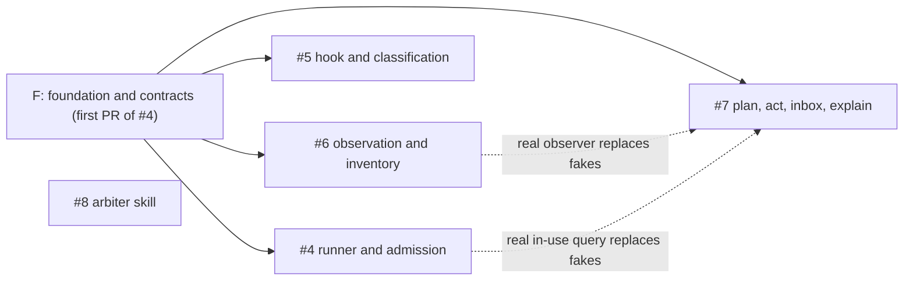

# cardinal phase 0 architecture

This document fixes the contracts that the phase 0 pieces build against: the crate and module layout, configuration, the state directory, the runner, the Claude Code hook, classification, observation, `plan` and `act`, the CLI and its JSON, libraries, tests, and the work split. [design.md](design.md) is the source for principles, non-goals, invariants, purpose-layer conditions G1–G14, and plan-layer claims C1–C21; this document refers to its sections as "design §N" and does not restate them. Where the design turned out to be wrong or incomplete, [section 17](#17-issues-with-the-design) says so and gives the resolution used here.

## Contents

1. [Phase 0 scope](#1-phase-0-scope)
2. [Crate and module layout](#2-crate-and-module-layout)
3. [Configuration](#3-configuration)
4. [State directory](#4-state-directory)
5. [Runner](#5-runner)
6. [Claude Code hook contract](#6-claude-code-hook-contract)
7. [Classification](#7-classification)
8. [Observation](#8-observation)
9. [plan, act, and invariants](#9-plan-act-and-invariants)
10. [Inbox and explain](#10-inbox-and-explain)
11. [CLI and JSON contracts](#11-cli-and-json-contracts)
12. [Libraries](#12-libraries)
13. [Test strategy](#13-test-strategy)
14. [Work split](#14-work-split)
15. [Purpose layer for phase 0](#15-purpose-layer-for-phase-0)
16. [Plan layer for phase 0](#16-plan-layer-for-phase-0)
17. [Issues with the design](#17-issues-with-the-design)

## 1. Phase 0 scope

Phase 0 builds the core (hook adapter, runner, admission and reservations, observation, records, `plan`/`act`/invariants, the inbox, the CLI for the arbiter), the Claude Code adapter, and the first arbiter skill. It is accepted by G4, G5, G10, and G14 (design §12).

**Phase 0 admission decides with exactly this:** the resources of every reservation that is live or recovery-needed, plus the new job's resources, compared per resource against the budgets in `host.toml`; a job gets all of its resources or none. There are no sensors, no priority classes, no queue order, and no measured weights. Resource amounts come from the matching classification rule. This is the design's "sensor read failed, decide from reservations alone" case (design §7), made permanent until phase 2.

Phase 0 leaves seams for phase 2 and later but implements none of them:

| Seam | Phase 0 shape | Filled by |
| --- | --- | --- |
| Sensors | `sensor::Sensors` trait; the only implementation returns `Unavailable` | Phase 2 (memory), phase 1 (disk) |
| Priority classes | `Priority` enum with one variant, `Normal`; stored in reservations | Phase 2 |
| Accepted jobs, `wait`, `cancel`, `logs` | Command names and `jobs/` path reserved; not registered in the CLI | Phase 2 |
| Queue tickets | `tickets/` path reserved | Phase 2 |
| Job spec, placement, executor | `exec::Invocation` (local form) and `exec::Placement::Local`; the runner calls `placement` and an `Executor` trait | Phase 2 |
| Measurements | Records carry `measurements: [{kind, …}]`; phase 0 writes only `wall_time` | Phase 2 (C21) |
| Parallelism injection | Not implemented; classification rules reject an `env` key | Phase 2 |
| Classifier and reconciler units | Built-in classifier implements the unit-shaped `Classifier` trait; JSON schemas fixed in [section 7.6](#76-classifier-unit-seam); `act` already honors per-unit `act = false` | Phase 1+ |
| Disk reserve file | Path reserved ([section 4.12](#412-disk-reserve-file)) | Phase 1 (C11) |
| OS timer, reconcile runner, starting the arbiter | None | Phase 1 |

## 2. Crate and module layout

### 2.1 One crate

Everything lives in the single crate `crates/cardinal` (library plus the `cardinal` binary). The library target exists so integration tests can call modules directly; it is not a published API.

| Option | Verdict |
| --- | --- |
| One crate with modules, layering checked by a test | **Chosen.** One compile unit, one binary, no version coordination. The dependency direction below is enforced by `tests/layering.rs`, which fails when a module imports one it must not |
| Workspace of `cardinal-core`, `cardinal-os`, `cardinal-claude`, `cardinal-cli` | Rejected for now. The compiler would enforce layering, but every contract change would touch several manifests, and no second consumer of the core exists yet. Split when one appears (a unit SDK, a control-plane connector) |

### 2.2 Modules

| Module | Owns | May use |
| --- | --- | --- |
| `contract` | serde types for every JSON document in [section 11](#11-cli-and-json-contracts) and the record and reservation files | std, serde |
| `config` | `host.toml` and `repos/*.toml`: locations, parsing, defaults | `contract` |
| `state` | State paths, atomic writes, lock helpers with deadlines, IDs and keys, JSONL append and read | `contract` |
| `record` | Record appending, rotation, reading | `state`, `contract` |
| `os` | Platform backends behind one API: process-group spawn and signal (Unix), Job Object (Windows), process table and start times, boot time, parent process | std, rustix, signal-hook, windows-sys, sysinfo |
| `sensor` | Phase 2 seam: `Sensors` trait, `Unavailable` implementation | `contract` |
| `exec` | `Invocation` (shell string, cwd, env by inheritance), `Placement::Local`, `Executor` trait, local executor | `os`, `contract` |
| `admission` | Budget math (pure), reservation store, liveness and recovery evaluation, worktree in-use query | `state`, `config`, `os`, `sensor`, `record`, `contract` |
| `run` | The runner: fail-open, wait loop, child supervision, release | `admission`, `exec`, `record`, `state`, `config`, `os` |
| `classify` | Shell tokenizer, normalizer, rule matcher, `Classifier` trait, built-in classifier | `config`, `contract` |
| `adapter::claude` | Hook input and output, rewrite builder, session-end snapshot | `classify`, `config`, `record`, `state`, `os` |
| `observe` | git and gh invocation with constructed environments and deadlines, repository and worktree facts, merge evidence, ignored-data classification, disk usage, outlived processes | `config`, `state`, `admission` (read-only queries), `os`, `contract` |
| `plan` | Plan generation, identity binding, approval scope | `observe`, `admission`, `state`, `record`, `contract` |
| `act` | Plan execution and the invariant checker | `plan`, `observe`, `admission`, `state`, `record`, `contract` |
| `inbox` | Inbox store, dedup, refresh (built-in raisers) | `admission`, `observe`, `state`, `record`, `contract` |
| `explain` | Explanation documents | `classify`, `record`, `plan`, `inbox`, `state`, `contract` |
| `cli` | clap definitions and thin handlers that print JSON | everything |



Two rules matter most and are part of the layering test:

- `admission`, `run`, and `exec` never import `observe`, `inbox`, `plan`, or `act`. The admission path therefore cannot reach the network (gh lives only in `observe`) or the arbiter (C17, C18).
- `contract`, `state`, and `config` import nothing above them, so every work unit can depend on them from day one.

## 3. Configuration

### 3.1 Locations

| | Unix (macOS, Linux) | Windows |
| --- | --- | --- |
| Config dir | `$CARDINAL_CONFIG_DIR`, else `$XDG_CONFIG_HOME/cardinal`, else `$HOME/.config/cardinal` | `$CARDINAL_CONFIG_DIR`, else `%LOCALAPPDATA%\cardinal\config` |
| State dir | `$CARDINAL_STATE_DIR`, else `$XDG_STATE_HOME/cardinal`, else `$HOME/.local/state/cardinal` | `$CARDINAL_STATE_DIR`, else `%LOCALAPPDATA%\cardinal\state` |

macOS uses the XDG locations too, as the design says (design §9) and as most developer CLIs do. Windows uses `%LOCALAPPDATA%` (not roaming) for both because the configuration describes one host. The `CARDINAL_*` overrides exist for tests and for running two independent instances. A relative or missing base directory is an error; before the child starts, every error fails open.

Files:

```text
<config>/
  host.toml          # one per host; optional
  repos/*.toml       # per-repository profiles; read in file-name order
```

Unknown keys are rejected (`deny_unknown_fields`) so typos surface as `config_invalid` instead of silently changing behavior. A config error never blocks a command: the hook does not rewrite, and the runner fails open.

### 3.2 `host.toml`

```toml
[budget]                 # admission budgets; a resource without a budget is unlimited
cpu = 8                  # default: logical CPUs (std::thread::available_parallelism)
memory_mb = 24000        # default: unset
# any other name is a resource too, e.g. gpu = 1

[admission]
default_resources = { cpu = 4 }  # for rules without `resources`; default: cpu = max(1, logical CPUs / 2)
lock_timeout_ms = 2000           # admission lock and in-use lock acquisition deadline
max_wait_ms = 30000              # upper bound of the synchronous wait
wait_fraction = 0.25             # share of the Bash timeout the wait may use

[hook]
enabled = true
runner = "/usr/local/bin/cardinal"  # path written into rewrites; default: the hook's own executable
deadline_ms = 500                   # internal classification deadline

[observe]
git = "git"
gh = "gh"
git_timeout_ms = 10000
gh_timeout_ms = 20000
repos = ["~/src/other"]             # extra main worktrees to inventory (profiles add theirs)
managed = [{ app = "t3code", root = "/path/to/t3code/worktrees" }]  # report-only worktrees

[records]
max_bytes = 8388608
keep = 4

# [unit.<name>] tables (design §5) are parsed from phase 1. In phase 0 the only
# honored key is `act` for callers that identify as a unit (section 9.7).
```

### 3.3 `repos/*.toml` profiles

```toml
[match]                                  # omit [match] for a generic profile that applies to every repository
paths = ["~/src/app"]                    # main worktree paths; matched through the git common dir
remotes = ["github.com/owner/app"]       # origin URL, normalized to host/owner/name

[git]
base = "origin/main"                     # default: the target of refs/remotes/origin/HEAD

[classify]
wrappers = [["npx"], ["pnpm", "exec"], ["pnpm", "dlx"], ["npm", "exec"], ["bunx"], ["mise", "exec", "--"], ["mise", "x", "--"]]

[[rule]]
id = "test"
commands = ["pnpm test", "pnpm -r test", "vitest", "cargo test", "cargo nextest run"]
except = ["--watch", "-w"]               # any of these words disqualifies a match
class = "test"                           # label for records (phase 2 measurement key)
resources = { cpu = 4, memory_mb = 9000 }

[data]
regenerable = ["node_modules", "target", "fuzz/target", ".DS_Store"]
protected = ["fuzz/corpus", "fuzz/artifacts", "proptest-regressions"]
```

- **Repository identity** is the canonical git common dir. A profile matches when one of `match.paths` has that common dir, or when `git remote get-url origin` normalizes to one of `match.remotes`. Path matching needs no child process and is tried first; remote matching runs git (section 8.1) and only when a rule could match the command at all.
- **Precedence:** matching profiles in file-name order, then generic profiles in file-name order. The first rule whose pattern matches wins. `[data]` lists are the union of the matching and generic profiles. `[git] base` and `[classify] wrappers` come from the first profile that sets them.
- **Data patterns:** an entry without `/` matches a file or directory with that name at any depth; an entry with `/` matches that worktree-relative path. No globs in phase 0.
- **No tool knowledge in code.** The core ships no default rules, wrappers, or data patterns (design §4). The repository ships `examples/config/` with a starting `host.toml` and a generic profile; the owner copies what they want.

## 4. State directory

### 4.1 Layout

```text
<state>/
  VERSION                     # layout version, "1"
  host-id                     # 16 hex chars, created once
  admission.lock              # empty; exclusive lock = the admission critical section
  live/<job>.lock             # empty; held exclusively by the owning runner for its lifetime
  reservations/<job>.json     # one per reserved job
  worktrees/<key>.lock        # empty; in-use lock (shared = in use, exclusive = being reclaimed)
  sessions/<session>.json     # SessionEnd snapshots awaiting the outlived-process sweep
  inbox/.lock                 # empty; serializes inbox upserts
  inbox/<key-hash>.json       # one per inbox item
  plans/<plan>/plan.json      # immutable after creation
  plans/<plan>/claim          # created once by the act that executes the plan
  plans/<plan>/result.json    # act result
  records/records.jsonl       # current record file
  records/records.<n>.jsonl   # rotated files, n = 1..keep-1
  records/.rotate.lock        # empty; serializes rotation
  tmp/                        # temporary files for atomic writes (same file system)
  jobs/                       # reserved for phase 2 accepted jobs
  tickets/                    # reserved for phase 2 queue tickets
  reserve                     # reserved for the phase 1 disk reserve file
```

| File | Format | Written by | Read by |
| --- | --- | --- | --- |
| `VERSION`, `host-id` | text | first cardinal process that finds them missing: a fully written temp file is hard-linked into place, which fails if another process won, and the loser reads the winner's file | all |
| `reservations/<job>.json` | `cardinal.reservation.v1` | owning runner; admission and `act` (`release_job`) delete others' reservations, only under the admission lock | admission, observe, inbox, plan, act |
| `sessions/<session>.json` | `cardinal.session-snapshot.v1` | `hook claude session-end` | inbox refresh |
| `inbox/<key-hash>.json` | `cardinal.inbox-item.v1` | inbox raise, refresh, resolve | `inbox`, `explain` |
| `plans/<plan>/plan.json` | `cardinal.plan.v1` | `plan` | `act`, `explain` |
| `plans/<plan>/claim` | `{"pid":…,"claimed_ms":…}` | `act` (create-new) | `act`, `explain` |
| `plans/<plan>/result.json` | `cardinal.act-result.v1` | `act` | `act`, `explain` |
| `records/*.jsonl` | one `cardinal.record.v1` object per line | every command | `explain`, `inventory` |

### 4.2 Write discipline

- **Atomic replace:** write to `tmp/<name>.<pid>.<n>`, flush, rename over the target. Readers see the old or the new file, never a mix. Leftover temp files older than one hour are removed by `plan` and `inbox` runs.
- **fsync policy:** reservations, live locks, and records are not fsynced; they are meaningless after a power loss (reservations from an earlier boot are released, section 4.5). Plan claims, act results, and inbox items are fsynced (file, then parent directory on Unix), because losing them could run a plan twice or bring back a resolved item. On Windows, `FlushFileBuffers` on the file only.
- **Exclusive creation for uniqueness:** a job ID is claimed by creating `live/<job>.lock` with `create_new`, a plan ID by creating `plans/<plan>/` with `create_dir`; a collision retries with a new ID.
- **IDs:** 16 lowercase hex characters from a randomly keyed SipHash (`std::hash::RandomState`) of time, PID, and a counter. No RNG crate. The CLI accepts any unique prefix of at least 4 characters.
- **Keys:** worktree keys and inbox key hashes are FNV-1a 64 of the canonical path or key, as 16 hex characters (hand-written, stable across Rust releases unlike `DefaultHasher`). A worktree-key collision only makes two worktrees share an in-use lock (more conservative); inbox files store the full key and probe `-1`, `-2`, … on collision.
- **Times** are integers in milliseconds since the Unix epoch (`*_ms`). Process start times are seconds, as the OS reports them (`*_s`).

### 4.3 Locks

Locks use `std::fs::File::{lock, lock_shared, try_lock, try_lock_shared}` (stable since Rust 1.89): `flock` on Linux and macOS, `LockFileEx` on Windows. The OS drops them when the holder dies, which is what makes liveness detection work without TTLs.

- Lock files are always empty and separate from data files, because Windows locks are mandatory: a locked byte range cannot be read by other processes.
- std opens files close-on-exec and non-inheritable, so a child never inherits the runner's locks. A surviving child therefore cannot keep a dead runner looking alive.
- Waiting with a deadline is a `try_lock` loop with backoff (5 ms doubling to 50 ms). Every acquisition has a deadline (`lock_timeout_ms`); there is no unbounded `lock()`.
- Lock order is always: worktree in-use lock, then admission lock, then inbox or rotate lock. Nothing takes them in another order.
- `admission.lock`, `worktrees/*.lock`, `inbox/.lock`, and `records/.rotate.lock` are never deleted, so no process can lock a file another process has already unlinked. `worktrees/*.lock` grows by one empty file per worktree ever used; phase 1 may prune them under the admission lock.

### 4.4 Admission protocol

The critical section only reads small files and writes one; process probes are a few system calls.

1. Take `admission.lock` exclusively (deadline `lock_timeout_ms`; on timeout, fail open).
2. On the runner's first pass only: create `live/<job>.lock` with `create_new` and take it exclusively. The runner holds it until it exits.
3. Read every `reservations/*.json` (a file that vanished meanwhile is skipped) and evaluate each one (section 4.5): `live`, `recovery_needed`, or `stale`. Delete `stale` ones and their live lock files, and delete live lock files that are free and have no reservation. For `recovery_needed` ones with a verified process group on Unix, send the stop signal (SIGTERM first; SIGKILL when a later pass finds the group still alive at least 2 s after the SIGTERM recorded in the reservation).
4. Sum the resources of `live` and `recovery_needed` reservations. If, for every resource the new job needs, `sum + need ≤ budget` (resources without a budget always fit), write `reservations/<job>.json` (atomic) with `state: "reserved"`.
5. Release `admission.lock`.

The liveness lock is held before the reservation becomes visible, so another admitter can never see the new reservation with a free liveness lock. Live lock files are created and garbage-collected only inside the admission lock, so collection can never delete a file between its creation and its locking. A missing live lock file counts as free.

### 4.5 Reservation lifecycle and recovery-needed

```text
reserved ──(write before spawn)──> spawning ──(write after spawn)──> running ──> deleted at release
```

A reservation's derived state is computed by whoever reads it; it is never stored:

| Condition | Derived state |
| --- | --- |
| `try_lock` on `live/<job>.lock` fails (owner holds it) | `live` |
| Reservation `boot_s` differs from the current boot time by more than 2 s | `stale` (no process survives a reboot) |
| Owner lock is free and `state` is `reserved` | `stale` (no child was ever spawned) |
| Owner lock is free, `state` is `running`, and the group is gone (Unix: `kill(-pgid, 0)` gives `ESRCH`; Windows: child PID absent or its start time differs) | `stale` |
| Owner lock is free, `state` is `running`, the group exists, and the group leader (PID = PGID) has the recorded start time | `recovery_needed`, verified: admission stops it (section 4.4) |
| Owner lock is free and `state` is `spawning`, or the group exists but the leader is gone or has another start time | `recovery_needed`, unverifiable: never signalled; counted until the arbiter or owner releases it with a `release_job` plan |

Recovery-needed reservations count as reserved for admission and as in use for their worktree. On Windows the runner's death closes the Job Object, whose `KILL_ON_JOB_CLOSE` stops the group, so recovery normally becomes `stale` at the next pass. On Unix the next admission pass stops a verified group and releases it once the group is gone. No TTLs are involved.

Leader verification exists because a process-group ID can be reused once the group is empty; signalling an unverified group could kill unrelated processes. The `spawning` window lasts from the write just before `spawn()` to the write just after it, a few hundred microseconds.

### 4.6 Worktree in-use lock

- The worktree of a job is found by walking up from the runner's cwd to the nearest `.git` entry (file or directory); the key is the FNV-1a of that directory's canonical path. A job outside any worktree takes no in-use lock.
- The runner takes `worktrees/<key>.lock` **shared** at acceptance, before admission and before any wait, and holds it until the child has exited and the reservation is deleted (C15). Several jobs can share a worktree.
- `act` takes it **exclusively** with `try_lock` (no waiting) and keeps it for the whole deletion. A worktree is in use when that `try_lock` fails, or when a `live` or `recovery_needed` reservation names the worktree key (checked under the admission lock while holding the exclusive lock). The second check covers a crashed runner, whose shared lock the OS has already dropped.
- A runner that cannot get the shared lock within `lock_timeout_ms` (an `act` is deleting the worktree) fails open.

### 4.7 Records

- One JSON object per line, appended with a single `write` on a file opened in append mode (`O_APPEND`; `FILE_APPEND_DATA` on Windows), so concurrent appenders do not interleave.
- When `records.jsonl` exceeds `max_bytes`, the appender that notices takes `.rotate.lock` with `try_lock` (skips rotation if busy), renames `records.<keep-2>` → `records.<keep-1>` … `records.jsonl` → `records.1.jsonl`. An appender that still holds the old file writes into the rotated file; nothing is lost.
- Readers skip lines that do not parse. A crash mid-write costs at most the torn line and the line appended after it.
- A record failure is never surfaced to a command and never causes a rerun (C5, C11).

### 4.8 Inbox store

`inbox/<key-hash>.json` holds one item (section 10.1). Upserts take `inbox/.lock` exclusively: an existing item with the same key is updated (`seen` incremented, `evidence` replaced) and is never reopened once `resolved` or `dismissed`.

### 4.9 Plans store

`plans/<plan>/plan.json` is written once. `act` claims a plan by creating `plans/<plan>/claim` with `create_new` and fsyncing it before any deletion, so a plan runs at most once even across a crash or power loss. A claim without a `result.json` means the run was interrupted; the plan is never retried, and a new plan has to be made. Plan directories older than 30 days are removed by `plan` runs.

### 4.10 Sessions

`hook claude session-end` writes `sessions/<session>.json` with the agent process and its descendants (section 6.6). Inbox refresh deletes it once none of the listed processes is alive.

### 4.11 Crash consistency

| Runner dies … | Left behind | Next reader does |
| --- | --- | --- |
| before its first admission pass | Nothing; its in-use shared lock is dropped by the OS | — |
| while waiting between passes | `live/<job>.lock`, free | Admission deletes free live locks that have no reservation |
| inside the admission lock | Temp file in `tmp/`; lock dropped by the OS | Temp GC |
| after writing the reservation (`reserved`), before `spawning` | Reservation, free live lock | `stale`: deleted at the next admission pass |
| between `spawning` and `running` | Reservation in `spawning` | `recovery_needed`, unverifiable; inbox item; released by a `release_job` plan |
| while the child runs | Reservation in `running` | Windows: job killed, `stale`. Unix: `recovery_needed`, verified; stopped and then released by admission |
| after the child exits, before release | Reservation in `running`, group gone | `stale`: deleted at the next pass; records lack `job_finished` |
| during release | Nothing or a free live lock | GC as above |

Power loss: reservations, live locks, and in-use locks are reset by the reboot (`boot_s` check, OS locks). Plans and the inbox survive through fsync.

### 4.12 Disk reserve file

Phase 1 creates `<state>/reserve` with really allocated blocks (written zeros, not `set_len`, which leaves a sparse file), 64 MiB by default, and deletes it when the state volume is full so minimal reclamation can proceed (C11). Phase 0 only reserves the path.

## 5. Runner

### 5.1 Invocation

```text
cardinal run [--class NAME] [--rule ID] [--res NAME=AMOUNT]... [--timeout-ms N] [--background]
             [--session ID] [--agent ID] [--tool-use ID]
             (--cmd-b64 BASE64URL | -c COMMAND)
```

- **The command** is the original shell string. The hook passes it as unpadded base64url of its UTF-8 bytes (`--cmd-b64`): the encoding has no quotes, spaces, `/`, `=`, or `:`, so no shell quoting can alter it and Git Bash's path conversion for native programs on Windows cannot rewrite it. `-c` is for people and tests.
- **cwd and environment** are not passed: the runner inherits them from the shell that runs the rewritten command, which is the Bash tool's shell, and does not change them. The child inherits them from the runner.
- **Classification** (`--class`, `--rule`, `--res`) comes from the hook. Without `--res`, the runner uses `admission.default_resources`.
- `--timeout-ms` and `--background` carry the Bash tool's effective timeout and `run_in_background` (section 6.3). `--session`, `--agent`, `--tool-use` carry the hook's identifiers into the reservation and records. Values outside `[A-Za-z0-9_.-]` are dropped by the hook.

### 5.2 Steps

1. Decode the command. Any error from here until the child starts is a pre-start failure: fail open (step 8).
2. Resolve the state dir and load `host.toml`.
3. Take the worktree in-use lock shared (section 4.6).
4. Admission (section 4.4), which claims the job ID and the live lock on the first pass. If the budget is full, release the admission lock, sleep (250 ms doubling to 2 s), retry until the wait cap (section 5.3).
5. Write `spawning`, spawn the child (section 5.4), write `running` with the child's identity, append `job_started`.
6. Wait for the child, forwarding signals.
7. Release: delete the reservation, drop the in-use lock, append `job_finished` (exit status, `measurements: [{kind: "wall_time", ms}]`), drop and delete the live lock, print the wait note if there was a wait, exit with the child's status (section 5.5).
8. **Fail open:** append `job_fail_open` if records still work, release whatever was taken, and run the original command without a reservation: `exec` the shell on Unix (the runner process becomes the command); on Windows spawn it, wait, and exit with its code. Nothing is printed, so stdout, stderr, and exit status equal a run without cardinal (G4).

### 5.3 Wait cap and phase 0 overflow

- Wait cap: `max_wait_ms` if `--background`; otherwise `min(max_wait_ms, timeout_ms × wait_fraction)`. Phase 2 subtracts the expected run time once measurements exist.
- **When the wait reaches the cap, phase 0 starts the command anyway, over budget** (admission result `overflow`), records it, and prints `[cardinal] Ran over budget after waiting 30 s (budget was full).` at the end. Phase 2 replaces this branch with an accepted job (C4). Alternatives rejected for phase 0: returning an error makes agents retry and adds load; waiting until the Bash timeout gets the command moved to the background by Claude Code with the wait still in front of it.
- After a wait of at least 1 s that ended in normal admission, the runner prints `[cardinal] Ran after waiting 40 s` at the end. Both notes go to the runner's stderr so they never enter a pipe that consumes the command's stdout.

### 5.4 Child execution

- **Shell:** the same shell binary as the runner's parent process (the Bash tool's shell) if its name is `bash`, `zsh`, `sh`, or `dash`; else `$SHELL` if it has one of those names; else `/bin/sh`. On Windows the parent is Git Bash's `bash.exe`. The child runs `<shell> -c <command>`.
- **stdio:** inherited. The runner never proxies output, so terminal detection, buffering, and pipe behavior are unchanged, and the runner's death cannot break the child's output.
- **Unix:** `CommandExt::process_group(0)` puts the child in a new group (PGID = child PID). The runner forwards SIGINT, SIGTERM, SIGHUP, and SIGQUIT to the group (signal-hook) and keeps waiting. When the direct child exits, the runner releases; group members left behind are not killed (the same as running the command without cardinal) and show up in `inventory`.
- **Windows:** before spawning, the runner creates a Job Object with `JOB_OBJECT_LIMIT_KILL_ON_JOB_CLOSE` and assigns itself to it; the child inherits membership, so there is no window in which a grandchild escapes. On normal completion the runner clears the kill-on-close limit before exiting, so leftovers behave as on Unix; only the runner's abnormal death kills the group.
- **Interactive terminals:** handing the terminal's foreground group to the child is out of scope for phase 0; the hook path has no terminal.

### 5.5 Exit status and infrastructure failure

| Situation | Exit status | stderr |
| --- | --- | --- |
| Child exited with code N | N | child's output only (plus a wait note) |
| Child killed by signal N (Unix) | 128 + N | child's output only |
| Pre-start failure | whatever the original command returns (fail open) | nothing added |
| Runner error after the child started, child status unknown | 125 | `[cardinal] Infrastructure failure after the command started: <reason>. The command was not rerun.` |
| Runner killed after the child started | set by the killer (137 for SIGKILL) | nothing; the record has `job_started` without `job_finished`, and `explain job` reports `runner_died` |
| Release or record failure after the child exited | the child's status | nothing |

125 follows the convention of `env`, `nice`, and `timeout` for "the wrapper itself failed". It can collide with a child's own 125, so the stderr line and the records are the distinguishing signal, not the code alone.

## 6. Claude Code hook contract

### 6.1 Facts from the Claude Code documentation

| Question | Answer | Source |
| --- | --- | --- |
| Is there a tool call ID in `PreToolUse`? | Yes: `tool_use_id`, next to `tool_name` and `tool_input` | [Hooks reference](https://code.claude.com/docs/en/hooks): "PreToolUse hooks receive `tool_name`, `tool_input`, and `tool_use_id`" |
| Session and cwd? | Common fields: `session_id`, `transcript_path`, `cwd`, `permission_mode`, `hook_event_name`; in a subagent also `agent_id` and `agent_type` | Hooks reference, common input fields |
| Bash `tool_input` fields | `command`, `description`, `timeout` (ms), `run_in_background` | Hooks reference example input |
| Bash timeout default and maximum | `BASH_DEFAULT_TIMEOUT_MS` default 120000; `BASH_MAX_TIMEOUT_MS` default 600000 (the ceiling is the larger of the two) | [Environment variables](https://code.claude.com/docs/en/env-vars) |
| What happens at the Bash timeout? | A foreground command that reaches its timeout is moved to the background, not stopped (unless it starts with `sleep` or `CLAUDE_CODE_DISABLE_BACKGROUND_TASKS=1`) | [Tools reference](https://code.claude.com/docs/en/tools-reference) |
| `updatedInput` semantics | "Replaces the entire input object, so include unchanged fields alongside modified ones." Permission rules and auto-background eligibility are evaluated against the returned input. Combine with `allow` to auto-approve or `ask` to prompt; without `permissionDecision` the normal permission flow applies | Hooks reference |
| Several hooks returning `updatedInput` | Not documented; hooks run in parallel | Hooks reference |
| Hook timeout | `timeout` in seconds; default 600 for command hooks; a timed-out `PreToolUse` hook is discarded and the call continues through the normal permission flow | Hooks reference |
| Exit codes and output | Exit 2 blocks the tool call; other non-zero exits are non-blocking; exit 0 with empty stdout is success; exit 0 with invalid JSON is a non-blocking error | Hooks reference |
| `SubagentStop` input | `agent_id`, `agent_type`, `agent_transcript_path`, `stop_hook_active`, `last_assistant_message`, plus common fields | Hooks reference |
| `SessionEnd` input | `reason`: `clear`, `resume`, `logout`, `prompt_input_exit`, `other`; default hook timeout 1.5 s | Hooks reference |
| Shell and cwd of Bash commands | The user's shell, with aliases, functions, and options captured from its rc file at session start; a `cd` carries over to later Bash calls while inside the project directory (never in subagents) | Tools reference |
| Windows | The Bash tool runs in Git Bash; without Git Bash a separate PowerShell tool is used, whose input has the same fields | Tools reference; [Troubleshooting install](https://code.claude.com/docs/en/troubleshoot-install) |

### 6.2 Installation

The owner adds this to `~/.claude/settings.json` (never to a repository, G5); `examples/claude/settings.json` ships it:

```json
{
  "hooks": {
    "PreToolUse": [{ "matcher": "Bash", "hooks": [{ "type": "command", "command": "cardinal hook claude pre-tool-use", "timeout": 5 }] }],
    "SubagentStop": [{ "hooks": [{ "type": "command", "command": "cardinal hook claude subagent-stop", "timeout": 5 }] }],
    "SessionEnd": [{ "hooks": [{ "type": "command", "command": "cardinal hook claude session-end", "timeout": 2 }] }]
  },
  "permissions": { "allow": ["Bash(/usr/local/bin/cardinal run:*)"] }
}
```

The explicit `timeout` matters: the 600 s default would let a stuck hook stall every Bash call. Set `[hook] runner` to a path that survives upgrades; the hook's own executable may live in a versioned directory, and a vanished runner path silently turns every rewrite into the fallback. The allow rule names the runner path exactly as the hook writes it (`[hook] runner`). cardinal must be the only hook that returns `updatedInput` for Bash, because the order in which several are applied is undefined.

### 6.3 `hook claude pre-tool-use`

1. Read stdin (bounded at 1 MiB) as JSON. If `tool_name` is not `Bash`, `tool_input.command` is not a string, `hook.enabled` is false, or anything fails: exit 0 with empty stdout.
2. Classify (section 7) within `hook.deadline_ms`, measured from process start. Past the deadline: no rewrite.
3. If classified, build the rewritten command (section 6.4) and print:

```json
{"hookSpecificOutput":{"hookEventName":"PreToolUse","updatedInput":{"command":"<rewritten>","description":"<unchanged>","timeout":120000,"run_in_background":false}}}
```

`updatedInput` is the original `tool_input` object with only `command` replaced, kept as a `serde_json::Value` so fields unknown to cardinal survive unchanged. No `permissionDecision` is returned (section 6.5).

4. Effective timeout passed to the runner: `tool_input.timeout` if it is a positive number, else `BASH_DEFAULT_TIMEOUT_MS` from the hook's environment (the hook inherits Claude Code's), else 120000; capped at `max(BASH_MAX_TIMEOUT_MS or 600000, default)`. `run_in_background: true` adds `--background`.

The hook writes nothing to the state dir and takes no reservation (C1). It never exits non-zero: panics are caught at the top level and turned into "no rewrite".

### 6.4 Rewritten command

POSIX shells (bash and zsh on macOS and Linux, Git Bash on Windows):

```sh
cd packages/app &&
if [ -x /usr/local/bin/cardinal ]; then /usr/local/bin/cardinal run --class test --rule app/test --res cpu=4 --timeout-ms 120000 --session 3f6c… --tool-use toolu_01… --cmd-b64 cG5wbSB0ZXN0IDI-JjEgfCB0YWlsIC01MA
else
pnpm test 2>&1 | tail -50
fi
```

- The first line is the hoisted prefix (section 7.4): leading `cd` commands stay in the outer shell so the Bash tool's persisted cwd changes exactly as without cardinal. Without a prefix, the command starts at `if`.
- `[ -x <runner> ]` is the fallback test: if the runner path is missing or not executable (uninstalled, moved, upgraded to another path), the `else` branch runs the original remainder verbatim. The `if` returns the status of whichever branch ran, so the original status is preserved either way.
- The `else` branch is on its own lines so a trailing `# comment` or a here-document in the original cannot swallow `fi`.
- The runner path is written unquoted when it matches `[A-Za-z0-9/._:+-]+` (so a permission rule can match it) and single-quoted otherwise. On Windows it is written with forward slashes (`C:/…/cardinal.exe`), which Git Bash accepts.
- Every flag value is alphanumeric or base64url, so nothing needs quoting.

PowerShell tool (Windows without Git Bash), specified now and implemented in phase 3:

```powershell
if (Test-Path -LiteralPath 'C:\…\cardinal.exe' -PathType Leaf) { & 'C:\…\cardinal.exe' run … --cmd-b64 … }
else {
<original>
}
```

Phase 3 adds `pwsh` and `powershell` to the shells the runner accepts from its parent (section 5.4). Whether PowerShell's profile-dependent state needs the same treatment as section 17's item 2 is a phase 3 question.

### 6.5 Permissions

Claude Code evaluates permission rules against the rewritten command. The rewrite returns no `permissionDecision`, and the command is built so its subcommands are the fallback test, the runner invocation, and the original remainder. With the allow rule for the runner installed, the rewritten command needs approval exactly when the original does, and deny rules on the original still match its copy in the `else` branch. Returning `allow` was rejected: it would auto-approve commands the owner never allowed. Whether Claude Code's command parser splits `if … then … else … fi` into those subcommands is not documented; it is the first real-host check of #5 (section 15, G4), and section 17 item 1 gives the fallback.

### 6.6 `subagent-stop` and `session-end`

Both read stdin, append one record (`subagent_stopped` or `session_ended`, with `session_id`, `agent_id`, `agent_type`, `reason`, `cwd`), and never stop processes (C9). Both exit 0 whatever happens.

`session-end` also writes `sessions/<session>.json`: the agent process (the nearest ancestor of the hook whose name is not a shell: `sh`, `bash`, `zsh`, `dash`, `cmd.exe`, `powershell.exe`, `pwsh.exe`) and every descendant of it except the hook's own chain, each as PID, start time, name, and the first 256 bytes of the command line. It must finish within the 1.5 s default timeout; one process-table refresh takes milliseconds.

A process outlived its session when it is listed in a snapshot, is still alive with the same start time, and the agent process is gone. The agent check matters because `SessionEnd` with `clear` or `resume` keeps the same agent process running. Processes that detach from the agent before `SessionEnd` (double-forked daemons) are not in the snapshot; phase 1 can add a process-environment marker if the owner needs them.

`SubagentStop` cannot attribute processes to a subagent (nothing in a process identifies the subagent), so it only records.

## 7. Classification

### 7.1 Pipeline

```text
command string ──tokenize──> top-level list ──hoist leading cd──> remainder
remainder ──normalize each simple command──> argv lists ──match rules──> class, rule, resources | unclassified
```

Unclassified means no rewrite: light unknown commands are not limited (design §7). Heavy unknown commands are limited only once a profile names them.

### 7.2 Tokenizer subset

A hand-written tokenizer for a conservative subset of POSIX shell syntax:

- Words with `'…'`, `"…"` (backslash escapes inside), and `\x` escapes; `$NAME` and `${…}` inside words are opaque text.
- Operators `&&`, `||`, `;`, `|`, `&`, and newlines separate simple commands.
- Redirections (`>`, `>>`, `<`, `2>&1`, `N>file`, `&>`) belong to their simple command and are not argv.
- **Anything else makes the whole command unclassified:** `$(`, backticks, `$((`, `<<` (here-documents), `<(`, `>(`, `(`, `)`, `{`, `}`, `[[`, `!`, and the keywords `if then else elif fi for while until do done case esac function select` in command position, unbalanced quotes. Not understanding a command can only cause a missed rewrite, never a changed one, because the runner receives the original string untouched.

### 7.3 Normalization

For each simple command:

1. Drop leading `NAME=value` assignments.
2. Unwrap shell-level wrappers (POSIX knowledge, built in): `env` (with assignments and `-u NAME` only; other options make it unclassified), `command`, `time`, and `nice [-n N]`.
3. Unwrap `sh`, `bash`, `zsh`, `dash` with `-c STRING` (optionally `-e`, `-l`): tokenize `STRING` and classify its simple commands, one level deep. Hoisting does not apply inside.
4. Unwrap tool wrappers from `[classify] wrappers` (profile data, not code): drop the wrapper's words, then words starting with `-` until the first that does not.
5. Replace argv[0] by its base name (`./node_modules/.bin/vitest` → `vitest`), and drop a `+toolchain` word right after `cargo`.

`pnpm exec vitest`, `npx vitest`, `env X=1 vitest`, and `bash -c 'vitest'` all normalize to `["vitest"]`.

### 7.4 Hoisting and state-changing builtins

The runner runs its string in a child shell, so shell state changes inside it do not reach the Bash tool's shell, which Claude Code keeps between calls (cwd) (section 17 item 2). Therefore:

- A leading run of `cd DIR` commands (one argument, no redirections), each followed by `&&` or `;`, is kept outside the `if` (the hoisted prefix in section 6.4). The job is the remainder.
- Classification resolves the repository from the hook input's `cwd` joined with the hoisted `cd` targets; a target containing `$` or a glob character keeps the input `cwd`, and `~` expands to `HOME`.
- If the remainder contains a top-level `cd`, `pushd`, `popd`, `export`, `unset`, `source`, `.`, `alias`, `unalias`, `set`, `shopt`, `setopt`, `unsetopt`, `eval`, `exec`, `exit`, `return`, `trap`, `ulimit`, `umask`, `declare`, `typeset`, `local`, `readonly`, `hash`, `builtin`, or `enable`, the command is not rewritten.

### 7.5 Rule matching and resources

- A pattern is split into words. It matches a normalized argv when it is a prefix of it; the word `*` matches any one word. A match is cancelled if any argv word equals an `except` entry.
- The first matching rule in precedence order (section 3.3) classifies a simple command. When several simple commands in one command match, the job's resources are the per-resource maximum of their rules and the class and rule are those of the first match; the job is still the whole remainder (design §6).
- Rules have `id`, `commands`, optional `except`, `class`, optional `resources` (positive integers per resource name). The rule ID in records is `<profile file stem>/<id>`.

### 7.6 Classifier unit seam

The built-in classifier implements `trait Classifier { fn classify(&self, req: &ClassifyRequest, deadline: Instant) -> ClassifyResponse }`. External classifier units (phase 1+) speak the same types as JSON over stdin and stdout, one request per process:

```ts
// stdin
{ schema: "cardinal.classify-request.v1", command: string, cwd: string,
  repo: { common_dir: string, main_worktree: string, remote: string | null } | null,
  tool: { name: "Bash", timeout_ms: number, background: boolean } }
// stdout
{ schema: "cardinal.classify-response.v1",
  decision: "wrap" | "pass",
  class?: string, rule?: string, resources?: { [name: string]: number },
  reason: string }
```

Classifiers run in a fixed order; the first `wrap` wins; a unit that misses the deadline, exits non-zero, or prints invalid JSON counts as `pass` (design §5).

## 8. Observation

### 8.1 Child processes for git and gh

- **Constructed environment:** start empty and copy an allowlist: `PATH`, `HOME`, `USER`, `LOGNAME`, `LANG`, `LC_*`, `TMPDIR`, `XDG_CONFIG_HOME`, `GIT_CONFIG_GLOBAL`, `GIT_CONFIG_SYSTEM`, `GIT_CONFIG_NOSYSTEM`, `GH_TOKEN`, `GITHUB_TOKEN`, `GH_HOST`, `GH_CONFIG_DIR`, `SSH_AUTH_SOCK`, and on Windows `SystemRoot`, `SystemDrive`, `ComSpec`, `PATHEXT`, `USERPROFILE`, `APPDATA`, `LOCALAPPDATA`, `ProgramData`, `TEMP`, `TMP`. Every other `GIT_*` (`GIT_DIR`, `GIT_WORK_TREE`, `GIT_INDEX_FILE`, `GIT_COMMON_DIR`, `GIT_OBJECT_DIRECTORY`, `GIT_NAMESPACE`, `GIT_CEILING_DIRECTORIES`, `GIT_CONFIG_PARAMETERS`, `GIT_CONFIG_COUNT`, …) is dropped, so a cardinal process started from a git hook can never act on another repository. Then add `GIT_OPTIONAL_LOCKS=0`, `GIT_TERMINAL_PROMPT=0`, `GH_PROMPT_DISABLED=1`, `GH_NO_UPDATE_NOTIFIER=1`, `NO_COLOR=1`. The `GIT_CONFIG_*` location variables stay because they decide where the owner's configuration lives, and git must read it the way the owner's git does (design §9).
- **Always** `git --no-optional-locks -C <absolute path> …`, so `status` does not refresh and rewrite the index. Observation never runs `fetch` or anything else that writes to a repository; stale remote-tracking refs only make fewer worktrees look merged.
- **Deadlines:** every child has one (`git_timeout_ms`, `gh_timeout_ms`). Output is read on threads; on the deadline the child is killed and the fact is `unknown`. Spawn failure, non-zero exit (where not meaningful), unparsable output, and timeouts all become `unknown`, never "safe".

### 8.2 Repositories and worktrees

Repositories to observe: the main worktrees of profiles with `match.paths`, plus `[observe] repos`, plus `--repo` arguments. Per repository:

| Fact | Command |
| --- | --- |
| Worktrees | `git worktree list --porcelain -z` (path, HEAD, branch, `locked`, `prunable`) |
| GitHub repository | `git remote get-url origin`, parsed to `owner/name` for `github.com` (or `GH_HOST`); anything else makes PR facts `unknown` |
| Base | `[git] base`, else `git symbolic-ref --short refs/remotes/origin/HEAD`; missing makes merge evidence `unknown` |
| Open PRs | `gh pr list --repo O/N --state open --limit 500 --json number,headRefName,headRefOid,isCrossRepository,url`; exactly 500 results makes it `unknown` |

Per worktree:

| Fact | Command | Value |
| --- | --- | --- |
| HEAD, branch, upstream, dirty, ignored entries | `git status --porcelain=v2 -z --branch --untracked-files=all --ignored=matching` | `dirty` is any entry other than `!` (ignored) |
| `has_upstream` | `# branch.upstream` header | detached HEAD: `no` |
| `unpushed` | `git rev-list --count HEAD --not --remotes` | `0` → `no`; otherwise `yes`, unless merge evidence is `merged_pr` (the commits exist on GitHub) |
| `base_ancestor` | `git merge-base --is-ancestor HEAD <base>` | exit 0 → `yes`, 1 → `no`, else `unknown` |
| `merged_pr` (only if not a base ancestor) | `gh pr list --repo O/N --state merged --search <HEAD oid> --json number,headRefOid,mergedAt,url --limit 20` | `yes` if a returned PR has `headRefOid == HEAD` |
| `open_pr` | from the repository's open PR list | `yes` if a same-repository PR has `headRefName == branch` or `headRefOid == HEAD` |

Merge evidence is `base_ancestor` or `merged_pr`, matched on the HEAD object ID, never on the branch name. So commits added after a merged PR, or a reused branch name, give no evidence (C12). Squash merges without a matching head stay without evidence and are left to the arbiter (design §7).

### 8.3 Ignored data

Each `!` entry from `git status` is classified with the profile's `[data]` patterns:

1. `protected` if the entry or anything below it matches a protected pattern (path patterns are checked by existence; name patterns by walking the entry);
2. else `regenerable` if the entry is, or is inside, a regenerable match;
3. else `unclassifiable`.

Walks never follow symbolic links and never cross into a directory that contains its own `.git` entry, which is reported as a `nested_repository` instead.

### 8.4 Managed worktrees

A worktree is managed by another app, and therefore only reported, when its path is under a `[observe] managed` root or git lists it as `locked`. The `managed_by` field names the app or `git-lock`.

### 8.5 Disk usage

`inventory --sizes` walks each worktree and its regenerable entries (threads per worktree, no symlink following). It reports `allocated_bytes` (blocks × 512 on Unix, file length on Windows, each inode once) and `exclusive_bytes` (only files whose link count is 1), because package managers hard-link into a shared store and deleting a linked `node_modules` frees much less than its apparent size. Without `--sizes`, size fields are `null`.

### 8.6 Processes

`inventory` lists reservations with their derived state and members of their process groups, and outlived processes from session snapshots (section 6.6). Inventory is read-only: it never deletes stale reservations or signals anything.

## 9. plan, act, and invariants

### 9.1 Plan kinds

| Kind | Target | Effect |
| --- | --- | --- |
| `reclaim_worktree` | A linked worktree (never a main worktree) | `git -C <main> worktree remove <path>` without `--force`; git refuses dirty or locked worktrees itself, a second line of defense. The branch is kept |
| `reclaim_dir` | A regenerable ignored entry inside an observed worktree | `std::fs::remove_dir_all` (does not follow symbolic links) or file removal |
| `release_job` | A recovery-needed reservation | Verified group: SIGKILL the group, wait up to 5 s for it to be empty, delete the reservation. Unverifiable: delete the reservation without signalling anything |

Caches outside worktrees (phase 1), process stops for outlived processes, and branch deletion are not phase 0 plan kinds.

### 9.2 Checks

Each plan carries a list of checks. An **invariant** failing or being `unknown` makes `act` refuse for every caller, including the owner (design §3). A **condition** failing only raises the plan's approval to `owner`.

| Check | Kind | Role | Pass when |
| --- | --- | --- | --- |
| `observed` | all | invariant | Every git and gh fact the plan depends on is known |
| `not_in_use` | `reclaim_worktree`, `reclaim_dir` | invariant | Exclusive in-use lock acquired and no live or recovery-needed reservation names the worktree (section 4.6) |
| `clean` | `reclaim_worktree` | invariant | `dirty` is `no` |
| `no_unpushed` | `reclaim_worktree` | invariant | `unpushed` is `no` |
| `no_open_pr` | `reclaim_worktree` | invariant | `open_pr` is `no` |
| `has_upstream` | `reclaim_worktree` | invariant | The branch has an upstream (G6). This also keeps freshly created worktrees, which start clean at the base, from being reclaimed before their first push |
| `no_protected` | `reclaim_worktree`, `reclaim_dir` | invariant | Nothing in the target, descendants included, is protected |
| `no_unclassifiable` | `reclaim_worktree`, `reclaim_dir` | invariant | Nothing in the target is unclassifiable ignored data |
| `no_nested_repository` | `reclaim_worktree`, `reclaim_dir` | invariant | No directory below the target root has its own `.git` entry (another worktree, a submodule, a nested clone) |
| `not_managed` | `reclaim_worktree` | invariant | Not under a managed root and not git-locked (design §4) |
| `regenerable` | `reclaim_dir` | invariant | The target is a `regenerable` ignored entry of a worktree that observation listed |
| `not_symlink` | `reclaim_worktree`, `reclaim_dir` | invariant | The target path itself is not a symbolic link |
| `runner_dead` | `release_job` | invariant | The owner's live lock is free |
| `merge_evidence` | `reclaim_worktree` | condition | `base_ancestor` or `merged_pr` is `yes` |
| `group_verified` | `release_job` | condition | The group is empty or its leader is verified |

Plans are created even when invariants fail, with `invariants_ok: false`, so the arbiter sees the reason and an `act` on them demonstrates the refusal (G10).

### 9.3 Approval scope

`approval` is `none` when every condition passes, and `owner` otherwise. This is the design's reclaim scope (design §5): without owner approval, the arbiter can reclaim regenerable data and whole worktrees that meet every reclaim condition. `act` executes an `owner` plan only with `--owner-approved`. The arbiter skill never passes that flag. It is self-regulation, not a security boundary (design §3). Phase 3 replaces the flag with an approval intent bound to the plan ID from the web UI.

### 9.4 Identity binding

A plan stores the target identity: `host_id`, repository common dir, worktree path, worktree root identity (`dev` and `ino` on Unix; creation time where the OS has one), HEAD object ID, target path, and for `release_job` the job ID and recorded group identity. `act` re-reads all of them; any difference makes the plan `expired` (C14). A new worktree created at the same path has a new root identity even if its HEAD and branch are the same.

### 9.5 act procedure

1. Load the plan; a wrong `host_id` gives `expired`.
2. Claim: create `plans/<id>/claim` with `create_new`, fsync. If it exists: `already_executed`. (`--dry-run` skips claiming.)
3. For worktree targets: take the in-use lock exclusively (`try_lock`), then check reservations under the admission lock. Keep the in-use lock until the end.
4. Re-observe the target from scratch (section 8) and compare identity.
5. Re-evaluate every check, walking the whole target including descendants (C13). Any invariant not `pass`: `rejected` with the failing checks.
6. If `approval` is `owner` and `--owner-approved` is absent: `rejected` with reason `owner_approval_required`.
7. Execute. A partial deletion (for example a file held open on Windows) gives `partial`; nothing deleted so far could have been owner data, because every check passed.
8. Write `result.json` (fsync), append an `act` record, release the in-use lock.

Two `act` runs on the same plan race only at step 2, where `create_new` lets exactly one through.

### 9.6 Dry-run and unit gating

- `act --dry-run` performs steps 1 and 3–6 without claiming or deleting. It reports `dry_run` with the checks and the bytes that would be freed when the plan would execute, and otherwise the refusal (`rejected` or `expired`) it would get.
- `act --caller unit:<name>` marks the caller. When `host.toml` has `[unit.<name>] act = false` (the default for any unit), `act` behaves as `--dry-run` and appends a `planned` record (C16). Phase 0 has no units, but the gate is part of `act` now so units cannot bypass it later.

## 10. Inbox and explain

### 10.1 Inbox

In phase 0 items are raised only by the refresh that `cardinal inbox` runs first (skipped with `--no-refresh`); from phase 1, units raise them through the same `inbox::raise` function. The refresh raises and clears:

| Kind | Key | Raised when | Cleared (resolved by `cardinal`) when |
| --- | --- | --- | --- |
| `recovery_needed` | `recovery_needed:<job>` | A reservation is `recovery_needed` (evidence: group members, verified or not) | The reservation is gone |
| `outlived_processes` | `outlived:<session>` | A session snapshot has live processes after its agent process ended | None of them is alive |

Statuses are `open`, `escalated` (waiting for the owner), `resolved`, and `dismissed`. Raising a key that exists updates `seen` and evidence of an open or escalated item and leaves resolved and dismissed items alone (C19).

### 10.2 explain

`explain` shows where a decision came from: configuration files and keys, the rule, observations (the exact command and its result), and records. Subjects: `job <id>`, `plan <id>`, `inbox <key>`, and `command [--cwd DIR] -- <string>` (a classification trace without running anything).

## 11. CLI and JSON contracts

### 11.1 Conventions

- Every JSON document on stdout is one object with a `schema` field `"cardinal.<name>.v<N>"`. Adding fields keeps `N`; removing or changing a field's meaning bumps it. Readers ignore unknown fields.
- Enums are lowercase `snake_case` strings. Tri-state facts are `"yes" | "no" | "unknown"`.
- Paths are native absolute paths (on Windows without the `\\?\` prefix). Times are `*_ms` (Unix ms) or `*_s` (process start, Unix s).
- Human-readable errors go to stderr; machine-readable ones to stdout as `cardinal.error.v1`.

| Exit code | Meaning (all commands except `run` and `hook`) |
| --- | --- |
| 0 | Success, including an `act --dry-run` that would execute |
| 1 | Error; stdout has `cardinal.error.v1` |
| 2 | Usage error (clap) |
| 3 | `act` did not execute: `rejected`, `expired`, or `already_executed` |

`run` exits as in section 5.5; `hook` always exits 0.

### 11.2 Commands

| Command | Output |
| --- | --- |
| `cardinal run …` | The command's own output and status (section 5) |
| `cardinal hook claude pre-tool-use \| subagent-stop \| session-end` | Hook JSON or nothing (section 6) |
| `cardinal inventory [--repo PATH]... [--sizes]` | `cardinal.inventory.v1` |
| `cardinal inbox [--status open\|escalated\|resolved\|dismissed\|all] [--no-refresh]` | `cardinal.inbox.v1` |
| `cardinal inbox resolve KEY --outcome resolved\|escalated\|dismissed [--note TEXT]` | `cardinal.inbox-item.v1` |
| `cardinal plan [--repo PATH]...` | `cardinal.plan-list.v1`: plans for every whole-worktree candidate, every regenerable entry of worktrees that are not candidates, and every recovery-needed reservation |
| `cardinal plan reclaim-worktree PATH \| reclaim-dir PATH \| release-job JOB` | `cardinal.plan.v1` |
| `cardinal act PLAN [--dry-run] [--owner-approved] [--caller arbiter\|owner\|unit:NAME]` | `cardinal.act-result.v1` (default caller `arbiter`) |
| `cardinal explain job ID \| plan ID \| inbox KEY \| command [--cwd DIR] -- STRING` | `cardinal.explain.v1` |
| `cardinal --version` | text |

### 11.3 Schemas

Types are written in TypeScript notation; `?` marks fields that may be absent, `| null` fields that are present but empty.

```ts
type Tri = "yes" | "no" | "unknown";
type Resources = { [name: string]: number };            // positive integers
type Check = { name: string; role: "invariant" | "condition";
               result: "pass" | "fail" | "unknown"; detail: string };

// cardinal.error.v1
{ schema; error: { code: "state_unavailable" | "config_invalid" | "not_found" | "ambiguous_id"
                        | "invalid_argument" | "not_implemented" | "internal"; message: string } }

// cardinal.reservation.v1  (reservations/<job>.json)
{ schema; job_id: string; state: "reserved" | "spawning" | "running";
  boot_s: number; created_ms: number; updated_ms: number;
  runner: { pid: number; start_s: number };
  child: null | { pid: number; pgid?: number; start_s: number };   // pgid on Unix only
  stop_signal_ms: number | null;                                     // last SIGTERM by recovery
  priority: "normal"; resources: Resources;
  admission: "within_budget" | "overflow";
  class: string | null; rule: string | null;
  worktree: null | { key: string; path: string };
  session: null | { id: string; agent_id: string | null; tool_use_id: string | null };
  cwd: string; command: string }                                     // command truncated to 16 KiB

// Reservation as shown by inventory and inbox evidence
type ReservationView = Reservation & {
  derived: "live" | "recovery_needed" | "stale";
  group: null | { verified: boolean; members: { pid: number; start_s: number; name: string }[] } };

// cardinal.inventory.v1
{ schema; observed_ms: number;
  host: { id: string; hostname: string; os: "macos" | "linux" | "windows"; arch: string; boot_s: number };
  budget: Resources; reserved: Resources;                  // reserved = live + recovery_needed
  reservations: ReservationView[];
  repos: Repo[];
  outlived: { session_id: string; ended_ms: number;
              processes: { pid: number; start_s: number; name: string; command: string }[] }[];
  errors: { scope: string; message: string }[] }

type Repo = {
  common_dir: string; main_worktree: string; profiles: string[];
  github: string | null;                                   // "owner/name"
  base: null | { ref: string; oid: string };
  gh: "ok" | "unknown" | "not_applicable"; gh_error: string | null;
  worktrees: Worktree[] };

type Worktree = {
  path: string; main: boolean; head: string | null; branch: string | null; upstream: string | null;
  managed_by: string | null;                               // app name or "git-lock"
  facts: { dirty: Tri; has_upstream: Tri; unpushed: Tri; open_pr: Tri;
           merge_evidence: "base_ancestor" | "merged_pr" | "none" | "unknown";
           merged_pr: null | { number: number; url: string };
           in_use: { value: boolean; jobs: string[] } };
  ignored: { path: string; class: "regenerable" | "protected" | "unclassifiable" | "nested_repository";
             allocated_bytes: number | null; exclusive_bytes: number | null }[];
  reclaim: { candidate: boolean; failed: string[]; unknown: string[] };  // check names
  allocated_bytes: number | null; exclusive_bytes: number | null };

// cardinal.plan.v1
{ schema; id: string; created_ms: number; host_id: string;
  kind: "reclaim_worktree" | "reclaim_dir" | "release_job";
  target: { path: string | null; repo: string | null; worktree: string | null; head: string | null;
            root_id: null | { dev: number; ino: number }; root_created_ms: number | null;
            job_id: string | null };
  bytes: { allocated: number | null; exclusive: number | null };
  checks: Check[]; invariants_ok: boolean; approval: "none" | "owner" }

// cardinal.plan-list.v1
{ schema; plans: Plan[]; errors: { scope: string; message: string }[] }

// cardinal.act-result.v1
{ schema; plan_id: string; caller: string;
  status: "executed" | "partial" | "dry_run" | "rejected" | "expired" | "already_executed";
  reasons: string[];                                       // failing check names, "owner_approval_required", "identity_changed:<field>"
  checks: Check[]; freed_bytes: number | null; error: string | null; finished_ms: number }

// cardinal.inbox-item.v1
{ schema; key: string; kind: "recovery_needed" | "outlived_processes";
  status: "open" | "escalated" | "resolved" | "dismissed";
  subject: { job_id?: string; session_id?: string; worktree?: string };
  evidence: object;                                        // the observation that raised it
  suggested_plans: ("release_job")[];
  created_ms: number; updated_ms: number; seen: number;
  resolution: null | { outcome: "resolved" | "escalated" | "dismissed"; by: string; note: string; at_ms: number } }

// cardinal.inbox.v1
{ schema; items: InboxItem[] }

// cardinal.explain.v1
{ schema; subject: { kind: "job" | "plan" | "inbox" | "command"; id: string };
  summary: string;                                         // e.g. "admitted within budget after 12 s"
  sources: ( { kind: "config"; file: string; key: string; value: unknown }
           | { kind: "rule"; rule: string; pattern: string; normalized_argv: string[] }
           | { kind: "observation"; command: string[]; exit: number | null; result: string }
           | { kind: "record"; record: object } )[];
  outcome: string | null }                                 // e.g. "runner_died", "fail_open:<reason>"

// cardinal.record.v1  (one line in records/*.jsonl)
{ schema; ts_ms: number; host_id: string;
  kind: "job_admitted" | "job_started" | "job_finished" | "job_fail_open" | "job_infra_failure"
      | "job_released" | "session_ended" | "subagent_stopped" | "plan_created" | "act" | "planned"
      | "inbox_raised" | "inbox_resolved" | "hook_error" | "config_error";
  job_id?: string; plan_id?: string; inbox_key?: string; session_id?: string;
  data: object }                                           // kind-specific; job_finished.data has exit, signal, waited_ms, measurements

// cardinal.session-snapshot.v1  (sessions/<session>.json)
{ schema; session_id: string; reason: string; ended_ms: number;
  agent: { pid: number; start_s: number; name: string };
  processes: { pid: number; start_s: number; name: string; command: string }[] }
```

### 11.4 Phase 2 placeholders

These names are reserved and not registered in phase 0 (an unregistered command is a clap usage error; nothing pretends to work):

| Command | Contract sketch |
| --- | --- |
| `cardinal wait JOB [--timeout-ms N]` | Blocks until the accepted job ends; prints its output and exits with its status, or prints `cardinal.job.v1` with `--json` |
| `cardinal cancel JOB` | Cancels a waiting or running accepted job |
| `cardinal logs JOB [--follow]` | Streams `jobs/<id>/log` |
| `cardinal exec --stdio` | Executor protocol (design §8): JSON over stdin and stdout |

## 12. Libraries

| Crate | Decision | Reason |
| --- | --- | --- |
| `clap` (derive) | Use | Already in the workspace; subcommands and typed flags |
| `serde`, `serde_json` | Use | Every JSON contract; `Value` keeps unknown hook fields intact |
| `toml` | Use | Configuration (design §9) |
| `sysinfo` (`system` feature only) | Use | Process table, start times, parent, boot time on all three OSes; memory sensors later come from the same crate |
| `rustix` (`process` feature) | Use (Unix) | Safe `kill_process_group` and `test_kill_process_group`; avoids raw `libc` |
| `signal-hook` | Use (Unix) | Forwarding signals to the child group without hand-written handlers |
| `windows-sys` | Use (Windows) | Job Object FFI. Chosen over `windows` (design candidate) because only a few raw calls are needed and it compiles much faster |
| `base64` | Use | `--cmd-b64` encoding |
| `thiserror` | Use | Typed errors where callers branch (pre-start vs post-start, config vs state) |
| `dunce` | Use | Canonical Windows paths without `\\?\`, so they compare equal to paths from git |
| `fs4` | Skip | std has file locks since Rust 1.89 with the same `flock`/`LockFileEx` semantics; the reserve file is written with zeros |
| `jobserver` | Skip (phase 2) | Only needed when cardinal shares a jobserver with Cargo |
| `anyhow` | Skip | Typed errors are needed for JSON error codes anyway |
| `rand`, `uuid`, `getrandom` | Skip | `RandomState` plus `create_new` gives unique IDs |
| `chrono`, `time`, `jiff` | Skip | All times are integer milliseconds |
| `walkdir`, `ignore` | Skip | `read_dir` recursion is enough; git reports ignored entries |
| `shlex`, `conch-parser`, `brush-parser` | Skip | Splitting words is not enough and a full bash grammar accepts more than the runner can preserve; the subset tokenizer refuses what it does not understand |
| `wait-timeout`, `duct` | Skip | One helper with `try_wait` polling and reader threads covers deadlines |
| `tracing`, `log` | Skip | Records and `explain` are the diagnostics; hooks must not write to stderr |
| `schemars` | Skip (phase 1 candidate) | Contract types in `contract` are the source of truth; generated JSON Schema files can follow when external units appear |
| `tempfile` (dev) | Use | Fixture directories in the OS temp dir |
| `assert_cmd` (dev) | Use | Running the real binary in integration tests |
| `proptest` (dev) | Use | Tokenizer, normalizer, rewrite round trips, JSONL torn tails |

## 13. Test strategy

### 13.1 Deterministic concurrency

Tests do not rely on starting processes at the same time. The binary has named pause points, active only when `CARDINAL_TEST_PAUSE_DIR` and `CARDINAL_TEST_PAUSE=<point>[,<point>]` are set (one cached environment read otherwise). At a point the process creates `<dir>/<point>.<pid>.reached` and polls for `<dir>/<point>.release`; after 30 s it aborts so a broken test fails instead of hanging.

Points: `admission.locked`, `admission.reserved`, `run.spawned`, `run.child_exited`, `act.claimed`, `act.before_delete`, `hook.classified`. Examples:

- Two runners and a budget of one job: pause the first at `admission.locked`, start the second, assert it cannot reserve, release, assert exactly one `within_budget` and the other admitted only after the first released.
- `act` racing a runner: pause `act` at `act.before_delete` holding the exclusive lock, start a runner in the worktree, assert it fails open only after `lock_timeout_ms` and that the reservation never named the worktree during deletion.
- Two `act` runs on one plan: pause the first at `act.claimed`; the second returns `already_executed`.

### 13.2 Real process groups

Recovery tests run real children: `cardinal run -c 'sleep 30 & sleep 30 & wait'`, pause at `run.spawned`, SIGKILL the runner by its PID, then assert: the reservation is `recovery_needed` (verified), `act` on the worktree is `rejected` with `not_in_use`, the next admission sends SIGTERM and keeps counting, the group is empty afterwards (`kill(-pgid, 0)` → `ESRCH`), and the next job is admitted. Unverifiable cases are built by rewriting the reservation's leader start time. On Windows the same test asserts the children die with the runner. Every test kills what it started, by PID, in a drop guard.

### 13.3 Git fixtures

`tests/support` provides the only way tests run git:

- Fixtures live under `tempfile::TempDir` in the OS temp dir, outside any repository.
- `Fixture::git(dir, args)` canonicalizes `dir` and panics unless it is inside the fixture root.
- The environment is constructed, not inherited: `HOME`, `XDG_CONFIG_HOME`, and `GIT_CONFIG_GLOBAL` point inside the fixture, `GIT_CONFIG_NOSYSTEM=1`, `GIT_CEILING_DIRECTORIES` is the fixture's parent, `PATH` is the test process's; no other `GIT_*` passes.
- Author and committer identity come only from `GIT_AUTHOR_NAME`, `GIT_AUTHOR_EMAIL`, `GIT_COMMITTER_NAME`, `GIT_COMMITTER_EMAIL` (and fixed dates). Tests never run `git config user.*` or `--global`. The isolated config disables signing and hooks.
- "Remote" repositories are bare fixtures; GitHub is a fake `gh` (a shell script on Unix, a `.cmd` on Windows) selected with `[observe] gh`, returning canned JSON or failing (exit 1, timeout, invalid JSON).
- Product-side isolation is tested too: observation runs with `GIT_DIR`, `GIT_WORK_TREE`, and `GIT_INDEX_FILE` exported to point at a decoy fixture, and the decoy must be untouched.

### 13.4 Repository guard

`scripts/repo-guard snapshot|verify <repo> <file>` records, for the repository the tests run in: `git show-ref --head`, `git worktree list --porcelain`, `git config --local --list`, `git stash list`, and `git hash-object` of the index. `scripts/test` takes a snapshot, runs `cargo test --locked`, and verifies; CI and the pre-push hook run it, and CI runs it a second time with `GIT_DIR`, `GIT_WORK_TREE`, and `GIT_INDEX_FILE` exported as a git hook would. `tests/repo_guard.rs` proves the guard works: it snapshots a fixture, mutates it, and asserts `verify` fails.

### 13.5 Other rules

- Each integration test gets its own `CARDINAL_STATE_DIR` and `CARDINAL_CONFIG_DIR` in a temp dir.
- G5 and C20 tests list the worktree recursively, including ignored files, before and after hook, run, and act, and use child commands that write nothing.
- C6 tests run each input through the real shells (`bash` and `zsh` where installed, `sh` always, Git Bash on Windows CI) once directly and once through the rewrite, and compare stdout, stderr, exit status, final `pwd` (printed by the outer shell after the command), and `env` output.
- CI runs the whole suite on macOS, Linux, and Windows. Unix-only tests (process groups, signals, zsh) are `#[cfg(unix)]`; Job Object tests are `#[cfg(windows)]`; nothing is skipped silently through features.

## 14. Work split

### 14.1 Order



- **Immediately after approval:** F and #8 (whose content depends only on this document).
- **After F merges:** #4, #5, #6, #7 in parallel. #7 codes against the `observe` and `admission` function signatures that F declares and tests with in-crate fakes until #4 and #6 land; its final integration PR follows them.

F declares every public function signature named below with bodies that return `cardinal.error.v1` code `not_implemented` (clippy denies `todo!` and `unimplemented!`), so each work unit only fills bodies in modules it owns plus one `match` arm in `cli`.

### 14.2 Work units

| Work unit | Owns | Depends on | Completion |
| --- | --- | --- | --- |
| **F** (first PR of #4) | `src/lib.rs`, `src/main.rs`, `src/cli/mod.rs` (all commands and flags of section 11.2), `src/contract/`, `src/config/`, `src/state/`, `src/record.rs`, `src/sensor.rs`, `src/os/mod.rs` (API only), skeleton `mod.rs` of every other module with signatures: `admission::{list_reservations, in_use}`, `observe::{inventory, observe_worktree}`, `classify::classify`, `inbox::raise`, `plan::create`, `act::execute`; `tests/support/`, `tests/layering.rs`, `tests/records.rs`, `tests/repo_guard.rs`, `scripts/repo-guard`, `scripts/test`, CI and `lefthook.yml` switched to `scripts/test`; `examples/config/` | — | Common commands below; `tests/records.rs` covers torn tails and rotation; `tests/layering.rs` passes and fails when a forbidden import is added |
| **#4** runner, admission, reservations | `src/admission/`, `src/run/`, `src/exec/`, `src/os/unix.rs`, `src/os/windows.rs` | F | `tests/admission_concurrency.rs`, `tests/run_fail_open.rs`, `tests/run_infra_failure.rs`, `tests/run_wait.rs`, `tests/recovery.rs`, `tests/in_use.rs` |
| **#5** Claude Code hook | `src/classify/`, `src/adapter/claude/`, `examples/claude/settings.json` | F | `tests/hook_claude.rs`, `tests/rewrite_equivalence.rs`, `tests/session_end.rs`, `tests/no_repo_writes.rs`, proptest suites in `classify` |
| **#6** observation, inventory | `src/observe/`, the `inventory` handler | F | `tests/observe_worktrees.rs`, `tests/observe_env.rs`, `tests/observe_readonly.rs`, `tests/inventory.rs` |
| **#7** plan, act, inbox, explain | `src/plan/`, `src/act/`, `src/inbox/`, `src/explain.rs`, their handlers | F; integration with #4 and #6 | `tests/plan_act.rs`, `tests/act_single.rs`, `tests/inbox.rs`, `tests/unit_dry_run.rs`, `tests/explain.rs` |
| **#8** arbiter subagent and skill | `integrations/claude-code/agents/cardinal-arbiter.md`, `integrations/claude-code/skills/cardinal-arbiter/SKILL.md`, install notes in `integrations/claude-code/README.md`, `tests/skill_commands.rs` | this document; F for the test | `tests/skill_commands.rs` parses every `cardinal …` line in the skill with the clap definitions |

Common completion commands for every work unit:

```sh
mise exec -- cargo fmt --all --check
mise exec -- cargo clippy --all-targets --locked -- -D warnings
scripts/test            # repository guard around `cargo test --locked`
```

### 14.3 Arbiter skill v1 (#8) contract

The subagent runs headless, one at a time, and only through the CLI:

1. `cardinal inbox` → for each `open` item, `cardinal explain inbox KEY` and `cardinal inventory`.
2. Reclaim work: `cardinal plan` (or a targeted plan), then `cardinal act PLAN --caller arbiter` for plans with `invariants_ok: true` and `approval: "none"`. Never `--owner-approved`.
3. A plan with `approval: "owner"` or a decision outside the reclaim scope: `cardinal inbox resolve KEY --outcome escalated --note "<what the owner must decide, with the plan ID>"`.
4. Resolve items it handled with `--outcome resolved` and a note; report refused acts with their `reasons`.

It never edits files in repositories, never runs `git worktree remove` or `rm` directly, and never kills processes outside `release_job` plans. Starting it from an OS timer is phase 1; in phase 0 it is started by hand.

## 15. Purpose layer for phase 0

Real-host checks run on macOS with Claude Code and the hook installed as in section 6.2, a scratch state and config dir, and scratch repositories outside the owner's projects. Windows real-host checks are phase 3.

| ID | Condition (design §10) | Check on a real host |
| --- | --- | --- |
| G4 | Before the child starts, a missing, crashed, or unresponsive cardinal, or a runner that cannot start, leaves the command running exactly once with the same result; after start, no rerun and an infrastructure failure | A classified probe script prints its args, `pwd`, sorted `env`, writes to stdout and stderr, appends one line to a counter file outside the repository, and exits 7. Run it from an agent: (a) without the hook, (b) with the runner path not executable, (c) with the state dir unwritable, (d) with `admission.lock` held by another process past `lock_timeout_ms`, (e) with the hook's deadline forced to be missed. All outputs equal (a), and the counter grows by one each time. Also confirm the agent was not asked for permission in any case where (a) was not (section 6.5). Then start a long probe, SIGKILL the runner: the counter shows one start, the exit status is 137, and `cardinal explain job` reports `runner_died` |
| G5 | No files or instructions are added to target repositories | Snapshot `git status --porcelain --ignored --untracked-files=all` and a recursive listing (ignored files included) of a real worktree; install, run classified commands that write nothing, run `inventory`, `plan`, `act` (reclaiming a sibling worktree); compare. Also confirm no repository file mentions cardinal |
| G10 | With valid plans, safe operations succeed and only G6/G7 operations are refused | Prepare: a merged clean worktree with `node_modules` (control), the `target/` of a dirty worktree (control), a worktree with `fuzz/corpus`, a dirty worktree, a worktree with an unpushed commit, a worktree without upstream, a worktree with a waiting job. Ask the arbiter to reclaim all of them. The two controls are reclaimed; each other one is refused with the matching check; the protected worktree's `target/` is reclaimable separately |
| G14 | After a runner crash, reservation and in-use state remain until the group stops, then are released | Budget of one job. Start a classified command whose script starts background children; SIGKILL the runner. Immediately: `inventory` shows `recovery_needed` and `in_use`; `act` on that worktree's plan is refused (`not_in_use`). Start another classified command: it waits while recovery stops the group, then runs. Afterwards `ps -g <pgid>` is empty and the reservation is gone |

## 16. Plan layer for phase 0

Claims from design §11 that phase 0 implements, restated for phase 0, plus new claims A1–A9. EARS, one line each.

| ID | Claim (EARS) | Source | Test |
| --- | --- | --- | --- |
| C1 | When a classified command reaches the PreToolUse hook, the hook shall rewrite it to run through `cardinal run` and shall not create a reservation. | G14 | `hook_claude::rewrite_takes_no_reservation` |
| C2 | When the runner decides admission, it shall decide inside the admission lock from the live and recovery-needed reservations and the new job's resources against the host budgets, and shall reserve all resources or none. (Sensors: phase 2.) | G1 | `admission_concurrency::*` |
| C5 | If the runner cannot start, the shell prefix shall run the original command; if reservation or recording fails before the child starts, the runner shall run it; after the child starts, cardinal shall not rerun it and shall report an infrastructure failure; if the hook misses its deadline, the command shall not be rewritten. | G4 | `run_fail_open::*`, `run_infra_failure::*`, `hook_claude::deadline_no_rewrite`, `rewrite_equivalence::runner_missing` |
| C6 | When the hook rewrites a command, the other Bash input fields shall be unchanged and the command shall run with the same meaning, including cwd, persisted cwd, and environment. (No injection in phase 0.) | G4 | `rewrite_equivalence::*`, `hook_claude::other_fields_preserved` |
| C8 | When a runner dies, its reservation and in-use state shall count as reserved and in use until the recorded process group is confirmed stopped; on Windows the Job Object stops the group, on Unix admission stops a verified group. | G14 | `recovery::*` |
| C9 | On SubagentStop and SessionEnd, cardinal shall record the end and shall not stop processes; processes that outlive their session shall appear in the inbox. | G8 | `session_end::*`, `inbox::outlived_processes_raised` |
| C12 | A whole worktree shall be a plan with `approval: "none"` only when it has merge evidence, is clean, has no unpushed commits, no open PR, an upstream, is not in use, contains no protected, unclassifiable, or nested-repository data, and observation succeeded. | G3, G6, G7 | `plan_act::candidates::*` (commits after merged PR, reused branch name, no upstream, gh failure, control) |
| C13 | When `act` runs, it shall inspect the whole target including descendants and shall refuse it if it contains protected or unclassifiable ignored data. | G7, G10 | `plan_act::protected_worktree_refused_target_dir_reclaimed` |
| C14 | `act` shall require a plan ID, expire the plan when its identity changed, apply the same checks for every caller, and never run a plan twice. | G10 | `plan_act::identity::*`, `act_single::*` |
| C15 | The runner shall hold the worktree's in-use lock from acceptance until completion, and reclamation shall proceed only with the lock taken exclusively. | G6 | `in_use::waiting_and_running_jobs_block_act` |
| C16 | While a unit's `act` is false, `act` called as that unit shall leave the target unchanged and record the planned operation. | G3 | `unit_dry_run::*` |
| C17 | The admission path shall not use the network. | G11 | `layering::admission_has_no_observe_dependency` |
| C18 | The admission path shall not call the arbiter or wait for it. | G1, G4 | `layering::admission_has_no_inbox_dependency` |
| C19 | When an item is raised, the inbox shall not duplicate an existing key and shall not reopen resolved or dismissed items. | G8 | `inbox::*` |
| C20 | cardinal shall create no files inside target repositories. | G5 | `no_repo_writes::*` |
| A1 | When the wait reaches the wait cap, the phase 0 runner shall start the command once over budget, record `overflow`, and print the overflow note to stderr. | G4; seam for C4 | `run_wait::overflow_runs_once` |
| A2 | When cardinal runs git or gh, it shall pass a constructed environment from which repository-location variables inherited from the caller are absent. | G5 | `observe_env::inherited_git_vars_ignored` |
| A3 | Observation shall not write inside any repository, including its `.git` directory. | G5, C20 | `observe_readonly::index_and_refs_unchanged` |
| A4 | When recovering a reservation on Unix, cardinal shall signal the process group only if the leader's PID and start time match the record; otherwise the reservation shall stay counted and appear in the inbox. | G14 | `recovery::unverified_group_not_signalled` |
| A5 | When a reservation was written in an earlier boot, admission shall release it. | G14 | `recovery::previous_boot_released` |
| A6 | If the hook fails, reads malformed input, or misses its deadline, it shall exit 0 with empty stdout. | G4 | `hook_claude::never_blocks::*` |
| A7 | When a plan's approval is `owner`, `act` shall not execute it without `--owner-approved`. | design §5 | `plan_act::owner_plan_needs_flag` |
| A8 | `act` shall refuse a target that contains another repository or worktree below its root. | G7 | `plan_act::nested_repository_refused` |
| A9 | `act` shall refuse to reclaim a worktree under a managed root or locked by git. | design §4 | `plan_act::managed_worktree_refused` |

Out of scope for phase 0: C3 and C4 (phase 2, memory pressure and accepted jobs), C7 (phase 3, WSL), C10 and C11 (phase 1, disk thresholds and the reserve file), C21 (phase 2, measurement kinds).

## 17. Issues with the design

1. **Permission rules see the rewritten command.** Claude Code evaluates permission rules against `updatedInput`, not the original command ([hooks reference](https://code.claude.com/docs/en/hooks)). design §6 does not account for this: a plain rewrite would make every classified command prompt (or be denied in auto mode). Resolution: no `permissionDecision`, an allow rule for the runner, and a rewrite whose subcommands are the fallback test, the runner, and the original (section 6.5). Unverified: whether Claude Code splits `if/then/else/fi` for permission matching. If it does not, the fallback is to return `permissionDecision: "allow"` only when `permission_mode` is `bypassPermissions` or `dontAsk`, and otherwise not to rewrite; this keeps permissions intact at the cost of coverage.
2. **A child shell does not carry shell state back.** Claude Code keeps the Bash tool's working directory across calls and runs commands with aliases, functions, and options captured from the user's rc file ([tools reference](https://code.claude.com/docs/en/tools-reference)). Running "the shell string" in the runner's child shell (design §6) drops both: `cd sub && pnpm test` would no longer move the persisted cwd, and a command whose first word is an alias or function would run differently. Resolution: hoist leading `cd`, refuse to rewrite commands with other top-level state changes (section 7.4), and accept the residual alias/function/option difference for classified commands, which are build and test tools invoked by name. C6's tests include the persisted cwd.
3. **The Bash timeout does not kill.** design §6 bounds the wait by the Bash tool timeout. Claude Code moves a foreground command that reaches its timeout to the background instead of stopping it ([tools reference](https://code.claude.com/docs/en/tools-reference)), so an overrun costs the agent a background task, not the command. The bound is kept (section 5.3); design §14's first question is answered by section 6.1.
4. **Unix process-group identity is ambiguous after the leader exits.** design §6 says admission or a reconciler stops a dead runner's group before releasing it. A PGID can be reused once the group empties, so "the group still exists" does not prove it is the job's. Resolution: signal only when the leader is verified, otherwise keep counting and raise an inbox item, released by a `release_job` plan (sections 4.5, 9.1, A4). The same applies to the short window between spawning the child and recording its group.
5. **No accepted jobs in phase 0.** design §6's step for a wait that reaches the cap is an accepted job, which is phase 2. Phase 0 starts the command over budget instead (A1). This weakens G1 until phase 2, which phase 0 does not claim.
6. **`git status` writes.** Without `--no-optional-locks`, `git status` refreshes and rewrites the index of the worktree it observes. Observation always disables optional locks (A3) so that observing does not change repositories.
7. **"No upstream" is an invariant.** G6 and G10 make a branch without upstream unreclaimable, so `act` refuses it even with owner approval. A worktree whose work was never pushed has to be pushed or removed by hand. This is intended: it also protects freshly created worktrees.
8. **Hard links distort disk numbers.** Package managers that hard-link from a shared store make `node_modules` look larger than what deleting it frees. Inventory reports exclusive bytes next to allocated bytes (section 8.5).
9. **PowerShell on Windows.** Claude Code on Windows without Git Bash runs commands through a separate PowerShell tool. design §9 names only the Bash tool. Section 6.4 fixes the PowerShell rewrite form for phase 3.
10. **Hook defaults are unsafe for cardinal.** Command hooks default to a 600 s timeout, and several hooks returning `updatedInput` have no defined order. The installation sets explicit timeouts and requires cardinal to be the only Bash-rewriting hook (section 6.2).
