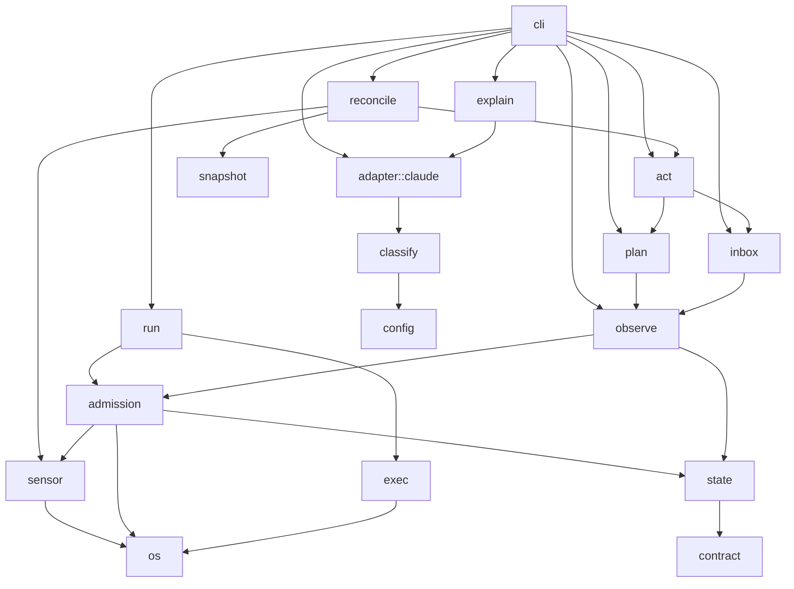
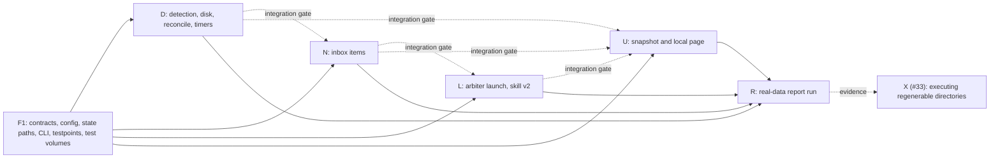

# cardinal architecture

This document fixes the contracts that phases 0 and 1 build against: the crate and module layout, configuration, the state directory, the runner, the Claude Code hook, classification, observation, `plan` and `act`, the inbox, `cardinal reconcile` with disk thresholds and the arbiter's start, the read-only web UI, the CLI and its JSON, libraries, tests, and the work split. [design.md](design.md) is the source for principles, non-goals, invariants, purpose-layer conditions G1–G14, and plan-layer claims C1–C21; this document refers to its sections as "design §N" and does not restate them. Where the design turned out to be wrong or incomplete, [section 17](#17-issues-with-the-design) says so and gives the resolution used here.

## Contents

1. [Scope](#1-scope)
2. [Crate and module layout](#2-crate-and-module-layout)
3. [Configuration](#3-configuration)
4. [State directory](#4-state-directory)
5. [Runner](#5-runner)
6. [Claude Code hook contract](#6-claude-code-hook-contract)
7. [Classification](#7-classification)
8. [Observation](#8-observation)
9. [plan, act, and invariants](#9-plan-act-and-invariants)
10. [Inbox, reconcile, and explain](#10-inbox-reconcile-and-explain)
11. [CLI and JSON contracts](#11-cli-and-json-contracts)
12. [Libraries](#12-libraries)
13. [Test strategy](#13-test-strategy)
14. [Work split](#14-work-split)
15. [Purpose layer](#15-purpose-layer)
16. [Plan layer](#16-plan-layer)
17. [Issues with the design](#17-issues-with-the-design)

## 1. Scope

Phase 0 built the core (hook adapter, runner, admission and reservations, observation, records, `plan`/`act`/invariants, the inbox, the CLI for the arbiter), the Claude Code adapter, and the first arbiter skill, accepted by G4, G5, G10, and G14 (design §12) on macOS and Linux; on Windows the hook does not rewrite (section 5.5).

Phase 1 ships in two releases. The first (units F1 to R) adds detection and reporting, accepted by G8 and the report parts of G2, G3, G6, and G7 (section 15); it executes nothing, and where this document says phase 1 executes nothing, it means this release. The second (unit X, #33) executes regenerable directories for the callers a host grants (section 9.7), accepted by the execution parts of G2 and G7; whole worktrees stay report-only (section 14.5):

- **Reports** (section 9.3): `plan`, `inventory`, `reconcile`, and the arbiter identify reclaimable worktrees and regenerable directories and raise inbox items; in the first release `act` evaluates every plan and executes none (`execution_not_designed`).
- **`cardinal reconcile`** (section 10.3), started by an OS timer and at job ends: the inbox refresh, inbox items raised from observation (section 10.1), disk states and the built-in `disk-reclaim` reconciler's report (section 10.4), starting the arbiter (section 10.5), and the read-only web UI page (section 10.6).
- **The arbiter skill v2** (section 14.3) with squash-merge judgments and reports of what would be reclaimed.
- **Executing regenerable directories** (unit X, section 9.7): `act` deletes a `reclaim_dir` target on the state dir's volume for a granted caller, the owner or `disk-reclaim` under disk pressure, by moving it out of its worktree, checking it again, and deleting it entry by entry; an execution that dies is finished or undone by the next `reconcile` pass.

Phase 1 first runs on macOS against real worktrees (section 14.4); the counts of that run size what X enables (section 14.5). Linux builds and tests everything; the real-data run is macOS only.

**Admission decides with exactly this:** the resources of every reservation that is live or recovery-needed, plus the new job's resources, compared per resource against the budgets in `host.toml`; a job gets all of its resources or none. There are no sensors in admission, no priority classes, no queue order, and no measured weights. Resource amounts come from the matching classification rule. This is the design's "sensor read failed, decide from reservations alone" case (design §7), kept until phase 2.

Seams left for later phases:

| Seam | Shape | Filled by |
| --- | --- | --- |
| Sensors in admission | `sensor::Sensors`; phase 1 implements disk free space for `reconcile` and the runner's job-end check (section 10.4); memory and admission's use of sensors stay `Unavailable` | Phase 2 |
| Priority classes | `Priority` enum with one variant, `Normal`; stored in reservations | Phase 2 |
| Accepted jobs, `wait`, `cancel`, `logs` | Command names and `jobs/` path reserved; lock handoff fixed in [section 5.7](#57-executor-contract-phase-2-seam); not registered in the CLI | Phase 2 |
| Queue tickets | `tickets/` path reserved | Phase 2 |
| Job spec, placement, executor | `exec::Invocation` (local form), `exec::Placement::Local`, and the `Executor` contract of section 5.7 | Phase 2 |
| Measurements | Records carry `measurements: [{kind, …}]`; only `wall_time` is written | Phase 2 (C21) |
| Parallelism injection | Not implemented; classification rules reject an `env` key | Phase 2 |
| Classifier and reconciler units | The built-in classifier and the built-in `disk-reclaim` reconciler are unit-shaped; the classifier JSON is fixed in [section 7.6](#76-classifier-unit-seam); `act` honors per-unit `act = false` ([section 9.6](#96-dry-run-and-gating)); external units are not run | Later |
| Disk admission (heavy jobs wait below the critical line, growth reserved before a job) | None; below the critical line the owner is told through the inbox (section 10.4) | Phase 2 |
| Pushing to the Cloudflare control plane | The snapshot document of section 10.6; nothing is sent | Not planned (section 14.5) |
| Executing whole worktrees | `reclaim_worktree` plans report `dry_run` with `execution_not_designed`; section 9.7 lists what executing them requires (requirements 15–17) | Later, after its own design (section 14.5) |

## 2. Crate and module layout

### 2.1 One crate

Everything lives in the single crate `crates/cardinal` (library plus the `cardinal` binary). The library target exists so integration tests can call modules directly; it is not a published API. The workspace has one more crate, `crates/test-support` (`cardinal-test-support`), a dev-dependency that holds the spawn API and git fixtures of section 13.3; it does not depend on `cardinal`.

| Option | Verdict |
| --- | --- |
| One crate with modules, layering checked by a test | **Chosen.** One compile unit, one binary, no version coordination. The dependency direction below is enforced by `tests/layering.rs`, which fails when a module imports one it must not |
| Workspace of `cardinal-core`, `cardinal-os`, `cardinal-claude`, `cardinal-cli` | Rejected for now. The compiler would enforce layering, but every contract change would touch several manifests, and no second consumer of the core exists yet. Split when one appears (a unit SDK, a control-plane connector) |

### 2.2 Modules

| Module | Owns | May use |
| --- | --- | --- |
| `contract` | serde types for every JSON document in [section 11](#11-cli-and-json-contracts) and the record, reservation, and run-spec files | std, serde |
| `config` | `host.toml` and `repos/*.toml`: locations, parsing, defaults | `contract` |
| `state` | State paths, atomic and durable writes (a claim's publication included), lock helpers with deadlines, IDs and keys, JSONL append and read, the reserve file (section 9.7) | `contract` |
| `record` | Record appending, rotation, reading | `state`, `contract` |
| `testpoint` | Pause points and failure injection for tests ([section 13.1](#131-deterministic-concurrency)) | std |
| `os` | Platform backends behind one API: process table, start times, parent PID, process working directories, boot time; process-group setup and signals (Unix); `os::child`, which runs a short-lived child in an environment the caller constructs, under an absolute deadline and an output cap, and kills the child's process group (Unix) or Job Object (Windows) at the end of every run; on Unix it waits, signals groups, and takes over SIGCHLD and the termination signals through `os::unix`, process-wide state that cardinal, a command line program, owns ([section 8.1](#81-child-processes-for-git-and-gh)); `os::disk`, the free space of the volume holding a path (section 10.4); on Windows a regular file's index and link count, and on macOS a directory's entries with each regular file's private size (`getattrlistbulk`), which the walk reads (section 8.5); `os::fds`, the descriptor scan of section 9.7 (each of the user's processes' working and root directories, executable, and descriptors) and a descriptor's current path; `os::spawn_detached`, which starts a cardinal process in a new session (on Windows, outside the starter's job objects, refused where a job does not allow that) with null standard streams and does not wait for it | std, rustix, signal-hook, libc, sysinfo, windows-sys, objc2-core-foundation |
| `sensor` | `Sensors` trait; the host implementation reads disk free space by path through `os::disk` (section 10.4); memory stays `Unavailable` | `os`, `contract` |
| `exec` | `Invocation` (argv; cwd and env by inheritance), `Placement::Local`, `Executor` trait, local executor | `os`, `contract` |
| `admission` | Budget math (pure), reservation store, liveness and the recovery pass, worktree in-use query | `state`, `config`, `os`, `sensor`, `record`, `contract` |
| `run` | The runner: start boundary, fail-open, wait loop, child supervision, release, the job-end disk check that starts `cardinal reconcile` as a separate process (section 5.2) | `admission`, `exec`, `record`, `state`, `config`, `os`, `testpoint` |
| `classify` | Shell tokenizer, stage finder, normalizer, rule matcher, stage rewriting (section 6.4), `Classifier` trait, built-in classifier | `config`, `contract` |
| `adapter::claude` | Hook input and output, session-end snapshot | `classify`, `config`, `record`, `state`, `os` |
| `observe` | git and gh invocation with constructed environments and deadlines, repository and worktree facts, merge evidence and content in the base, closed pull requests, ignored-data classification, disk usage, outlived processes | `config`, `state`, `admission` (read-only queries), `os`, `contract` |
| `plan` | Plan generation, identity binding, the checks | `observe`, `admission`, `state`, `record`, `contract` |
| `act` | Plan evaluation and its report (sections 9.5 and 9.6); executing `reclaim_dir` plans, and recovering executions that died (section 9.7) | `plan`, `observe`, `admission`, `inbox`, `state`, `record`, `contract`, `testpoint`, rustix |
| `inbox` | Inbox store, dedup, refresh (recovery pass and outlived processes) | `admission`, `observe`, `state`, `record`, `contract` |
| `reconcile` | `cardinal reconcile` and `cardinal arbiter run`: the pass order, the recovery of executions that died, disk states and the reserve file, the `disk-reclaim` reconciler, inbox items raised from observation, the arbiter's trigger and launcher (sections 10.3–10.5) | `act`, `plan`, `inbox`, `observe`, `sensor`, `snapshot`, `admission`, `record`, `state`, `config`, `os`, `contract` |
| `snapshot` | `cardinal.snapshot.v1` and the static page of the read-only web UI (section 10.6) | `inbox`, `record`, `state`, `contract` |
| `explain` | Explanation documents | `adapter::claude` (the hook's repository, origin, and timeout lookups for `explain command`), `classify`, `record`, `plan`, `inbox`, `admission` (the reservation snapshot of `explain job`), `state`, `contract` |
| `cli` | clap definitions and thin handlers that print JSON | everything |

"May use" is read transitively: a module may also use whatever the modules it may use may use, so `run` may use `contract` through `admission`. `testpoint` is open to every module above the foundation. `tests/layering.rs` checks every `crate::` and `super::` path in `src/` against this reading; a glob import of the crate root or an alias of `crate` counts as using every module, and `clippy::wildcard_imports` is denied, so no module comes into scope without a path the test sees.



Two rules matter most and are part of the layering test:

- `admission`, `run`, and `exec` never import `observe`, `inbox`, `plan`, `act`, `reconcile`, or `snapshot`, and `admission` uses neither `std::net` nor `std::process`. gh lives only in `observe`, nothing on the admission path raises inbox items, and the runner starts `cardinal reconcile` only as a separate process after the stage's status is known (C17, C18). Section 13.5 checks the same at run time.
- `contract`, `state`, `config`, `testpoint`, and `os` import nothing above them, so every work unit can depend on them from day one.

## 3. Configuration

### 3.1 Locations

| | Unix (macOS, Linux) | Windows |
| --- | --- | --- |
| Config dir | `$CARDINAL_CONFIG_DIR`, else `$XDG_CONFIG_HOME/cardinal`, else `$HOME/.config/cardinal` | `$CARDINAL_CONFIG_DIR`, else `%LOCALAPPDATA%\cardinal\config` |
| State dir | `$CARDINAL_STATE_DIR`, else `$XDG_STATE_HOME/cardinal`, else `$HOME/.local/state/cardinal` | `$CARDINAL_STATE_DIR`, else `%LOCALAPPDATA%\cardinal\state` |

macOS uses the XDG locations too, as the design says (design §9) and as most developer CLIs do. Windows uses `%LOCALAPPDATA%` (not roaming) for both because the configuration describes one host. The `CARDINAL_*` overrides exist for tests and for running two independent instances. A relative or missing base directory is an error; before a stage starts, every error fails open.

Files:

```text
<config>/
  host.toml          # one per host; optional
  repos/*.toml       # per-repository profiles; read in file-name order
```

Unknown keys are rejected (`deny_unknown_fields`) so typos surface as `config_invalid` instead of silently changing behavior. A profile that cannot be read, its `stat` included, is an error too, never an absent profile, which would drop its `protected` list. A config error never blocks a command: the hook does not rewrite, and the runner fails open.

### 3.2 `host.toml`

```toml
[budget]                 # admission budgets; a resource without a budget is unlimited
cpu = 8                  # default: logical CPUs (std::thread::available_parallelism)
memory_mb = 24000        # default: unset
# any other name is a resource too, e.g. gpu = 1

[admission]
default_resources = { cpu = 4 }  # for rules without `resources`; default: cpu = max(1, logical CPUs / 2)
lock_timeout_ms = 2000           # admission lock deadline
max_wait_ms = 30000              # upper bound of the synchronous wait
wait_fraction = 0.25             # share of the Bash timeout the wait may use

[hook]
enabled = true
runner = "/usr/local/bin/cardinal"  # absolute path written into rewrites; default: the hook's own executable
deadline_ms = 500                   # internal classification deadline

[observe]
git = "git"
gh = "gh"
git_timeout_ms = 10000
gh_timeout_ms = 20000
repos = ["~/src/other"]             # extra main worktrees to inventory (profiles add theirs)
managed = [{ app = "t3code", root = "/path/to/t3code/worktrees" }]  # report-only worktrees

[records]
max_bytes = 8388608
keep = 4

[disk]                   # lines for every watched volume, in MiB of free space (section 10.4)
warning_mib = 20480      # below: under pressure, reported (C10)
recovery_mib = 30720     # pressure ends above this
critical_mib = 5120      # below: critical
volumes = [{ mount = "/Volumes/Scratch", warning_mib = 600, recovery_mib = 900, critical_mib = 200 }]  # per-mount lines
reserve_mib = 64         # reserve file on the state dir's volume (section 9.7)

[arbiter]
command = ["claude", "-p", "…", "--allowedTools", "…"]  # default: the launch of integrations/claude-code/README.md
timeout_s = 1200         # the launcher stops the session after this
min_interval_s = 1800    # between passes (section 10.5)
retry_s = 7200           # an item is due again this long after its pass ended
max_items = 10           # the most due items one pass is assigned, longest due first (and only as many as its listing holds, section 10.5)

[reconcile]
observe_every_s = 3600   # full observation (git, gh) at most this often; the rest runs every pass
reclaim_budget_s = 120   # a pass starts no recovery or execution after this (section 9.7)

[unit.disk-reclaim]      # [unit.<name>] tables honor only `act` (section 9.6)
act = false              # while false, an explicit act as this unit records planned (C16); the pass's disk report records planned unless this is true and [act] execute grants the unit (section 9.7)

[act]                    # executing plans (section 9.7); nothing executes by default
execute = { owner = ["reclaim_dir"], "unit:disk-reclaim" = ["reclaim_dir"] }  # plan kinds each caller executes
```

`[hook] runner` must be absolute and consist only of `A–Z a–z 0–9 / . _ + -`; otherwise the hook does not rewrite and records `config_error`. The path is the only configuration value that appears in shell text, and this rule means it never needs quoting.

`[disk]` lines must satisfy `critical < warning < recovery`, globally and per volume; `volumes` entries match the mount point a path resolves to (section 10.4). `[act] execute` accepts the callers `owner` and `unit:disk-reclaim` and the kind `reclaim_dir` (section 9.7). `[arbiter] command` is an argv, never a shell string; launchd and systemd start it with the timer's environment, so its first word should be absolute or found on the timer's `PATH` (section 10.3).

### 3.3 `repos/*.toml` profiles

```toml
[match]                                  # omit [match] for a generic profile that applies to every repository
paths = ["~/src/app"]                    # main worktree paths; matched through the git common dir
remotes = ["github.com/owner/app"]       # origin URL, normalized to host/owner/name

[git]
base = "origin/main"                     # default: the target of refs/remotes/origin/HEAD

[classify]
wrappers = [["npx"], ["pnpm", "exec"], ["pnpm", "dlx"], ["npm", "exec"], ["bunx"], ["mise", "exec", "--"], ["mise", "x", "--"]]
skip = []                                # command words never rewritten in matching repositories

[[rule]]
id = "test"
commands = ["pnpm test", "pnpm -r test", "vitest", "cargo test", "cargo nextest run"]
except = ["--watch", "-w"]               # any of these words disqualifies a match
class = "test"                           # label for records (phase 2 measurement key)
resources = { cpu = 4, memory_mb = 9000 }

[data]
regenerable = ["node_modules", "target", "fuzz/target", ".DS_Store"]
protected = ["fuzz/corpus", "fuzz/artifacts", "proptest-regressions"]
```

- **Repository identity** is the canonical git common dir. A profile matches when one of `match.paths` has that common dir, or when `git remote get-url origin` normalizes to one of `match.remotes`. Path matching needs no child process and is tried first; remote matching runs git (section 8.1) and only when a rule could match a stage at all. In the hook, a git still running at the hook's deadline means no rewrite, and a git that fails, or prints anything but one URL, leaves the profiles that match without the remote.
- **Precedence:** matching profiles in file-name order, then generic profiles in file-name order. The first rule whose pattern matches wins. `[data]` lists and `[classify] skip` are the union of the matching and generic profiles. `[git] base` and `[classify] wrappers` come from the first profile that sets them.
- **Data patterns:** an entry without `/` matches a file or directory with that name at any depth. A `regenerable` entry with `/` matches that worktree-relative path; a `protected` entry with `/` matches that sequence of names at any depth (`fuzz/corpus` protects `target/a/b/fuzz/corpus`), so protection never depends on where a tool put its data. Observation, `plan`, and `act` all match through `config::data_pattern_covers`. No globs.
- **Patterns match the entries git lists.** git lists an ignored directory as one entry, with nothing below it, when a rule excludes the directory itself and nothing below it is tracked: under `.wrangler/`, `git status --ignored=matching` lists `! .wrangler/` alone. A `regenerable` pattern naming a path below it (`.wrangler/tmp`) then never matches, and the entry is regenerable only through a pattern at or above it, while a `protected` pattern below it (`.wrangler/state`) is found by the walk (section 8.3) and protects the whole entry. Under a rule like `.wrangler/*`, or once a path below the directory is tracked (`git add -f .wrangler/keep`), git lists the directories inside instead (`.wrangler/cache/`, `.wrangler/state/`, `.wrangler/tmp/`), and a pattern naming one of them matches it (probed with git 2.54).
- **No tool knowledge in code.** The core ships no default rules, wrappers, or data patterns (design §4). The repository ships `examples/config/` with a starting `host.toml` and a generic profile; the owner copies what they want.

## 4. State directory

### 4.1 Layout

```text
<state>/
  VERSION                     # layout version, "1"
  host-id                     # 16 hex chars, created once
  admission.lock              # empty; exclusive lock = the admission critical section
  live/<job>.lock             # empty; held exclusively by the owning runner for its lifetime
  reservations/<job>.json     # one per reserved job
  worktrees/<key>.lock        # empty; in-use lock, held shared by jobs
  sessions/<session>.json     # SessionEnd snapshots awaiting the outlived-process sweep
  inbox/.lock                 # empty; serializes inbox upserts
  inbox/.refresh.lock         # empty; one inbox refresh at a time, from its observation to its last write (section 10.1)
  inbox/<key-hash>.json       # one per inbox item
  plans/<plan>/plan.json      # immutable after creation
  executions/<plan>/act.lock  # empty; held by the act or recovery working on the plan's execution (section 9.7)
  executions/<plan>/manifest, claim, result.json  # an execution's records (section 9.7)
  trash/<plan>/t, trash/<plan>/h  # a target moved out of its worktree, and the hold its entries pass through (section 9.7)
  reconcile.lock              # empty; one reconcile pass at a time
  reconcile/state.json        # pass times; the arbiter trigger's last snapshot
  reconcile/observation.json  # the last full observation (cardinal.inventory.v1)
  disk/<volume>.json          # disk state of one watched volume (section 10.4)
  arbiter/.lock               # empty; held by the arbiter launcher (section 10.5)
  arbiter/last.json           # the last arbiter pass
  arbiter/<pass>.log          # an arbiter pass's output, capped
  ui/index.html, ui/snapshot.json  # the read-only web UI (section 10.6)
  records/records.jsonl       # current record file
  records/records.<n>.jsonl   # rotated files, n = 1..keep-1
  records/.lock               # empty; appenders shared, rotation exclusive
  tmp/                        # temporary files for atomic writes (same file system)
  jobs/                       # reserved for phase 2 accepted jobs
  tickets/                    # reserved for phase 2 queue tickets
  reserve                     # reserve file of the state dir's volume (section 9.7)
```

| File | Format | Written by | Read by |
| --- | --- | --- | --- |
| `VERSION`, `host-id` | text | first cardinal process that finds them missing: a fully written temp file is hard-linked into place, which fails if another process won, and the loser reads the winner's file | all |
| `reservations/<job>.json` | `cardinal.reservation.v1` | owning runner; the recovery pass deletes others' reservations; both only under the admission lock (section 4.3) | admission, observe, inbox, plan, act, explain, all under the admission lock |
| `sessions/<session>.json` | `cardinal.session-snapshot.v1` | `hook claude session-end` | inbox refresh |
| `inbox/<key-hash>.json` | `cardinal.inbox-item.v1` | inbox raise, refresh, resolve, and the arbiter launcher's assignments and outcomes, all under `inbox/.lock` | `inbox`, `explain`, the arbiter trigger (under `inbox/.lock`) |
| `plans/<plan>/plan.json` | `cardinal.plan.v1` | `plan` | `act`, `explain` |
| `executions/<plan>/manifest`, `claim`, `result.json` | `cardinal.act-manifest.v1`, `cardinal.act-claim.v1`, `cardinal.act-result.v1` | the `act` or recovery holding the plan's `act.lock` (section 9.7) | `act`, recovery, `explain` |
| `disk/<volume>.json` | `cardinal.disk-state.v1` | `reconcile`, under `reconcile.lock` | `reconcile`, `inventory`, the UI |
| `reconcile/*.json` | `cardinal.reconcile-state.v1`, `cardinal.inventory.v1` | `reconcile`, under `reconcile.lock` | `reconcile`, the runner's job-end check (file time only), the UI |
| `arbiter/last.json` | `cardinal.arbiter-pass.v1` | the launcher and, as it settles the last pass, the trigger, each under `arbiter/.lock` | the arbiter trigger, `inventory`, the UI |
| `records/*.jsonl` | one `cardinal.record.v1` object per line | every command | `explain`, `inventory`, the UI |

### 4.2 Write discipline

- **Atomic replace:** create `tmp/.cardinal-tmp.<name>.<pid>.<n>` with `create_new`, write, flush, rename over the target. Readers see the old or the new file, never a mix. A file already at that name fails the write and is left alone; a write removes only the file it created, and only before its rename. The create-once files (`VERSION`, `host-id`) are written under the same names before they are hard-linked into place. Leftover temp files older than one hour are removed by `plan`, `inbox`, and `reconcile` runs, and only names of that form, so a state dir that overlaps other files (a `CARDINAL_STATE_DIR` inside a worktree) keeps them.
- **fsync policy:** reservations, live locks, and records are not fsynced; they are meaningless after a power loss (reservations from an earlier boot are released, section 4.5). Inbox items are fsynced (file, then parent directory on Unix), because losing one could bring back a resolved item or lose a pass's assignment (section 10.5). An execution's manifest, claim, and result are fsynced, and so are the directories its moves change, in the order of section 9.7; recovery syncs what it finds before it acts on it. Plans are written without fsync; one lost to a power loss makes `act` report `not_found`, and the arbiter plans again. Disk states, reconcile state, and arbiter pass records are not fsynced: after a power loss they are measured or decided again. On macOS a durable write uses `F_FULLFSYNC` (std's `File::sync_all`), because `fsync` there leaves the drive's cache unflushed. On Windows, `FlushFileBuffers` on the file only.
- **Exclusive creation for uniqueness:** a job ID is claimed by creating `live/<job>.lock` with `create_new`, a plan ID by creating `plans/<plan>/` with `create_dir`; a collision retries with a new ID.
- **IDs:** 16 lowercase hex characters from a randomly keyed SipHash (`std::hash::RandomState`) of time, PID, and a counter. No RNG crate. The CLI accepts any unique prefix of at least 4 characters.
- **Keys:** worktree keys and inbox key hashes are FNV-1a 64 of the canonical path or key, as 16 hex characters (hand-written, stable across Rust releases unlike `DefaultHasher`). A worktree-key collision only makes two worktrees share an in-use lock (more conservative); inbox files store the full key and probe `-1`, `-2`, … on collision.
- **Times** are integers in milliseconds since the Unix epoch (`*_ms`). Process start times are seconds, as the OS reports them (`*_s`).

### 4.3 Locks

Locks use `std::fs::File::{lock, lock_shared, try_lock, try_lock_shared}` (stable since Rust 1.89): `flock` on Linux and macOS, `LockFileEx` on Windows. The OS drops them when the holder dies, which is what makes liveness detection work without TTLs.

- Lock files are always empty and separate from data files, because Windows locks are mandatory: a locked byte range cannot be read by other processes.
- std opens files close-on-exec and non-inheritable, so a child never inherits the runner's locks. A surviving child therefore cannot keep a dead runner looking alive.
- Waiting with a deadline is a `try_lock` loop with backoff (5 ms doubling to 50 ms). Every acquisition has a deadline; there is no unbounded `lock()`.
- Lock order is always: `reconcile.lock`, then an execution's `executions/<plan>/act.lock`, then the worktree in-use lock, then `inbox/.refresh.lock`, then the admission lock, then the inbox or records lock. Nothing takes them in another order, and `act` takes its plan's `act.lock` and the in-use lock with one try each (section 9.7). `arbiter/.lock` comes after `reconcile.lock` and before an `act.lock` and the inbox lock: it is held by the arbiter launcher, whose session takes the others in this order through the commands it runs, and briefly by a trigger that records an abandoned pass (section 10.5); it is never inherited.
- **Reservations and live lock files change only under `admission.lock`, and `reservations/` is listed only under it.** A directory listing that runs while another process renames or unlinks an entry of that directory may omit entries, unchanged ones included, so a pass that listed `reservations/` while a runner replaced its reservation could count too few and admit over budget (C2). Under the lock: the admission and recovery passes (section 4.4), each write of `starting` and `running` and each release (section 4.5), the deletion of the live lock file of a runner that never got a reservation, and the readers `inventory`, `plan`, `act`, and `explain job`. A reader holds the lock only to read every reservation file and releases it before it evaluates them: liveness probes, the process table, git, records, and the inbox stay outside. Every one of these waits at most `lock_timeout_ms`. A reader that times out reports the reservations as unreadable, never as none: `inventory` adds an error with scope `reservations`, `inventory`, `plan`, and `act` leave the `not_in_use` check `unknown`, so it does not pass, and `explain job` fails as it does when the records cannot be read. Section 4.5 gives what a timeout does to a runner's writes.
- Lock files (`admission.lock`, `worktrees/*.lock`, `inbox/.lock`, `inbox/.refresh.lock`, `records/.lock`, `reconcile.lock`, `arbiter/.lock`) are never deleted while in use, so no process can lock a file another process has already unlinked. `worktrees/*.lock` grows by one empty file per worktree ever used and is not pruned: a runner opens it before it takes any other lock, so no lock could make its removal safe. An `executions/<plan>/act.lock` is removed only with its execution directory, by the `plan` run that holds it, once the plan's own directory is gone (section 4.9). A process that takes an `act.lock` checks, holding it, that `executions/<plan>/act.lock` still names the file it locked, and an `act` that the plan's directory still exists; otherwise it lets go and reports `not_found`, so a lock that a `plan` run removed meanwhile is never taken for the plan's.

### 4.4 Admission protocol

The critical section only reads small files and writes one; process probes are a few system calls.

1. Take `admission.lock` exclusively (deadline `lock_timeout_ms`; on timeout, fail open).
2. On the runner's first pass only: create `live/<job>.lock` with `create_new` and take it exclusively. The runner holds it until it exits.
3. Run the **recovery pass**: read every `reservations/*.json` (a file that vanished meanwhile is skipped) and evaluate each one (section 4.5). Delete `stale` ones and their live lock files, and delete live lock files that are free and have no reservation. The pass never signals: `live` and `recovery_needed` reservations stay as they are.
4. Sum the resources of `live` and `recovery_needed` reservations. If, for every resource the new job needs, `sum + need ≤ budget` (resources without a budget always fit), write `reservations/<job>.json` (atomic) with `state: "reserved"` and the runner's group identity (section 5.5).
5. Release `admission.lock`.

The liveness lock is held before the reservation becomes visible, so another admitter can never see the new reservation with a free liveness lock. Live lock files are created, deleted, and garbage-collected only inside the admission lock, so collection can never delete a file between its creation and its locking. A missing live lock file counts as free. `cardinal inbox` runs the same recovery pass (section 10.1).

### 4.5 Reservation lifecycle and recovery-needed

```text
reserved ──(written immediately before spawn)──> starting ──(after spawn)──> running ──> deleted at release
```

Each transition, and the deletion at release, takes `admission.lock` with the deadline `lock_timeout_ms` (section 4.3). When the lock is not free in time, nothing is written or deleted:

- `starting`: the reservation stays `reserved` and the runner fails open with `admission_lock_timeout` (section 5.3). The release that fail-open does takes the lock too; when it times out, the job is abandoned: the reservation and live lock file stay and the live lock is dropped, and the recovery pass releases the reservation as `stale` once the runner has left its group.
- `running`: the reservation stays the complete `starting` one written before the spawn, `job_infra_failure` is recorded, and the stage keeps running. A `starting` reservation whose runner dies counts as `recovery_needed`, unverified, while its group lives.
- Release, and a job dropped while still `reserved`: the job is abandoned as above, and the recovery pass releases the reservation once the group is empty.

The group identity is fixed before the reservation exists: the runner makes itself a process-group leader, so the PGID is the runner's PID (section 5.5). A reservation's derived state is computed by whoever reads it; it is never stored:

| Condition (evaluated in order) | Derived state |
| --- | --- |
| `try_lock` on `live/<job>.lock` fails (the owner holds it) | `live` |
| `boot_s` differs from the current boot time by more than 2 s | `stale`: no process survives a reboot |
| The group is empty: `kill(-pgid, 0)` fails with `ESRCH`, or a process whose PID equals the PGID has a start time other than the runner's (POSIX does not reuse a PID while a process group with that ID exists, so the job's group must have emptied first) | `stale` |
| Otherwise | `recovery_needed` |

A `recovery_needed` group is **verified** when the recorded child (PID and start time) is alive and still has the recorded PGID; the inbox item shows this with the group's members. **Recovery never signals a group, verified or not:** nothing pins a dead runner's PGID between a check and a signal, so the group could empty and its ID pass to an unrelated group in that window. The reservation keeps counting until the group is empty or the boot changes. PGID reuse by an unrelated group therefore only delays release, and the delay clears itself when that group ends. Only a live runner signals its own group (section 5.5): the group's ID is the runner's PID, so no other group can take it while the runner lives. Nobody, including the owner, can release a non-empty group's reservation (G14). Recovery-needed reservations count as reserved for admission and as in use for their worktree.

### 4.6 Worktree in-use lock

- The worktree of a job is found by walking up from the runner's cwd to the nearest `.git` entry (file or directory); the key is the FNV-1a of that directory's canonical path. A job outside any worktree takes no in-use lock.
- The runner takes `worktrees/<key>.lock` **shared** at acceptance, before admission and before any wait, and holds it until the stage has exited, on every path that runs the stage: admitted, overflow, fail-open, and TTY passthrough (C15). Several jobs can share a worktree.
- **The lock marks a worktree in use; it does not protect data.** When the lock cannot be opened or taken within the wait cap (another process holds it exclusively, or the state dir is broken), the runner runs the stage anyway (G4) and records `in_use_unprotected`, so no deletion could rest on it (section 9.7, design §7).
- `plan`, `inventory`, and an `act` that does not execute only probe the lock, never taking it or waiting. An executing `act` takes it exclusively with one try and holds it from its snapshot until it commits or restores, so commands that arrive meanwhile wait at most their wait cap (section 9.7). A worktree is in use when the lock is held, when a `live` or `recovery_needed` reservation names the worktree key (read under the admission lock; this covers a crashed runner, whose shared lock the OS has already dropped, and a runner that went on without the lock), or when a process other than the reader has its working directory inside the worktree.

### 4.7 Records

- One JSON object per line, appended with a single `write` on a file opened in append mode (`O_APPEND`; `FILE_APPEND_DATA` on Windows), so concurrent appenders do not interleave.
- An appender holds `records/.lock` **shared** from opening `records.jsonl` until its write is done (waiting at most 1 s for a rotation to finish, else the record is dropped). Rotation and removal take it **exclusively**, so no file is renamed or removed while an appender has it open, and a delayed appender never writes into a file a later rotation has replaced.
- When `records.jsonl` exceeds `max_bytes`, the appender that notices takes the lock exclusively with a 100 ms deadline (on timeout the next append rotates), checks the size again, and renames `records.<keep-2>` → `records.<keep-1>` … `records.jsonl` → `records.1.jsonl`; with `keep = 1` it moves `records.jsonl` into `tmp/` under a new temporary name and removes it there, so the name is free at once even while a reader has the file open (Windows keeps a removed file's name until its last handle closes); the cleanup of `tmp/` sweeps a file whose removal never came.
- Readers skip lines that do not parse. A crash mid-write costs at most the torn line and the line appended after it.
- A reader that must not read a record twice (the snapshot, section 10.6) holds the lock **shared** only while it opens the files, newest first, and takes their lengths, then reads up to those lengths through its descriptors, keeping no appender or rotation waiting: an append lands past them, and a rotation renames a file without changing it. Out of descriptors, it loses the oldest files, never the current one.
- A record failure, a panic in an append included, is never surfaced to a command and never causes a rerun (C5, C11): the runner loses the record and goes on.

### 4.8 Inbox store

`inbox/<key-hash>.json` holds one item (section 10.1). Upserts take `inbox/.lock` exclusively: an existing item with the same key is updated (`seen` incremented, `evidence` replaced) and is never reopened once `resolved` or `dismissed`. Raising or ending an occurrence (`inbox::apply`) first reads every item under the lock and fails with `state_unavailable` when `inbox/` cannot be listed to the end or a listed item file cannot be read or parsed, a dangling link included, as that file may hold the item.

### 4.9 Plans store

`plans/<plan>/plan.json` is written once, without fsync. `act` only reads it and writes nothing to the plan's directory; an execution keeps its records in `executions/<plan>/` (section 9.7). Plan directories older than 30 days are removed by `plan` runs. Once a plan's directory is gone, a `plan` run removes its execution directory too, holding its `act.lock`, when that directory has no claim, or has a result and no trash entry; an execution that left data in the trash keeps its directory until that data is gone.

### 4.10 Sessions

`hook claude session-end` writes `sessions/<session>.json` with the agent process and its descendants (section 6.6). Inbox refresh deletes it once none of the listed processes is alive.

### 4.11 Crash consistency

| Runner dies … | Left behind | Next reader does |
| --- | --- | --- |
| before its first admission pass | Nothing; its in-use shared lock is dropped by the OS | — |
| while waiting between passes | `live/<job>.lock`, free | The recovery pass deletes it |
| inside the admission lock | Temp file in `tmp/`; lock dropped by the OS | Temp GC |
| at `reserved` | Reservation; its group was the runner alone and is now empty | `stale` |
| at `starting` | Reservation; a child may or may not exist in the group | Empty group: `stale`. Otherwise `recovery_needed`, unverified, until the group is empty |
| at `running` | Reservation with the child's identity | `recovery_needed` (verified while the child lives) until the group is empty, then `stale` |
| after the child exits, before release | Reservation | `recovery_needed` while members remain, then `stale`; records lack `job_finished` |
| during release | Nothing or a free live lock | Recovery pass |

An `act` that reports changes nothing but the records; an execution that dies leaves its claim, and the next `reconcile` pass or `act` on its plan finishes or undoes it (section 9.7). Power loss: reservations, live locks, and in-use locks are reset by the reboot (`boot_s` check, OS locks); inbox items and an execution's records survive through fsync; plans may be lost and are planned again.

## 5. Runner

### 5.1 Invocation

```text
cardinal run [--spec-b64 SPEC] -- COMMAND [ARG]...
```

- **The stage** arrives as argv after `--`: the stage's own words after the calling shell has expanded them (variables, including ones that are not exported, globs, `~`, quoting), with the stage's redirections already applied to the runner process by that shell. The runner executes the argv directly, without a shell, so expansion, cwd, environment, and redirections are exactly those of the calling shell.
- **`--spec-b64`** is unpadded base64url of a `cardinal.run-spec.v1` JSON document (section 11.3): class, rule, resources, Bash timeout, background flag, session, agent, and tool-use IDs, stage index, and the stage's source text. Everything the runner needs from the hook travels here, so no configuration value is ever spliced into shell text, and base64url contains nothing a shell treats specially. Without a spec (people, tests), `admission.default_resources` applies.

### 5.2 Steps

1. Start watching signals and the parent process (section 5.5). When the signal handlers cannot be set up, the runner takes the in-use lock (step 4) and then runs the stage by TTY passthrough (step 2) or fails open.
2. If stdin is a terminal (**TTY passthrough**): take the in-use lock as in step 4, record `tty_passthrough`, and run the stage as fail-open does.
3. Decode the spec, resolve the state dir, load `host.toml`.
4. Take the worktree in-use lock shared (section 4.6). If that is not possible within the wait cap, continue without it and record `in_use_unprotected`.
5. Set up the process group (section 5.5).
6. Admission (section 4.4). If the budget is full, release the admission lock, sleep (250 ms doubling to 2 s), and retry until the wait cap (section 5.4).
7. Write `starting` (the start boundary, section 5.3), look again for a signal or the parent's exit, spawn the stage, write `running` with the child's PID and start time, append `job_started`.
8. Wait for the child, forwarding signals.
9. Release: delete the reservation when no member of the group other than the runner is left, otherwise leave it for the recovery pass (section 5.5); append `job_finished` (exit status, `waited_ms`, `measurements: [{kind: "wall_time", ms}]`), drop the live lock and the in-use lock, run the job-end disk check (below), and exit with the child's status or re-raise its signal (section 5.6).

**Fail open** (section 5.3): append `job_fail_open` if records still work, drop the reservation and live lock if taken (abandoning them when the admission lock is not free in time, section 4.5), restore the original process group, spawn the stage in it, and finish as in step 9; the runner never `exec`s, so the in-use lock stays held until the stage exits. Nothing is printed, except `<command>: <OS error>` with exit 127 (not found) or 126 when the stage cannot be executed, as shells do.

**Job-end disk check:** once the stage's status is known and the runner's locks are dropped, on every path that ran the stage, the runner reads the free space of its worktree's volume (or its cwd's) with `statfs`/`statvfs` (microseconds; never the slower measure of section 10.4) and compares it with that volume's warning line from `host.toml` (a runner that could not read `host.toml` has no line, and checks nothing). Below it, and when `reconcile/state.json` is more than 60 s old, it starts `cardinal reconcile --trigger job-end` with `os::spawn_detached` (new session, null standard streams) and does not wait. Any failure is ignored and recorded at most; the check never changes the exit status or output and never runs before the status is known (C18).

**Cancellation:** a handled signal (section 5.5) or the parent's exit before the spawn, seen during any wait or at the spawn itself on every path, ends the run without starting the stage. The runner appends `job_finished` with `cancelled`, releases what it holds, and dies by that signal, or exits 129 when the parent exited.

### 5.3 Start boundary

- **The stage has started once `spawn()` has returned a child.** Before that, the runner itself runs the stage on every failure it can observe: signal handlers that cannot be set up (step 1), an error in steps 3–7, a failed `spawn()` (the OS guarantees that no child ran), and a panic, which a `catch_unwind` around the whole run turns into fail-open. Every wait before the spawn has a deadline: the admission lock (`lock_timeout_ms`, then fail open), the in-use lock (the wait cap, then unprotected), and the budget (the wait cap, then overflow, section 5.4).
- **After `spawn()` has returned, the runner never runs the stage again.** The runner marks the stage as started the moment `spawn()` returns, before it reads anything about the child. A later error or panic ends in waiting for the child (again, by its PID, when the wait itself panicked) and returning its status when possible, and otherwise in exit 125. A panic while recovering from a panic re-enters recovery, which goes on from what the runner holds; a runner that still cannot get past its panics aborts without unwinding, like a runner that crashed. Once `starting` is written, no path that drops the job, unwinding included, deletes its reservation: the job is then abandoned, and only the recovery pass releases the reservation once the group is empty (section 4.5).
- **The `starting` record**, written immediately before `spawn()`, is the boundary as seen from the state dir: a reservation at `starting` whose runner died may or may not have a child, and recovery treats it as possibly running.
- **Zero-run cases that remain:** the runner killed (for example by SIGKILL) between its start and the spawn; a runner path that is executable but cannot be loaded (`[ -x R ]` passes, the exec fails with a loader error); and a cancellation, by the parent's exit or a signal before the spawn (section 5.2). The first two end the Bash call with a visible non-zero status (137, or 126 with the shell's message), nothing runs twice, and nothing reports success (section 17, item 5).

### 5.4 Wait cap and overflow

- Wait cap: `max_wait_ms` if the spec says background; otherwise `min(max_wait_ms, timeout_ms × wait_fraction)`. Phase 2 subtracts the expected run time once measurements exist.
- **When the wait reaches the cap, the runner starts the stage anyway, over budget** (admission result `overflow`). This is an interim rule until phase 2 replaces it with an accepted job (C4). Alternatives rejected: returning an error makes agents retry and adds load; waiting until the Bash timeout gets the command moved to the background by Claude Code with the wait still in front of it.
- **Waits add no output,** because text from the runner would enter the stage's pipes (`2>&1 | jq .`); `job_finished` records `waited_ms` and the admission result for `explain job`. Phase 2's accepted-job reply is the only output cardinal adds to a successful command (design §6).

### 5.5 Child execution

- **Execution:** argv is resolved through `PATH` as `env` does, with inherited stdio, cwd, and environment. The runner never proxies output, so terminal detection, buffering, and pipe behavior are unchanged, and the runner's death cannot break the child's output.
- **Process group:** in step 5 the runner calls `setpgid(0, 0)` and records `pgid` as its own PID; a failure is a pre-start failure. The child inherits the group, whose PGID is thus known before the reservation is written (section 4.5). A runner that already leads its group (`getpgid(0)` equals its PID) does not take that group as its own, because other processes can be in it: a job-control shell makes the first command of a pipeline the leader of the job's group, which the pipeline's other commands join. Step 5 then fails without calling `setpgid`, and the run fails open in that group, where the runner signals only its child (signals below).
- **Signals:** on the admitted path the runner forwards SIGINT, SIGTERM, SIGHUP, and SIGQUIT to the rest of the group. On the fail-open and TTY paths the child shares the caller's group and gets terminal signals itself; the runner ignores SIGINT and SIGQUIT while waiting, as `system()` does, and forwards SIGTERM and SIGHUP. A signal the caller ignores (`SIG_IGN`) gets no handler, so it stays ignored for the stage, as in a direct run. SIGCHLD is the exception: the runner sets it to its default action before it starts any child, because a caller that ignores it would have Linux reap the runner's children, and the runner could neither keep a child's PID reserved nor learn its status. The stage starts with SIGCHLD ignored again (set between `fork` and `exec`) when the caller ignored it. Each handled signal's handler writes to a pipe read by a thread of its own; the runner starts every reader before it installs the first handler, because a handler whose reader never ran would swallow its signal. It sets them up at its start, before any other thread exists, with the handled signals blocked, and unblocks them once every handler is installed: `signal-hook` installs a handler before it publishes the action that handler runs, and drops a signal that arrives in between, while a blocked signal stays pending until it is unblocked. The readers keep the signals blocked, so the handlers run on the runner's other threads. When a reader or a handler cannot be set up, the runner installs none, each signal gets back the disposition it had before the runner unblocks it, and the run fails open (`signal_setup`) with nothing forwarded: the stage shares the caller's group and gets terminal signals itself, and a SIGINT, SIGTERM, SIGHUP, or SIGQUIT that reaches the runner ends it with its default action. A stage that survives the signal then runs on without the in-use lock, which goes with the runner. For the same reason the runner cancels nothing when a SIGHUP comes with its parent's exit (a hangup, or the kernel's orphaned-group SIGHUP to a stopped runner, below); a parent exit without a signal is cancelled as on the other caller-group paths.
- **Job control:** on the fail-open and TTY paths, when the child stops, the runner stops itself with the same signal, so the caller's job control sees the stage stop, and continues the child once it is continued itself. A runner that never stopped itself would hide the stage's stop from the caller's job control. On these paths the runner signals the child by its PID and never signals the caller's group.
- **Parent death:** the runner watches its parent from its start and reads the parent PID itself before the spawn and before its wait ends. If the parent exits before the spawn (the Bash call was cancelled), the runner releases what it holds and exits 129 without starting the stage. After the spawn on the admitted path, it sends SIGTERM to the group, also when the child has exited and only descendants are left, and waits until no member is left. If members remain 5 s later, it records the job, leaves the reservation for the recovery pass, and sends SIGKILL to the whole group, itself included while it is a member; the reservation is released once the group is empty. Only a live runner signals: the group's ID is its PID, so the ID cannot pass to another group while it lives.
- **Parent death in the caller's group:** on the fail-open and TTY paths the runner holds no reservation (TTY passthrough bypasses admission, and fail-open drops what it reserved); what it holds until the child is gone is the in-use lock. After the spawn the child gets SIGTERM, and SIGKILL 5 s later, by its PID, which stays reserved because the runner reaps the child only when its wait ends; the runner waits for it at most 30 s. This cancellation progresses while the runner executes. A runner stopped with its stage (job control above) runs none of its threads, so it sees its parent's exit only once it is continued, and the cancellation waits until then. When the parent's exit leaves the caller's group orphaned, the kernel sends every member SIGHUP and then SIGCONT, which continues the runner; while another member keeps the group from becoming orphaned, nothing does. The kernel's continuation does not cover a runner that found its parent alive just before and stops right after it: the runner then stays stopped with the in-use lock, and the stage, continued by the same SIGCONT, is not guaranteed to stay stopped. In launchd's session on macOS (session ID 1), when a runner that launchd adopted exits, the kernel can send SIGHUP and SIGCONT to a stopped member of the caller's group that is not part of the stage, even one whose parent in another group of the session keeps the group from becoming orphaned; those signals come from the kernel's orphaned-group handling, not from cardinal. cardinal does not cover these cases with a helper process: a signal to the caller's group reaches its unrelated members, a helper in that group is stopped with it, and a helper outside it cannot pin the runner's PID, which could pass to another process between the helper's check and its signal.
- **Normal exit:** when the direct child exits, the runner returns its status at once. It deletes the reservation only when no member of the group other than itself is left: it moves back into the caller's group and asks `kill(-pgid, 0)`. When it cannot move, because the caller's group is gone, `kill` would count the runner itself, and the process table can miss a live member (one that a member forked before it exited unread), so the runner leaves the reservation for the recovery pass, which releases it once `kill` reports the group gone. macOS can report the group for a moment after the runner reaped its last member (`EPERM`, as for a group of zombies), so while the process table lists no live member, the runner asks `kill` again, for up to 1 s; once the SIGKILL after its parent's exit is due, it asks once, so the SIGKILL comes at 5 s. Otherwise the reservation stays for the recovery pass, which releases it once the group is empty, so the budget and the worktree stay taken while the stage's descendants run. Those members are not killed (the same as running the stage without cardinal) and show up in `inventory`. Processes that leave the group (`setsid`) are not tracked.
- **Windows:** the hook does not rewrite (section 6.3) and `cardinal run` always takes the fail-open path; the argument contract and Job Objects are phase 3 (section 17, item 9).

### 5.6 Exit status and infrastructure failure

| Situation | Exit | Added output |
| --- | --- | --- |
| Child exited with code N | N | none |
| Child killed by signal N | signal N: after releasing, the runner restores N's default disposition and raises it | none |
| Pre-start failure, TTY passthrough | the stage's status or signal | none |
| Runner error after the child started, child status unknown | 125 | `[cardinal] Infrastructure failure after the command started: <reason>. The command was not rerun.` on stderr |
| Runner killed after the child started | set by the killer (137 for SIGKILL) | none; the record has `job_started` without `job_finished`, and `explain job` reports `runner_died` |
| Release or record failure after the child exited | the child's status | none |

125 follows the convention of `env`, `nice`, and `timeout` for "the wrapper itself failed". It can collide with a child's own 125, so the stderr line and the records are the distinguishing signal. The line appears only when the stage's own status is unknown, so it never changes the output of a command whose result is known.

### 5.7 Executor contract (phase 2 seam)

```rust
pub trait Executor {
    /// Sets up the process group; runs before the reservation is written.
    fn prepare(&self) -> Result<GroupIdentity, NotStarted>;
    /// Starts the invocation. `Err` guarantees that nothing started, so the caller may run the stage itself.
    fn start(&self, inv: &Invocation) -> Result<Box<dyn Running>, NotStarted>;
}
pub trait Running {
    fn child(&self) -> ChildIdentity;          // written as `running`
    fn wait(self: Box<Self>) -> ExecOutcome;    // blocks; forwards cancellation
}
pub enum ExecOutcome { Exited(i32), Signaled(i32), InfraFailure(String) }
```

The local executor is the only implementation. The start boundary is the same for every executor: `starting` is written before `start`, and an `Ok` from `start` means the stage may have run. For phase 2's accepted jobs, the accepting runner starts a detached runner, which takes its own live lock and a shared in-use lock and rewrites the reservation's owner to itself before the accepting runner drops its locks and prints the job ID; both hold the locks for that moment, so the job is never unowned.

## 6. Claude Code hook contract

### 6.1 Facts

| Question | Answer | Source |
| --- | --- | --- |
| Is there a tool call ID in `PreToolUse`? | Yes: `tool_use_id`, next to `tool_name` and `tool_input` | [Hooks reference](https://code.claude.com/docs/en/hooks): "PreToolUse hooks receive `tool_name`, `tool_input`, and `tool_use_id`" |
| Session, cwd, mode | Common fields: `session_id`, `transcript_path`, `cwd`, `permission_mode`, `hook_event_name`; in a subagent also `agent_id` and `agent_type`. `permission_mode` takes `default`, `acceptEdits`, `dontAsk`, `auto`, `bypassPermissions` | Hooks reference; values checked against Claude Code 2.1.322 |
| Bash `tool_input` fields | `command`, `description`, `timeout` (ms), `run_in_background` | Hooks reference example input |
| Bash timeout default and maximum | `BASH_DEFAULT_TIMEOUT_MS` default 120000; `BASH_MAX_TIMEOUT_MS` default 600000 (the ceiling is the larger of the two) | [Environment variables](https://code.claude.com/docs/en/env-vars) |
| What happens at the Bash timeout? | A foreground command that reaches its timeout is moved to the background, not stopped, unless it starts with `sleep` or `CLAUDE_CODE_DISABLE_BACKGROUND_TASKS=1` | [Tools reference](https://code.claude.com/docs/en/tools-reference) |
| `updatedInput` semantics | "Replaces the entire input object, so include unchanged fields alongside modified ones." Permission rules and auto-background eligibility are evaluated against the returned input. Combine with `allow` to auto-approve or `ask` to prompt; without `permissionDecision` the normal permission flow applies | Hooks reference |
| How is `if … then … else … fi` matched against permission rules? | Each branch separately, in one-line and multi-line form, after `cd … &&`, inside pipelines and lists, and with two wrapped stages: with an allow rule for the runner, the outcome equals the original's. Other fallback shapes (`&&`/`\|\|`/`;` chains, `{ …; } \|\| …`, `test -x … && exec …`) prompt even when every part is allowed. `"ask"` always prompts; `"allow"` runs commands the original's rules would not. In `auto` mode the classifier denied a rewritten command whose original stage no rule allowed, while allowing the original | Checked against Claude Code 2.1.322 |
| Do assignment prefixes before the runner match its rule? | No: `FOO=1 R run …` prompts under `Bash(R run:*)`; only known variables such as `LANG` are stripped | Checked against Claude Code 2.1.322 |
| Several hooks returning `updatedInput` | Not documented; hooks run in parallel | Hooks reference |
| Hook timeout | `timeout` in seconds; default 600 for command hooks; a timed-out `PreToolUse` hook is discarded and the call continues through the normal permission flow | Hooks reference |
| Exit codes and output | Exit 2 blocks the tool call; other non-zero exits are non-blocking; exit 0 with empty stdout is success; exit 0 with invalid JSON is a non-blocking error | Hooks reference |
| `SubagentStop` input | `agent_id`, `agent_type`, `agent_transcript_path`, `stop_hook_active`, `last_assistant_message`, plus common fields | Hooks reference |
| `SessionEnd` input | `reason`: `clear`, `resume`, `logout`, `prompt_input_exit`, `other`; default hook timeout 1.5 s | Hooks reference |
| Shell and cwd of Bash commands | The user's shell, with aliases, functions, and options captured from its rc file at session start; a `cd` carries over to later Bash calls while inside the project directory (never in subagents) | Tools reference |
| Windows | The Bash tool runs in Git Bash; without Git Bash, a separate PowerShell tool runs commands | Tools reference; [Troubleshooting install](https://code.claude.com/docs/en/troubleshoot-install) |

### 6.2 Installation

The owner adds this to `~/.claude/settings.json` (never to a repository, G5); `examples/claude/settings.json` ships it:

```json
{
  "hooks": {
    "PreToolUse": [{ "matcher": "Bash", "hooks": [{ "type": "command", "command": "cardinal hook claude pre-tool-use", "timeout": 5 }] }],
    "SubagentStop": [{ "hooks": [{ "type": "command", "command": "cardinal hook claude subagent-stop", "timeout": 5 }] }],
    "SessionEnd": [{ "hooks": [{ "type": "command", "command": "cardinal hook claude session-end", "timeout": 2 }] }]
  }
}
```

The explicit `timeout` keeps a stuck hook from stalling Bash calls for the 600 s default. Set `[hook] runner` to a path that survives upgrades (a vanished runner path silently turns every rewrite into the fallback). No permission rule ships: approval stays with Claude Code (section 6.5). cardinal must be the only hook returning `updatedInput` for Bash; the order of several is undefined.

### 6.3 `hook claude pre-tool-use`

1. On Windows (section 5.5), exit 0 with empty stdout at once, before reading the input or the configuration, so the hook records nothing there. Elsewhere, read stdin (bounded at 1 MiB) as JSON. Exit 0 with empty stdout, rewriting nothing, if `tool_name` is not `Bash`, `tool_input.command` is not a string, `hook.enabled` is false, `permission_mode` is `auto` (section 6.5), or anything fails.
2. Find and classify stages (section 7) within `hook.deadline_ms`, measured from process start. The deadline is checked after classification and again after the output is serialized, right before it is written; past it: no rewrite.
3. If at least one stage is classified, rewrite each classified stage (section 6.4) and print:

```json
{"hookSpecificOutput":{"hookEventName":"PreToolUse","updatedInput":{"command":"<rewritten>","description":"<unchanged>","timeout":120000,"run_in_background":false}}}
```

`updatedInput` is the original `tool_input` object with only `command` replaced, kept as a `serde_json::Value` so fields unknown to cardinal survive unchanged. No `permissionDecision` is returned (section 6.5).

4. The effective timeout written into each spec: `tool_input.timeout` if it is a positive number, else `BASH_DEFAULT_TIMEOUT_MS` from the hook's environment (the hook inherits Claude Code's), else 120000; capped at `max(BASH_MAX_TIMEOUT_MS or 600000, default)`. `run_in_background: true` sets the spec's background flag.

On the way to a rewrite the hook writes nothing to the state dir and takes no reservation (C1). A configuration error, a runner path that is a directory included, appends `config_error`; input the hook cannot use (unreadable, not a JSON object, over 1 MiB, or a Bash call without a string command), a missed deadline, or another failure appends `hook_error` with reason `invalid_input`, `deadline_missed`, or `failed`. It never exits non-zero: panics are caught at the top level and turned into "no rewrite".

### 6.4 Rewritten command

The hook replaces only the span of each classified stage, in place, and leaves every other byte of the command alone. For a stage `S`, the replacement is

```sh
if [ -f R ] && [ -x R ]; then S'; else S; fi
```

where `R` is the runner path, the `else` branch is the stage as written, and `S'` is `S` with `R run --spec-b64 <spec> --` inserted immediately before its command word. Example:

```sh
# original
cd packages/app && pnpm test 2>&1 | tail -50 || echo failed
# rewritten
cd packages/app && if [ -f /usr/local/bin/cardinal ] && [ -x /usr/local/bin/cardinal ]; then /usr/local/bin/cardinal run --spec-b64 eyJzY2hlbWEiOi… -- pnpm test 2>&1; else pnpm test 2>&1; fi | tail -50 || echo failed
```

- **Everything else stays in the calling shell:** pipes, `&&`/`||`/`;` lists and their short-circuiting, a leading `cd` and the cwd it leaves for later Bash calls, shell options such as `pipefail` and `errexit`, functions used by other stages, and the command's first word unless its first stage is classified. Claude Code's timeout handling depends only on a leading `sleep`, and a `sleep` stage is never wrapped (section 7.2).
- **Both branches carry the stage's own words,** so variables, globs, `~`, and quoting are expanded by the calling shell either way, and exactly one branch runs. The `if` returns the status of the branch that ran, so pipeline and list semantics are unchanged.
- **`[ -f R ] && [ -x R ]`** is the fallback test: if the runner path is missing, not a regular file (a directory passes `-x`), or not executable (uninstalled, moved, upgraded to another path), the `else` branch runs the original stage. The hook also refuses a directory runner path as a configuration error (section 6.3).
- **Several classified stages** in one command are each wrapped and reserved separately; the spec's stage index tells them apart. Scripts started inside a stage are not controlled separately; their weight is learned for the stage (design §6).
- **One-line form:** a wrapped stage's span never contains a newline or a comment (section 7.2), so the replacement stays on one line and the rest of the line follows `fi` unchanged.

In bash, zsh, and sh this form gives the original's stdout, stderr, and status for lists, `pipefail`, `errexit`, non-exported variables, globs, and redirections, with the runner present, missing, or a directory; `tests/rewrite_equivalence.rs` keeps these cases (section 13.5). Two kinds of stage are exceptions, and section 7.2 leaves them unwrapped:

- a stage that redirects a stream its pipeline connects (`cmd > log | tail`, `x | cmd < file`): zsh's `MULTIOS` sends such a stream to both the redirection and the pipe only while both belong to the same simple command, and in the rewrite the pipe belongs to the `if`;
- a stage that runs in the calling shell, alone or last in its pipeline, where a status it does not produce can decide `errexit`: a later command of its and-or list (`cmd && false`), or with `pipefail` an earlier stage of its pipeline (`false | cmd`). Once an `if`, like any compound command, has run in the calling shell, zsh no longer applies `errexit` to either, so the failure would not end the shell. A stage that feeds a pipe runs in a subshell, which keeps this to itself.

The fallback test and the runner are commands of the calling shell, so a trap or tracing that is active when the command starts (a `DEBUG` trap or `xtrace` from the owner's shell startup) sees them, the way an rc alias that shadows a tool changes what the runner runs (section 7.5); both are outside this equivalence. A command that sets a trap or tracing itself is not rewritten (section 7.2).

### 6.5 Permissions

cardinal installs no execution grants and delegates approval to Claude Code. The rewrite returns no `permissionDecision`, and Claude Code evaluates its permission rules against the rewritten command, splitting `if … then … else … fi` into its branches for matching (section 6.1). In `default` and `acceptEdits` modes a rewritten Bash call therefore needs one approval per call, one for all its stages, including commands that were allowed before rewriting; unattended sessions without an approval surface refuse them. `bypassPermissions` and `auto` modes are unchanged: the first runs the rewritten call as it runs the original, and the second is not rewritten (below). Deny rules on the original still match its copy in the `else` branch. Returning `"allow"` would run commands the owner never allowed.

Accepting Claude Code's suggested persistent rule `cardinal run *`, or any rule that matches a runner prefix, re-opens a way around the owner's rules: an agent could run any command directly as `R run -- cmd`, whatever the rules for `cmd` say. Such a rule must not be used. Bash permission rules match the invocation text and are not a program-level boundary. The G4 real-host check repeats this section for the Claude Code version in use.

**`auto` mode is not rewritten,** because the auto-mode classifier may deny a stage's rewritten form while allowing the original; commands in `auto` mode bypass admission. Lifting this needs cardinal to evaluate the owner's permission rules (to rewrite only stages an allow rule covers), or Claude Code to report the original call's permission decision to hooks.

### 6.6 `subagent-stop` and `session-end`

Both read stdin, append one record (`subagent_stopped` or `session_ended`, with `session_id`, `agent_id`, `agent_type`, `reason`, `cwd`), and never stop processes (C9). Both exit 0 whatever happens.

`session-end` also writes `sessions/<session>.json`: the agent process (the nearest ancestor of the hook whose name is not a shell: `sh`, `bash`, `zsh`, `dash`, `cmd.exe`, `powershell.exe`, `pwsh.exe`) and every descendant of it except the hook's own chain, each as PID, start time, name, and the first 256 bytes of the command line. It must finish within the 1.5 s default timeout; one process-table refresh takes milliseconds.

A process outlived its session when it is listed in a snapshot, is still alive with the same start time, and the agent process is gone. The agent check matters because `SessionEnd` with `clear` or `resume` keeps the same agent process running, and it is why the hook cannot raise the item itself: the sweep runs in the inbox refresh, which every `reconcile` pass runs (section 10.3). Processes that detach from the agent before `SessionEnd` (double-forked daemons) are not in the snapshot; a process-environment marker can be added if the owner needs them.

`SubagentStop` cannot attribute processes to a subagent (nothing in a process identifies the subagent), so it only records.

## 7. Classification

### 7.1 Pipeline

```text
command string ──tokenize──> lists, pipelines, stages with byte spans
each stage ──normalize──> argv ──match rules──> class, rule, resources | unclassified
classified stages ──rewrite spans (last to first, so earlier offsets stay valid)──> rewritten command
```

A stage is one simple command: a pipeline element or a list element, with its own assignment prefixes and redirections. Unclassified stages are left alone: light unknown commands are not limited (design §7), and heavy unknown commands are limited only once a profile names them.

### 7.2 Tokenizer subset and refusals

The hand-written tokenizer accepts a conservative subset of POSIX shell syntax: words with `'…'`, `"…"` (backslash escapes inside), and `\x` escapes; plain parameter expansions inside words, `$NAME` and `${NAME}`, also with a literal integer subscript, which evaluates nothing (`${NAME[0]}`, `${NAME[-1]}`, zsh's `$NAME[1]`), and positional and special parameters (`$1`, `${10}`, `$#`, `$@`, `$*`, `$?`, `$-`, `$$`, `$!`, `$_`); the operators `&&`, `||`, `;`, `|`, `&`, and newlines; redirections (`>`, `>>`, `<`, `2>&1`, `N>file`, `&>`); and `#` comments.

**The whole command is left unrewritten** when a stage span cannot be delimited with certainty or the outer shell could change what a stage means: a here-document or here-string, `$(`, backticks, `$((`, `$[`, `$'…'`, `<(`, `>(`, `(`, `)`, `{` and `}` outside `${NAME}`, `[[`, `!` outside `$!` and `${!}`, `|&`, a line continuation, a keyword in command position (`if then else elif fi for while until do done case esac function select`, and bash's and zsh's `coproc repeat foreach end`), a function definition, or unbalanced quotes.

**Every other expansion also leaves the whole command unrewritten,** in any stage and redirection target, quoted or not: `${…}` with an operator, a subscript other than a literal integer, substring, length, flag, or indirection (`${x:-y}`, `${a[i]}`, `${a[@]}`, `${x:1}`, `${#x}`, `${(e)x}`, `${!x}`, `${x@P}`), zsh's other subscripts and modifiers after an unbraced parameter (`$a[i]`, `$a[1,2]`, `$x:h`; `$PATH:/bin` is plain) and its `$#name`, `$=name`, `$~name`, `$^name`, and `$+name`, and `$"…"`. An operator can evaluate arithmetic that reads what the fallback test changes (`"${UNSET:-$[PIPESTATUS[0]]}"`, `"${text:PIPESTATUS[0]}"`), and in an earlier stage it runs in the calling shell, where it can assign the shells' function or command-path tables (`: ${functions[probe]:=cd sub}`, `: "${a[functions[probe]=0]}"`, `: "${BASH_CMDS[probe]:=/bin/echo}"`); either way a wrapped `probe` would differ from the stage as written.

**A command that reads the `-c` string is left unrewritten:** `BASH_EXECUTION_STRING` and `ZSH_EXECUTION_STRING` hold the whole command, which the rewrite of any stage changes (`echo "$BASH_EXECUTION_STRING" | wc -c; probe x`). This holds for either expanded in any word or redirection target, and for either named in a word the shell reads as a name (below: `declare -p BASH_EXECUTION_STRING`). A listing of every variable (`set`, `declare -p` without names) also shows the string, and there it shows the rewritten command; such a command is still rewritten, because the listing is a diagnostic and nothing the command runs depends on that line.

**The whole command is also left unrewritten when one of its stages can change what a later stage means or trace it,** because a later wrapped stage would then run something else than the same stage unwrapped, or its fallback test and runner would show in the trace. Command words are read after quote removal (`"eval"`, `\eval`) and behind precommand modifiers (`command`, `builtin`, `exec`, `noglob`, `nocorrect`, `-`, `time`). The command is refused for:

- a command word that is not a literal: one with an expansion (`$TOOL`, `"$X"`), an unquoted pattern character (`*`, `?`, `[…]`, and zsh's `^`, and `#` or `~` after the word's start), or an unquoted leading `~` (`$HOME`, `$PWD` as `~+`, `$OLDPWD` as `~-`, or a named directory), which can name any command, `eval` among them (`HOME=eval; ~ 'probe() { cd sub; }'`), or with `nullglob` vanish and leave its arguments to run in the calling shell (`./absent*/tool cd sub`); in arguments, `~` stays allowed;
- a builtin that defines, removes, or redirects commands or sources code into the calling shell: `eval`, `.`, `source`, `alias`, `unalias`, `unset` (bash falls back to functions), `functions`, `unfunction`, `autoload`, `enable`, `disable`, `hash`, `unhash`, `rehash`, and the `f` option of `typeset`, `declare`, `local`, `export`, `readonly`, `integer`, `float`, and `private`; zsh's `emulate` with anything after its mode (`-c CODE` runs code, and its flags set options as `set` does);
- the shells' tables of functions, aliases, command paths, options, builtins, reserved words, and parameters (`functions`, `aliases`, `galiases`, `saliases`, `commands`, `options`, `builtins`, `reswords`, `patchars`, `parameters`, the `dis_` variants, `functions_source`, `BASH_ALIASES`, `BASH_CMDS`), and array elements, whose subscript is arithmetic that can assign anything: an assignment word to either (`functions[probe]=…`, `a[i]=…`); a name argument that is not a plain identifier outside the tables, for every name a builtin assigns: the names of `typeset` and its relatives above (also after `--`), `printf -v` and zsh's `print -v`, `read`, `getopts`, and zsh's `set -A`; the `n` option of those relatives but `export` (bash's namerefs, which can point a plain name at a table element); `let` with a subscript or an expansion; `mapfile` and `readarray` (whose `-C` runs a command per line), `vared`, and `zparseopts`, whichever names they get; and a table element's name (`functions[`) in a word the shell reads as a name or arithmetic, where `functions[probe]=0` defines a function: an assignment word (an integer variable's value is arithmetic) and every argument of a builtin, behind precommand modifiers too (zsh evaluates arithmetic in `printf %d`, `shift`, `[ … -eq … ]`, `exit`, and other builtins' numeric arguments). Other commands get their arguments as text, so `grep -F 'functions[' code.txt` is rewritten;
- removing the export of `PATH` (`export -n PATH`, `typeset +x PATH`, `declare +x PATH`): the shell still finds commands in its `PATH`, but the runner gets only the exported environment;
- `trap`, and options that trace commands: `set -x`, `-v`, `-T`, `set -o xtrace|verbose|functrace`, `setopt`/`unsetopt` of `xtrace` or `verbose` (zsh spellings included), and `shopt -s extdebug`; an option word with an expansion counts as one of these;
- options that change how the shell finds a command, which the runner, searching `PATH` afresh, does not follow: zsh's `PATH_DIRS` (`set -Q`), which searches `PATH` for a command word with a slash (`tools/probe`); the hashing options, which decide whether the shell runs a remembered path (zsh's `HASH_CMDS`, `HASH_DIRS`, `HASH_EXECUTABLES_ONLY`, bash's `hashall` or `set -h`, and `shopt -s checkhash`); `restricted` (`set -r`), which refuses the runner's path; and bash's `keyword` (`set -k`), which moves a stage's `NAME=value` arguments into the runner's environment. Set or unset, in any spelling zsh accepts, each refuses the command. Other options, `set -e`, `set -u`, and `set -o pipefail` among them, do not change what a wrapped stage runs and stay accepted.

**A single stage is left unwrapped** (other stages may still be wrapped) when:

- its command word is a shell builtin, keyword, or precommand modifier (`time`, `command`, `builtin`, `exec`, `noglob`, `nocorrect`, and the rest of the shell's builtins), `sleep`, or in `[classify] skip`;
- it expands, in a word or a redirection target, a parameter whose value the rewrite changes or no two runs share. The fallback test sets `$?` (zsh's `$status`), `$_` (the test's last word, `]`), `PIPESTATUS` and `pipestatus`, and, when the runner is missing, zsh's `ERRNO`; bash's `BASH_COMMAND` holds the text of the command running, which the rewrite changes. `$$`, `$!`, `BASHPID`, `RANDOM`, `SRANDOM`, `SECONDS`, `EPOCHSECONDS`, and `EPOCHREALTIME` are computed per reference from the process, a clock, or a generator, so no test can show that the rewrite keeps them. Every other plain parameter, positional parameters, `$#`, `$@`, `$*`, `$-`, and `LINENO` among them, keeps its value inside the `if`. A literal integer subscript leaves the decision to its parameter: `"${PIPESTATUS[0]}"` keeps its stage unwrapped, while the pipeline before it is still wrapped (`cmd 2>&1 | tail; echo "${PIPESTATUS[0]}"`);
- it has assignment prefixes: in front of the runner they would also set the runner's own environment, from which it finds its state dir (`HOME=/tmp/h cargo test`, section 3), and as `env` arguments they would change meaning (`A=one B="$A" cmd`, readonly variables). Phase 0 therefore does not limit stages such as `CI=1 pnpm test`;
- it runs asynchronously (followed by `&`), because its runner would outlive the calling shell;
- its pipeline contains another classified stage, because a stage waiting for admission could block a running one through the pipe;
- it redirects a stream its pipeline connects: standard output while a later stage reads it, or standard input while an earlier stage feeds it (`cmd > log | tail`, `x | cmd < file`), because zsh's `MULTIOS` copies such a stream both ways only while the redirection and the pipe belong to the same simple command (section 6.4);
- it is the last stage of a pipeline of several (`x | cmd`), or it runs alone in its pipeline and its and-or list goes on after it (`cmd && echo ok`), because zsh would then ignore `errexit` for the status of the earlier stages under `pipefail` or for the rest of the list (section 6.4). A stage that feeds a pipe is still wrapped (`cmd 2>&1 | tail || echo failed`);
- its span contains a newline (inside quotes), which the one-line form does not allow.

Not understanding a command can only cause a missed rewrite, never a changed one.

### 7.3 Normalization

Normalization decides the class only; the rewrite always uses the stage's own words. For each stage:

1. Drop leading `NAME=value` assignments.
2. Unwrap shell-level wrappers (POSIX knowledge, built in): `env` (with assignments and `-u NAME` only; other options make it unclassified) and `nice [-n N]`.
3. Unwrap `sh`, `bash`, `zsh`, `dash` with `-c STRING` (optionally `-e`, `-l`): tokenize `STRING`; the stage is classified by its first matching simple command, one level deep.
4. Unwrap tool wrappers from `[classify] wrappers` (profile data, not code): drop the wrapper's words, then words starting with `-` until the first that does not.
5. Replace argv[0] by its base name (`./node_modules/.bin/vitest` → `vitest`), and drop a `+toolchain` word right after `cargo`.

`pnpm exec vitest`, `npx vitest`, `env X=1 vitest`, and `bash -c 'vitest'` all normalize to `["vitest"]`; each stage is still wrapped as written (`R run … -- npx vitest`).

### 7.4 Rule matching and resources

- A pattern is split into words. It matches a normalized argv when it is a prefix of it; the word `*` matches any one word. A match is cancelled if any argv word equals an `except` entry.
- The first matching rule in precedence order (section 3.3) classifies the stage. Each classified stage is its own job with its rule's resources.
- Rules have `id`, `commands`, optional `except`, `class`, optional `resources` (positive integers per resource name). The rule ID in records is `<profile file stem>/<id>`.

### 7.5 Scope of the equivalence

The rewrite's equivalence covers commands as agents write them. Four things are outside it.

**Startup state.** An alias or function in the owner's rc that shadows a classified tool's name is not applied when the stage runs through the runner, which executes the tool from `PATH`. Shadowing aliases and functions, bash namerefs (`declare -n`) from the rc, which can turn a plain parameter or name into a table element, and any other startup state (options, traps, variables; section 6.4) are outside the equivalence. The owner writes both the rules and the rc, and can keep a shadowed tool out of rewriting with `[classify] skip` (per repository, or in a generic profile for all). Phase 0 does not detect shadowing; a later check could run the owner's shell once and report every rule command word that resolves to an alias or function.

**The calling shell's command cache.** A stage as written leaves its command's path in bash's hash table (zsh's command table); a wrapped stage leaves the runner's absolute path, which is not cached. A later stage that reads the cache sees the difference (`probe; type probe` reports `probe is hashed` only as written), and a later stage of the same command can resolve a name differently when a file in `PATH` appears or moves while the command runs. Effects on the cache created during the command are outside the equivalence; options that change how the shell uses the cache are refused (section 7.2).

**The macOS text encoding variable.** On macOS, CoreFoundation, which cardinal links, sets `__CF_USER_TEXT_ENCODING` in the runner before `main`, so a stage sees the system value even when the caller exported another; every CoreFoundation-linked process (Claude Code, and any such tool the stage runs) does the same, and no command's meaning depends on it.

**Inputs built to make the rewrite differ.** The rules of section 7.2 recognize the forms in which commands read or change what a wrapped stage depends on, not every construction that reaches the same state at run time: a table name assembled inside arithmetic from plain parameters (`t=functions; printf '%d' "${t}[probe]=0"`, `declare -i n; n="${t}[probe]=0"`, and the same through `shift`, `let`, or `printf -v`) passes them. Such a command can make a wrapped stage behave differently from the stage as written, but the rewrite grants no execution rights (section 6.5, design §6): the agent host still decides whether the rewritten command runs, so the difference gives the agent nothing it could not run directly. The rules stay conservative, refusing what they do not recognize, and are not extended to such constructions.

### 7.6 Classifier unit seam

The built-in classifier implements `trait Classifier { fn classify(&self, req: &ClassifyRequest, deadline: Instant) -> ClassifyResponse }`, called once per stage. External classifier units (phase 1+) speak the same types as JSON over stdin and stdout, one request per process:

```ts
// stdin
{ schema: "cardinal.classify-request.v1", command: string, stage: string, argv: string[], cwd: string,
  repo: { common_dir: string, main_worktree: string, remote: string | null } | null,
  tool: { name: "Bash", timeout_ms: number, background: boolean } }
// stdout
{ schema: "cardinal.classify-response.v1",
  decision: "wrap" | "pass",
  class?: string, rule?: string, resources?: { [name: string]: number },
  reason: string }
```

`argv` is the normalized form. Classifiers run in a fixed order; the first `wrap` wins; a unit that misses the deadline, exits non-zero, or prints invalid JSON counts as `pass` (design §5). Units decide the class only; where a stage may be wrapped is decided by section 7.2.

## 8. Observation

### 8.1 Child processes for git and gh

- **Constructed environment for git:** start empty and copy an allowlist: `PATH`, `HOME`, `USER`, `LOGNAME`, `LANG`, `LC_*`, `TMPDIR`, `XDG_CONFIG_HOME`, `GIT_CONFIG_GLOBAL`, `GIT_CONFIG_SYSTEM`, `GIT_CONFIG_NOSYSTEM`, `GH_TOKEN`, `GITHUB_TOKEN`, `GH_HOST`, `GH_CONFIG_DIR`, `SSH_AUTH_SOCK`, `CARDINAL_TEST_RUN` (the test harness's run marker, section 13.4), and on Windows `SystemRoot`, `SystemDrive`, `ComSpec`, `PATHEXT`, `USERPROFILE`, `APPDATA`, `LOCALAPPDATA`, `ProgramData`, `TEMP`, `TMP`. Every other `GIT_*` (`GIT_DIR`, `GIT_WORK_TREE`, `GIT_INDEX_FILE`, `GIT_COMMON_DIR`, `GIT_OBJECT_DIRECTORY`, `GIT_NAMESPACE`, `GIT_CEILING_DIRECTORIES`, `GIT_CONFIG_PARAMETERS`, `GIT_CONFIG_COUNT`, …) is dropped, so a cardinal process started from a git hook can never act on another repository. Then add `GIT_OPTIONAL_LOCKS=0`, `GIT_NO_LAZY_FETCH=1`, `GIT_TERMINAL_PROMPT=0`, `GH_PROMPT_DISABLED=1`, `GH_NO_UPDATE_NOTIFIER=1`, `NO_COLOR=1`. The `GIT_CONFIG_*` location variables stay because they decide where the owner's configuration lives, and git must read it the way the owner's git does (design §9).
- **Constructed environment for gh:** built the same way from its own allowlist: `PATH`, `HOME`, `USER`, `LOGNAME`, `LANG`, `LC_*`, `TMPDIR`, `XDG_CONFIG_HOME`, `GH_CONFIG_DIR`, the tokens gh authenticates with (`GH_TOKEN`, `GITHUB_TOKEN`, `GH_ENTERPRISE_TOKEN`, `GITHUB_ENTERPRISE_TOKEN`), `CARDINAL_TEST_RUN`, and the Windows variables above, plus the same added variables. `GH_HOST`, `GH_REPO`, and every `GIT_*` are dropped, so gh asks exactly the host and repository observation names (section 8.2). The caller's `GH_HOST` only decides which origin hosts count as GitHub.
- **No lazy fetch:** in a partial clone, a promisor repository (`extensions.partialClone`, `remote.<name>.promisor`, or `remote.<name>.partialCloneFilter` set; git registers a promisor remote from the filter even where `promisor` is false), git fetches a missing object from the promisor remote when a command needs it, writing a pack into the repository: `git diff --name-only` against the base in a `--filter=tree:0` clone did (probed with git 2.54). With `GIT_NO_LAZY_FETCH=1` (git 2.45.1 and later) such a command fails instead (exit 128, nothing written): a failed step, whose facts are `unknown`. Older git ignores the variable, and 2.45.0 reads it but still fetches in the inexact rename detection that `status` runs on a staged rename (the check moved into the promisor fetch itself in 2.45.1), so observation reads `git --version` once and, below 2.45.1, runs no command that reads objects, `status` included, in a promisor repository, which it tells from the configuration git reads where each command runs: the base in the directory observation entered, each worktree's commands in that worktree, whose `config.worktree` can name a promisor the repository's configuration does not; those facts are `unknown`.
- **Always** `git --no-optional-locks -c core.fsmonitor=false -C <absolute path> …`, so `status` does not refresh and rewrite the index, and a configured filesystem monitor does not start a daemon that writes inside `.git`. No filter driver runs either: observation first lists the drivers the worktree's configuration defines (`git config --name-only --get-regexp '^filter\.'`, which reads configuration only) and passes each one's `clean`, `smudge`, and `process` as empty and `required` as false (`GIT_CONFIG_KEY_<n>` and `GIT_CONFIG_VALUE_<n>` pairs, which carry any driver name). `status` runs a tracked file's clean filter whenever the file's index entry needs a content check (after a same-size edit, a touch, or a checkout that left the entry racily clean), and a filter is the owner's program, free to write: Git LFS's clean filter stores the file in `.git/lfs/objects`, and a filter that writes into the git dir ran under `--no-optional-locks` (probed with git 2.54). Without its filter, such a file is compared raw with its cleaned blob, so status reports it modified whether or not it changed (section 8.2). Two residuals remain. A driver configured between the listing and `status` still runs: that takes a filter installed within a fraction of a second of a pass, and what runs is the owner's own filter writing its own cache, as the owner's next `git status` would, so nothing of cardinal's is created and no data is lost; observation lists the drivers again after `status`, and a changed list fails that worktree's observation (`filters_changed`). And a filtered file whose worktree bytes equal its cleaned blob reads as unchanged; ordinary edits do not produce such bytes (an LFS pointer left in the worktree is unchanged either way, and a git-crypt user would have to type ciphertext), and those bytes are in git as that blob. Reading a split index still freshens its shared index file, so a worktree that uses one (a `sharedindex.*` file in its git dir or the common dir, or `core.splitIndex` set) is not read with any command that reads the index: its status and tracked files are `unknown`, and the step counts as failed. Every git child runs in that directory, and gh in the directory of the repository or worktree it is asked about, so no child inherits cardinal's working directory. `observe::git` runs git this way for observation, and the hook runs its one git command, `remote get-url origin` (section 3.3), the same way. Observation never runs `fetch` or anything else that writes to a repository; stale remote-tracking refs only make fewer worktrees look merged.
- **Deadlines and output:** git and gh run through `os::child`; `os::child::git_env` and `os::child::gh_env` build the two environments above, which stay separate. A program named without a path (`git` and `gh` by default) is started from where the child's `execvp` would find it, when that is known without trying it: the first directory of the `PATH` of the child's environment holding an executable regular file of that name, every directory before it absolute and without that name (`ENOENT` or `ENOTDIR`), with the name as `argv[0]`. An empty or relative directory, one ending in `/` (which `execvp` joins to the name with a second `/`, a path a script sees as `$0`), or any other answer on the way (a name `exec` refuses, which `execvp` passes over; a loop of symbolic links, which glibc's `execvp` stops at and Apple's passes over; another error), leaves the name to the child's `execvp`, started as before. The lookup is done on Unix only, Windows starting every child by its name, and for every child `os::child` starts, so the arbiter's session (`[arbiter] command`, section 10.5) starts by it too. Started by a path, std spawns the child with `posix_spawn`; started by a name the child's own `PATH` must resolve, it forks cardinal, and the forks of a process with many threads and much memory are slow and wait for each other in the kernel: an observation of over a hundred worktrees under launchd's background policy spent about two fifths of its workers' time in them. When the start by the path fails, the name is started as before, so what `execvp` does beyond finding the file (`sh` for a script without a `#!` line, the next directory after a failed `exec`) still happens. Each start, the first and the one by name, comes only before the child's deadline: past it, nothing is started and the run ends as a timeout. The lookup itself has no deadline, as `execvp`'s search had none. Every child has an absolute deadline (`git_timeout_ms`, `gh_timeout_ms` from its start; the hook's git ends at the hook's deadline, section 6.3) and reads at most 256 MiB from each of stdout and stderr (the hook's git 64 KiB). Output is read on threads; on the deadline the fact is `unknown`, and a stream over the cap makes it `unknown` at once. A child that exits while a descendant still holds its output open (a tool that leaves a helper holding its output) ends the same way on every platform: the run waits for end of file until the deadline, so it ends as a timeout, not success. On Unix each child leads its own process group; on Windows it starts suspended, is assigned to its own Job Object, and only then resumes, so every process it starts is in the job. Every end of a run, a normal exit included, kills what is left of the group or the job before the child is reaped (on Unix the child stays unreaped until then, so the group's ID cannot pass to another group; before its first child cardinal sets SIGCHLD to its default action, because with SIGCHLD ignored, as a caller can pass it on across `exec`, the kernel reaps children itself), so no descendant that is still in the child's process group or job outlives the run. A descendant that called `setsid()` has left the group and is not killed; a reader thread blocked on a pipe it holds open outlives a timeout, so `os::child` serves only short-lived processes (CLI commands and the hook), whose exit ends such threads. A cardinal process that is terminated takes its live children along. On Unix a command that runs children first installs handlers for SIGTERM, SIGINT, and SIGHUP (each unless ignored; `os::child::prepare`, or else the first child does) that kill every live child's group and then end the process by the same signal with its default action, so a process that forwards these signals itself does not use `os::child`. Each handler's reader thread starts before any handler is installed; if setting them up fails, every signal gets its previous disposition back, no child starts, and the step fails, as does every later step of the process that runs a child. While the handlers go in, the three signals are blocked on the installing thread, and so on the reader threads it starts: signal-hook installs its OS handler before it publishes the action that handler runs, and a signal in between would reach a handler that does nothing with it. Blocked, the signal stays pending until the handlers are in place (or the previous dispositions are back) and then reaches them. A signal sent to the process meanwhile can still reach another thread that does not block it and be lost there, so `cardinal inventory`, `plan`, and `act`, the commands that observe, install the handlers before they start any thread. Resetting SIGCHLD and installing these handlers change process-wide signal state, which cardinal owns: it is a command line program, and its library serves only its own binary and tests (section 2.1). On Windows each child's job kills its processes when its last handle closes, and cardinal holds the only handle, so the processes in it end when cardinal ends, by any means. The child enters its job in the call after the one that creates it suspended; a cardinal ended between the two leaves at worst that child suspended, a process that never ran. Creating it inside its job (`PROC_THREAD_ATTRIBUTE_JOB_LIST`) would need a hand-written `CreateProcessW`, because std does not expose that attribute. A process cardinal starts otherwise (such as a detached runner, section 5.7) is in no such job and outlives it. Spawn failure, non-zero exit (where not meaningful), unparsable output, and timeouts all become `unknown`, never "safe". A failed git or gh step of a worktree or its repository also makes that worktree's `observed` check fail, even when other evidence answers the fact.

### 8.2 Repositories and worktrees

Repositories to observe: the main worktrees of profiles with `match.paths`, plus `[observe] repos`, plus `--repo` arguments. Per repository:

| Fact | Command |
| --- | --- |
| Worktrees | `git worktree list --porcelain -z` (path, HEAD, branch, `locked`) |
| GitHub repository | `git remote get-url origin`, parsed to `HOST/OWNER/NAME` for `github.com` (or the caller's `GH_HOST`); anything else makes PR facts `unknown`. JSON shows `owner/name`; gh always gets `--repo HOST/OWNER/NAME` |
| Base | `[git] base`, else `git symbolic-ref --quiet refs/remotes/origin/HEAD`, then `git rev-parse --verify --quiet <full ref>^{commit}`. The base is always a full ref, never revision syntax (`:path` would read the index): a configured base must pass the ref-name rules of `git check-ref-format` and is looked up as `refs/remotes/<base>`, then `refs/heads/<base>` (as itself when it starts with `refs/`); `origin/HEAD` must point under `refs/remotes/origin/`. Exit 1 (absent) makes merge evidence `unknown`; an invalid name, any other status, a signal, or output that is not such a ref or an object ID is a failed step (section 8.1) |
| Open PRs | `gh pr list --repo HOST/O/N --state open --limit 500 --json number,headRefName,headRefOid,isCrossRepository,url`; exactly 500 results makes it `unknown` |

Per worktree:

| Fact | Command | Value |
| --- | --- | --- |
| HEAD, branch, upstream, dirty, ignored entries | `git status --porcelain=v2 -z --branch --ignore-submodules=all --untracked-files=all --ignored=matching` | `dirty` is `yes` for any entry other than `!` (ignored), except a worktree-side modification (`.M`) of a path whose `filter` attribute names a configured driver (`git check-attr -z filter -- <path>…`, run only when a driver is configured, the paths as arguments, since `os::child` closes a child's stdin, in batches whose command line fits: on Windows within the 32,767 characters of `CreateProcessW`, or the 8,191 of cmd.exe when `[observe] git` names a batch file (`.bat`, `.cmd`), which the standard library starts through cmd.exe with each `%` escaped; 64 KiB of paths elsewhere; a `set` value counts where a driver named `set` is configured, because check-attr also prints `set` for a bare attribute), which cannot be told from an unchanged file (section 8.1): when only such entries are present, `dirty` is `unknown` with the reason `filtered_paths` and up to 20 of the paths, kept with the facts (`dirty_unknown`, section 11.3) and in the `clean` check's detail and facts. That is not a failed step: it fails `clean`, while a `reclaim_dir` plan in the worktree, which does not depend on `dirty`, keeps `observed` when the facts it needs are known. Status never enters a submodule, whose own index could be split (section 8.1); a populated gitlink fails `no_nested_repository` anyway. Nor does status report a staged gitlink change, so when it finds the worktree otherwise clean (or `unknown`) and HEAD exists, `git diff-index --cached --name-only -z --no-renames --ignore-submodules=none HEAD`, with the drivers disabled as for status, compares the index with HEAD's tree: any path it lists, such as a gitlink moved or the last gitlink removed, makes `dirty` `yes` |
| `has_upstream` | `# branch.upstream` header | detached HEAD: `no` |
| `unpushed` | `git rev-list --count HEAD --not --remotes` | `0` → `no`; otherwise `yes`, unless merge evidence is `merged_pr` (the commits exist on GitHub) |
| `base_ancestor` | `git merge-base --is-ancestor HEAD <base>` | exit 0 → `yes`, 1 → `no`, else `unknown` |
| `merged_pr` (only if not a base ancestor) | `gh pr list --repo HOST/O/N --state merged --search <HEAD oid> --json number,headRefOid,mergedAt,url --limit 20` | `yes` if a returned PR has `headRefOid == HEAD`; a full page of 20 without one is `unknown` |
| `open_pr` | from the repository's open PR list | `yes` if a same-repository PR has `headRefName == branch` or `headRefOid == HEAD` |
| `closed_pr` (only for a worktree that is dirty or has no merge evidence) | `gh pr list --repo HOST/O/N --state closed --head <branch> --json number,state,headRefOid,url --limit 20`, then `git merge-base --is-ancestor <headRefOid> HEAD` for each | the newest PR closed without merging (`state == "CLOSED"`) whose head is HEAD or an ancestor of it (a head missing locally is not); a full page of 20 is `unknown` |
| `content_in_base` (only when merge evidence is `none`) | `git merge-base HEAD <base>`, then `git diff --name-only -z --no-renames --ignore-submodules=none <merge base> HEAD` (the paths the branch changed) and the same diff of `<base>` and HEAD (the paths that differ from the base), a gitlink counting as any path whatever `diff.ignoreSubmodules` says | `yes` when no path is in both lists: every file the branch changed has the same content and mode in the base, as after a squash merge; otherwise `no`, with up to 20 of the paths in `content_diff`. Tree-to-tree diffs read no index |
| `git_dir` | `git rev-parse --absolute-git-dir` | the worktree's administrative entry, `<common dir>/worktrees/<id>` for a linked worktree |
| `last_activity_ms` | `lstat` of the file `git rev-parse --git-path index` names | the index's modification time: commits, checkouts, staging, and status refreshes by other tools (cardinal's own status writes nothing) |
| Tracked protected data, gitlinks | `git ls-files -z --stage` | a tracked path covered by a protected pattern fails `no_protected`; a gitlink (mode 160000) whose directory has its own `.git` entry fails `no_nested_repository`, with or without `.gitmodules` |

In a repository that keeps files in Git LFS, `dirty` is therefore `unknown` only while an LFS file's index entry needs a content check: after a checkout (every filtered file of a fresh clone did, probed with a filter that stores files as Git LFS does) until a git command of the owner or an agent refreshes the index, or after a tool touched the file. A worktree an agent has worked in usually has its index refreshed by the agent's own git commands and stays known; section 14.4 counts the others. Making `dirty` `unknown` for every repository that configures a filter driver would instead leave an LFS repository with no worktree ever reported.

Merge evidence is `base_ancestor` or `merged_pr`, matched on the HEAD object ID, never on the branch name. So commits added after a merged PR, or a reused branch name, give no evidence (C12). A squash merge through a pull request whose head is the worktree's HEAD is `merged_pr`. Other squash merges are left to the arbiter (design §7): `content_in_base` is the fact it judges from, and counts as evidence only when the arbiter or the owner passes `--squash-merged` to `act`, which reads the fact again (section 9.3).

### 8.3 Ignored data

Each `!` entry from `git status` is classified as a whole with the profile's `[data]` patterns (under a rule that excludes a directory itself, git lists the directory as one entry and nothing inside it while nothing below it is tracked, so a regenerable pattern naming a path inside such a directory never matches, section 3.3):

1. `protected` if the entry, a directory it is inside, or anything below it (found by walking the entry) matches a protected pattern. Protected patterns match at any depth, a pattern with `/` as that sequence of components, so `fuzz/corpus` also protects `target/a/b/fuzz/corpus`; every module matches through `config::data_pattern_covers`, or `config::data_patterns_cover` for a list of patterns, which splits the path once;
2. else `nested_repository` if a directory at or below the entry has its own `.git` entry or is a git directory itself (`HEAD`, `objects/`, and `refs/`, as git recognizes a bare repository);
3. else `regenerable` if the entry is, or is inside, a regenerable match (a regenerable pattern with `/` is worktree-relative);
4. else `unclassifiable`, also when the walk could not read part of the entry.

An entry that matches a regenerable pattern keeps that match (`regenerable_match`) whatever its class, so a `target/` holding `fuzz/corpus` is `protected` and still gets a plan, which its failing check keeps ineligible and names (section 9.2), and which the disk report counts as blocked (section 10.4).

Walks never follow symbolic links and never cross into a directory that contains its own `.git` entry or is a git directory.

### 8.4 Managed worktrees

A worktree is managed by another app when its path is under a `[observe] managed` root or git lists it as `locked`. The `managed_by` field names the app or `git-lock`. Managed worktrees and everything inside them are only reported (design §4); `act` refuses both plan kinds for them (section 9.2).

### 8.5 Disk usage

`inventory --sizes` walks each worktree and its regenerable entries (threads per worktree, no symlink following); `plan`'s walk and `act`'s snapshot measure a target the same way. They report three sizes:

- `allocated_bytes`: blocks × 512 on Unix, file length on Windows, which overcounts a sparse or compressed file.
- `aliased_bytes`: the part held by files with links outside the entry (an `st_nlink` above the names the walk found), which deleting the entry does not free: a `node_modules` hard-linked from a package store is mostly aliased.
- `exclusive_bytes`: a lower bound of what deleting the entry frees, by which `disk-reclaim` ranks targets and projects recovery (section 10.4), with `exclusive_measure` naming how it was read. A file counts once per `dev` and `ino`, and only when the walk found all its links inside the entry (as many names as its `st_nlink`); a file with a link outside counts nothing, whatever it shares. The measure depends on the file system, whose type `local_volume` reads (section 9.2):
  - **APFS** (`private_size`): the sum of each counted regular file's `ATTR_CMNEXT_PRIVATESIZE`, its bytes "not trapped inside a clone or snapshot" (`getattrlist(2)`). The walk lists each directory with `getattrlistbulk` on the descriptor it checked, with `FSOPT_ATTR_CMN_EXTENDED`, asking for `ATTR_CMN_RETURNED_ATTRS`, `ATTR_CMN_NAME`, and the private size: without `ATTR_CMN_NAME` the call fails with `EINVAL`. A call that fails leaves the entry's `exclusive_bytes` null (`read_failed`), with the error in the observation's errors; a read that succeeds but whose returned attributes lack the private size for a regular file leaves it null too (`not_measured`), since the link count cannot see clones.
  - **ext2, ext3, ext4** (`extents`): the sum of each counted regular file's data extents as `FIEMAP` reports them without `FIEMAP_FLAG_XATTR`, through a descriptor opened read-only on the file (`O_NOFOLLOW`), leaving out extents flagged `FIEMAP_EXTENT_UNKNOWN` (delayed allocation included), `FIEMAP_EXTENT_ENCODED`, or `FIEMAP_EXTENT_NOT_ALIGNED` (inline data); directories count nothing. These file systems never share data extents, having no reflink, but `st_blocks` also counts an extended-attribute block, which ext4 shares among files with the same attributes: a sparse file with no data and such a block shared with a file outside the target reads 4,096 allocated bytes and frees no file bytes. A `FIEMAP` that fails leaves the entry null (`read_failed`). Not probed here; X's Linux tests check it on CI (section 13.7).
  - **HFS+, tmpfs** (`links`): the allocated blocks of each counted file and of every directory. HFS+ has neither clones nor snapshots, and on it `getattrlistbulk` succeeds and returns none of the extended attributes (probed); tmpfs gives each file pages of its own, with neither reflinks nor snapshots.
  - **Btrfs, XFS** (`sharing_unread`): null. A reflinked file (pnpm's clone import on Linux) or a file in a Btrfs snapshot has one link and its own allocated blocks while sharing its extents, so the link count would overstate. `FIEMAP` marks shared extents (`FIEMAP_EXTENT_SHARED`), which `btrfs filesystem du` reads, and would give a bound from the extents neither shared nor encoded; it is not adopted until probed on both.
  - **Windows and every other type** (`not_measured`): null.

What the bound leaves out was probed on APFS and HFS+ disk images, each deletion read with `statvfs` after a `sync`, before and after:

- **Links.** A 1 MiB file with two names inside a target and a third outside read 1,048,576 private bytes at each name, and deleting the target freed nothing; with all three names inside, the deletion freed 1,048,576, counted once. A partly cloned file inside a target (49,152 private bytes) with a hard link outside freed nothing. On HFS+, a target holding a 1 MiB file linked from outside and a 1 MiB file of its own freed 1,048,576.
- **Zero bounds.** Two clones of a 1 MiB file, alone in a target, read no private bytes each, and deleting the target freed 1,048,576; a file compressed with `ditto --hfsCompression` read no private bytes and 12,288 allocated, and its deletion freed 12,288. A bound of 0 for a target with counted files therefore says nothing beyond 0: only a target whose every regular file has a link outside it is known to free none of their blocks (section 10.4).
- **Metadata.** Deletions freed between 0 and 497 bytes per entry beyond the bound: none for the hard-linked targets above, 200,704 bytes for 800 empty files, a 4 KiB file, and their directory (about 250 per entry), and 310–497 for pnpm's `node_modules` below. No allowance per entry stays under every measurement, so none is added.

The private size replaces the link count on APFS because pnpm imports by clone there: its default import method tries `clonefile` first on macOS, so each file in `.pnpm` has one link and shares all its blocks with the store, and its `aliased_bytes` is 0. On an APFS disk image (pnpm 12; twelve deletions, each run twice, with and without the store and a second project), deleting a `node_modules` freed 2.5–3.4% of its allocated bytes while the store held its packages and about 99% with no store, and in every run the sum of the private sizes was at most what the deletion freed. On one development host the private sizes of its regenerable entries summed to about a fifth of their allocated bytes (19.8%), from 0.1% to 100% per `node_modules` (median 47.5%) and nearly all of it test and build caches, so allocated bytes rank these targets wrongly. One `getattrlistbulk` pass over a 26,954-entry tree took 0.13–0.16 s with its metadata cached, about what an `lstat` walk of it takes (0.10 s).

`exclusive_bytes` is a reading. A clone or a local snapshot made after it keeps blocks it counted (blocks a snapshot held before it are outside the private size, per `getattrlist(2)`; the probes ran on volumes without snapshots), and deleting one entry can turn blocks it shared with another into that one's private bytes, so later deletions can free more than their readings. A file that a process mapped and then closed its descriptor on, which the descriptor scan does not see, frees nothing until it is unmapped: 1 MiB on APFS (probed) and 8 MiB on ext4 (measured) were freed only at `munmap`. On ext4, blocks freed while the volume is inside its root reserve raise `f_bfree` but not `f_bavail`, the free space cardinal reads: freeing 1 MiB there left `f_bavail` at 0 (measured). The bounds are therefore estimates, and only the volume's readings establish recovery: `disk-reclaim` stops on them, not on the bounds (section 10.4). Without `--sizes`, size fields are `null`. Free space per volume is the disk state of section 10.4, which `inventory` reads from `disk/` without measuring: it is as of the last `reconcile` pass, with its reading times.

### 8.6 Processes

`inventory` lists reservations with their derived state and the members of their process groups, read as a snapshot under the admission lock (section 4.3), outlived processes from session snapshots (section 6.6), and the arbiter's state (section 10.5). Inventory is read-only: it never deletes stale reservations or signals anything.

## 9. plan, act, and invariants

### 9.1 Plan kinds

| Kind | Target |
| --- | --- |
| `reclaim_worktree` | A linked worktree (never a main worktree) |
| `reclaim_dir` | An ignored entry inside an observed worktree that matches a regenerable pattern (section 8.3) |

`act` executes a `reclaim_dir` plan for a caller the host grants (section 9.7) and reports every other plan (section 9.3); `reclaim_worktree` plans are only reported, and section 9.7 lists what executing them requires. Caches outside worktrees (the pnpm store, sccache), process stops for outlived processes, and branch deletion are not plan kinds. A recovery-needed reservation is never released by a plan; it is released only when its group is empty (section 4.5).

### 9.2 Checks

Each plan carries a list of checks. An **invariant** failing or being `unknown` makes `act` refuse for every caller, including the owner (design §3). A **condition** failing only makes owner approval necessary (section 9.3).

| Check | Kinds | Role | Pass when |
| --- | --- | --- | --- |
| `observed` | both | invariant | Every git and gh fact the plan depends on is known |
| `not_in_use` | both | invariant | The in-use lock is not held (probed, section 4.6), no live or recovery-needed reservation names the worktree, and no process other than the reader has its working directory inside the worktree; a process table that does not list the reader (its enumeration failed or was cut short) leaves the check `unknown`. The whole worktree counts in `reclaim_dir` too: a dev server, a language server, or an open agent session started there uses its `node_modules` and `target/`. For `reclaim_dir` (unit X), the descriptor scan of section 9.7 also finds none of the user's processes holding a descriptor on the target, rooted in it, or running an executable from it, and an executing `act` takes the in-use lock instead of probing it |
| `not_managed` | both | invariant | The worktree is not under a managed root and not git-locked (design §4) |
| `clean` | `reclaim_worktree` | invariant | `dirty` is `no` |
| `no_unpushed` | `reclaim_worktree` | invariant | `unpushed` is `no` |
| `no_open_pr` | `reclaim_worktree` | invariant | `open_pr` is `no` |
| `has_upstream` | `reclaim_worktree` | invariant | The branch has an upstream (G6). This also keeps freshly created worktrees, which start clean at the base, from being reclaimed before their first push |
| `regenerable` | `reclaim_dir` | invariant | The target is an ignored entry of a worktree that observation listed and matches a regenerable pattern; whether everything in it is regenerable is for `no_protected`, `no_unclassifiable`, and `no_nested_repository` |
| `plain_target` | both | invariant | The target is not a symbolic link, not a mount point, and on the same device and mount as its parent, and no directory below it is on another device or mount, so the walk classified and measured all of it. A bind mount on the same device counts as a mount point: the mount is told by its mount ID (`statx`) on Linux and by the path it is mounted on (`statfs`) on macOS; a mount that cannot be read is `unknown`. `plan`'s walk and `act`'s snapshot read mounts the same way (`os::mount`), for the target and every directory they would enter, and list a directory only after its mount is read. On Windows a folder a volume is mounted on is a reparse point, which both treat as a symbolic link. For `reclaim_dir` (unit X), nothing in the target is a FIFO, a socket, or a device either: processes meet at FIFOs and sockets by path, and a device does not belong in build output; the detail names them, so the owner can remove a stale socket |
| `no_protected` | both | invariant | Nothing in the target, descendants included, is protected |
| `no_unclassifiable` | both | invariant | Nothing in the target is unclassifiable ignored data |
| `no_nested_repository` | both | invariant | No directory at or below the target's root has its own `.git` entry (another worktree, a submodule, a nested clone) or is a git directory (a bare repository: `HEAD`, `objects/`, and `refs/`) |
| `local_volume` | `reclaim_dir` (unit X) | invariant | The target's file system is a local one: APFS or HFS+ on macOS; ext2, ext3, ext4, XFS, Btrfs, or tmpfs on Linux. Processes on other hosts or behind a FUSE server are invisible to the descriptor scan (section 9.7); a type that cannot be read is `unknown` |
| `merge_evidence` | `reclaim_worktree` | condition | `base_ancestor` or `merged_pr` is `yes`, or the caller passed `--squash-merged` and `content_in_base` is `yes` (section 9.3) |

Bulk `cardinal plan` and step 5 of a `reconcile` pass make a plan for every linked worktree that observation lists and for every ignored entry of every worktree that matches a regenerable pattern, whether or not its checks pass: a failing plan carries its reason (G6, G7, G10), and a worktree without merge evidence has the plan `merge_undecided` needs (G8). `plan` evaluates every check on the target; `act` evaluates them again at run time, walking the whole target (section 9.5). Plans are created even when invariants fail, with `invariants_ok: false`, so the arbiter sees the reason and an `act` on them demonstrates the refusal (G10). A `merge_evidence` that fails while `content_in_base` is `yes` says so in its detail and facts, which is how the arbiter finds the plans it may judge.

Bulk `plan` and step 5 build the plans of one worktree together, those of up to four worktrees at a time on threads of the process, and store them in the order observation lists the worktrees. Their reads of reservations run one at a time in the process, each taking the admission lock and then probing the live locks of the jobs it found, so each is the read a plan built alone makes when its plan is built: run together, one read would find the admission lock held by another and, past `admission.lock_timeout_ms`, report the reservations unreadable, and one read's probe would find a live lock held by another's probe and count a gone job as live. Reading the reservations once for the whole pass would give later plans an older read than they get built in turn. A linked worktree's plan walks the whole worktree first. Each `reclaim_dir` target below it that this walk listed takes its walk from it: the target as the walk recorded it, on the root's mount with no link in its path, since the walk listed every directory above it on the root's device and mount, and the run of entries and boundaries below it, which the walk read as a walk of the target alone reads them. The plan first runs again the checks a walk of the target runs at the target, by the same code (the directories above it for a symbolic link, its entry and mount against its parent's, and the open that would list it), and takes the walk only when they find the target listable with the entry the worktree's walk recorded. Otherwise the target is walked on its own and its plan finds what that walk finds: a target replaced or removed since, one below a directory replaced by a symbolic link, one that can no longer be read, and one now on a mount of its own, as a bind mount of it onto itself is with the same device, inode, and type. Nothing below the target is read again. So the plans of a linked worktree read the entries below a taken target once, and that target's facts are those of the moment the worktree's walk read them; an entry written below the target during or after that walk can differ from the recording, as one written during a walk of the target alone can, and `act` walks the target again before it acts (section 9.5). A target the worktree's walk did not list (missing then, on another device or mount, or replaced or removed before it was listed), a target changed since, a target that is not a directory, and the targets of a main worktree, which has no worktree plan, are walked on their own, and so is every target on Windows, which reads no device and inode of a directory. These walks are apart from observation's classification of the ignored entries, which walks each of them before any plan is built (section 8.3). More threads read more metadata at a time but contend in the kernel: on a 12-core macOS host, eight cut the plans of a pass by a seventh against four, for half again the kernel time and memory, and gained nothing under launchd's background policy, which runs the process on the four efficiency cores.

`plan`'s walk records the target and every entry below it, parents before children in name order, without following symbolic links, with one directory open at a time. A directory whose recorded device is another than the target's is recorded and never listed. Otherwise the walk reads the directory's mount by path: on Linux by `statx` of the path, which does not open the directory, and on macOS by opening it (`O_NOFOLLOW`) for `fstatfs`, which identifies it without reading any of its entries. A directory on another mount than the target is recorded and never listed; such a directory, or one on another device, fails `plain_target`. To list a directory, the target included, the walk opens it with `O_DIRECTORY | O_NOFOLLOW` and lists it only when that descriptor has the `dev` and `ino` the walk recorded for the directory and the target's mount, read from the descriptor (`statx` with `AT_EMPTY_PATH` on Linux, `fstatfs` on macOS); it then lists through that descriptor and reads each entry's metadata relative to it (`fstatat` without following links). Every directory the walk lists is therefore the one it recorded, on the target's mount, and every entry below the target is read from a directory so listed: a directory replaced by a symbolic link, by another directory, or by a mount after the walk recorded it is not listed. A target that fails this is reported as a mount boundary, which fails `plain_target`; a directory below the target that fails it stays recorded as the walk saw it, with nothing below it. An entry removed before the walk reads its metadata is left out, and a directory removed after that stays recorded as the walk saw it, with nothing below it. The target itself is reached by path, so a directory above it replaced after the walk checked the path for symbolic links is not detected by the walk; `act` reaches the target through descriptors from the worktree root (section 9.5). On Windows the walk lists by path.

### 9.3 Approval scope and reports

Approval is needed when a condition fails; otherwise none is needed. This is the design's reclaim scope (design §5): without owner approval, the arbiter can reclaim regenerable data and whole worktrees that meet every reclaim condition. **`act` computes approval from the checks it evaluates at run time**; the `approval` stored in the plan is informational and never widens what `act` may do. A plan that needs approval is `rejected` (`owner_approval_required`) unless `--owner-approved` is given, which `act` accepts only together with `--caller owner` (a usage error otherwise). The arbiter skill never passes it. It is self-regulation, not a security boundary (design §3): the arbiter's allow rule for `cardinal act` would let its session pass any flag, and what that could skip is a condition, never an invariant. Phase 3 replaces the flag with an approval intent bound to the plan ID from the web UI.

**Squash-merge judgment.** `--squash-merged` (callers `arbiter` and `owner`) says the caller judged HEAD squash-merged. `act` then counts merge evidence as present only when `content_in_base` is `yes` in its own observation at its checks (section 9.5, step 4); otherwise `merge_evidence` fails as without the flag. The flag can therefore turn only "every file the branch changed is identical in the base" into evidence, and every invariant still holds: the worktree is clean, its commits are on a remote, and its branch is kept (section 17 item 12). In phase 1 the judgment changes a report only: the plan reports `dry_run` instead of `rejected` (`owner_approval_required`).

**Execution.** A plan whose invariants pass and whose approval is met (none needed, or `--owner-approved` from the owner) executes when it is a `reclaim_dir` plan and its caller holds a grant on this host (section 9.7). Otherwise it reports `dry_run` with the reason it did not execute in `reasons`: `execution_not_granted` (no grant), `dry_run_requested` (`--dry-run`), `not_on_state_mount`, `bound_elsewhere`, `sparse_checkout`, `tracked_overlap`, or `not_directory_excluded` (the target fails an eligibility rule, section 9.7), or `execution_not_designed` (a whole worktree, every plan on Windows, and every plan in phase 1's first release, which has no grants). Every other evaluation reports `rejected` or `expired` (section 9.5). The reason names what is missing, and the arbiter, the records, and the page read every `dry_run` alike: it means "would reclaim". `[unit.<name>] act` keeps its phase 0 meaning (C16): while it is false the unit only lists and records `planned` naming `unit.<name>.act`. A plan that needs approval is `rejected` (`owner_approval_required`) without `--owner-approved`, so `dry_run` always means "would reclaim" (G3's report part).

### 9.4 Identity binding

A plan stores the target identity: `host_id`, repository common dir, worktree path, worktree root identity (`dev` and `ino` on Unix; creation time where the OS has one), the worktree's git dir (section 8.2), HEAD object ID, branch, and target path. `act` re-reads all of them; any difference makes the plan `expired` (C14), and a new worktree at the same path has a new root identity. The target entry is not bound to the plan (a package manager may have recreated `node_modules`): `act` reports on the entry its snapshot finds, and an execution binds itself to that entry and to the directories above it (section 9.7).

### 9.5 act procedure

`act` reports in these steps on every platform. It takes no lock but the admission lock, to read reservations, and the records lock, to append its record, and writes nothing else. A granted `act` follows the same steps with the additions of section 9.7, which take locks and execute.

1. **Load.** Load the plan; a wrong `host_id` gives `expired`.
2. **In-use facts.** Probe the worktree's in-use lock, never taking it or waiting, so a report never makes a command wait (an executing `act` holds it, section 9.7), and read the reservations naming the worktree under the admission lock.
3. **Snapshot.** Open the target from the worktree root through directory descriptors, each relative to its parent without following links (`openat` with `O_DIRECTORY | O_NOFOLLOW`), and walk it as `plan`'s walk does (section 9.2). A tree deeper than the open-file limit fails the snapshot (`EMFILE`), and the checks that read it fail with it. On Windows the snapshot walks by path without following links.
4. **Observe.** Re-observe the worktree from scratch (section 8): the local git facts, and for a worktree plan gh and, with `--squash-merged`, `content_in_base`. Compare the identity of section 9.4, the worktree root as the snapshot opened it included, and for a worktree plan that it is not the main worktree; a difference gives `expired` with `identity_changed:<field>` reasons.
5. **Check.** Read the processes whose working directory is inside the worktree, and for `reclaim_dir` run the descriptor scan (section 9.7), and evaluate every check of section 9.2 on these facts and the snapshot: an invariant not `pass` gives `rejected` with the failed checks, a failed condition without approval `rejected` (`owner_approval_required`), and otherwise either the execution of section 9.7 or `dry_run` with its reason (section 9.3) and in `freed_bytes` the snapshot's `exclusive_bytes`, the lower bound of section 8.5, or null where that is unknown (with unit X; the first release reports the snapshot's allocated bytes, section 11.3).
6. **Record.** Append the record of section 9.6 and print the result.

git reads the tree after the snapshot, so a change made before the snapshot is in what git checked. The snapshot and the identity checks describe what `act` observed; they do not exclude a change made meanwhile, which an execution excludes by checking again after it has moved the target (section 9.7).

### 9.6 Dry-run and gating

An `act` that does not execute is a dry run (section 9.3). A unit whose `act` is false appends a `planned` record naming the configuration key instead of an `act` record (C16); every other run appends an `act` record. `disk-reclaim`'s report under pressure is not an `act`: it appends `planned` records from the pass's checks whatever its unit's `act`, and only a pass that executes runs `act` (section 10.4). Both carry the status, the checks with their facts, and the provenance of section 10.2. A dry run writes nothing to the plan's directory or inside the repository and reports the same each time it is repeated on unchanged facts.

### 9.7 Executing regenerable directories

Unit X (#33) executes `reclaim_dir` plans on macOS and Linux for the callers a host grants, on the state dir's mount; a target that fails an eligibility rule (below), whole worktrees, and Windows stay report-only (requirements 14–17 below). An execution moves its target out of the worktree with one rename, checks it again where no path leads to it, and deletes it there entry by entry, each entry only while it is the inode that was checked. A user or writer it misses costs a rebuild of regenerable data; protected, unclassifiable, and nested-repository data is never deleted. The requirements at the end of this section say where each one is met.

**Grants** (requirement 13). `[act] execute` in `host.toml` lists, per caller, the plan kinds `act` executes on this host. It is empty by default, so a host executes nothing until its owner adds a caller, and a grant names a kind, so a unit that later learns another kind does not start deleting it on an upgrade.

| Caller | Executes a `reclaim_dir` plan whose checks pass when | Otherwise |
| --- | --- | --- |
| `owner` | `execute.owner` lists `reclaim_dir`, and `--dry-run` is absent | `dry_run` with `execution_not_granted`, or `dry_run_requested` with `--dry-run` |
| `unit:disk-reclaim` | `execute."unit:disk-reclaim"` lists `reclaim_dir` and `[unit.disk-reclaim] act` is true; the unit executes only on the state dir's volume, under pressure (section 10.4) | The unit lists its targets and records them `planned`, naming `unit.disk-reclaim.act` while that is false (C16) and `act.execute` otherwise |
| `arbiter` | Never: skill v2 only reports (section 14.3) | `dry_run` with `execution_not_granted` |

Validation of `host.toml` refuses an `arbiter` entry, until a skill that executes ships, and the kind `reclaim_worktree`: a whole-worktree plan, like every plan on Windows, reports `dry_run` with `execution_not_designed`. So does every plan in phase 1's first release (units F1 to R), which has no grants. The caller is what `--caller` declares, as with `--owner-approved` (section 9.3): a grant is self-regulation, and a caller that names another can at most execute a plan whose invariants pass.

**Trash.** A rename cannot leave its mount, so an execution moves its target into `<state>/trash/` (mode 0700), and only a target on that directory's mount is eligible (below). An execution owns `<state>/trash/<plan>/`: `t`, its target as moved, and `h`, the hold its entries pass through.

**Records.** `executions/<plan>/` in the state dir holds `act.lock`, held by the `act` or the recovery working on the plan; `manifest` (`cardinal.act-manifest.v1`), every entry of the target as the snapshot read it; `claim` (`cardinal.act-claim.v1`), the stage and what recovery needs: the worktree root, the chain of directories above the target, and the target's identity; and `result.json` (section 11.3). A claim appears complete or not at all: the `act.lock`, checked as section 4.3 says, keeps every other writer out, and the `act` holding it finds no claim and writes one as section 4.2 replaces a file, durably; each later stage replaces it the same way. A plan whose execution directory holds a result reports `already_executed`.

**Eligibility.** After the checks of section 9.5 pass, a granted `act` checks these rules (step 2 below) with the target present, running git as section 8.1 does and bound to the checked worktree (below), and reports `dry_run` with the reason of each rule that fails (section 9.3):

| Rule | Reason |
| --- | --- |
| The target, `<state>/trash/`, and `<state>/executions/` are on one mount, each read from its opened directory as section 10.4 reads a volume (on Linux the mount ID: a bind mount has its own, though it shares `st_dev` with its source), so the move and every record of the execution are on one volume | `not_on_state_mount` |
| On Linux, no mount of the target's file system has its root at or below the target: a line of `/proc/self/mountinfo` for that file system (field 3) whose root (field 4) is at or below the target's path in it is a bind mount that keeps the moved tree reachable at its mount point (probed in a Linux container). macOS has no bind mount that a user without root can make | `bound_elsewhere` |
| No entry of the index as git's own commands see it, as `git ls-files -z -t --sparse` lists it, is marked skip-worktree or is a sparse directory (an `S`). git reads a `.gitignore` missing from the worktree from the index when its entry is so marked, whatever `core.sparseCheckout` says, and no file identity binds that read. The rule reads git's view, not the stored bit: with sparse checkout enabled, git clears the mark in memory from entries whose file is present, so a stored mark on a present `.gitignore` lists as `H`, and git reads a present file from the worktree either way. The setting alone changes no classification: with it true and no marked entry, with or without an `info/sparse-checkout` file, in cone mode, and with `index.sparse`, `check-ignore -v` and `status --ignored=matching` answered as without it, and `switch`, `checkout`, and `read-tree -mu` without a patterns file marked nothing. A patterns file applied later marks entries (`sparse-checkout reapply` marked the excluded ones), which the listing of the index at the commit finds (step 8). All probed with git 2.54 | `sparse_checkout` |
| No index entry names the target, a path below it, or a directory above it, as the volume resolves names. Going down the target's chain from the worktree root, cardinal takes the entries of `git ls-files -z -t --sparse` whose leading components resolved to the chain so far and `lstat`s each one's next component in the current directory (`fstatat`, not following links): one that is the target (`dev`, `ino`) counts, and so does an entry whose path ends at a directory of the chain, such as a tracked symbolic link `cache` replaced by the directory above `cache/build` (probed with git 2.54); the volume thus applies its own folding | `tracked_overlap` |
| `git check-ignore -v` on the target names a rule that is not a negation, and neither that rule's source nor any other ignore input (below) is in the target, which the move would take away: with `core.excludesFile` set to `target/global-ignore`, git names that file as the source. `/target/`, `target`, and `**/target/` match the directory; under `/target/*` or `target/**` alone, observation lists the entries inside instead, each planned on its own (probed with git 2.54) | `not_directory_excluded` |

Section 14.4 counts the targets each rule leaves report-only. git re-includes nothing below an excluded directory, so under a rule that excludes the target itself nothing inside the target is an input, and that rule, like every source git reads for the target, comes from outside it. These **ignore inputs** are bound: each `.gitignore` from the worktree root down to the target's parent, the common dir's `info/exclude`, and the excludes file (`core.excludesFile`, else `$XDG_CONFIG_HOME/git/ignore` or `~/.config/git/ignore` in git's environment), each read before and after the query by the name git opens: the `lstat` of the name, since git reads no in-tree `.gitignore` through a symbolic link (probed with git 2.54), and through it the file's `dev`, `ino`, size, mtime, and an FNV-1a hash of its content (one whose `lstat` fails with `ENOENT` as missing); and the values that git resolves in the worktree, includes and `config.worktree` included, of `core.excludesFile`, `core.ignoreCase`, `core.precomposeUnicode`, and `core.splitIndex`.

**Procedure.** A granted `act` without `--dry-run` follows section 9.5 with these additions. Before step 2:

1. **Exclude.** Create `executions/<plan>/` when it is missing, take its `act.lock` with one try (held: `in_progress`), and check it as section 4.3 says. A result there gives `already_executed`; a claim without one belongs to an execution that died, which this `act` recovers (below) instead of starting another. Then take the worktree's in-use lock exclusively with one try (held: `rejected`, `not_in_use`). Runners that arrive wait for it, at most their wait cap (section 5.4), so no job that takes the lock starts before the commit or the restore.

After step 5, when every invariant passes:

2. **Claim.** Check the eligibility rules (above); then write the manifest from the snapshot, sync it, and publish the claim at stage `claimed`.
3. **Move.** Create `<state>/trash/<plan>/` and its hold `h`, each without replacing, and sync them and `<state>/trash/`; pin the index (below); rename the target from its parent's descriptor to `<state>/trash/<plan>/t` without replacing, and sync the parent and the trash entry. A name already taken stops the step before anything moved: `rejected` (`trash_occupied`), with the entry in `trash` when it holds something the execution did not put there; so does a split index, or an index file the pin cannot `stat`: `rejected` (`changed_during_act`, naming the index).
4. **Verify** that `t` is the snapshot's target (`dev`, `ino`, type) and that the planned path, walked again by name from a fresh open of the worktree root, still leads through the chain. A rename through the parent's descriptor takes the target from wherever that parent is, so this is what binds the move to the planned place. Otherwise: restore, `expired` (`identity_changed:target` or `identity_changed:parent`).
5. **Compare** the moved tree, walked from `t`'s descriptor as the snapshot walked, with the manifest: the same paths, each with the same `dev`, `ino`, type, size, and mtime (the root by `dev`, `ino`, and type, since the rename changes its times), every directory on the target's mount, and no FIFO, socket, device, or mount. A difference is a change since the snapshot: restore, `rejected` (`changed_during_act`, naming the paths).
6. **Check again**, now that no path leads into the target: load the configuration again, read again git's lock on the worktree, and evaluate `regenerable`, `no_protected`, `no_unclassifiable`, and `not_managed` on the manifest. A change or a failure restores and reports it.
7. **In use, last.** Read the reservations naming the worktree, the working directories inside the worktree, and the descriptor scan (below) of the trash entry. A runner whose wait cap ended runs without the in-use lock but has a reservation, and a process that holds the target holds it at its new path. Anything found: restore, `rejected` (`not_in_use`, naming it).
8. **Commit.** After that scan, with the claim's `committed` stage written and synced under a temporary name (section 4.2), in this order: check that the worktree root and its git dir still have the `dev` and `ino` the checks read, and the index file its pin; list the index again, bound, which must pass the sparse and overlap rules, the entries reaching the target's parent being, in the spelling the index stores, those step 2 found there, since the moved target no longer resolves: an entry there that step 2 did not list, such as `Target/x` beside `target/` on a case-insensitive volume, cannot be resolved against the target and keeps it; verify the ignore inputs, the values git resolves first; load the configuration again for the caller's grant and its unit gate; and, last, check the root's and the git dir's identities and the pin again. A withdrawn grant or a closed gate restores and reports what `act` reports without it (section 9.3), and any other change, or a read that fails (below), restores, `rejected` (`changed_during_act`, naming it: the index, an entry, an ignore input, the root, or the git dir). Then rename the claim into place. That rename is the commit: `committed` is the decision to delete, made once after every check; from it on the execution never restores, and recovery acts on it and reads git no more. Sync the execution directory and release the in-use lock; no entry is taken before that sync succeeds, and a failed sync leaves the claim to recovery. Each input is decided at its own read: what the index tracks at the pin's last check, the classification at the verification of its inputs, and the grant and the gate at the reload. A change after that read and before the rename is the residual section 14.5 accepts: the rename came under 1 ms after the reload, the ignore files' reads, and the last check, and 8–11 ms after the git run that reads the values (a Python stand-in on one development host, 1,374 and 27,002 tracked entries).
9. **Delete** (below).
10. **Finish.** Remove `t` once it is empty, then `h` and the trash entry, sync what changed, write `result.json` durably (`executed`, or `partial` with the kept entries in `skipped_changed` and their trash entry in `trash`), release `act.lock`, and append the `act` record. Kept entries raise `reclaim_stranded` (section 10.1).

**Pin and bound reads.** git replaces a changed index with a new file renamed over it: `status`, `add`, and `reset` each gave the index file a new inode, and `ls-files`, `check-ignore`, `rev-parse`, `config`, and `status --no-optional-locks` left it as it was (probed with git 2.54). Right before the rename of step 3, the execution pins the index file that `git rev-parse --git-path index` names, by `dev`, `ino`, size, and mtime, from a `stat` that must succeed, since git lists a missing index as empty and exits 0 (probed); unchanged at step 8's last check, it is the index in force since before the move, which step 8 listed. Any rewrite in between restores, one that changes no entry included: with `core.untrackedCache` set, the first `git status` after the move rewrites the index for its parent's new mtime (probed). Sampled once a second for an hour on one development host, the index files of its observed worktrees outside a managed root changed 0.0005 times per worktree-minute, all but one change with a process inside the worktree, which `not_in_use` refuses, and the busiest worktree, a new managed one, 0.32 times a minute; the steps from the pin to the last check took 40 ms for a target of 72 entries and 240 ms for one of 27,284 (synthetic trees on that host's volume). Fewer than one execution in 100,000 restores, then, and one in 150 at the busiest rate. A restored target is planned again and executed by a later pass, or by the owner's `act` on a new plan, at the cost of time. A split index is not read (section 8.1), each read of one setting its shared file's mtime (probed): one found at the pin, `core.splitIndex` taken from the ignore inputs' values, rejects before the move, and splitting the index later rewrites the pinned file. Every git command of the eligibility rules, the pin, and step 8 runs in the worktree root, from which sparse checkout makes `ls-files` look for entries' files (probed), with `--git-dir` and `--work-tree` naming the git dir and the root the checks read, so none discovers a git dir through the root's `.git`: after `git worktree move A A2` and `git worktree move B A`, the bound `ls-files` read A's index, git keeping a worktree's administrative entry across a move, where `git -C A` read B's (probed). No other read of git's inputs spans the window: observation's and the plan's reads come before the snapshot and are read again by the eligibility rules and step 8; step 6 reads git's lock on the worktree, not the index; the deletion, recovery, and `disk-reclaim`'s order read none, the classification being fixed at the commit; and each `act` of a pass takes its own pin.

**Reads that fail.** A read decides only when it is complete: git ends with a status that answers (0, or 1 from `check-ignore` for no match), nothing on stderr, and output that parses to its end, an ignore input is missing only on `ENOENT`, the configuration loads (section 3.1), and the process table lists cardinal's own process (section 9.2). git does not always fail: with an unreadable `.gitignore` above the target, `check-ignore -v` exited 0 naming a rule further down, with a warning on stderr (probed). A read that is not complete decides nothing: at eligibility its rule fails; before the commit's rename, the target is restored (`changed_during_act`, naming the read and its error); after it, live or in recovery, the deletion stops as it does for a process found. One process the scan cannot read is no such failure: it is listed and does not count (below).

**Restore** renames `t` back into the parent's descriptor without replacing, wherever that parent now is, so a rollback stays bound to the original parent. It syncs both directories and removes the empty hold and trash entry before the result is written. When the name has been taken meanwhile (a job recreated `target/`) or the rename fails, `t` stays in the trash under its `claimed` claim, `reclaim_stranded` names both paths, and recovery tries again at a later pass.

**Deletion** follows the manifest, children before parents. Each directory is opened one name at a time from its parent's descriptor, starting at `t`'s, with `O_DIRECTORY | O_NOFOLLOW | O_CLOEXEC` as std's `remove_dir_all` opens each level, on the state dir's mount, and only with its recorded `dev` and `ino`, so a directory moved out of `t` or replaced is not entered; recovery's put-backs walk the same way. In each directory it opens on the way, the deleter looks for a repository marker, a `.git` entry or `HEAD`, `objects`, and `refs` together, and a marker keeps that directory and everything below it as kept entries, so a repository made in the target after the checks (`git init` from a shell inside it) loses nothing. Each entry is

1. **taken**: renamed without replacing from its directory into `h`, under its manifest index; an entry no longer at its name (`ENOENT`) is gone and counts as neither deleted nor kept;
2. **checked** there: it is the manifest's inode and type, and a file or link also has the manifest's size and mtime; the directory it came from is still inside `t`, by that directory's descriptor's current path; and in the configuration last loaded a regenerable pattern still matches the target and no protected pattern covers the entry;
3. **deleted** from `h`, a directory only while it is empty, or, when a check fails, **put back** under its name without replacing. A name taken meanwhile leaves the entry in `h` under its index, which the manifest maps to its original path.

Whatever is at a name when it is taken is what gets checked, so a file renamed or saved over that name is put back, never deleted, and no descriptor that followed a moved directory deletes outside `t`: the first entry taken from such a directory fails its check and goes back. Before each batch of deletions, when it starts and every 2 s, the deleter runs the descriptor scan of the trash entry, and it loads the configuration again whenever one of its files changed; a process found stops the deletion, and what is left stays in `t`. These checks after the commit are best-effort, and git's classification is not among them (the table below). `freed_bytes` adds, for each file whose last link it removed, what the measure of section 8.5 reads for that file in the hold just before the unlink: its private size on APFS, which by then includes blocks it shared only with entries already deleted (two clones of a 1 MiB file read 0 and then 1,048,576 private bytes, and the two unlinks freed 0 and 1,048,576, probed), its data extents under `extents`, and its allocated blocks under `links`, directories' blocks included. Where the target's measure is null, `freed_bytes` is null. The sum is what the unlinks are expected to have freed, not a verified amount: a mapping whose descriptor was closed, a clone made between the reading and the unlink (`cp -c`), or a local snapshot keeps blocks read as private (a 1 MiB file read 1,048,576 private bytes and its unlink freed nothing). No projection counts it; only the volume's readings establish what was recovered, and `disk-reclaim` stops on them (section 10.4). A result that recovery writes counts only the unlinks recovery made, since the process that died recorded none of its own.

**Recovery.** An execution directory whose claim has no result and whose `act.lock` is free belongs to an execution that died. Step 2 of every `reconcile` pass recovers each one, and `act` recovers its own plan's first; both hold the `act.lock`, checked as section 4.3 says, so a recovery and an execution of one plan never overlap. Recovery first makes durable what it found, the claim and its directory, and the target's parent, `<state>/trash/`, and the trash entry as far as they resolve, so it never acts on a stage or a place that a power loss could still undo, an apparently finished restore or cleanup included. The trash is on the state dir's mount, so a recovery that reads the claim reads the trash entry too.

| Claim | Found | Recovery |
| --- | --- | --- |
| Absent | — | Nothing was changed, since the claim precedes every change |
| Unreadable | — | Nothing is touched; `reclaim_stranded` names the execution directory and any trash entry of the plan, and `act` on the plan reports `already_executed` (`claim_unreadable`). A later attempt on the target is a new plan with its own claim, so nothing waits on this one |
| `claimed` | The target in its place (the chain resolves by name from the worktree root with the claimed identities, and the name holds the claimed inode), and no `t` | Remove the trash entry and its empty hold, if any; `rejected` (`interrupted`) |
| `claimed` | `t` holds the claimed inode | Restore into the parent the chain resolves to, then `rejected` (`interrupted`). When the chain no longer resolves (the parent moved) or the name is taken, `t` stays and `reclaim_stranded` names both paths |
| `claimed` | `t` holds another inode (a replacement the move took), or the entry holds anything else the claim does not account for | Nothing is touched; `reclaim_stranded` |
| `committed` | Any part of the trash entry: `t`, `h`, entries in either, or the empty entry of an interrupted cleanup | When the caller still holds its grant and, for `unit:disk-reclaim`, `[unit.disk-reclaim] act` is still true (C16): load the configuration and scan the trash entry (in use, or a load or scan that fails: wait for the next pass, with `reclaim_stranded` naming the user or the failure); put each `h/<index>` back through `t` by its manifest path, walking as the deletion walks (an entry stays in `h` when the walk stops or its name is taken, and so does a name that is no manifest index); delete what is in `t` as live deletion does; finish. Otherwise nothing is touched, and `reclaim_stranded` says why |
| `committed` | No trash entry | Finish |

Recovery deletes only manifest entries that pass every check of the deletion against the configuration and the scan it has just read, so it keeps what live deletion keeps. It finishes committed work whatever the volume reads and restores a `claimed` execution whatever its caller's grant or gate; a pass starts no recovery once it has spent `reclaim_budget_s`. The pass also lists `<state>/trash/` and raises `reclaim_stranded` for an entry that no execution directory names; such an entry is never deleted.

**Durable order.** Each record is made durable only after the change it describes, and each change only after the record that lets recovery undo or finish it:

| Before | Durable first |
| --- | --- |
| Publishing the claim | The manifest, and `executions/<plan>/` in `executions/` |
| The move | The claim, and the trash entry and its hold in `<state>/trash/` |
| `committed` | The move: the parent and the trash entry |
| The first take | `committed` |
| The result | Every directory a restore or a put-back changed, and the trash entry's removal |
| Recovery's first change | What it found: the claim, its directory, and the directories it read |

A failed sync before the commit's rename restores and rejects with the error; a failed sync of a restore, or any from that rename on, `committed`'s own included, leaves the claim to recovery. A power loss can therefore drop only a change that no later record relies on, which leaves a state recovery also meets after a crash at that step (section 13.7).

**Space.** An execution writes only on the state dir's volume, which holds its target too: `executions/<plan>/`, its `act.lock`, the manifest, the claim and its stages, the result, the trash entry and its hold, the move, takes, put-backs, and unlinks, and, in a pass that executes, the plans of step 5; records that fail are dropped (section 4.7). On a full 64 MiB APFS image a directory creation, a rename between or within directories, and a small write each failed with `ENOSPC` while an unlink succeeded (probed). The volume therefore keeps one reserve file, `<state>/reserve`: `[disk] reserve_mib` (64 MiB) of written blocks, never sparse, owned by the user, so a quota counts it too. It must hold what a pass writes before its first deletion frees anything: the plans of step 5 and a manifest, with the claim, the result, and the directories. On one development host (section 14.4) a pass under pressure wrote 451 plans, and 2,000 of the plans stored there took 3,712 bytes on average and 6,237 at most, so 451 take under 3 MB. Its largest listed target held 27,284 entries and its largest blocked one 39,213. The manifests were measured by writing, in memory, the lines of section 11.3's format (compact JSON, one line per entry, from an `lstat` walk) for the eight largest listed targets still present (26,197 to 27,448 entries) and for that blocked one: 197–200 bytes per entry and at most 5.4 MB for the listed ones, 165 bytes per entry and 6.5 MB for the blocked one. 64 MiB holds about seven times the largest manifest and a pass's plans together, so the default stands. A write the execution or its recovery needs that fails with `ENOSPC` or `EDQUOT` deletes the reserve and is retried once, at once, which narrows the window in which another writer can take the freed space without closing it; a retry that fails stops the execution as below. An execution goes on only past writes that succeeded; one that fails with no reserve left, or again after its retry, stops it where it is: before the move with `rejected` (`no_space`) and nothing moved, and a plan the pass could not write is not executed at all; after the move and before the commit by restoring, and when the restore fails too, `t` stays under its `claimed` claim, `act` reports `rejected` (`no_space`) naming the trash entry, and a later pass restores it; after the commit by leaving the claim to recovery. Step 4 of a `reconcile` pass writes a missing reserve when the volume reads above its recovery line plus the reserve's size, so writing one never puts the volume under pressure, and no execution waits for a pass: executing and `disk-reclaim` form no cycle (C11). On a volume with local snapshots, deleting the reserve or a target frees only the blocks no snapshot references (design §7), and deleting a target never frees blocks that a hard link or a clone outside it still holds (section 8.5).

**Starters:**

| Starter | Runs in | May delete | With | `reconcile.lock` |
| --- | --- | --- | --- | --- |
| The owner | `cardinal act PLAN --caller owner`, granted | The plan's target | Section 9.2's checks, those after the move, and the deletion's | Not taken; the in-use lock keeps it apart from a pass's execution in the same worktree |
| `disk-reclaim` | Step 6 of a pass, granted, for the state dir's volume under pressure | The volume's eligible plans, in its order (section 10.4), each through `act` | As the owner's: each `act` observes again | Held by the pass. Once it has spent `[reconcile] reclaim_budget_s` (120 s) on recovery and executions, it starts no more, and the one under way finishes |
| Recovery | Step 2 of a pass, and `act` on the plan | Manifest entries of a committed execution, under its caller's grant and unit gate | The deletion's, on a scan and a configuration read just before | Held when the pass runs it, within the same budget |

**What the checks see, and what a miss costs.** The descriptor scan lists the user's processes and reads each one's working directory, root directory, executable, and descriptors on files and directories. A process uses the target when one of these is an entry of the target by `dev` and `ino`, or lies under the target before the move or under the trash entry after it. A file with more links than the manifest has names for it (a package store's hard link) does not count, since deleting this name leaves the file to its other names. A process the scan cannot read is listed in the result and does not count, and a scan that cannot list processes leaves `not_in_use` `unknown`. What the checks miss costs a rebuild or a restart, not data:

| Way in | Detected | A miss costs |
| --- | --- | --- |
| A reader: a descriptor, a working or root directory, or an executable of the user's processes | Before the move, after it, while deleting (every 2 s), and before recovery deletes | Use that starts and ends between two scans: the rebuild of what it read |
| A writer into a regenerable entry after its check: an append through a descriptor opened after the last scan, a copy that keeps size and mtime (`cp -p`), a shared mapping whose descriptor was closed, a lookup in flight across the move, a reopen by file identity | At the next scan while it holds a descriptor; otherwise no | The write is lost with the entry: a rebuild. New protected, unclassifiable, or nested-repository data is never deleted, since only manifest entries are, and none in a directory with a repository marker |
| A change to git's classification: an ignore file saved, or `git reset` putting back an index entry below the target | Until step 8 reads that input (the ignore inputs' verification, or the pin's last check, which any rewrite of the index trips); after that read, no: the commit, at most 11 ms later, fixes the classification | Before that read, time: the target is restored and executed again later. After it, entries already quarantined are deleted as classified: a rebuild, or a checkout from git for a tracked path |
| Another user's process, or a non-dumpable one on Linux | No; listed as unscanned | Daemons that read files (indexing, backups) see them vanish |
| A FIFO, a socket, or a device in the target | Refused: `plain_target` fails, naming the entry | A stale socket keeps its directory until the owner removes it |
| A watcher (FSEvents, inotify) | No | A dev server or a test watcher sees the target vanish and rebuilds |
| A container or VM using the worktree (a VirtioFS share, a bind mount) | No: the host's own file system, with its guests' processes invisible | A build in the guest fails; such worktrees go under `[observe] managed` (section 14.5) |
| A network or FUSE file system | Refused: `local_volume` fails | — |
| A mount below the target | Refused by `plain_target`, or found by the comparison after the move and never entered | — |
| A bind mount of the target, or of a directory in it, elsewhere (Linux) | Report-only: `bound_elsewhere` | — |
| The owner moving cardinal's hold or trash entry during an execution (into `fuzz/corpus`, say) | No | Not ordinary work: the trash is cardinal's quarantine, and an entry taken into the hold is deleted wherever the hold went |

**Methods considered:**

| Method | Verdict |
| --- | --- |
| Deleting in place, from the top (`rm -rf`) or over the manifest | Rejected: a job sees a partly deleted tree, and an editor's atomic save lands at a name being deleted |
| One move into the trash, then a check and an unlink by name | Rejected: an entry renamed over a name between its check and its unlink is the one deleted, and a deleter walking held descriptors deletes wherever a moved directory now is |
| **One move into the trash, then each entry taken into a hold, checked there, and deleted** | **Chosen**: the move leaves the target whole or absent; whatever is taken is what is checked; a failed check puts it back; the hold's names map to the manifest across a crash |
| Classifying the moved paths again (`check-ignore` over the manifest) | Rejected: git reads no ignore file inside a moved tree, so a negation inside it, or a new tree's ignore file at the old path, is unseen (probed); under a directory rule nothing inside the target is an input |

**Requirements.** The requirements this design was made to, each with where it is met:

1. **The target and the directories above it.** An execution is bound to the entry its checks read and to the directories from the worktree root to its parent, by `dev` and `ino`. A moved directory keeps its identity, and a rename through a descriptor held on it still moves the target: probed on macOS, with the target's parent moved into `fuzz/corpus`, which is protected. *Met by* steps 3 and 4 and the restore into the parent's descriptor; recovery walks the claim's chain.
2. **Each deleted entry.** An entry is deleted only while it is the inode that was checked and only while it is inside what the execution owns. Unlinking by name after checking an entry's metadata deletes a file renamed over that name in between (probed), and an atomic save puts a new file, possibly the only copy of unrelated data, exactly there. Descriptors held on a tree follow it when it is moved out of the deletion area, so a deleter that walks through them deletes wherever the tree now is, inside `fuzz/corpus` included. Renaming each entry into a hold directory before its check closes the first window at 2.2 times the deletion time (20,000 files: 0.77 s against 1.73 s). *Met by* the deletion's take, check, and put-back.
3. **Git's classification until the commit.** An entry's class can change while the entry does not: a `.gitignore` saved after the checks turns `! target/` into `? target/draft` with the same inode, size, and mtime, so no comparison of metadata sees it. The ignore rules the classification read (each `.gitignore` on the path, `info/exclude`, the excludes file) must be bound to the checks, or the classification established again once nothing can change the target. The index is an input too: a path tracked below the target at any moment from the move to the commit, under any name the volume resolves to it, stays tracked, and an entry marked skip-worktree, as a sparse checkout marks them, makes git read a `.gitignore` from it. A listing reads one version of the index, and only of the worktree it is pointed at: `git reset <tree> -- target/x` before the move and `git reset HEAD -- target/x` after it leave a listing on each side clean, and two `git worktree move` commands can put another worktree at the path a listing names, and git lists a missing index as empty (probed with git 2.54). The git checks end at the commit, each input decided at its own read. *Met by* Eligibility and step 8: nothing inside the target is an input, no ignore input included; the index file is pinned before the move and must be unchanged at step 8's last check, after its listing and the ignore inputs' verification, so the listing read the only index in force meanwhile; git's reads are bound to the checked root and git dir, whose identities step 8 checks before and after them; a read that is not complete decides nothing; a change to an input after its own read, at most 11 ms before the commit, does not protect entries already quarantined (accepted in section 14.5).
4. **Later writes and later use.** Live deletion and recovery never delete protected, unclassifiable, or nested-repository data created after the checks, entries a new protected pattern covers or the regenerable patterns stop covering, or entries a process is found using, and keep a file whose size or mtime changed. A later write that keeps both, or use between two scans, can be lost with a regenerable entry: a rebuild (requirement 5). *Met by* the comparison, the deletion's check and repository markers, scans, and reloads, which recovery repeats.
5. **Processes the in-use facts miss.** Section 9.2 reads the in-use lock, reservations, and working directories. A process can also hold a target through open descriptors, which the user's own processes expose (probed on macOS: 648 processes read in 55 ms for 8,192 vnode descriptors), while other users' processes and, on Linux, non-dumpable ones cannot be read, and some ways in leave no descriptor at all (a reader blocked opening a FIFO, probed on macOS; a closed mapping; a watcher; a container's file server). Files with links outside the target are not the target's to free. For each way in, the design detects it or names what a miss costs, and the owner accepts that cost (section 14.5). *Met by* the descriptor scan and the table of what a miss costs.
6. **Special files and file systems.** FIFOs and sockets, where processes meet, devices, which do not belong in build output, a mount below the target, which moves with it on a rename (probed on APFS and Linux), a bind mount of the target elsewhere, which keeps it reachable after the move (probed on Linux), and file systems whose users no local check sees (network, FUSE, a share into a container or VM) each need a rule. *Met by* `plain_target` and `local_volume` (section 9.2), the comparison of step 5, `bound_elsewhere`, and `[observe] managed` for worktrees that containers or VMs use.
7. **Jobs that start meanwhile.** A runner whose wait cap ends runs without the in-use lock (G4, section 4.6), so the lock cannot exclude it. A job that starts during an execution finds the target whole or absent, never partly deleted, or fails visibly. *Met by* the single move and the restore, which leave the path leading to the whole tree, to nothing, or to the tree restored whole; the in-use lock, on which runners that take it wait until the commit or the restore; step 7, which finds an admitted runner whose wait cap ended by its reservation; and the scans, which alone find a run cardinal never admitted (fail-open, or a TTY passthrough whose lock wait ended).
8. **Recovery and rollback.** An execution that dies is finished or undone later by another process. Before it deletes anything, recovery establishes the in-use checks again (requirement 5) as well as each entry's inode, size, and mtime, so it keeps what requirement 4 keeps. The decision to delete is made once, after every check, and is durable before anything is deleted, so recovery never decides from git again: before it, recovery restores; after it, recovery deletes only what it covered. Live and in recovery, a failure is handled alike: the decision is published in one step, before which both restore and after which neither does. A rollback stays bound to the target's original parent: when that parent moved, the name is occupied, or a restore did not complete, the data stays where it can be found, and its place is tracked until the plan expires. Entries staged away from the target keep their mapping to their originals across a crash, and a restore counts as done only once the directories it changed are durable. *Met by* the restore, which every failed check after the move ends in, the pin's included; the claim's `committed` stage, published by a rename after step 8's last check, from which the live run never restores, and durable before the first take; the recovery table and the syncs recovery makes before it acts, the hold's index names, walks that check recorded identities, and the durable order; an execution directory stays while any of its data is in the trash (section 4.9).
9. **A claim never blocks a retry.** A claim written by creating its file and then writing it (`create_new`, as `state::fs::create_new_durable` does) is left empty or short by a crash or a full disk, and every later attempt then finds a claim it cannot read. A claim appears complete or not at all, and an unreadable one has a defined outcome. *Met by* the claim's publication and the recovery table's unreadable row.
10. **Space on a full volume.** Every write the execution and its recovery need, the records recovery relies on included, must succeed on a full volume. Working space is released only when a write needs it, right before that write, since space released before cardinal observes it can be taken by another writer. C11 asks cardinal to complete minimal reclamation on a full volume; executing and the disk reconciler do not depend on each other in a cycle, and on APFS a local snapshot can keep the freed blocks (design §7). *Met by* Space, on the one volume that eligibility allows.
11. **Starters.** Which starters exist (the owner, the arbiter, a reconciler, recovery) and where they run is the design's. Each has its own rule for what it may delete, with which checks, and how long it may hold `reconcile.lock`, and a recovery and an execution of the same plan never overlap. An execution driven by disk pressure measures free space again after every change it makes, a partial success included, and stops once a reading is above the recovery line or at a reading it cannot take. Deleting adds to the latency of section 10.4: on one APFS host about 7.5 s for 110,000 entries, after about 1 s for a snapshot and a comparison. *Met by* Starters, the plan's `act.lock`, and `disk-reclaim` executing (section 10.4).
12. **Power loss.** Each record an execution writes is durable only after the change it describes, and each change only after the record that lets recovery undo or finish it. Killing a process tests the recovery decisions, not this order, since the page cache survives it. *Met by* the durable order, tested as section 13.7 says.
13. **Grants.** Which callers may execute and how each is enabled. A grant agrees with what its caller does: the arbiter skill only reports (section 14.3), so an arbiter grant waits for a skill that executes, and a unit's grant names what the unit deletes. Enabling is per caller and per host, after the evidence of section 14.4. *Met by* Grants; section 14.5 orders the enabling.
14. **Windows.** Moving and deleting through handles, and files that running programs hold open (design §2); phase 3. *Not met:* `act` reports `execution_not_designed` on Windows.

**Whole worktrees** (design §12). Not met: `reclaim_worktree` plans are reported, never executed (section 14.5).

15. **An idle state that can be enforced.** A missed user of a worktree loses work, so removing one needs a state in which nothing may use it, entered and checked through a mechanism every user honours, not inferred from a scan.
16. **The worktree's ID serialized against git.** Moving or deleting a linked worktree's administrative entry frees its ID while the worktree still points at it: probed with git 2.54, a worktree created meanwhile took the ID, and `git add` in the first worktree staged into the new one's index; `git worktree prune` can likewise remove an entry restored later. Removal and any restore are serialized with git's own creation and pruning of worktrees.
17. **Per-worktree git state classified as disposable.** The HEAD reflog (the only reference to a commit made on a detached HEAD and then left), per-worktree refs, `config.worktree`, and an operation in progress live in the administrative entry; each is positively classified as disposable, not merely absent from `git status`.

**Implementation notes.** The no-replace rename is `renameat2` with `RENAME_NOREPLACE` on Linux and `renameatx_np` with `RENAME_EXCL` on macOS (rustix `renameat_with`); both fail with `EEXIST` (probed). A descriptor's current path is `F_GETPATH` on macOS (rustix `getpath`), which names a path the same way whichever spelling opened it (a firmlink's or a symbolic link's), and the link `/proc/self/fd/<n>` on Linux; both follow a moved directory, and on Linux a removed one reads `(deleted)` (probed). The descriptor scan reads `proc_listallpids`, `proc_pidinfo` (`PROC_PIDVNODEPATHINFO`, `PROC_PIDLISTFDS`), `proc_pidfdinfo` (`PROC_PIDFDVNODEPATHINFO`), and `proc_pidpath` on macOS, as `cardinal-test-support`'s scope marker does, and `/proc/<pid>/cwd`, `root`, `exe`, and `fd/*` on Linux. A durable write on macOS needs `F_FULLFSYNC` (about 4 ms for an APFS directory), which std's `File::sync_all` issues, on directories too.

## 10. Inbox, reconcile, and explain

### 10.1 Inbox

Items are raised and their occurrences ended through `inbox::apply`: by the refresh that `cardinal inbox` runs first (skipped with `--no-refresh`) and that every `reconcile` pass runs, by `reconcile` from its full observation and its disk states, by the arbiter launcher, and by an execution and its recovery for data left in the trash (section 9.7). The refresh first runs the recovery pass of section 4.4 under the admission lock, so recovery does not depend on another job being admitted; it then raises and clears. A process listing that fails stops only what needs it: the refresh still raises and clears `recovery_needed` from the recovery pass, leaves the session snapshots for the next refresh, and then fails with the listing's error. One refresh runs at a time: it holds `inbox/.refresh.lock` from before it reads the items until its last write, so an observation a newer refresh superseded never raises or clears anything. It clears `recovery_needed` and `outlived_processes` only once the reservation or session snapshot file is absent: a file that is there but cannot be read or parsed proves nothing. Every raiser clears only items it read before it started observing, and only while they are unchanged (checked under `inbox/.lock`), so it never closes an item that another raiser raised or updated from a newer observation, or one the owner or the arbiter changed meanwhile: a `reconcile` pass reads them before step 4 of section 10.3, its first reading, and hands them to its worktree and disk raisers, and a refresh reads them under `inbox/.refresh.lock` before its recovery pass:

| Kind | Key | Raised when (by) | Cleared (resolved by `cardinal`) when |
| --- | --- | --- | --- |
| `recovery_needed` | `recovery_needed:<job>` | A reservation is `recovery_needed` (evidence: group members, verified or not) (refresh) | The reservation is gone |
| `outlived_processes` | `outlived:<session>` | A session snapshot has live processes after its agent process ended (refresh) | None of them is alive and the session snapshot has been deleted. The refresh shares no lock with `hook claude session-end`, so a snapshot that the same session, resumed and ended again, writes between the refresh's read and its deletion is deleted unread: that end's outlived processes go unreported, and nothing else is lost, as no in-use fact or decision comes from a snapshot |
| `reclaimable` | `reclaimable:<worktree>@<head>` | A whole-worktree plan passes every check without approval (reconcile; evidence: the plan ID) | The worktree is gone or its HEAD changed |
| `merge_undecided` | `merge_undecided:<worktree>@<head>` | Every invariant of a whole-worktree plan passes and `merge_evidence` fails (reconcile; evidence: `content_in_base` with `content_diff`, `closed_pr`, the plan ID) | The worktree is gone, its HEAD changed, or merge evidence appeared |
| `closed_pr_dirty` | `closed_pr_dirty:<worktree>#<pr>` | The worktree is dirty and its branch's pull request was closed without merging (reconcile) | The worktree is gone or clean |
| `managed_merged` | `managed_merged:<worktree>@<head>` | A managed worktree (section 8.4) other than a main worktree, which is never removed, has merge evidence, is clean, and is not in use; only its app or the owner can remove it (reconcile) | The worktree is gone or its HEAD changed |
| `unclassifiable_data` | `unclassifiable:<worktree>:<set>`, `<set>` the FNV-1a of the sorted paths of its unclassifiable ignored entries | A worktree has unclassifiable ignored data, or part of its ignored-data walk failed (reconcile; evidence: up to 50 paths with their sizes when known, and the observation errors) | The worktree is gone, or its unclassifiable entries are no longer this set: none are left, or a different set raises its own item and supersedes this one |
| `disk_low` | `disk_low:<volume>` | A watched volume leaves `ok`, entering `warning` or `critical` (reconcile, after `disk-reclaim`; evidence: the volume's disk report, section 11.3, updated by every pass under pressure) | The volume is back to `ok` |
| `disk_critical` | `disk_critical:<volume>` | A watched volume enters `critical`, from `ok` or `warning` (reconcile, after `disk-reclaim`; evidence as for `disk_low`) | The volume leaves `critical` |
| `arbiter_failing` | `arbiter_failing:<pass>`, `<pass>` the first failed pass of the run | Three arbiter passes in a row failed, timed out, or were abandoned (launcher, trigger; evidence: the passes of the run and their logs) | A pass completes |
| `reclaim_stranded` | `reclaim_stranded:<plan>` | An execution left data in the trash: entries it kept while deleting, a target whose restore found its parent moved or its name taken, a claim it cannot read, a restore that failed for lack of space, a recovery waiting on a process, a withdrawn grant, or a unit whose `act` is false, or a trash entry no execution names (act, recovery, the pass's trash listing; evidence: the target's original path, the trash entry, the entries and bytes left, the reason; section 9.7) | The trash entry is gone |

Statuses are `open`, `escalated` (waiting for the owner), `resolved`, and `dismissed`. `<worktree>` is the worktree's path; `<volume>` is the key of section 10.4. An item about a worktree also names, in `subject`, the HEAD and branch it was raised for; the arbiter answers it only while its raise condition still holds (section 14.3). Without `--status`, `cardinal inbox` lists open and escalated items. `cardinal inbox resolve` records the resolution with `by: "cli"`, cardinal's clearing with `by: "cardinal"`.

**Occurrences.** Each key in the table is followed by `@<since_ms>`, the time of the observation that found the condition, so an item is one occurrence of a condition; what else makes a recurrence new is in the key too (a worktree's HEAD, a pull request's number, a set of unclassifiable entries). Raising a condition whose latest occurrence has not ended updates `seen` and evidence of an open or escalated item and leaves a resolved or dismissed one alone (C19), so a resolved item never comes back while its condition lasts. An occurrence ends when a raiser observes its clearing condition (the last column): the raiser sets the item's `ended_ms` and resolves it if it is open or escalated. A condition found again after its occurrence ended is a new occurrence and raises a new item, whatever the old one's status: unclassifiable entries that change from set A to set B and back to A raise three items.

**Gone worktrees.** An item ends only on what the observation read: a fact that is `unknown`, a HEAD that was not read, or ignored entries that were not listed end nothing. A worktree is gone when the observation lists no worktree at its path and either the path no longer exists or it is no longer a worktree of the item's repository, its `.git` entry absent or leading to another common dir. A listing can miss a worktree without failing (`git worktree list` skips a `worktrees/` directory it cannot read and exits 0), so a path whose `.git` entry still leads into the repository's common dir, or whose `.git` entry cannot be read, is not gone.

The arbiter decides which items need the owner (section 14.3): it reports `reclaimable` items, which phase 1 does not execute (section 9.3), judges `merge_undecided` items, and escalates what only the owner can decide, such as `closed_pr_dirty`, `managed_merged`, and `unclassifiable_data` (whether each entry is regenerable or protected, a line in the repository's profile). Unclassifiable data is never deleted (design §7), so without this item it would stay unreclaimable without anyone being asked. `disk_low`, `disk_critical`, `arbiter_failing`, and `reclaim_stranded` are for the owner directly and never start an arbiter (section 10.5): beyond what `disk-reclaim` may delete only the owner can free space, a disk item already holds the evidence the owner needs, and data in the trash is the owner's to delete or move back.

### 10.2 explain

`explain` shows where a decision came from: configuration files and keys, the rule, observations, and records. Observations are the facts the checks read, each with its value and the tool or read that produced it (`git`, `gh`, `lstat`, the process table, …), and what could not be observed with its error; the observation module returns facts, not command transcripts, so exit codes and raw output are not kept. A plan stores them with its checks (`facts`, every entry of a list included) and in `provenance` (errors and the configuration keys used: the repository's `[data]` lists and `[observe] managed`), and every `act` record repeats them for its own evaluation. Subjects: `job <id>`, `plan <id>`, `inbox <key>`, and `command [--cwd DIR] -- <string>` (a classification and rewrite trace without running anything). Job and plan IDs resolve by unique prefix.

| Subject | `outcome` |
| --- | --- |
| `job` | `exited:<code>` or `signaled:<signal>` (from `job_finished`), `infra_failure:<reason>`, `running`, `waiting` (reserved, not started), `runner_died` (started or reserved, live lock free), or `fail_open:<reason>` |
| `plan` | The status of the latest `act` or `planned` record (`dry_run`, `rejected`, or `expired` in the first release; with X also `executed`, `partial`, and `already_executed`); null before any `act`. A gated dry run also lists `unit.<name>.act` as a configuration source |
| `inbox` | `<status> by <by>: <note>` (without `: <note>` when empty) once resolved, escalated, or dismissed; null while open |
| `command` | null. Each wrapped stage lists its rule, the pattern that matched, the normalized argv, and the profile key, from the classification module's trace; `rewritten` is the command the hook would produce, or null with the reasons it stays unrewritten in `summary` |

### 10.3 Reconcile

`cardinal reconcile [--trigger timer|job-end|manual]` runs one pass and exits; nothing stays resident between passes (design §9). What can notice a disk crossing without a resident service:

| Trigger | Cost | Reach | Verdict |
| --- | --- | --- | --- |
| The PreToolUse hook | Work on every Bash call, on the synchronous path, which must write nothing on the way to a rewrite (C1) | Every agent command | Not used |
| The runner's job end (section 5.2) | One `statfs` per job; a detached start only below the warning line | Growth that cardinal's jobs cause, when they end | Used, for disk |
| The runner while its job runs | A sampling thread in every runner | Growth during long jobs (fuzzing) | Phase 2, with measurements |
| An OS timer: a launchd agent (`StartInterval`) on macOS, a systemd user timer on Linux | One process start per interval. A pass without full observation reads a few files, the process table, and the free space (milliseconds); the full observation runs git per worktree and gh per repository and walks every linked worktree for its plan (section 9.2), at most every `observe_every_s` | Everything, within one interval | Used: the base trigger |
| launchd `LaunchEvents` on the notify(3) key `com.apple.system.lowdiskspace` | Nothing until it fires | Only at the system's own threshold, far below the warning line | Not used; a possible backstop |
| A resident service | A process per host | Immediate | Rejected by design §9 |

The repository ships `examples/launchd/dev.cardinal.reconcile.plist` (`ProgramArguments` with the absolute path of `cardinal`, `reconcile`, `--trigger`, `timer`; `StartInterval` 300; `RunAtLoad`; `ProcessType` `Background`; `LowPriorityIO`; a `PATH` in `EnvironmentVariables` that finds git, gh, and claude; output to `/dev/null`) and `examples/systemd/cardinal-reconcile.service` and `.timer` (`Type=oneshot` with `KillMode=process`, so the arbiter launcher a pass starts detached is not killed with the service's control group when the pass exits; `OnActiveSec=1min` and `OnUnitActiveSec=5min`: a pass a minute after the timer starts, as `RunAtLoad` runs one, then every 5 minutes). They are installed by hand in user-level configuration, never in a repository.

A pass runs these steps in order; a failing step is recorded and the next one runs:

1. Take `reconcile.lock` exclusively with one try; when it is held, print `skipped: "busy"` and exit 0.
2. Remove old temp files, then recover the executions that died and list the trash (section 9.7).
3. Run the inbox refresh (section 10.1).
4. Read the inbox items that the raisers of steps 5 and 6 may end (section 10.1). Then read the free space of every watched volume and update its disk state (section 10.4); write the reserve file when it is missing and the state dir's volume reads above its recovery line plus the reserve's size (section 9.7).
5. When the last full observation is older than `observe_every_s`, or a volume is under pressure (section 10.4), observe (`inventory` of section 8, with sizes only for the entries matching a regenerable pattern in worktrees on volumes under pressure), keep the result in `reconcile/observation.json` when that write succeeds, which reclamation does not wait for, build the plans from the observation in memory (section 9.2), and raise and clear the worktree items of section 10.1. These plans, their checks and exclusive bytes evaluated together and timestamped, are the one set `disk-reclaim` reports from.
6. For each volume under pressure at step 4, read it again; the pass's last successful reading, this one or else step 4's, updates the disk state (section 10.4), and `disk-reclaim` runs against it while that state is under pressure, reading the volume again after each `act` when it executes. Then raise, update, and end the disk items of every watched volume from its state, with the disk report of section 11.3. The trigger and the page, which come next, see the items complete.
7. Run the arbiter trigger (section 10.5).
8. Write the UI page (section 10.6) and `reconcile/state.json`.
9. Print `cardinal.reconcile.v1`.

Watched volumes are the mounts of the state dir and of each worktree in the last full observation.

### 10.4 Disk thresholds and reclamation

**Free space** is what new data can use. On macOS it is the `kCFURLVolumeAvailableCapacityForImportantUsageKey` of the path, read through CoreFoundation's `CFURL` (`objc2-core-foundation`), falling back to `kCFURLVolumeAvailableCapacityKey` when that is missing or zero, as `sysinfo` does; it includes purgeable space (local snapshots, caches the system drops when a write needs room). On Linux it is `statvfs` (`f_bavail × f_frsize`). On one host's APFS volume without local snapshots, important usage read about 10% more than `statfs` and opportunistic usage about 30% less, each query taking 15–30 ms; other hosts and volumes can differ. A read that fails is `unknown` and changes nothing: the disk state and disk items stay as they were, the failure is recorded, and `disk-reclaim` runs only against a successful reading of the pass. The runner's job-end check uses `statfs`, which read lower than important usage on that host, so there it starts a pass early rather than late; where `statfs` reads higher, the check can miss a crossing, and the timer catches it within one interval.

**Volumes and lines.** A path's volume is its mount: the mount path from `statfs` on macOS, the mount ID from `statx` on Linux (`os::mount`) with the device and root `/proc/self/mountinfo` lists for it, since the kernel reuses the ID of a mount that is gone. Symbolic links in the path are resolved first, so the identity and the readings of a watched path are of the file system the path leads to. A plan's target is on the volume of the entry itself: its directory resolved, a final link not followed, so a link, pointing to another volume or dangling, is reported on the volume that holds it. `<volume>` in keys and file names is the FNV-1a of that identity. Lines come from the matching `[disk] volumes` entry, else the global lines.

**States.** Each volume is `ok`, `warning`, or `critical`, kept with the time it entered and its last 12 readings in `disk/<volume>.json`, written only under `reconcile.lock`:

- `ok` → `warning` below the warning line, or when the readings of the last hour predict the critical line within two timer intervals (free space above critical, divided by the growth rate between the first and the last successful readings of the hour; design §7), the interval being the shipped timers' 5 minutes;
- `ok` or `warning` → `critical` below the critical line, a first reading included;
- `critical` → `warning` above the critical line;
- `warning` or `critical` → `ok` only above the recovery line.

A volume in `warning` or `critical` is **under pressure**: the pass observes and `disk-reclaim` runs in both, so falling below the critical line never stops the report. Leaving `ok` raises `disk_low` for the episode and each entry into `critical` raises `disk_critical`, both at step 6 of the pass, after `disk-reclaim`, with its disk report; every later pass under pressure updates that report. Transitions take the pass's last successful reading, step 6's when it succeeds and else step 4's, so a failed reading never ends a live item. `disk_critical` ends when a reading finds the volume out of `critical` and `disk_low` when one finds it back to `ok`, so a volume that has recovered is never shown as critical. Both go to the owner directly (section 10.1). Stopping heavy jobs below the critical line is admission's, phase 2.

**`disk-reclaim`** (C10) is built in and unit-shaped. It reports from one set of facts: the plans of step 5 of the same pass, whose checks and exclusive bytes were evaluated together and carry their time, and the pass's last successful reading of the volume (section 10.3, step 6). Listing, it runs no `act` and observes nothing again; an explicit `act` on a plan is the on-demand recheck (section 9.5). For a volume under pressure it takes the `reclaim_dir` plans on that volume that passed every check without approval (`invariants_ok`, `approval: "none"`), in design §7's reclamation order after its first tier, which is whole worktrees and waits for their execution (design §12): first the targets whose `exclusive_bytes`, the lower bound of section 8.5, is above 0, worktrees by `last_activity_ms`, oldest first, and within a worktree the most exclusive bytes first; then the targets whose bound is 0 or null, worktrees oldest first, since deleting them can still free space that no reading counted (two clones of one file, a compressed file, a file system whose sharing is not read). A target that has regular files, every one with a link outside it, frees none of their blocks and is skipped, whatever its directories hold. It lists targets in that order until their bounds would lift that reading above the recovery line, counting nothing for a bound of 0 or null, and when all of them would not, it reports the shortfall, the bytes the bounds leave missing. That projection is an estimate (section 8.5: a mapped file, ext4's root reserve, a clone or snapshot after the reading), and only the readings establish recovery. It appends a `planned` record for each listed target, with the checks and bytes it used; a record it cannot append is reported in the pass's `errors`. A target a job starts using after the checks stays listed until the next pass finds it in use; the evidence carries the time of the checks. Data in use and protected data are skipped because their plans fail `not_in_use` or `no_protected`; each entry on the volume that matches a regenerable pattern but whose plan failed is reported in the disk report's `blocked` with its worktree, its path, its first failed check, and its bytes, as is a target every regular file of which has a link outside it (`aliased`), so the owner sees how much space is held and by what. Each worktree on the volume that the observation read only in part, with an error of its own or of its repository, is in the report's `incomplete` with that error's message, so a reader tells "nothing reclaimable" from "could not see"; a repository's error counts for each of its worktrees, on the volume that worktree is on. Caches outside worktrees and old toolchain outputs have no plan kind yet.

**Executing** (unit X). When `[unit.disk-reclaim] act` is true and `[act] execute` grants `unit:disk-reclaim` the kind `reclaim_dir` (section 9.7), `disk-reclaim` executes instead of recording `planned` on the state dir's volume, the only one an execution reaches (section 9.7), and lists on any other as without the grant: it runs `act` as `unit:disk-reclaim` on the volume's eligible plans in the order above, the listed ones and then the rest, since a deletion can free more or less than its bound: a bound of 0 or null counts nothing it may free, a clone or a local snapshot made after the reading keeps blocks it counted (section 8.5), and a target can be refused since step 5. The bounds only order the targets and project what the listing reaches; the volume's readings decide when to stop. Each `act` checks its target again (section 9.5), so a target that a job started using after step 5 is refused and stays. After every `act`, a `partial` or refused one included, `disk-reclaim` reads the volume again and updates its disk state from a reading that succeeds, and it stops once a reading is above the recovery line, at a reading it cannot take, or when the plans run out, and starts no `act` once `reclaim_budget_s` is spent (section 9.7). Its disk report carries its last successful reading and the targets it ran `act` on, in order, each with its status and the bytes `act` expects it freed (section 9.7), which no projection counts: the readings show what was recovered. Without the grant, or while `act` is false, it lists and records `planned` as above.

**One order.** Only `disk-reclaim` evaluates `reclaim_dir` plans for disk pressure. The arbiter never acts on them on its own (section 14.3): a live worktree's regenerable data is reclaimable only when its volume is under pressure, in the order above, because outside pressure no goal needs it gone and each deletion costs a reinstall or a rebuild.

**Latency.** A crossing is noticed at the end of the job that crossed it or at the next timer pass. A pass that finds `reconcile.lock` held exits `busy` (section 10.3), and the pass holding it reports on a volume only when its own reading at step 4 found pressure there. A crossing just after that reading is reported by the first pass that starts after the running one ends: at most the rest of the running pass, one timer interval, and the length of the reporting pass, so one interval and two pass lengths. A pass is bounded by its deadlines (lock waits, and git and gh per worktree and repository, section 8.1) and by its walks: observation's classification of each ignored entry (section 8.3) and the plans' walks, up to four worktrees at a time, of every linked worktree, whose regenerable entries take their walks from the worktree's where they are unchanged, and, under pressure, of the regenerable entries of the main worktrees (section 9.2); executing adds its checks and deletions: a pass starts none once it has spent `reclaim_budget_s`, so they add at most that budget and the execution under way (section 9.7). The warning line leaves room for the growth over that bound; section 14.4 measures a pass under pressure, and the lines are set from it (section 14.5, section 17 item 13).

### 10.5 Starting the arbiter

Only `reconcile` starts the arbiter, at step 7 of a pass, by starting `cardinal arbiter run` with `os::spawn_detached`; the pass does not wait. On Windows the launcher starts outside the job objects the pass runs in (`CREATE_BREAKAWAY_FROM_JOB`), because a job that ends with the pass, as a test harness's or a supervisor's does, would end the launcher and leave its pass running until `timeout_s`; where a job does not allow that, the start fails, the error goes into the pass's `errors` (scope `arbiter`), and no pass starts.

**Due items.** Each inbox item records the last pass it was assigned to and how that pass ended (`arbiter` in `cardinal.inbox-item.v1`), written durably with the item. An open item is **due** when no pass has been assigned it, or when `[arbiter] retry_s` (2 hours by default) has passed since that pass ended, whatever its outcome. An item a pass left open, because the arbiter could not finish it (an `act` that a job made `rejected`) or because it waits on something outside (a verified `recovery_needed`), and the items of a pass that failed, timed out, or was abandoned are therefore tried again after that cooldown, and not before. A pass starts when an item is due and `min_interval_s` has passed since the last pass started, and is assigned the due items in the order they became due, at most `[arbiter] max_items` (10 by default) and only as many as `cardinal inbox --assigned --brief` lists within its bound (below), the first always: an item no pass was assigned became due when it was raised (`created_ms`), and an assigned one when its cooldown ran out, ties going by key. The rest stay due for the passes after it, so a host with a backlog of items is worked through one bounded batch per interval, as a job queue's consumer takes at most a batch of messages per receive, and an item a pass left open goes behind every item due before it, as a message whose visibility timeout ran out does: no item starves while passes keep leaving theirs open. `disk_low`, `disk_critical`, `arbiter_failing`, and `reclaim_stranded` items are never due, being the owner's (section 10.1), and items are read under `inbox/.lock`. An item the arbiter's own commands raise (an `outlived_processes` item from the refresh its `cardinal inbox` runs) waits for the next pass after the interval: the arbiter's commands never start an arbiter, because only `reconcile` does and the arbiter's allow list includes neither `reconcile` nor `arbiter`.

**Assigned items.** Before it starts the session, the launcher records the new pass and the due items' keys in `arbiter/last.json` and then assigns the items to the pass: under `inbox/.lock` it writes `arbiter: {pass, assigned_ms}` into each, durably. The pass works on those and no others, and on their subjects only: it plans just the worktrees they name, acts only on those plans, and answers an item only while the condition it was raised for still holds in a fresh inventory (section 14.3). The launcher names the pass in the session's environment (`CARDINAL_ARBITER_PASS`); the session reads its items with `cardinal inbox --assigned --brief`, the open and escalated items assigned to that pass (section 11.2), and answers them with `cardinal inbox resolve KEY --assigned`, which records the answer in the item's `arbiter` entry and refuses (`not_assigned`) an item not assigned to that pass, and every item once the pass has ended or been recorded `abandoned`, checking the pass and its deadline under `inbox/.lock`, after it looked the item up and right before it writes, so an answer that waited for the lock past the deadline, or while the launcher recorded the end, is refused too. It answers an item once, from `open`: `resolved`, `escalated`, or `dismissed`, which close it as the owner's `cardinal inbox resolve` does, or `deferred`, which leaves it open with the pass's note until `retry_s` after the pass ended; an item the pass already answered is refused (`invalid_argument`). An item that becomes due while a pass runs therefore waits for a pass of its own, and a session left running after its pass (below) answers nothing. When none of the due items is still open as the launcher assigns them (each was closed after it was found due), it starts no session: still under `arbiter/.lock`, it puts back the `last.json` it replaced, written as every `last.json` write is, or removes it when no pass ran before, and exits `not_found`, leaving no record of the pass. A launcher killed before that leaves the pass in `last.json` without an end, which ends `timeout_s` after its start as any pass whose launcher died. When the pass ends, the launcher writes its outcome and end time into the `arbiter` entry of each item assigned to it, and of no other, and then records the end in `last.json`, both under one hold of `inbox/.lock` (taken after `arbiter/.lock`, section 4.3); it records the end also when an item could not be written, and without the lock when it cannot be taken. When the pass in `last.json` is recorded `abandoned`, its items that have no outcome get that outcome with one end time, `timeout_s` after the pass started, and items that have one keep it. An item whose pass `last.json` no longer names (it is not fsynced, so a power loss can roll it back) is treated the same way, ended `timeout_s` after its `assigned_ms`. So a launcher that dies while assigning or recording strands no item, and an item listed in `last.json` but never assigned is due at the next trigger.

**One at a time.** `cardinal arbiter run` waits up to 3 seconds for `arbiter/.lock`, exclusively, which a trigger holds while it settles the last pass; still held, it exits 0 printing the running pass when `arbiter/last.json` records one without an end, and otherwise fails as busy (`state_unavailable`), never printing the last pass, which ended, as its own. Holding the lock, it checks the trigger again from the items it lists. It writes `arbiter/last.json` with a new pass ID, the start time, and the due items' keys, assigns those items to the pass, and starts `[arbiter] command` through `os::child` in a process group of its own, with cwd `arbiter/` (no repository, so no repository's instructions are loaded), its own environment with `CARDINAL_ARBITER_PASS` set, and standard output and error into `arbiter/<pass>.log`, capped at 1 MiB: `os::child` reads each stream into memory up to that cap and ends a session that writes more (`failed:output_too_large`), and the launcher writes the log once the session has ended, followed by its own notes, so a session killed at `timeout_s` leaves only the launcher's note that it did not finish by its deadline, not its output. The lock stays with the launcher, close-on-exec as every lock (section 4.3): a session's processes could not keep it, because a process can close descriptors it inherits, and Node closes every one but the standard three in each child it starts (libuv's `POSIX_SPAWN_CLOEXEC_DEFAULT`; probed). A pass is **running** while the launcher holds the lock, or, after the launcher died (the lock free and `last.json` without an end), until `timeout_s` after the pass started; the next trigger after that records it `abandoned`, in `arbiter/last.json` and in those of its items that have no outcome. The trigger and the launcher read `last.json` holding `arbiter/.lock`, and when it exists but cannot be read or parsed they start no pass: the launcher fails with `state_unavailable`, the trigger's error goes into the `reconcile` pass's `errors` (scope `arbiter`), and `--assigned` lists and answers nothing, failing the same way. So a pass history that cannot be read never lets passes start more often than `min_interval_s`.

**Bounded.** At `[arbiter] timeout_s` (20 minutes by default) `os::child` kills the session's process group, which cannot have passed to another group because its leader is not yet reaped (section 8.1). When the pass ends, the launcher records its outcome, `completed`, `failed:<status>`, or `timed_out`, in the items assigned to the pass and in `arbiter/last.json` (under one hold of `inbox/.lock`), then in an `arbiter_pass` record. A session that exits 0 having answered none of its items while one of them is still open ends `failed:no_answer`, decided under that hold from the items' answers: a session that could not read its items, or read them and did nothing, then counts toward `arbiter_failing` like one that crashed, instead of completing every `min_interval_s` without progress. A pass that answered one item, an escalation or a deferral included, completes, and so does one whose items were all closed by others before it ended. Under the lock the launcher reads each item `last.json` lists for the pass by its key; when it cannot take `inbox/.lock` within its wait, or one of those items is missing, cannot be read, or does not parse, nothing checks the answers: a session that exited 0 ends `failed:unverified`, which counts like `failed:no_answer`, and any other outcome stays as the session's end gave it. `arbiter_failing` follows the recorded ends: after each end it records, and again for the end `last.json` holds, the launcher or the trigger brings it in line through the inbox's occurrences (section 10.1), applied under one hold of `inbox/.lock`. While the last pass ends a run of three or more failures, one occurrence is open, the condition `arbiter_failing:<pass>` of the run's first failed pass (from the `arbiter_pass` records) found when that pass ended, raised when none is; once a completed pass is recorded, every occurrence that has not ended ends, if it is unchanged since it was read. Both hold `arbiter/.lock`, and nothing else raises or ends `arbiter_failing`. Writing the outcome into the items does not end it, so a launcher that dies between the two leaves a pass that is recorded `abandoned` and continues the run, and an alert or an end a launcher died before writing is written by the next trigger or launcher: a run of failures raises one item, and the completed pass that ends it ends the item. A launcher killed with SIGKILL kills nothing, so its session runs on unwatched, as do processes that left the session's group (`setsid`) while the launcher lived, and a pass started after `timeout_s` may overlap them. Nothing relies on one session at a time: every command a session runs takes its own locks (section 4.3), and in phase 1 nothing executes (section 9.3), so an overlap costs model usage only.

**The command** defaults to the launch in `integrations/claude-code/README.md`: `claude -p` with a prompt that starts the `cardinal-arbiter` subagent, and an allow list of the five `cardinal` subcommands the skill uses. It runs as a subagent because a main-thread agent does not load the skills its definition lists (PR #27). Each pass costs model usage; the trigger limits passes to due items and to one per interval, and tries an item again only after `retry_s` (section 14.5).

**Bounded inputs.** Claude Code shows a Bash command's output inline up to `bashOutputMaxChars`, 30,000 characters by default (4,000 to 128,000), and saves a longer one to a file, showing a 2,000-character preview and the file's path; a command that fails shows a head-and-tail excerpt of about 10,000 characters ([tools reference, "Output limits"](https://code.claude.com/docs/en/tools-reference#output-limits); the constants read the same in the 2.1.322 and 2.1.325 binaries). The arbiter's allow list reads no file, so an output past the limit is lost to it: on a host with many worktrees, the whole inventory and the full assigned items each passed it, and a pass answered nothing. Every command a pass the timer started runs therefore prints at most 15,000 bytes, half of the default limit, whatever the host holds, and `act`, which exits 3 when it refuses, at most 6,000, three fifths of the failing excerpt; a byte bounds a character of the output. The bounds hold by what each command keeps, however many worktrees, items, ignored entries, and processes the host has, for paths as long as an app's worktree root makes them:

| Command | What it keeps |
| --- | --- |
| `cardinal inbox --assigned --brief` | `cardinal.inbox-brief.v1`: at most `max_items` items, each with the evidence fields its kind's decision reads (section 14.3), lists cut to 3 entries with the rest counted in `omitted`, and free text and notes cut to a preview of 120 characters marked in `truncated`, while keys, paths, IDs, sets, and PIDs stay whole, so no cut value reads as another one. The launcher assigns a pass no more items than this listing holds in 15,000 bytes, counting each item answered and closed with notes as wide as UTF-8 makes them, so the listing stays within the bound however long an item's paths are, and only an item larger than that alone, assigned so that it is not stranded, can exceed it |
| `cardinal inbox resolve KEY … --assigned --brief` | The answered item as one `cardinal.inbox-brief.v1` item |
| `cardinal inventory --worktree PATH` | `cardinal.worktree.v1`: that worktree alone, observed from scratch, its ignored entries cut to 10 and counted, and the set its unclassifiable entries form, which the subject check compares with an `unclassifiable_data` item's whatever their number |
| `cardinal plan reclaim-worktree PATH` | One plan, printed with each list fact cut to 10 entries and the rest counted in `omitted` (section 11.3), and check details naming 5 paths and processes; the stored plan keeps every entry |
| `cardinal act PLAN --caller arbiter [--squash-merged]` | The act result, its checks printed as above; the `act` record keeps every entry |

The cuts follow Alertmanager's webhook `max_alerts`, which sends at most that many alerts and the count of the rest in `truncatedAlerts`; and as Alertmanager truncates when it sends, not in what it stores, every cut is made when the command prints: the full item stays in `cardinal inbox` and `cardinal explain inbox KEY`, the full observation in `cardinal inventory`, and every fact in the stored plan, the `act` record, and `cardinal explain plan ID`, for the owner. `tests/arbiter_bounds.rs` measures each command on `max_items` items of each kind with the largest evidence its raiser writes and on a repository of 200 worktrees with one holding 240 ignored entries.

### 10.6 Read-only web UI

The phase 1 web UI shows one host's state and answers nothing; answering pending decisions from it is phase 3 (design §12).

**What is shown** is `cardinal.snapshot.v1` (section 11.3): the host; each watched volume's disk state and readings; the worktrees of the last full observation (path, branch, managing app, facts, reclaim candidacy, last activity, and sizes when known); reservations with their derived state; open and escalated inbox items with their evidence; the last 50 `act`, `planned`, and `inbox_*` records; and the last arbiter pass: its outcome, the items assigned to it, and the path of its log, which holds its output. Each part carries the time it was observed, so stale parts show as stale: the page marks a part whose own observation time (a volume's last reading, the observation, the reservations' reading, an item's last sighting, a disk report's checks, the arbiter's last pass) is older than twice `[reconcile] observe_every_s`, when the page is written and again when it is viewed. Records are events: each shows when it was recorded, and their part shows when they were read. Process command lines appear only on the local page.

**Marked for the owner**, and listed first: escalated items, with the arbiter's note as the question, and items of the kinds only the owner can act on (`disk_low`, `disk_critical`, `arbiter_failing`, `reclaim_stranded`), a disk item with the disk report its evidence carries (the final reading, the targets in order, the shortfall, the blocked entries, and the worktrees the pass could see only in part, so a volume it could not read in full never shows as nothing reclaimable), and a stranded execution with its trash entry and the target's original path. Each mark shows the CLI command that answers it as text (`cardinal inbox resolve KEY …`; `cardinal act PLAN --caller owner --owner-approved`, labelled as a recheck that returns a report); the page has no buttons and sends nothing.

**Bytes by measure.** The page shows a disk report target's `exclusive_bytes`, and an ignored entry's, by its `exclusive_measure` (section 8.5): under a measure that reads (`private_size`, `extents`, `links`), as at least that many bytes, and a 0 as "0 counted, may free more"; under one that does not (`read_failed`, `sharing_unread`, `not_measured`), as unknown, naming the measure; and with no measure, a report or observation made before the field, as allocated bytes that may overstate. An executed target's `freed_bytes` is shown as expected, not verified, beside the readings. The arbiter's report to the owner shows bytes the same way (section 14.3).

**When and by what.** Every `reconcile` pass writes it at step 8 from what it already holds, with no extra git, gh, or network call; an arbiter pass its step 7 starts records itself in `arbiter/last.json` on its own, so the page shows it from the next write on; `cardinal ui` writes it on demand and prints the page's path. `snapshot` renders the page as HTML, every value escaped as text, so what the page shows does not depend on its script; the script only shows each time in the viewer's local time with its age and adds the stale marks of when the page is viewed.

**What it cannot read.** A part that cannot be read, or is read only in part, is recorded in the snapshot's `errors` under the part's name, and the page shows it as not read in full, never as empty: a file that does not parse, a directory or file that cannot be read, a file a listing found that is gone by the read included, or a lock not taken by its deadline (the admission lock for the reservations, `inbox/.lock`, held shared, for the items, `records/.lock`, held shared, for the records). Only a file that may not exist yet (the observation, the arbiter's last pass, the current record file) is empty when missing. The reservations and the files among them that do not read come from one listing under the admission lock, and the records are read once `records/.lock` is released, up to the lengths their files had while it was held (section 4.7). None of these stops the page. It is not written only when the state dir cannot be opened, the configuration cannot be loaded (`cardinal ui`; a pass that has its configuration goes on), or writing `ui/snapshot.json` or `ui/index.html` fails; the previous page then stays, and its generation time shows its age.

**Where it is shown:**

| Option | What it takes | Cost | To decide first |
| --- | --- | --- | --- |
| **A. Local static page** | `ui/index.html` in the state dir: one self-contained file (inline style and script, the snapshot embedded as JSON, no external resources), opened in a browser | About 300 lines in `snapshot`; nothing leaves the host | Nothing |
| B. Cloudflare Worker and one Durable Object, push only | A connector step after step 8 (`cardinal push`) sends the same snapshot with a per-host token; the Worker keeps the latest snapshot per host in a SQLite-backed Durable Object and serves the same page behind Cloudflare Access | A TypeScript Worker in this repository, an HTTPS client in the binary (or a `curl` child), a token in `host.toml`. Durable Objects with SQLite storage run on Workers Free (100,000 requests a day) or Workers Paid (from $5 a month); a push every 5 minutes is 288 requests a day per host. Cloudflare Access is free up to 50 users, with a card on file | The account, the plan, the Access application and identity provider, a hostname, per-host tokens, and what may leave the host (paths, branch names, pull request URLs, process names) |
| C. A static page on Cloudflare (Workers static assets or R2) reading a pushed JSON object | As B without the Durable Object | As B, with less code | As B |

Phase 1 builds A, which needs no account; B and C are not planned (section 14.5). The snapshot is the push payload either way, so B adds a transport and a Worker, not a contract. B is the design's control plane (design §5, §9); C saves the Durable Object but has nowhere to keep phase 3's answers. Prices are Cloudflare's published ones as of November 2026.

## 11. CLI and JSON contracts

### 11.1 Conventions

- Every JSON document on stdout is one object with a `schema` field `"cardinal.<name>.v<N>"`. Adding fields keeps `N`; removing or changing a field's meaning bumps it. Readers ignore unknown fields.
- Enums are lowercase `snake_case` strings. Tri-state facts are `"yes" | "no" | "unknown"`.
- Paths are native absolute paths (on Windows without the `\\?\` prefix). Times are `*_ms` (Unix ms) or `*_s` (process start, Unix s).
- Human-readable errors go to stderr; machine-readable ones to stdout as `cardinal.error.v1`.

| Exit code | Meaning (all commands except `run` and `hook`) |
| --- | --- |
| 0 | Success, including an `act` that reports `executed`, `partial`, or `dry_run`, and a `reconcile` or `arbiter run` that found another one running |
| 1 | Error; stdout has `cardinal.error.v1` |
| 2 | Usage error (clap), including `--owner-approved` without `--caller owner` |
| 3 | `act` reports a refusal: `rejected`, `expired`, or `already_executed` |

`run` exits as in section 5.6; `hook` always exits 0. New enum values (statuses, kinds, reasons) are additions within a schema version: readers treat a value they do not know as unknown, never as success.

### 11.2 Commands

| Command | Output |
| --- | --- |
| `cardinal run [--spec-b64 SPEC] -- COMMAND [ARG]...` | The stage's own output and status (section 5) |
| `cardinal hook claude pre-tool-use \| subagent-stop \| session-end` | Hook JSON or nothing (section 6) |
| `cardinal inventory [--repo PATH]... [--sizes]` | `cardinal.inventory.v1` |
| `cardinal inventory --worktree PATH` | `cardinal.worktree.v1`: the worktree at PATH alone, observed from scratch, in a bounded size (section 10.5); `not_found` when PATH is in no worktree git lists |
| `cardinal inbox [--status open\|escalated\|resolved\|dismissed\|all] [--assigned] [--no-refresh] [--brief]` | `cardinal.inbox.v1`, or `cardinal.inbox-brief.v1` with `--brief`; `--assigned`: the open and escalated items assigned to the pass `CARDINAL_ARBITER_PASS` names while it runs (section 10.5), without the refresh, which the pass that started the arbiter ran; refused (`not_assigned`) when no pass is named |
| `cardinal inbox resolve KEY --outcome resolved\|escalated\|dismissed\|deferred [--note TEXT] [--assigned] [--brief]` | `cardinal.inbox-item.v1`, or `cardinal.inbox-brief.v1` with the item alone with `--brief`; with `--assigned`, the answer of the pass `CARDINAL_ARBITER_PASS` names, recorded in the item's `arbiter.answer`: an item not assigned to that pass, or any item once that pass has ended, is refused (`not_assigned`), and an item the pass already answered (`invalid_argument`), each left unchanged; `deferred`, which leaves the item open, only with `--assigned` (a usage error otherwise) |
| `cardinal plan [--repo PATH]...` | `cardinal.plan-list.v1`: plans for every linked worktree and every ignored entry matching a regenerable pattern, failing ones included (section 9.2) |
| `cardinal plan reclaim-worktree PATH \| reclaim-dir PATH` | `cardinal.plan.v1` |
| `cardinal act PLAN [--dry-run] [--owner-approved] [--squash-merged] [--caller arbiter\|owner\|unit:NAME]` | `cardinal.act-result.v1` (default caller `arbiter`) |
| `cardinal reconcile [--trigger timer\|job-end\|manual]` | `cardinal.reconcile.v1` (section 10.3) |
| `cardinal arbiter run` | `cardinal.arbiter-pass.v1`: the pass it ran, or the running one (section 10.5); `not_found` when no item is due, `min_interval_s` has not passed, or every due item was closed before it was assigned; `state_unavailable` when `arbiter/last.json` exists but cannot be read, or `arbiter/.lock` stays held and no pass is running |
| `cardinal ui` | The path of the written page as text (section 10.6) |
| `cardinal explain job ID \| plan ID \| inbox KEY \| command [--cwd DIR] -- STRING` | `cardinal.explain.v1` |
| `cardinal --version` | Text: `cardinal VERSION`, and in a build from a checkout of cardinal `cardinal VERSION (COMMIT DATE)`, as cargo and rustc print theirs: HEAD's commit ID abbreviated to 9 hex digits (more where 9 are ambiguous), `-dirty` appended when a tracked file differed from HEAD, as `git describe --dirty` marks it, and the committer date as `YYYY-MM-DD`. `build.rs` reads them from git at build time, so answering starts no process. It runs again when the worktree's HEAD, a ref of the chain HEAD names, `packed-refs`, a reftable stack, `PATH`, or one of the binary's own inputs (`src`, the manifests, `Cargo.lock`) changes: a change to other tracked files alone shows in the mark at the next such run. A commit in another worktree runs it again only where it writes what is watched: while a ref of the chain is only packed, the nearest existing directory that will hold its loose file stands in for it, so a commit whose loose ref lands under that directory runs it again (with `refs/heads/nested` present, a packed `refs/heads/nested/current` reruns for `refs/heads/nested/other`, not for `refs/heads/elsewhere`); so does a rewrite of `packed-refs` (`git pack-refs`, deleting a packed ref) and, with the refs in a reftable, any ref update. Sources outside a checkout (a source archive, a crate package, which its `Cargo.toml.orig` or `.cargo_vcs_info.json` marks wherever it sits, a copy vendored into another repository) or a build where git fails get the version alone. Checkouts that share one target directory (`CARGO_TARGET_DIR`) can get the binary cargo built in another of them, with that build's commit, when their sources are not newer than that build; build each checkout in its own, the default, which `cargo install --path` uses too (the workspace's `target`) |

### 11.3 Schemas

Types are written in TypeScript notation; `?` marks fields that may be absent, `| null` fields that are present but empty.

```ts
type Tri = "yes" | "no" | "unknown";
type Resources = { [name: string]: number };            // positive integers
type Check = { name: string; role: "invariant" | "condition";
               result: "pass" | "fail" | "unknown"; detail: string;
               facts?: { name: string; value: unknown; source: string;  // what the check read;
                         omitted?: number }[] };  // printed by `plan reclaim-worktree` and `act`, a list value keeps its
                                                  // first 10 entries: how many it left out; stored plans keep them all
type Provenance = { errors: { source: string; message: string }[];
                    config: { file: string; key: string; value: unknown }[] };
type GroupIdentity = { kind: "pgid"; pgid: number; leader_start_s: number };  // leader = the runner; phase 3 adds a Job Object kind

// cardinal.error.v1
{ schema; error: { code: "state_unavailable" | "config_invalid" | "not_found" | "ambiguous_id"
                        | "invalid_argument" | "not_assigned" | "not_implemented" | "internal"; message: string } }

// cardinal.run-spec.v1  (decoded --spec-b64)
{ schema; class: string | null; rule: string | null; resources: Resources;
  timeout_ms: number; background: boolean; stage_index: number; stage: string;
  session_id: string | null; agent_id: string | null; tool_use_id: string | null }

// cardinal.reservation.v1  (reservations/<job>.json)
{ schema; job_id: string; state: "reserved" | "starting" | "running";
  boot_s: number; created_ms: number; updated_ms: number;
  runner: { pid: number; start_s: number };
  group: GroupIdentity;
  child: null | { pid: number; start_s: number };                   // set at `running`
  stop_signal_ms: number | null;                                     // last SIGTERM by recovery
  priority: "normal"; resources: Resources;
  admission: "within_budget" | "overflow";
  class: string | null; rule: string | null;
  worktree: null | { key: string; path: string; protected: boolean };  // false: in_use_unprotected
  session: null | { id: string; agent_id: string | null; tool_use_id: string | null; stage_index: number };
  cwd: string; argv: string[] }                                      // argv truncated to 16 KiB in total

// Reservation as shown by inventory and inbox evidence
type ReservationView = Reservation & {
  derived: "live" | "recovery_needed" | "stale";
  members: { pid: number; start_s: number; name: string }[];
  verified: boolean };

// cardinal.inventory.v1
{ schema; observed_ms: number;
  host: { id: string; hostname: string; os: "macos" | "linux" | "windows"; arch: string; boot_s: number };
  budget: Resources; reserved: Resources;                  // reserved = live + recovery_needed
  reservations: ReservationView[];
  repos: Repo[];
  outlived: { session_id: string; ended_ms: number;
              processes: { pid: number; start_s: number; name: string; command: string }[] }[];
  disk: DiskState[];                                       // read from disk/, not measured
  arbiter: { running: boolean; last: ArbiterPass | null };
  errors: { scope: string; message: string }[] }

type Repo = {
  common_dir: string; main_worktree: string; profiles: string[];
  github: string | null;                                   // "owner/name"
  base: null | { ref: string; oid: string };
  gh: "ok" | "unknown" | "not_applicable"; gh_error: string | null;
  worktrees: Worktree[] };

// cardinal.worktree.v1  (`inventory --worktree PATH`): one worktree, observed from scratch, in a bounded size
{ schema; observed_ms: number;
  repo: Repo;                                              // its `worktrees` empty
  worktree: Worktree;                                      // `ignored` cut to its first 10 entries
  ignored_entries: number;                                 // how many ignored entries it has
  unclassifiable_set: string | null;                       // the <set> of its unclassifiable_data condition (section 10.1);
                                                           // null: none, or the ignored entries were not listed
  errors: { scope: string; message: string }[] }           // the observation's, the process table's, the reservations'

type Worktree = {
  path: string; main: boolean; head: string | null; branch: string | null; upstream: string | null;
  git_dir: string | null; last_activity_ms: number | null;
  managed_by: string | null;                               // app name or "git-lock"
  facts: { dirty: Tri; dirty_unknown: null | { reason: "filtered_paths"; paths: string[] };  // up to 20 paths
           has_upstream: Tri; unpushed: Tri; open_pr: Tri;
           merge_evidence: "base_ancestor" | "merged_pr" | "none" | "unknown";
           merged_pr: null | { number: number; url: string };
           content_in_base: Tri; content_diff: string[];   // "unknown" unless merge_evidence is "none"
           closed_pr: null | { number: number; url: string };
           in_use: { value: boolean; jobs: string[] } };
  ignored: { path: string; class: "regenerable" | "protected" | "unclassifiable" | "nested_repository"; regenerable_match: boolean;
             allocated_bytes: number | null; aliased_bytes: number | null;
             exclusive_bytes: number | null; exclusive_measure: ExclusiveMeasure | null }[];  // section 8.5
  reclaim: { candidate: boolean; failed: string[]; unknown: string[] };  // check names
  allocated_bytes: number | null };

// How exclusive_bytes was read (section 8.5); exclusive_bytes is null for the last three. Both fields are optional
// on read wherever they appear: a document written before them, an observation or plan alike, reads them as null.
type ExclusiveMeasure = "private_size" | "extents" | "links" | "read_failed" | "sharing_unread" | "not_measured";

// cardinal.plan.v1
{ schema; id: string; created_ms: number; host_id: string;
  kind: "reclaim_worktree" | "reclaim_dir";
  target: { path: string; repo: string; worktree: string; head: string | null; branch: string | null;
            git_dir: string | null;
            root_id: null | { dev: number; ino: number }; root_created_ms: number | null };
  allocated_bytes: number | null; aliased_bytes: number | null;  // aliased: held by files with links outside the target
  exclusive_bytes: number | null;                          // a lower bound of the freed bytes (section 8.5)
  exclusive_measure: ExclusiveMeasure | null;
  checks: Check[]; invariants_ok: boolean;
  approval: "none" | "owner";                              // informational; act recomputes it
  provenance: Provenance }

// cardinal.plan-list.v1
{ schema; plans: Plan[]; errors: { scope: string; message: string }[] }

// cardinal.act-result.v1  (stdout of act; executions/<plan>/result.json)
{ schema; plan_id: string; caller: string;
  status: "executed" | "partial" | "dry_run" | "rejected" | "expired" | "already_executed";  // first release: dry_run, rejected, expired
  reasons: string[];                                       // failing check names, "owner_approval_required", "identity_changed:<field>";
                                                           // why a dry_run did not execute: "execution_not_granted", "dry_run_requested",
                                                           // "execution_not_designed" (whole worktrees, Windows, the first release),
                                                           // section 9.7's "not_on_state_mount", "bound_elsewhere", "sparse_checkout", "tracked_overlap",
                                                           // "not_directory_excluded";
                                                           // execution (section 9.7): "changed_during_act", "no_space", "trash_occupied", "interrupted",
                                                           // "in_progress", "claim_unreadable", "in_use_while_deleting"
  checks: Check[]; freed_bytes: number | null;             // dry_run: the snapshot's exclusive_bytes, null where unknown
                                                           // (the first release: its allocated bytes); executed, partial:
                                                           // what this run's unlinks are expected to have freed, not
                                                           // verified, null under a null measure
                                                           // (section 9.7). Unit X raises this schema's version to 2:
                                                           // the dry_run change alters the field's meaning (section 11.1)
  skipped_changed: string[];                               // entries an execution kept, relative to the target
  trash: string | null;                                    // the trash entry holding what an execution kept or could not put back
  recovered: boolean;                                      // written by recovery (section 9.7)
  error: string | null; finished_ms: number }

// cardinal.act-claim.v1  (executions/<plan>/claim; published complete, replaced at each stage)
{ schema; plan_id: string; caller: string; stage: "claimed" | "committed"; created_ms: number; updated_ms: number;
  worktree: { path: string; root: { dev: number; ino: number } };
  chain: { name: string; dev: number; ino: number }[];    // the worktree root's children down to the target's parent
  target: { name: string; dev: number; ino: number; type: "dir" | "file" | "symlink" };
  manifest_entries: number }

// cardinal.act-manifest.v1  (executions/<plan>/manifest): a header line, then one entry per line, in walk order
{ schema; plan_id: string; entries: number }
{ i: number; path: string; dev: number; ino: number;       // path relative to the target, "" for the target;
  type: "dir" | "file" | "symlink"; size: number;          // a name that is not UTF-8 goes in path_b64 instead
  mtime_ns: number; nlink: number }

// cardinal.inbox-item.v1
{ schema; key: string;
  kind: "recovery_needed" | "outlived_processes" | "reclaimable" | "merge_undecided" | "closed_pr_dirty"
      | "managed_merged" | "unclassifiable_data" | "disk_low" | "disk_critical" | "arbiter_failing" | "reclaim_stranded";
  status: "open" | "escalated" | "resolved" | "dismissed";
  subject: { job_id?: string; session_id?: string; worktree?: string;
             head?: string | null; branch?: string | null };  // a worktree item's identity as raised
  evidence: object;                                        // the observation that raised it
  created_ms: number; updated_ms: number; seen: number;
  ended_ms: number | null;                                 // the occurrence ended: its clearing condition was observed (section 10.1)
  arbiter: null | { pass: string; assigned_ms: number;     // the last pass the item was assigned to;
                    answer: null | { outcome: "resolved" | "escalated" | "dismissed" | "deferred";  // set when that pass answers it
                                     note: string; at_ms: number };
                    outcome: ArbiterPass["outcome"]; ended_ms: number | null };  // outcome and ended_ms set when that pass ends
  resolution: null | { outcome: "resolved" | "escalated" | "dismissed"; by: string; note: string; at_ms: number } }

// cardinal.inbox.v1
{ schema; items: InboxItem[] }

// cardinal.inbox-brief.v1  (`inbox --brief`, `inbox resolve --brief`): items in a bounded size (section 10.5)
{ schema; items: { key: string; kind: InboxItem["kind"]; status: InboxItem["status"];
                   subject: InboxItem["subject"];
                   evidence: object;                       // the fields its kind's decision reads, an unclassifiable_data item's
                                                           // `set` (the <set> of its key) added; lists cut to 3 entries; free
                                                           // text (`command`, `detail`, `message`, `reason`) cut to a preview;
                                                           // identities (keys, paths, IDs, sets, PIDs) never cut
                   omitted: { [pointer: string]: number }; // per cut list, its JSON pointer in the item: how many it left out
                   truncated: { [pointer: string]: number }; // per text cut to a preview of at most 120 characters ending
                                                           // in `…`, its JSON pointer in the item: its full length in characters
                   arbiter: InboxItem["arbiter"];          // the answer's note cut to a preview
                   resolution: InboxItem["resolution"] }[] }  // the note cut to a preview

// cardinal.explain.v1
{ schema; subject: { kind: "job" | "plan" | "inbox" | "command"; id: string };
  summary: string;                                         // e.g. "admitted within budget after 12 s"
  sources: ( { kind: "config"; file: string; key: string; value: unknown }
           | { kind: "rule"; rule: string; pattern: string; normalized_argv: string[] }
           | { kind: "observation"; command: string[]; exit: number | null; result: string }
           | { kind: "record"; record: object } )[];
  rewritten: string | null;                                // for `command`: the rewrite the hook would produce
  outcome: string | null }                                 // e.g. "runner_died", "fail_open:<reason>"

// cardinal.record.v1  (one line in records/*.jsonl)
{ schema; ts_ms: number; host_id: string;
  kind: "job_admitted" | "job_started" | "job_finished" | "job_fail_open" | "job_infra_failure"
      | "job_recovered" | "in_use_unprotected" | "tty_passthrough" | "session_ended" | "subagent_stopped"
      | "plan_created" | "act" | "planned" | "inbox_raised" | "inbox_resolved"
      | "disk_state" | "reconcile" | "arbiter_pass" | "hook_error" | "config_error";
  job_id?: string; plan_id?: string; inbox_key?: string; session_id?: string;
  data: object }                                           // kind-specific; job_finished.data has exit, signal, waited_ms, admission, measurements

// cardinal.session-snapshot.v1  (sessions/<session>.json)
{ schema; session_id: string; reason: string; ended_ms: number;
  agent: { pid: number; start_s: number; name: string };
  processes: { pid: number; start_s: number; name: string; command: string }[] }

// cardinal.disk-state.v1  (disk/<volume>.json); DiskState in inventory and snapshot
type DiskState = { schema; volume: string; mount: string;
  measure: "important_usage" | "statvfs";
  state: "ok" | "warning" | "critical" | "unknown"; since_ms: number;
  lines: { warning_bytes: number; recovery_bytes: number; critical_bytes: number };
  readings: { at_ms: number; free_bytes: number | null; total_bytes: number | null }[] }  // last 12

// DiskReport: disk-reclaim's report on one volume (section 10.4); reconcile prints it, disk items carry it, the page shows it
type DiskReport = { volume: string;
  reading: { at_ms: number; free_bytes: number };          // the pass's last successful reading
  lines: { warning_bytes: number; recovery_bytes: number; critical_bytes: number };
  checks_ms: number;                                       // when the plans' checks and sizes were evaluated
  targets: { plan_id: string; worktree: string; target: string;
             exclusive_bytes: number;                      // the plan's lower bound (section 8.5), 0 where that is null
             exclusive_measure?: ExclusiveMeasure | null;  // the plan's; absent in reports made before it
             status?: string; freed_bytes?: number | null }[];  // in order; when executed (unit X), the status and the
                                                           // act's expected freed bytes, not verified (section 9.7)
  shortfall_bytes: number;                                 // 0 when the targets' bounds reach the recovery line
  blocked: { worktree: string; target: string; check: string; bytes: number }[];  // first failed check, or "aliased"
                                                           // (every regular file has a link outside, section 10.4)
  incomplete: { worktree: string; reason: string }[] };  // worktrees on the volume observed only in part; [] when absent

// cardinal.reconcile.v1  (stdout of reconcile)
{ schema; trigger: "timer" | "job-end" | "manual"; skipped: null | "busy";
  disk: DiskState[]; observed: boolean;
  disk_reports: DiskReport[];                              // one per volume disk-reclaim ran on
  recovered: { plan_id: string; status: string }[];        // executions that died, finished or undone at step 2 (unit X)
  inbox: { raised: string[]; cleared: string[] };
  arbiter: "started" | "running" | "not_needed" | "interval";
  errors: { scope: string; message: string }[] }

// cardinal.reconcile-state.v1  (reconcile/state.json)
{ schema; last_pass_ms: number; last_observation_ms: number | null }

// cardinal.arbiter-pass.v1  (arbiter/last.json, stdout of arbiter run); ArbiterPass
type ArbiterPass = { schema; id: string; started_ms: number; ended_ms: number | null;
  outcome: null | "completed" | "timed_out" | "abandoned" | `failed:${string}`;  // null while running
  items: string[];                                         // the keys of the items assigned to the pass
  log: string; failures_in_a_row: number }

// cardinal.snapshot.v1  (ui/snapshot.json, embedded in ui/index.html)
{ schema; generated_ms: number; host: Inventory["host"];
  disk: DiskState[];
  observation: { observed_ms: number; repos: Repo[];       // the last full observation,
                 errors?: { scope: string; message: string }[] } | null;  // with Inventory["errors"]; absent: none
  reservations: { observed_ms: number; items: ReservationView[] };
  inbox: (InboxItem & { needs_owner: boolean })[];         // open and escalated; marked as in section 10.6
  records: Record[];                                       // the last 50 act, planned, and inbox_* records
  arbiter: ArbiterPass | null;
  errors?: { scope: string; message: string }[] }         // parts not read, or read in part: scope "host", "disk",
                                                           // "observation", "reservations", "inbox", "records", or "arbiter";
                                                           // absent (a snapshot written before it): none
```

### 11.4 Phase 2 placeholders

These names are reserved and not registered before phase 2 (an unregistered command is a clap usage error; nothing pretends to work):

| Command | Contract sketch |
| --- | --- |
| `cardinal wait JOB [--timeout-ms N]` | Blocks until the accepted job ends; prints its output and exits with its status, or prints `cardinal.job.v1` with `--json` |
| `cardinal cancel JOB` | Cancels a waiting or running accepted job |
| `cardinal logs JOB [--follow]` | Streams `jobs/<id>/log` |
| `cardinal exec --stdio` | Executor protocol (design §8): JSON over stdin and stdout |

## 12. Libraries

| Crate | Decision | Reason |
| --- | --- | --- |
| `clap` (derive) | Use | Already in the workspace; subcommands, typed flags, trailing argv |
| `serde`, `serde_json` | Use | Every JSON contract; `Value` keeps unknown hook fields intact |
| `toml` | Use | Configuration (design §9) |
| `sysinfo` (`system` feature only) | Use | Process table, start times, parents, working directories, boot time on all three OSes; memory sensors later come from the same crate. Its `disk` feature is skipped for free space: on macOS it lists only browsable volumes (a `-nobrowse` disk image or a hidden volume is missing) and reports by mount point, while cardinal needs the volume of a path |
| `rustix` (`process`, `fs` features) | Use (Unix) | Safe `setpgid`, `getpgid`, `kill_process_group`, `test_kill_process_group`; `openat`/`statat`/`fstat` for the walk and the snapshot relative to directory descriptors, which never follow a symbolic link or a replaced directory; `statvfs`/`statfs` for free space; for executing (section 9.7), `renameat_with` with `NOREPLACE` (`renameat2` on Linux, `renameatx_np` on macOS), `unlinkat`, and `getpath` (macOS `F_GETPATH`) for a descriptor's current path; avoids raw `libc` |
| `objc2-core-foundation` (`CFURL`, `CFString`, `CFNumber`, `CFDictionary`, `CFArray`, `CFError` features; macOS) | Use | The important-usage capacity of the volume holding a path (`CFURL` resource properties), the measure section 10.4 uses. Already in the lock file as `sysinfo`'s binding; Foundation's `NSURL` would add an Objective-C runtime dependency for the same value |
| `signal-hook` | Use (Unix) | Forwarding and re-raising signals without hand-written handlers |
| `libc` | Use (Unix) | `sigaction` and `pthread_sigmask`, which rustix does not expose: reading a signal's disposition, so an ignored signal gets no handler; putting back the one a failed setup replaced; setting SIGCHLD to its default; blocking signals while their handlers are installed. On macOS, the descriptor scan of section 9.7 (`proc_listallpids`, `proc_pidinfo`, `proc_pidfdinfo`, `proc_pidpath`), declaring the one struct `libc` lacks as `cardinal-test-support`'s scope marker does, and the private sizes of section 8.5 (`getattrlistbulk` with `ATTR_CMN_RETURNED_ATTRS`, `ATTR_CMN_NAME`, and `ATTR_CMNEXT_PRIVATESIZE` under `FSOPT_ATTR_CMN_EXTENDED`, all in libc 0.2.191), which rustix does not wrap |
| `libproc` | Skip | Wraps the same macOS calls and Linux's `/proc` reads; `os::fds` needs four calls that `libc` already declares, and the test support already makes them |
| `remove_dir_all`, `fs_extra`, `trash` | Skip | They delete or move by path from the top, which section 9.7 rejects: nothing binds what they delete to what was checked, and the user's Trash copies between volumes |
| `base64` | Use | `--spec-b64` encoding |
| `thiserror` | Use | Typed errors where callers branch (before or after the start boundary, config vs state) |
| `dunce` | Use | Canonical Windows paths without `\\?\`, so they compare equal to paths from git |
| `windows-sys` (`Win32_Foundation`, `Win32_Security`, `Win32_Storage_FileSystem`, `Win32_System_JobObjects`, `Win32_System_Threading`) | Use (Windows) | Telling an exited process from a running one: Windows lists an exited process until its last handle closes, and sysinfo reports every Windows process as running. The walk's link counts: `GetFileInformationByHandle` (`nNumberOfLinks` and the file index) on each regular file, opened as `symlink_metadata` opens it, without following a reparse point, because std exposes neither on stable; a file with names outside a target is aliased as on Unix (section 8.5). `os::child`'s Job Objects: each child starts suspended (std's `creation_flags`), joins a job with the kill-on-close limit, resumes through std's `main_thread_handle`, and the job is terminated at the end of every run, so a timed-out child's whole tree goes, nothing a finished child left behind stays, and the tree ends with cardinal. Preferred over `windows` (design candidate) for its smaller compile |
| `process-wrap` 10 (`os::child`) | Skip | Its sync frontend does the suspended start and the job assignment, but creates the job without the kill-on-close limit and exposes no handle to set it, so the children of a terminated cardinal would run on |
| `fs4` | Skip | std has file locks since Rust 1.89 with the same `flock`/`LockFileEx` semantics |
| `jobserver` | Skip (phase 2) | Only needed when cardinal shares a jobserver with Cargo |
| `anyhow` | Skip | Typed errors are needed for JSON error codes anyway |
| `rand`, `uuid`, `getrandom` | Skip | `RandomState` plus exclusive creation gives unique IDs |
| `chrono`, `time`, `jiff` | Skip | All times are integer milliseconds |
| `walkdir` | Skip | `plan`'s walk must read a directory's mount before listing it (section 9.2), and `walkdir` lists every directory it reaches before yielding it (`filter_entry` and `skip_current_dir` act after that), so it would list a mount point below the target. The walk lists one directory at a time, in name order, through the descriptor it checked (`std::fs::read_dir` on Windows), and closes it before listing anything below it |
| `rayon`, `jwalk` | Skip | Plans of up to four worktrees are built at a time on scoped std threads (section 9.2), as observation observes worktrees; a work-stealing pool would be a dependency for two loops. A parallel walker lists a directory before it yields its entries, as `walkdir` does, so it would list a mount point below the target |
| `ureq`, `reqwest` | Skip (section 10.6, option B) | Needed only for a Cloudflare push, which is not planned (section 14.5); cardinal's own code opens no network connection (gh does, for observation) |
| `ignore` | Skip | git reports ignored entries |
| `vergen-gitcl`, `vergen-gix`, `built`, `git-version` | Skip | The source commit of `cardinal --version` (section 11.2). In a linked worktree `vergen-gitcl` 10 and `vergen-gix` 10 watch the branch's ref under the worktree's git dir, where it never is, instead of the common dir, so a commit there does not rerun the build script; `vergen-gitcl` runs git through `$SHELL -c` with the build's environment, so an inherited `GIT_DIR` chooses the repository, and `vergen-gix` brings gitoxide. `built` 0.8 reads git through `git2` or `gix` and watches no git file, so a commit alone does not rerun it. `git-version` 0.3 is a proc macro that runs git with the inherited environment and watches `logs/HEAD` and `index` (`include_bytes!`), so every write of the index, a `git add` included, recompiles the crate. `build.rs` asks git with a constructed environment, as observation does (section 8.1), in about a hundred lines with no dependency |
| `shlex`, `conch-parser`, `brush-parser` | Skip | `shlex` only splits words, and a parser such as `brush-parser` gives stage spans but not the safe-to-wrap policy, the caller-state analysis, zsh handling, or fail-open refusal, so a parser plus a whitelist would still need everything the subset tokenizer does |
| `wait-timeout`, `duct` | Skip | `os::child`, polling for the exit status (`waitid` with `WNOWAIT` on Unix, `try_wait` on Windows) with reader threads, covers deadlines and output caps |
| `tracing`, `log` | Skip | Records and `explain` are the diagnostics; hooks must not write to stderr |
| `schemars` | Skip (phase 1 candidate) | Contract types in `contract` are the source of truth; generated JSON Schema files can follow when external units appear |
| `tempfile` (dev) | Use | Scope roots in the per-run temp dir |
| `assert_cmd` (dev) | Use | Assertions on the output of the real binary; never to start it (section 13.3) |
| `proptest` (dev) | Use | Tokenizer, stage spans, rewrite round trips, JSONL torn tails |
| `pulldown-cmark` (dev, default features off) | Use | Reads the repository's Markdown as CommonMark with GitHub tables where tests check a document against the code, instead of matching its lines by hand |
| `rustix` (`process`, and `event` on Linux, test-support) | Use (Unix) | `waitid(WNOWAIT)` and `kill_process_group` for cleanup that signals a group only while its leader is unreaped; `pidfd_open`, `poll`, and `pidfd_send_signal` for the sweep of `run-processes`, which signals a process through a pidfd where the kernel has them. `sysinfo` does not do for the sweep: its start times have one-second resolution, and it holds no pidfd |
| `process-wrap` (`std`, `job-object`, test-support) | Use (Windows) | Starts a child suspended, puts it in a job object, then resumes it, so nothing the child starts escapes the job. Not on Unix: its process-group wrapper reaps the leader before waiting on the group and later signals the group ID, which may be reused by then. `command-group` is its deprecated predecessor |
| cargo-nextest (tool, pinned in `mise.toml`) | Use | Builds an archive of the test binaries, then runs each test in its own process through a target runner (the sandbox), with per-test timeouts and a leak check on inherited output. Its leak check misses children that closed their output and kills nothing, so `scripts/test` keeps its own sweep |
| `sandbox-runtime` (`srt`) | Skip | Same `sandbox-exec` and bubblewrap underneath, but it always denies writes to `.git/hooks`, `.git/config`, and `.gitconfig` inside allowed roots (so `git init` in a fixture fails), keeps `/tmp/claude` writable outside them, and needs Node at run time; the profile in `scripts/test` is a dozen lines |

## 13. Test strategy

### 13.1 Deterministic concurrency

Tests do not rely on starting processes at the same time. The `testpoint` module provides named pause points and failure injection, active only when `CARDINAL_TEST_DIR` is set (one cached environment read otherwise):

- `CARDINAL_TEST_PAUSE=<point>[,<point>]`: at a point the process creates `<dir>/<point>.<pid>.reached` and polls for `<dir>/<point>.release`; after 30 s it aborts so a broken test fails instead of hanging.
- `CARDINAL_TEST_FAIL=<point>`: the process returns an injected error at that point.
- `CARDINAL_TEST_PANIC=<point>[,<point>]`: the process panics at a listed point.

Points: `admission.reserved` (reservation committed, admission lock released), `admission.waiting` (budget full, about to sleep), `inuse.waiting`, `run.watching` (the runner's signal handlers about to be set up), `run.before_starting`, `run.spawning` (admitted path, last cancellation check done, about to spawn), `run.spawned` (the spawn returned, nothing about the child read), `run.after_spawn`, `run.reaped` (the stage's child reaped, its status not read), `run.finished` (the status read and `job_finished` appended, the runner's locks dropped, the job-end check not started), `run.reconcile_spawning` (the job-end check found the volume below the warning line and is about to start `cardinal reconcile`), `act.snapshotted` (snapshot recorded, local facts not read again, checks not run), `reconcile.observed` (the full observation kept, no item raised), `arbiter.locked` (the launcher holds `arbiter/.lock`, no command started), `arbiter.recorded` (the pass and its keys in `last.json`, no item assigned), `arbiter.items_writing` (the items of the pass read and its outcome decided under `inbox/.lock`, none written), `arbiter.outcomes` (the outcome in every item of the pass, `inbox/.lock` held, the end not in `last.json`), `arbiter.answering` (an `--assigned` answer about to wait for `inbox/.lock`), `walk.target_checked` (`plan`'s walk found the target a directory on its parent's mount and has not opened it to list it), `walk.dir_checked` (`plan`'s walk read the mount of a directory below the target by path and has not opened it to list it), `observe.filters_listed` (a worktree's filter drivers listed, `status` not run), `hook.classified`, `record.opened` (shared records lock held, current file open, line not written), `inbox.listing` (the refresh ran its recovery pass and is about to list the processes), `inbox.observed` (the refresh observed reservations, and processes and sessions unless the listing failed; nothing raised or cleared), `inbox.refresh_waiting` (a refresh found `inbox/.refresh.lock` held and is about to wait for it), for the snapshot (section 10.6) `snapshot.records_opened` (the record files open with their lengths taken, `records/.lock` released, no line read) and `snapshot.reservations_read` (the reservations read in one pass, the admission lock released, no state derived), and for executing (section 9.7) `act.lock_opened` (an `act.lock` opened by `act` or recovery, not yet tried), `act.excluded` (the plan's `act.lock` and the in-use lock held, no snapshot taken), `act.publishing` (the claim written and synced under a temporary name, not renamed into place), `act.claimed` (the claim published and the trash entry created, the index not pinned, nothing moved), `act.moved` (the target moved and synced, nothing checked after the move), `act.checked` (every check after the move passed, the commit's checks not run), `act.committed` (`committed` renamed into place and not synced, the in-use lock held, nothing taken), `act.taken` (an entry in the hold, not checked), `act.held` (an entry in the hold passed its check, not deleted), `act.restored` (a restore renamed back, not synced), `act.finishing` (`t` removed after the deletion, `h` and the trash entry left, no result), and `recover.locked` (a recovery holds an execution's `act.lock` and has read nothing). A pause point reached again after its release does not pause. **Every contended test waits for the second actor's `.reached` file before releasing the first**, so it proves the second actor actually hit the contended point. Examples:

- Two runners and a budget of one job: pause the first at `admission.reserved`; start the second and wait for its `admission.waiting`; release; assert the second starts only after the first's reservation is gone.
- `act` and a runner: a runner paused at `run.after_spawn` makes `act` `rejected` with `not_in_use`.
- Snapshot inspection: editing a tracked file at `act.snapshotted` gives `rejected` (`clean`) with nothing touched.
- Walk: replacing the target at `walk.target_checked`, or a directory below it at `walk.dir_checked`, with a symbolic link to a directory outside the worktree, with that directory, or (Linux) with a bind mount of it leaves the replacement's entries out of the walk.
- Records: pause an appender at `record.opened`; two appends that would each rotate leave `records.jsonl` in place, and after the release the paused record is read back with the others.
- Start boundary: a runner killed at `run.before_starting` runs the stage zero times and the Bash-level status is 137; an injected failure at `run.before_starting` or `run.watching`, a panic at `run.spawning`, or a failed spawn runs it once, after `run.watching` in the caller's group without admission; a runner killed at `run.after_spawn`, or a panic at `run.spawned` or `run.after_spawn`, never reruns it, and a panic returns its status, also when the fail-open after a panic at `run.spawning` panics at `run.spawned`. A panic at `record.opened` on every append loses the records and runs the stage once; with the records lock held until `run.spawned`, every append from the first one after the spawn panics and is lost, and the reservation stays while the stage runs. An injected failure at `run.reaped` leaves the status unknown: exit 125 with one line, and no rerun.
- Parent death: killing the runner's parent at `admission.waiting`, or at `run.before_starting` on the admitted and the fail-open path, leaves the stage unstarted and no reservation behind; killing it at `run.after_spawn` once the direct child has exited stops the descendant it left; with a grandchild that ignores SIGTERM, the reservation stays until the runner's SIGKILL 5 s later has emptied the group, and the recovery pass then releases it; when the parent was reaped, so that the runner cannot move back into the caller's group, the runner leaves the reservation, and the recovery pass releases it once the group is gone. On the fail-open and TTY paths, with the runner stopped with its stage: in a group that another member keeps from becoming orphaned, killing the parent leaves the runner, the stage, and an unrelated stopped member stopped, and SIGCONT to the runner alone makes it end the stage by SIGTERM within the bound and free the in-use lock, with the other member still stopped; when killing the parent orphans the group, the runner, continued by the kernel, ends a stage that ignores SIGHUP by SIGTERM within the bound.
- Signals: a stage killed by SIGTERM gives `bash -c` the same status and message with and without cardinal; a runner that already leads its group fails open in it, and SIGTERM to the runner leaves another member of that group running; a signal the caller ignores stays ignored for the stage on every path, SIGCHLD included, while the runner still learns the stage's status; a signal sent while the stage is stopped reaches it once continued; a stage that stops itself on a terminal stops the runner.

### 13.2 Real process groups

Recovery tests run real children: `cardinal run -- sh -c 'sleep 30 & sleep 30 & wait'`, pause at `run.after_spawn`, SIGKILL the runner by its PID, then assert: the reservation is `recovery_needed` and verified, `act` on the worktree is `rejected` with `not_in_use`, recovery passes leave every member running and keep counting the reservation, and once the test has ended the group (`kill(-pgid, 0)` gives `ESRCH`) the next job is admitted and the reservation released. A runner killed at `run.before_starting` leaves a `stale` reservation, and a stage whose child exited with a descendant left keeps its reservation until the descendant ends. The derived-state function is also tested against a fake process table for the cases a real system cannot produce on demand: a reused PGID with a new leader (released), a reused PGID whose leader has exited (kept, never signalled), and a child that left its descendants behind (kept, never signalled). Every child a test starts is cleaned up by the spawn API (section 13.3); a group the runner made for its stage, by a `GroupGuard`; a grandchild that reported its PID, by a `PidGuard` that checks its start time first.

### 13.3 Spawn API and git fixtures

`cardinal-test-support` is the only way tests start processes and run git, in integration tests and in `#[cfg(test)]` unit tests alike. `clippy.toml` forbids every way the dependencies offer to build or start a process everywhere else: `std::process::Command::{new, spawn, output, status}`, `assert_cmd`'s constructors (its `Command`, the `CommandCargoExt` trait on std's `Command`, and `cargo_bin_cmd!`), and `process-wrap`'s `CommandWrap` entry points; the spawn API and each product spawn site carry `#[expect(clippy::disallowed_methods, reason = "…")]`. A test that needs something the API does not offer gets it as a typed operation added to `cardinal-test-support`, never as a raw `Command` or a way to reach the one inside the API.

- `Scope::new()` creates a root under the temp dir that is outside any repository (it panics otherwise), with `home/` (and the XDG directories inside it), `tmp/`, and a git config that disables signing, hooks, fsmonitor, auto maintenance, credential helpers, and every transport (`protocol.allow=never`, `file` included).
- `Scope::command(program, cwd)` returns a `Command` built with `env_clear()` and the scope's environment: `HOME`, `XDG_*`, `TMPDIR` (Windows: `TEMP`, `TMP`, `USERPROFILE`, `APPDATA`, `LOCALAPPDATA`), and `GIT_CONFIG_GLOBAL` inside the root, `GIT_CONFIG_NOSYSTEM=1`, `GIT_CEILING_DIRECTORIES` at the root's parent, `GIT_TERMINAL_PROMPT=0`, `LC_ALL=C`, fixed commit identity and dates; `PATH`, `CARDINAL_TEST_RUN`, and on Windows the variables programs need to start come from the test process. `cwd` must resolve inside the root, and the `Command` offers no way to change it or to restore the inherited environment. Variables a test needs it sets explicitly with `env`. `get_program`, `get_args`, `get_envs` (the whole constructed environment), and `get_current_dir` read what was built. `cmd` must start with `/D`; `Scope::shell` runs `sh -c` or `cmd /D /C`. On Unix a child holds no descriptor of the test process but the standard streams it is given and the scope's marker (below): between fork and exec the child marks every other descriptor from 3 up close-on-exec (`close_range` on Linux 5.11 and later, otherwise each one up to the highest the test process holds), so one that whatever started the run left open (such as a CI runner's sockets) stops at the test, and the test process's own descriptor flags never change.
- Each child's cleanup slot is registered before it starts. On Unix the child leads a new process group, or with `Command::new_session` a new session (`setsid`) whose group it leads; when it exits (seen with `waitid(WNOWAIT)`, which leaves it unreaped; a stopped child has not exited), when `kill` is called, or when its `Child` or the `Scope` is dropped, the group is sent SIGKILL and then the leader is reaped. The group is signalled only while its leader is unreaped, so its ID cannot belong to anything else. A child started with `Command::join_group(&leader)` runs in the group another unreaped child leads, as a shell without job control runs a command; it is killed and reaped alone, and the group goes with its leader. On Windows the child runs in a job object it joined before it ran (`process-wrap`), and the job is terminated at the same points. A process that leaves its group or job is caught by the sweep of section 13.4.
- On Unix every child holds its scope's marker: `Scope::new` creates `.cardinal-scope` in the root and opens it close-on-exec at the first free descriptor from 200, above the small numbers scripts redirect and shells keep for themselves, and between fork and exec each child clears close-on-exec on it, so the child and its descendants hold it unless they close it. A child also keeps every marker the test process inherited, so the children of a helper carry the scope that started the helper too. The marker is identified by device and inode, not by path. The guards below own exactly the processes that hold it: macOS lists a process's descriptors with `proc_pidinfo(PROC_PIDLISTFDS)` and reads each file's identity with `PROC_PIDFDVNODEPATHINFO`, and Linux reads `/proc/<pid>/fd` after opening the process's pidfd. A process that moved into the root does not hold it, and one that left the root still does. The environment would not do as a marker: macOS hides it for platform binaries such as `/bin/sh` and `/bin/sleep`, even from their owner, and most children are platform binaries. A process that closed every descriptor, the marker with them, is left to the end-of-run sweep (section 13.4), which finds it by the run's sandbox on macOS and the run marker on Linux. Windows has no marker: a job object holds every child, `LeftoverGuard` selects the processes working inside the root, and `PidGuard` goes by start time alone.
- For processes the spawn API does not clean up by itself, and for terminal input, `cardinal-test-support` offers these typed operations: `process::GroupGuard::new(&scope, pgid)` kills by PID every live member of a group that a started process made for itself (`setpgid(0, 0)`), for at most 2 s, and asserts that none is left; `process::LeftoverGuard::new(&scope)` does the same for every process of the scope, for at most 5 s; `process::PidGuard::new(&scope, pid)` kills a process the test did not start, by PID and start time (on Linux through a pidfd it opens when it is made), when dropped or with `kill`; `Child::kill_leader` kills a child alone and leaves its group running; `Command::output_within(limit)` runs a child to completion with one deadline for its exit and the end of its output, kills a child still running then as `Child::kill` does, and fails; `pty::Pty` opens a pseudo-terminal whose slave a child takes as stdin, without becoming anyone's controlling terminal. `Command::copy_env(&other)` gives a command every variable another sets or removes, for a shell that starts the other's program. Each guard signals only processes of its scope: `PidGuard` registers a PID only if its process holds the marker when the guard is made, and every guard reads the start time and the marker again right before the signal (section 13.4), so a process that took over a registered PID, or a group ID that names another group by the time the guard drops (the group emptied and a new process took the ID), is never signalled; start times are compared at the finest resolution the OS reports, microseconds on macOS (`proc_pidinfo`) and clock ticks on Linux (`/proc/<pid>/stat`). A test still drops a group's guard before it reaps the group's leader where it can.
- `Scope::started_script(path, body)` (Unix) writes an executable `sh` script inside the root and starts it once with `--started-once`, on which the script exits before `body`. A script the product starts within a deadline (the hook's git, a program `os::child` finds on `PATH`, the observation tests' fake `gh` and `[observe] git` wrappers) is written this way, and the `os::child` test of a script without a `#!` line starts its script once through `sh -c 'exec …'`, which runs it as `execvp` does, so the deadline never covers the script's first start: macOS checks an executable at its first launch ([XProtect](https://support.apple.com/guide/security/protecting-against-malware-sec469d47bd8/web)), which took up to 10.8 s for a two-line script while four test runs loaded a development Mac, against at most 0.1 s for the same script started again.
- `process::deliverable(signals)` (Unix) gives each signal its default disposition in the test process and unblocks it on the calling thread. A test that delivers a signal, to its own process or to one it starts, calls it first and never skips a signal: a process starts with the signals its parent ignores still ignored and with its parent's signal mask, Rust's `Command` resets only the mask and SIGPIPE in a child, and an ignored signal stays ignored through the runner by design (section 5.5), so a test started with SIGTERM ignored would check nothing, or fail on a status its stage never gets.
- `bin_exe(name)` returns the path of a binary under test from `NEXTEST_BIN_EXE_<name>`, which cargo-nextest sets for an integration test at run time and, in a run of `scripts/test` (section 13.4), to the binary extracted with the tests, which the harness has started once. Cargo's compile-time `CARGO_BIN_EXE_<name>` names the build tree instead, where a build in the same checkout during the run replaces the binary under test. A helper process or a fake arbiter session gets no nextest variable, so the test passes the path on as an argument.
- Helper processes re-run the test binary in a helper mode named by command-line arguments that `support::helper::args` builds (`support::helper::command` starts one through a scope); inherited variables never select a mode or a path. A test crate's own mode is `Mode::Custom` with one argument (a JSON request), which its `helper` test reads back with `support::helper::custom_request`.
- `Scope::mount_namespace(command, binds)` (Linux) starts the child in a user namespace and a mount namespace of its own, with each `(source, target)` of `binds` bind-mounted before its program runs; `Scope::bind_mount(child, source, target)` bind-mounts into that namespace later, from a short-lived child that joins it. Both paths must resolve inside the root. The namespaces are entered between fork and exec (`unshare`, `setns`), so the tests run them inside bubblewrap's confinement; no ID map is written, because bubblewrap's `/proc` is read-only (`unshare -r` fails there writing `/proc/self/uid_map`). Inside the namespace the child's IDs and the owner of every file show as the overflow IDs, while file access is still checked against its real IDs. Its mounts never propagate back and end with the namespace.
- `Scope::tmpfs()` (Linux, `scope/tmpfs.rs`) returns a scope whose root is on a 64 MiB tmpfs, a small volume that fills up: writes past its size fail with `ENOSPC`, and space returns at once on unlink. `scripts/test`'s bubblewrap mounts it for each test process (`--size … --tmpfs R/volume`) and names it in `CARDINAL_TEST_TMPFS`. bubblewrap mounts it in its own user namespace, which has an ID map; a tmpfs mounted in the namespace of `Scope::mount_namespace`, which has none, refuses every file it would create (`EOVERFLOW`, found in a Linux container under bubblewrap), and its ID map cannot be written there. Every test process runs in a bubblewrap of its own, so no other test process sees its volume; within the process one scope at a time holds it, a second `Scope::tmpfs()` while it is held panics, and the volume must be an empty tmpfs mount when taken. Without confinement there is no volume, and a test that needs it fails where `CI` is `true` and is skipped with the reason otherwise.
- `Scope::attach_image(target)` (macOS, `scope/image.rs`) clones (`clonefile`) an empty 256 MiB APFS disk image that `scripts/test` creates under `R` before the tests start and names in `CARDINAL_TEST_IMAGE`, into the scope's root, attaches the clone at `target`, an existing directory inside the root, resolved once to an absolute path from the test's working directory (`hdiutil` runs in the root), with `hdiutil attach -nobrowse`, and detaches it (`hdiutil detach -force` of the image's whole device) when its guard drops; an attach that fails leaves nothing mounted and no clone. The process that mounts it runs outside the sandbox, so the guard ends it: a detach counts only once it has succeeded, and a failed `detach` keeps the guard, which tries again on a later call or its drop. A drop that still cannot detach never panics: it reports the failure on stderr and leaves the clone and the scope's root in place, so nothing is removed through the mounted volume. `scripts/test` detaches an image under `R` that a killed test or such a guard left attached, listing again after each of up to three tries, fails the run, and leaves `R` in place while one stays attached or the list cannot be read. Probed on one development Mac: inside the tests' sandbox `hdiutil create` fails and `hdiutil attach` of an existing image works, which is why the harness creates the image. Whether GitHub's macOS runners allow `hdiutil attach` is unverified, and F1's first CI run settles it. A test that needs it and finds no image fails where `CI` is `true` and is skipped with the reason otherwise, like the bind-mount tests.
- `Fixture` (a scope with git) offers typed operations only: `init`, `init_bare`, `commit_file`, `add`, `commit`, `worktree_add`, `worktree_add_existing`, `worktree_lock`, `worktree_remove`, `worktree_list`, `push`, `remote_add`, `remote_add_url`, `remote_set_url`, `push_remote`, `branch`, `switch`, `detach`, `set_upstream`, `tag`, `update_ref`, `symbolic_ref`, `symbolic_ref_delete`, `split_index`, `stash_push`, `config_set`, `config_get`, `fsmonitor`, `fsmonitor_running`, `rev_parse`, `show_ref`, `for_each_ref`, `log`, `status`, `partial_clone`, `clean_filter`. Each builds its own arguments; names must be plain (no leading `-`, no `..`), paths must resolve inside the root with symbolic links followed as the OS would, a remote URL (`remote_add_url`, `remote_set_url`, for an `origin` that observation only reads) must be `https://` with a plain host and path, and `config_set` takes keys of the `branch`, `cardinal`, and `test` sections only. `fsmonitor` sets `core.fsmonitor=true` in one repository's local config, so a test can show that observation starts no filesystem monitor; its guard stops any monitor daemon running for that repository and removes the setting when dropped, and a test that uses it also holds a `LeftoverGuard`, since the daemon leaves the group of the git that started it. Before git runs, `git rev-parse --absolute-git-dir --git-common-dir` in the directory must name dirs inside the root; "not a git repository" is told apart from any other failure, which panics. `Fixture::push` and `Fixture::partial_clone` (a `--filter=tree:0` or `--filter=blob:none` clone, for the lazy-fetch tests) are the only ways to move objects: both reach only a `BareRepo`, which only `Fixture::init_bare` creates, and only these two calls enable the `file` transport. `partial_clone` sets `uploadpack.allowFilter` in the bare repository's own config, because the `upload-pack` of a local clone does not read the cloning command's `-c` settings. `clean_filter` sets a `filter.<name>.clean` driver, `required`, that runs a script inside the root, so a test can show that observation runs no filter driver. `tests/fixture_guard.rs` covers the refusals (a decoy `.git` file pointing outside, links out of the root, config keys, option-shaped names).
- "Remote" repositories are bare fixtures; GitHub is a fake `gh` (a shell script on Unix, a `.cmd` on Windows) selected with `[observe] gh`, returning canned JSON or failing (exit 1, timeout, invalid JSON).
- Product-side isolation is tested too: observation runs with `GIT_DIR`, `GIT_WORK_TREE`, and `GIT_INDEX_FILE` exported to point at a decoy fixture, and the decoy must be untouched.

### 13.4 Test harness and repository guard

`scripts/test` is the completion check, run as `mise exec -- scripts/test` by humans, the git hooks, every work unit, and CI (on Windows `sh scripts/test`). The test harness, not each test, provides these properties:

- **Constructed environment before any startup file.** The script starts as `sh`, which reads no startup file for a script, and re-executes itself with `env -i` and `bash --noprofile --norc`. Only `PATH`, `CARGO_HOME`, `RUSTUP_HOME`, `RUSTUP_TOOLCHAIN`, `CI`, `CARGO_TERM_COLOR`, and on Windows the variables programs need to start (one list in `scripts/clean-env.sh`, which the guard shares) and those the MSVC linker lookup needs, pass; `HOME`, `BASH_ENV`, `ENV`, `GIT_*`, `GH_*`, `CLAUDE_*`, and `CARDINAL_*` do not. A per-run root `R` comes from `mktemp -d` outside any repository; `HOME` and the XDG directories point inside it from then on.
- **Build, then run confined.** Phase 1 runs `cargo fmt --all --check`, `cargo clippy --all-targets --locked -- -D warnings` (also for `x86_64-pc-windows-msvc` when that target is installed, as `mise.toml` asks), and `cargo nextest archive`. Phase 2 extracts the archive (`cargo nextest list`), starts each binary under test once with `--version`, so its first start, which macOS checks for seconds on a loaded host (section 13.3), is behind every test, and runs the extracted tests with cargo-nextest in a new `env -i` environment (`HOME`, `XDG_*`, temp dir, empty `GIT_CONFIG_GLOBAL` under `R`, `GIT_CONFIG_NOSYSTEM=1`, `GIT_CEILING_DIRECTORIES` at `R`'s parent, `GIT_TERMINAL_PROMPT=0`, `PROPTEST_DISABLE_FAILURE_PERSISTENCE=1`, the run marker, on macOS `CARDINAL_TEST_IMAGE` naming the empty disk image the harness creates under `R` for `Scope::attach_image`, on Linux under bubblewrap `CARDINAL_TEST_TMPFS` naming each test process's tmpfs for `Scope::tmpfs` (section 13.3), and `CI` when it is set, so a test that would skip for a missing host feature fails in CI), each test in its own process with its package root as working directory and a target runner that confines it and everything it starts: on macOS `sandbox-exec` with a profile that denies every file write outside `R` except `/dev/null`, `/dev/tty`, `/dev/fd/*`, and ptys, and all network except Unix sockets under `R`; on Linux bubblewrap (read-only `/`, a fresh `/dev`, empty file systems over `/tmp`, `/var/tmp`, `/run`, `/var/run` when it is not a link, and `/dev/shm`, the checkout bound back read-only when one of them would hide it, writable `R`, a 64 MiB tmpfs of the test process's own at `R/volume` for `Scope::tmpfs`, probed apart so that a bubblewrap that cannot mount it still confines the tests, without the volume, no network, dies with its parent) when it works on the host, otherwise the run says it is unconfined, and a run whose checkout bubblewrap still hides fails before the tests; on Windows the environment and the guard only. A test that writes outside `R` fails on macOS and wherever bubblewrap works. A read-only bind does not stop a connect, so the empty file systems are what keep the host's Unix sockets in those places (agents, the session bus, container daemons) out of reach; a socket elsewhere, such as under the real home directory, stays reachable under bubblewrap.
- **No test outlives the run.** `.config/nextest.toml` kills a test after 5 minutes and fails one whose children still hold its output a second after it ends. After the tests, every process the run started that is still alive is printed, killed, and fails the run, including one that started a new session, closed every descriptor, or forked twice to become a daemon. `run-processes` (a binary of `cardinal-test-support`) lists and kills the run's processes, found by what they cannot shed:
  - On macOS, the sandbox. The profile also denies looking up a Mach service name unique to the run, and `run-processes` finds every process whose sandbox denies that name and allows a second one, which only this run's sandbox does. A process cannot leave its sandbox. The environment would not do here: macOS hides it for platform binaries such as `/bin/sleep`, even from their owner. A process launchd starts on a test's behalf (`launchctl`, `open`, an XPC service) runs outside the sandbox and is not found.
  - On Linux, this user's processes with `CARDINAL_TEST_RUN=<id>` in `/proc/<pid>/environ`; a process that hides its environment and appeared during the run fails the run too. A scope passes the marker to every child it starts, and cardinal passes it to its git and gh children, whose environments are otherwise built from allowlists (section 8.1), so what they leave running is found too. Only the harness sets the marker; outside tests it is unset, and passing it changes nothing.

  A PID is signalled only while it names the process that was found, so a process that exits during the sweep cannot pass the signal to another process given its PID. On Linux `run-processes` opens a pidfd before reading the environment, checks afterwards that the process has not exited, repeats the check right before the kill, and sends SIGKILL through the pidfd. On macOS, which has no pidfd, and on Linux without pidfds (before 5.3, or under an emulator that lacks them, as a container of another architecture may run), it records the process's start time when it finds it and checks membership and the start time again right before `kill`; a process that exits between that check and the signal leaves its PID free, and a new process given that PID in that interval gets the signal. The guards of `cardinal-test-support` (section 13.3) signal the same way: on Linux through a pidfd opened before they read the process's start time and its scope marker again, otherwise by PID right after that read, with the same interval. What they cannot see, a process that closed every descriptor and the scope marker with them, is this sweep's. The process table must list `run-processes` itself, so a table that lists nothing (`proc_listallpids` returns 0 when it fails) or is cut short fails the run rather than reading as "nothing left". Before the tests, a probe started in the tests' confinement proves the scan sees it. The probe reports its PID from inside the confinement, and the check waits for that process rather than the runner that starts it: bubblewrap sets its command to die with it only right before the exec, so a kill during its setup would orphan the command. Once the probe has reported, `run-processes` kills it and its runner, and the run fails if anything of it outlives the kill. The harness signals nothing else: the self-check's socket listener exits by itself once its socket is removed or the harness is gone. Each leftover is printed with its process group and command line and its parent's PID and command line. The sweep runs when the archive run ends and again when the harness exits, not after each test process: until then confinement keeps a leaked process from writing outside `R`, and the run fails if it is still alive at the end. Windows has no sweep: only nextest's leak check applies there.
- **Proptest writes nothing into the checkout.** `PROPTEST_DISABLE_FAILURE_PERSISTENCE` turns off failure persistence for every proptest whose config starts from the default; the sandbox stops a `*.proptest-regressions` file elsewhere. To keep a shrunk case, add the minimal input proptest prints as a plain `#[test]`.
- **Doctests** are off (`doctest = false`): doc comments carry no examples, and nextest does not run them.
- **Repository guard.** `scripts/repo-guard snapshot|verify [--checkout] <worktree> <file>` (and `identify <worktree>`) re-runs itself under `env -i`, so no inherited `GIT_*` or startup file reaches it or git. It first checks that git resolves `<worktree>` to the top level, git dir, and common dir that its `.git` entry names. Where git has semantics of its own, the guard asks git instead of re-implementing them. The state is: the refs with HEAD, `packed-refs`, the worktree list, each `worktrees/<name>/gitdir`, every config entry git sees in the worktree with the file it comes from (`git config --list --show-origin --includes`, so nested and conditional includes and `config.worktree` count) and the content of each such file but the common `config` and of each file an `include.path` or `includeIf.<condition>.path` names, which may hold no entry and so have no origin (git names a file relative to the worktree or as an absolute path in its own form, `C:/...` with Git for Windows; the shell resolves it from the worktree, and a directory it cannot find fails the guard; an include path is resolved as git does, `~/` from `HOME` and a relative path from the including file, and one whose directory is missing is recorded as missing), the hooks directory git resolves (`git rev-parse --git-path hooks`, which follows `core.hooksPath` wherever it is set, relative to the worktree) with contents and modes, `info/`, the stash list, this worktree's git dir (HEAD, index, `sharedindex.*`, `config.worktree`, logs, sockets such as an fsmonitor daemon's), and the reflog of the branch it has checked out, as manifests walked without following symbolic links. Locally, other worktrees of the repository change legitimately, and other agents add and remove them, so the branches they have checked out at the snapshot or at the verify (refs, remote-tracking refs, reflogs, `branch.<name>.*` config, `packed-refs` lines), their entries in the worktree list and their `worktrees/<name>/gitdir` lines, their git dirs, the objects, and refs outside git's own namespaces are left out, while this worktree's own entry and `gitdir` line stay compared: the state marks the lines of each branch, and `verify` drops those of every branch another worktree had checked out at either point from both states, so a worktree that switches branch, or is added or removed, during the run does not fail it, while a branch another worktree had checked out only in between counts as a change. Where the tests run confined, the confinement already denies writes to the shared git dir and the guard is the second check, and CI runs the guard strict on every platform: with `CI=true` the guard compares the whole worktree list, the whole common git dir (objects by name), and every ref. A local run that is not confined (Linux without bubblewrap) has neither, so a test that changes what is left out passes it locally and fails only in CI. With `--checkout` or `CI=true` the state also holds the checkout's files as `git status` lists them: each tracked file that differs from the index or HEAD and each untracked file git does not ignore, with its content. `scripts/test` snapshots before phase 2 and verifies after it, with `--checkout` when the tests run unconfined (Linux without bubblewrap, Windows): a test's working directory is its package root inside the checkout, so a relative path lands there. Locally and confined the checkout is not compared, because the tests cannot write to it and the developer may edit files while they run. `tests/repo_guard.rs` snapshots a fixture, makes each kind of change a test that escaped its fixture would make, and asserts `verify` fails; it also shows that exported `GIT_*` variables do not move the guard to another repository.
- **Self-check.** `scripts/test --self-check` runs the canaries of `crates/test-support/canaries` (a separate workspace the normal run never builds) and expects: a raw `Command::new` and the `CommandCargoExt` form fail clippy; a test writing outside `R` fails and leaves nothing (reported as not prevented where there is no confinement); a test cannot connect to a Unix socket a listener holds beside `R`, while the same test run unconfined can and a socket inside `R` works; tests that leave a process with its output closed, one in a new session, one that closed every descriptor, and a double-forked daemon are killed by the sweep, which fails; a process table that lists nothing fails the sweep; and `scripts/test` started with `BASH_ENV`, `ENV`, `GIT_DIR`, `GIT_WORK_TREE`, and `GIT_INDEX_FILE` pointing at a decoy runs no startup file, gives a test none of them, and has the guard inspect this checkout while the decoy stays unchanged.

CI runs `scripts/test`, `scripts/test --self-check`, and `scripts/test` with `BASH_ENV` and decoy `GIT_*` exported, on macOS, Linux (with bubblewrap installed and unprivileged user namespaces allowed), and Windows. `tests/repo_guard.rs` covers the guard; `run-processes` has a unit test that hands the kill a record whose PID names another process, as PID reuse would, and asserts that process survives.

To reproduce the Linux job on another OS, run `scripts/test` in a container:

1. Start `rust:1.100-bookworm` (the Rust version `mise.toml` resolves to) with `--platform linux/amd64`, `--security-opt seccomp=unconfined --security-opt apparmor=unconfined`, which bubblewrap needs for an unprivileged user namespace, and `--init`, so that PID 1 reaps the processes orphaned to it. Without it, a container whose first process does not reap (such as `sleep infinity`) keeps every orphan as a zombie in its process group: tests that wait for a group to empty time out, and the sweep reports the zombies as left by the run.
2. Install `bubblewrap` and `procps` with apt, add the `rustfmt` and `clippy` components, and put `cargo-nextest` of the version in `mise.lock` (its release tarball) on `PATH`.
3. Create a user that is not root and give it `CARGO_HOME` and `RUSTUP_HOME`: the sweep looks only at the current user's processes, and root would make the run differ from CI.
4. Copy the tree in without the files git ignores and without macOS metadata (on macOS, `git ls-files -co --exclude-standard -z | COPYFILE_DISABLE=1 tar --no-xattrs --no-mac-metadata --null -T - -cf src.tar`; otherwise `._*` files fail the layering and config tests), then `git init` and commit it there, since the guard needs a repository.
5. As that user, run `CI=true scripts/test` and `CI=true scripts/test --self-check`.

### 13.5 Other rules

- Each integration test gets its own `CARDINAL_STATE_DIR` and `CARDINAL_CONFIG_DIR` inside a scope.
- Runner and admission tests start every child (the runner, shells, helpers) through one scope, in its worktree, shells without startup files (`bash --norc --noprofile`). The runner joins a group that an idle process of the test leads, as under a shell without job control, so it does not lead its own group (section 5.5); a test of a runner that leads its group starts it in a group of its own. Tests of the caller's session start a job-control `bash` (`set -m`) as the leader of a new session, which gives the runner's parent shell a group of its own; the parent starts the runner only once it leads that group, because on macOS the job's own `setpgid` can fail (`EPERM`) while the shell's is still moving the job, and a child started meanwhile stays in the shell's group. Dropping the test environment kills the caller's group, then every process still holding the scope's marker (`LeftoverGuard`), and asserts that none is left.
- G5 and C20 tests list the worktree recursively, including ignored files, before and after hook, run, and act, and use stages that write nothing.
- C6 tests run each input through the real shells (`bash` and `zsh` where installed, `sh` always) once directly and once rewritten, and compare stdout, stderr, exit status, final `pwd` (printed by the outer shell after the command), and `env` output. Inputs include short-circuit lists (`cd missing && cargo test | cat || printf fallback`), `pipefail`, and `errexit` from the rc, from a function, and from the command itself, with stages before `&&` and `||` and after a pipe, non-exported variables and globs in a stage, redirections (also of a stream the stage's pipeline connects), several classified stages, a missing runner path, and stages and commands that must stay unwrapped (section 7.2): among them, operators that read the fallback test's state, earlier stages that write the function or command-path tables, and a command word with a leading `~`. Wrapped stages run through the real runner: the built `cardinal`, linked into the test's `bin/` so the runner path passes the `[hook] runner` rule, with a state and config dir of the test's own. Its `job_started` records count the jobs it started, and a runner that fails open fails the test. The missing runner is a path that does not exist, a regular file without execute permission in place of the link, and a directory. On macOS, CoreFoundation, which `cardinal` links, sets `__CF_USER_TEXT_ENCODING` before `main`, so every stage the runner starts carries it; the agent's shell inherits the same value from the agent, which links CoreFoundation as well, and the test's shells get it from the test process.
- Tests of what reads reservations (`inventory`, the inbox refresh, `plan`, `act`) make them with the real runner (`tests/support/jobs.rs`): a runner paused after the spawn holds a `live` reservation and the worktree's in-use lock, one killed by SIGKILL after the spawn leaves a verified `recovery_needed` reservation while its group runs (unverified once the test also kills the stage's shell, the recorded child), and one killed before the start boundary leaves a `stale` one, which the next admission pass deletes, so it is made last. Each test's `host.toml` budget admits all its jobs at once, whatever the host's CPU count, and a stage's processes read a pipe the test holds, so they live until the test ends them. `plan`, `act`, and `explain` tests run the binary on fixture repositories whose branches are pushed to a bare remote, with gh answered by a fake that `[observe] gh` names; a fact changes through the fixture, gh's answers, or a real reservation. `explain command` is checked against the hook's own rewrite of the same command and configuration.
- Fakes remain where a system cannot produce the case on demand: gh; the process table of `tests/recovery.rs` (a reused PGID, a child that left its descendants behind); the reservations `tests/runner_support` writes and holds live to fill the budget at a set moment; the recovery pass of `inbox::concurrent_refresh_keeps_newer_items`, which needs a reservation that a newer refresh observes after an older one observed none; the recording `git`, `gh`, and `claude` of the admission-isolation test below; free-space readings, which a test writes into `CARDINAL_TEST_DIR` per path prefix and `sensor` reads only when that variable is set, for the order, stop, hysteresis, and prediction tests (the real measure is covered by the volume tests of section 13.6); and the arbiter command, a script `[arbiter] command` names that records its argv, environment, and inherited descriptors, holds or exits on the test's signal, and runs `cardinal` commands the test lists.
- **One check per refusal.** A refusal test builds a target on which every check passes except the one it names, and asserts that `reasons` equals exactly that check; it also runs the control, the same target without the fault, which reports `dry_run`. Two checks rejecting the same target can hide a missing one.
- **Tests pin what they assume.** Every test sets the budgets, disk lines, intervals, reserve sizes, and the reclaim budget it depends on in its own `host.toml`, as fractions of what it measured (the test volume's size, the host's CPU count), so a different host cannot change which branch it takes.
- **Every writer of what a decision reads holds that decision's lock**, and a test shows each: reservations under `admission.lock` (C2), disk states and reconcile state under `reconcile.lock`, the arbiter's pass record under `arbiter/.lock`, and inbox items under `inbox/.lock`. Each such test runs a writer paused inside the lock against the decision and asserts the decision waits or sees the write.
- The admission path performs no network or arbiter call at run time: `cardinal run` executes with recording fakes for `git`, `gh`, and `claude` first in `PATH` and a recording listener in `HTTP_PROXY`, `HTTPS_PROXY`, and `ALL_PROXY`; the test asserts no fake was invoked, no connection arrived, and the inbox directory is unchanged. It also asserts that the runner holds no socket at `admission.reserved` and `run.after_spawn` (`/proc/<runner>/fd` on Linux, `proc_pidinfo` on macOS). The runner starts with its standard streams only (section 13.3), so a socket it holds is one it opened. The listener runs on Linux, where the tests' confinement gives them a loopback of their own; the macOS sandbox denies the test every TCP socket, and the runner too, so a listener could neither bind nor see a connection there, and the proxy variables name a closed port. There the check rests on the two socket snapshots, which miss a socket the runner opened and closed between them.
- C13 fixtures put protected data deep inside a regenerable directory (`target/a/b/fuzz/corpus/seed`), so a check that stops at the top level fails. Refusal tests pair each refusal with a control that passes every check (`dry_run`), including `reclaim_dir` of `node_modules` in a managed worktree (refused) next to the same in an unmanaged one (`dry_run`).
- The shipped `examples/claude/settings.json` is parsed as JSON, not searched as text: no `permissions.allow` or `permissions.ask` entry may match a runner invocation, and `defaultMode` may not skip approval (section 6.5). The shipped launchd plist and systemd units are parsed too: they run `cardinal reconcile --trigger timer` and nothing else.
- CI runs the whole suite on macOS, Linux, and Windows. Unix-only tests (process groups, signals, zsh, rewriting, descriptor-relative snapshots) are `#[cfg(unix)]`; on Windows the hook's no-rewrite rule, the fail-open runner, and `act` as a dry run are tested; nothing is skipped silently through features. The Linux bind-mount tests need a mount namespace of their own (`Scope::mount_namespace`, section 13.3): where the host forbids it they are skipped with the reason written to stderr past the test harness's capture, and where `CI` is `true` they fail instead; each writes a line to stderr when its assertions ran, which `.config/nextest.toml` shows for a passing test.

### 13.6 Report, disk, and arbiter tests

Each test below records a listing with contents of the worktrees, their repositories' git dirs, and the directories outside them before and after, and asserts it unchanged: an `act` that does not execute changes nothing outside cardinal's state dir.

**Filtered paths.** A fixture of its own, observed by the no-write tests (`no_repo_writes`, `observe_readonly`) and the report tests, holds a tracked file whose `filter` attribute names a configured clean filter that writes into the git dir, as Git LFS's does, edited at the same size: the filter never runs; `dirty` is `unknown` with `filtered_paths` and the path, in the observation and the `clean` check; the worktree's plan is refused by `clean` alone; and a `reclaim_dir` plan in it reports `dry_run`. The clean controls of the other tests hold no filtered edit.

**Reports.** For both plan kinds, every caller, and with and without `--dry-run` and `--owner-approved` (from the owner), a plan whose checks pass reports `dry_run` with `execution_not_designed` and a plan whose check fails reports `rejected` with that check, repeated runs reporting the same. A symbolic link in the target to a directory outside, and one as the target; a hard link in the target to a file outside; a pnpm-like `node_modules` (packages linked into `.pnpm`, files hard-linked from a store outside the worktree), whose store files count in `aliased_bytes` and not in `exclusive_bytes`. On macOS, the same `node_modules` with its files cloned (`clonefile`) from the store instead, whose `aliased_bytes` is 0 and whose `exclusive_bytes` (`private_size`) is its own files' private sizes, a small part of its `allocated_bytes`, next to a directory of files written in place, whose bound is their allocated bytes; a file with two names inside the target and one outside, which counts nothing, and with all three inside, which counts once; and two clones of one file alone in a target and a file compressed with `ditto --hfsCompression`, each with a bound of 0 and not `aliased`. On their own inputs: `getattrlistbulk` failing (`read_failed`, the error recorded), a read whose returned attributes lack the private size (`links` on HFS+, `not_measured` on APFS), and the `FIEMAP` flags left out on ext4, and the file system types that give `sharing_unread` and `not_measured`. And a mount below the target (bind mount on Linux, `Scope::attach_image` on macOS), refused by `plain_target`.

**Disk.** With the readings fake: hysteresis, prediction, a first reading below the critical line (`critical` at once, and `disk-reclaim` runs), `disk-reclaim`'s order (oldest worktree, then most exclusive bytes: an aliased `node_modules` after a smaller unaliased directory, and on macOS a cloned one after a smaller directory written in place; then the targets whose bound is 0 or null, oldest worktree first, which add nothing to the projection; a target whose every regular file has a link outside in `blocked` as `aliased`), its stop once the listed bytes would lift the final reading above the recovery line, the shortfall when they would not, a final reading lower than step 4's, the `blocked` bytes per first failed check, an unreadable volume skipped, a `planned` record per listed target, and no `act` and no second observation. On a real small volume (the 64 MiB tmpfs of `Scope::tmpfs` on Linux, a 256 MiB APFS image of `Scope::attach_image` on macOS, lines set as fractions of its size), with regenerable entries in worktrees, one in use by a paused runner, and protected data: the test writes past the warning line, runs `cardinal reconcile`, and asserts the volume's state and the `disk_low` item's disk report: the final reading, the targets in order, and the in-use worktree's entries and the protected `target/` in `blocked` by worktree and path; a final reading that fails ends no item. **The handoff:** paused at `reconcile.observed`, a pass under pressure has written no disk item; released, its items are complete when the trigger and the page read them, no arbiter pass starts for them while a due worktree item the same pass raises starts one, assigned that item alone (on Windows, where the test's job does not let a process leave it, the start is refused, reported in the pass's `errors`, and nothing is assigned), and after the writer's file is deleted `disk_critical` ends at the first pass above the critical line while `disk_low` stays until the recovery line. **The job-end check:** paused at `run.finished`, the runner has made no attempt to start `cardinal reconcile` and `job_finished` is recorded; released, it reaches `run.reconcile_spawning` and a pass starts. A failure injected in the check leaves the stage's output and status as without it. **Bytes by measure:** the page from a fixed snapshot (`tests/ui.rs`) shows a target under `private_size` as at least its bytes, one with 0 counted as "0 counted, may free more", one under `sharing_unread` as unknown, and one from a report without the field as allocated bytes that may overstate; `tests/skill_commands.rs` checks that the skill's report rules name the same cases.

**Arbiter.** A `closed_pr_dirty` item a real pass raises is assigned to the pass it starts, and `cardinal inventory --worktree` shows its worktree with the item's HEAD, dirty, and with the closed pull request its key names, as its subject check compares. With the fake command: one pass per set of due items, and `reconcile` reports `running` during it; the fake's `cardinal inbox --assigned` lists exactly the pass's items, also when another item becomes due while it runs, its `cardinal inbox resolve KEY --assigned` on an item outside the pass, or on any item after its pass was recorded `abandoned`, is refused (`not_assigned`) and changes nothing, as is one that waited for `inbox/.lock` past the pass's deadline or while the launcher ended the pass, also when the launcher could not write the outcome into the item, a second answer to an item is refused, and the launcher writes the outcome into the pass's items only; a pass whose items were all closed before it assigned them runs no session and puts the previous `last.json` back, and a `last.json` that cannot be read starts no pass; a launcher killed at `arbiter.recorded` leaves the listed items unassigned and due at the next trigger, while one killed at `arbiter.outcomes` leaves its items' outcomes in place when the pass is recorded `abandoned`, and items given no outcome share one end time and are due `retry_s` after it; an item the fake leaves open (its `act` refused by a reservation) and the items of a fake that exits non-zero are due again after `retry_s`, not before, one it resolves never, and the third failed pass raises `arbiter_failing`, once per run of failures, also when its launcher was killed after recording the end or a completed pass's launcher exited before recording its end, and a recorded completed pass ends it also when its outcome could not be written into its items; disk items start no pass; a fake that does not exit is killed at the timeout (`timed_out`); items the fake raises wait for the interval. A fake that lists its items and answers none ends its pass `failed:no_answer`, and the third such pass raises `arbiter_failing`; a fake that defers its items completes and ends it, as does one that answers one of two items, and one whose items were all closed while it ran; a deferred item stays open with its note, is not answered again, and is due after `retry_s`. With `max_items` 10 and a fake that defers every item, each of 41 items is assigned within six passes, though the first forty come due again before the last is reached. A fake that exits 0 while the test holds `inbox/.lock` past the launcher's wait ends `failed:unverified` and counts in the run; one that exits 2 while the lock is held keeps `failed:exit 2`. A fake that exits 0 while its item does not parse, or on Unix cannot be read, ends `failed:unverified` as the third failure in a row, and the next launcher raises `arbiter_failing` once the item reads again. **Bounds.** With `max_items` due items of each kind holding the largest evidence its raiser writes, kind by kind, the launcher assigns at most `max_items` at a time, in the order they became due, and `cardinal inbox --assigned --brief`, run as the session, prints each pass's items in at most 15,000 bytes, while the same items in full exceed 30,000; with `max_items` 40, 40 `outlived_processes` items of three processes each, more than 15,000 bytes in one listing, go to passes of as many as the listing holds, in order; with `max_items` 2, five compact items that one listing would hold go to passes of two, two, and one; on a repository of 200 linked worktrees, one with 240 ignored entries, `cardinal inventory --worktree`, its plan, and its refused `act` stay within their bounds, the view's `unclassifiable_set` is the one the full observation gives, and that observation exceeds 30,000. Of a list fact of 12 entries, the printed plan and `act` result show 10 and count 2, while the stored plan, the `act` record, and `cardinal explain plan` hold all 12. **A launcher killed** with SIGKILL leaves the pass `running` until `timeout_s` after its start; the next `reconcile` records it `abandoned` in `last.json` and its items, which are due after `retry_s`, and nothing signals the fake.

### 13.7 Execution tests

Unit X's tests run `act` on fixture worktrees with real runners, real processes, and the test volumes of section 13.3, each with a control that executes in the same run. Each sets up a target on which every check passes but the one it names, and asserts that `reasons` is exactly that check (section 13.5); each record of what it kept or deleted is a listing with contents of the worktree, the trash, and the directories around them, before and after. With `CARDINAL_TEST_DIR` set, `act`, recovery, and `reconcile` read four more fakes there: a write of a named kind (the observation, a plan, the execution directory's creation, the manifest, the claim, the move, the commit, a put-back, a restore, the result) that fails with `ENOSPC` or `EDQUOT` once or every time, the file system type of a path prefix, the type the walk reads for a path (making a device needs root), and the deleter's clock, which a test advances to make the next batch due. With X, the report tests of section 13.6 expect `execution_not_granted` for a `reclaim_dir` plan whose caller holds no grant.

**Refusals** before the move, each alone: a process holding a descriptor on a file of the target, one whose root directory is in it, one running an executable from it, a FIFO, a socket, a device, a bare repository at the target's root and one below it, and an injected file system type (`nfs`, `fuse`); a file also linked outside the target and held open there does not count. **Report-only targets**, each alone on a fixture whose observation lists `target/` itself, report `dry_run` with their rule's reason while the control executes: a target on another mount than the state dir (`Scope::tmpfs` on Linux, `Scope::attach_image` on macOS), one on the state dir's device through a bind mount (Linux), which an `st_dev` comparison would pass, and a mount over `<state>/trash/` and over `<state>/executions/` (`not_on_state_mount`); a directory of the target bind-mounted elsewhere (Linux; `bound_elsewhere`); a worktree whose only skip-worktree entry is a `.gitignore` removed from the worktree, with `core.sparseCheckout` false (`sparse_checkout`), while a worktree with `core.sparseCheckout` set and no skip-worktree or sparse-directory entry, with no `info/sparse-checkout` file, executes, and so does one with the setting and a present `.gitignore` whose stored entry is marked, which git lists as `H`; on macOS, a tracked `Target/x` with `core.ignoreCase` false and a tracked path with the target's name decomposed (NFD), which APFS resolves to the target, and, in a test of its own, a tracked symbolic link `cache` replaced by a directory, with `cache/build/` listed as ignored (`tracked_overlap`); and `core.excludesFile` set to `target/global-ignore`, which holds the rule (`not_directory_excluded`). A tracked `target/x` or a rule like `/target/*` makes observation list the entries inside `target/` instead (probed with git 2.54), so those cases go where observation sends them: each listed entry is planned and executed on its own, and a plan made before the change reports `rejected` (`regenerable`). The rules' functions are also tested on their own inputs, among them `check-ignore` output that names no rule or a negation (`not_directory_excluded`) and `ls-files --sparse` output with a sparse directory entry (`S dir/`), which no fixture with `core.sparseCheckout` false produces, since git then expands the index; reads that are not complete, each deciding nothing: git exiting 0 with a warning on stderr, exiting 128, or ending its output without the final NUL, an ignore input whose `lstat` fails with `EACCES`, and a process table without cardinal's own process or one that fills its buffer (`act::execute::tests::incomplete_reads_decide_nothing`, `os::fds::tests::*`); and the working directory and arguments of every git command the execution runs, which name the checked root and git dir (`act::execute::tests::git_reads_are_bound`).

**Races**, each at a pause point, after the second actor's `.reached` file (section 13.1):

- At `act.lock_opened`: with the plan's directory removed meanwhile and the lock path still valid, `act` reports `not_found`; with the execution directory removed and made again, a recovery that locks the old file finds the path naming another and leaves the execution alone.
- At `act.claimed`: the target's parent moved into the worktree's `fuzz/corpus` gives `expired` (`identity_changed:parent`), with the target restored into the moved parent and nothing deleted; the target replaced by another directory gives `expired` (`identity_changed:target`), with both kept; an empty directory made at `t` makes the rename fail, with its inode unchanged and nothing moved (`trash_occupied`); `git update-index --split-index` gives `rejected` (`changed_during_act`, naming the index) with nothing moved and the shared index file's mtime unchanged, and so does the index file moved away, which git would list as empty. Two more restore the target at the commit (`changed_during_act`): on macOS, an index entry `Target/x` added with `core.ignoreCase` false, naming the entry; and `git reset` to a commit that tracked `target/x`, followed at `act.moved` by `git reset HEAD -- target/x`, which leaves both listings clean and is caught by the pin alone, naming the index, with `target/x`'s bytes restored and the claim never `committed`.
- At `act.moved`: a file appended in the moved tree gives `changed_during_act`; a protected pattern added to the profile gives `no_protected`; `git worktree lock` gives `not_managed`; a runner whose wait cap ended (a budget of one job taken, a short wait cap) gives `not_in_use` naming its reservation, and so does a process holding a descriptor on a file of the moved tree; a mount over a directory of the moved tree (a bind mount on Linux, `Scope::attach_image` on macOS) gives `changed_during_act`. Each restores the target whole, the mount with it, and so does `git status` with optional locks and `core.untrackedCache` true, which rewrites the index without changing an entry (`changed_during_act`, naming the index), after which a new plan of the target executes. A new `target/` made at the old path, with a `.gitignore` holding `!draft`, changes nothing: the execution commits, and the new tree stays.
- At `act.checked`, each alone restores the target: an ancestor `.gitignore`, the common dir's `info/exclude`, the file `core.excludesFile` names, and the default excludes file with `core.excludesFile` unset, each saved; an ancestor `.gitignore` rewritten with the same size and its mtime set back, which only the hash shows; an ancestor `.gitignore` moved away and replaced by a symbolic link to it, which only its `lstat` shows; an ancestor `.gitignore` made unreadable, which `check-ignore -v` passes over with a warning; the index file moved away; the profiles' directory made unsearchable, which fails the reload; `core.ignoreCase` or `core.precomposeUnicode` changed in a file the worktree's configuration includes; a tracked file marked skip-worktree (`git update-index --skip-worktree`); an index entry below the target put back by `git reset`; the worktree root renamed away with a copy put at its path; and `git worktree move` of the worktree away and of a second worktree into its path, the target going back into its parent in the moved worktree (each `changed_during_act`, naming it). `core.sparseCheckout` set alone changes nothing, and the execution commits. The caller's grant withdrawn, and the unit's `act` set to false, restore it and report as without them.
- At `act.committed`: a new file renamed over a manifest name, a file whose size alone changed, one whose mtime alone changed, and a new inode with the manifest's size and mtime are each kept, with `partial`, the paths in `skipped_changed`, and `reclaim_stranded`; a process that opens a descriptor on an entry stops the deletion before its first entry; and `git init` in a directory of the moved tree keeps that directory whole, with `partial`.
- At `act.taken`, on the first entry of a directory: that directory moved out of `t` into the worktree's `fuzz/corpus` gets its entry back and loses nothing; a directory of `t` not yet entered, replaced by a symbolic link to a directory outside that holds a file (std's `recursive_rmdir_toctou`, the race of CVE-2022-21658), is not entered, the link goes back, and the file stays; and an entry made to fail its check while another file is made at its name stays in `h` under its index, both files surviving.
- At `act.held`, on the first entry, with the clock advanced past the next batch: a process opening a descriptor on an entry not yet taken stops the deletion at the next entry; a protected pattern added keeps the entries it covers, and the profile dropping the target's regenerable pattern, or the profiles' directory made unsearchable, keeps every entry not yet taken.
- **Jobs that start meanwhile:** a process that lists the target's path at each pause point finds it whole before `act.moved`, absent from it on, and whole after a restore; a runner that takes the in-use lock while `act` is paused at `act.excluded` starts only after `act.committed`, then runs once.

**Crashes.** SIGKILL at each pause point, then `act` on the same plan and, in a second run, a `reconcile` pass: at `act.excluded` nothing changed and the next `act` executes; at `act.publishing` no claim exists, the temporary file is left to the cleanup of temp files, and the next `act` executes; at `act.claimed` the result is `rejected` (`interrupted`) with the target in place and the empty trash entry removed; at `act.moved` and `act.checked`, and at the publication of `committed` (its `act.publishing`), the target is restored; at `act.committed`, `act.taken`, and `act.held` the execution finishes, the entry left in the hold deleted or put back by its index, and a failure injected at `act.committed`, standing for a failed sync of `committed`, leaves the claim to that recovery with nothing restored or taken; at `act.finishing` recovery removes `h` and the trash entry and writes the result; at `act.restored` the restore is synced and the result written. Recovery touches nothing and raises `reclaim_stranded`: with the parent renamed, or the name taken by a recreated target, under a `claimed` claim; with `t` holding a replacement the move took; after the commit, with the caller's grant withdrawn, `[unit.disk-reclaim] act` set to false, or the target's regenerable pattern dropped, while a `claimed` execution is still restored. A held entry whose path inside `t` now runs through a replaced directory stays in the hold. With a process holding a descriptor on the trash entry, recovery waits for the next pass. An unreadable claim, written by the test, leaves everything untouched with `reclaim_stranded`, and a new plan for the same target executes. A trash entry that no execution names is reported and kept. A recovery paused at `recover.locked` keeps a second recovery and an `act` on the plan out (`in_progress`).

**Power loss.** Killing a process cannot drop a write the page cache holds, so two tests stand in for it. With `CARDINAL_TEST_DIR` set, `state` and `act` log each write, rename, unlink, and sync they issue with its result, and a test checks the logs of an execution, a restore, a deletion, a cleanup, and a recovery against each row of the durable order of section 9.7: every change follows a sync that succeeded for what that row makes durable first. Then, for each step a power loss could undo (the move, a stage of the claim, a put-back, a restore, the result), a test kills `act` or recovery right before that step's sync (for `committed`, at `act.committed`), undoes the step by hand, and runs recovery, which must handle the state as its table says: an undone `committed` is restored. Neither shows that the storage honours `fsync` or `F_FULLFSYNC`; that rests on the documented contract.

**Full volumes.** Injected failures at each write alone, the execution directory's creation, the manifest, the claim, a plan of the pass, the move, the commit, a put-back, a restore, and the result, each as `ENOSPC` and as `EDQUOT`: with the reserve present it is deleted and the write retried at once; without it, a plan that was not written is not executed, before the move the result is `rejected` (`no_space`) with nothing moved, at the commit the target is restored, a failed restore leaves it in `t` with `reclaim_stranded` until a later pass restores it, and at a put-back or the result the claim stays for recovery. A `reconcile` pass on a full state volume whose observation write fails still executes from the observation in memory. Real volumes (a 64 MiB `Scope::tmpfs` on Linux, a 256 MiB `Scope::attach_image` on macOS, sizes and lines as fractions of the volume) hold the state dir and the target: filled, the execution completes, the reserve deleted at the first write that fails. A pass writes a missing reserve only above its recovery line plus its size.

**Freed bytes** (macOS, `Scope::attach_image`, with the state dir on the image): worktrees on the image hold a `node_modules` whose files are clones of a store directory on the image outside the worktree, with a cache written into it in place; a `dist` of files written in place; a target with a file that has a hard link outside it; a target holding only two clones of one file; and a target of 800 empty files and one 4 KiB file. The owner's `act` reports each with `--dry-run`, then executes it, and the image's free space, read with `statvfs` after a `sync` at `act.committed` and at `act.finishing`, between which the execution only takes and deletes entries and writes no record of its own, rises by at least the plan's `exclusive_bytes`, the dry run's `freed_bytes`, and the result's `freed_bytes`: for the cloned `node_modules` by less than a tenth of its `allocated_bytes`, for the hard-linked file by nothing, and for the two clones by their size, which the result counts though the plan's bound is 0. With the store deleted first, a second such `node_modules` is planned with `exclusive_bytes` at least its files' allocated bytes. On Linux (`act_execute::freed_bytes::ext4_extents`), on R, whose file system is ext4 on CI's runners (where `CI` is true and R is not ext4 the test fails, and elsewhere it is skipped with the reason): a sparse file with no data and a 2 KiB extended attribute that a file outside the target also has, which ext4 keeps in one shared block, reads 4,096 in `st_blocks` and a bound of 0, and a file of written data reads its extents.

**Under pressure** (the readings fake of section 13.5, and the real volumes above): `disk-reclaim` with its grant executes in its order, reads the volume after every `act`, `partial` and refused ones included, and stops once a reading is above the recovery line, at a reading it cannot take, and once `reclaim_budget_s` is spent, letting the execution under way finish; a target that a job started using after step 5 is refused, and the next one executes; a target with a bound of 0 (two clones of one file) executes after every target with a positive bound, and the reading after it decides whether the pass goes on; a pass above the recovery line still finishes a committed execution; on a volume other than the state dir's it lists as without the grant; without the grant, or with `act = false`, it records `planned` and deletes nothing.

**Grants:** each caller with and without its grant, with `--dry-run`, and on Windows, where every plan reports `execution_not_designed`; a `reclaim_worktree` plan never executes; an `arbiter` entry or the kind `reclaim_worktree` in `[act] execute` is `config_invalid`.

## 14. Work split

Phase 0 was built as units F and #4–#8 of issue #9; their completion tests stay in the suite. Phase 1 is built as the units below, one PR each, after this document merges. The release pipeline (#10) is separate.

### 14.1 Order



F1 makes the tree build with every phase 1 contract in place and every existing test passing. It declares every contract type and schema of section 11.3, the configuration of section 3.2 with its validation, the state paths of section 4.1, the CLI of section 11.2 with handlers that call the new modules, the testpoints of section 13.1, and the module table of section 2.2 in `tests/layering.rs`, registers every new module in `src/lib.rs`, and adds `objc2-core-foundation` to the workspace and crate manifests (`Cargo.toml`, `crates/cardinal/Cargo.toml`) and `Cargo.lock`. It also declares, without bodies, what unit X adds to sections 4.1, 11.3, and 13.1: the execution and trash paths, the claim and manifest schemas, the new fields of the act result, the disk report, and the reconcile document, `reclaim_stranded`, and the pause points. X's configuration (`[act]`, `reserve_mib`, `reclaim_budget_s`) comes with X (section 14.2), so in the first release `[act]` is an unknown key and no caller holds a grant. It also builds the test volumes D uses: `Scope::tmpfs` and `Scope::attach_image` (section 13.3), the empty disk image `scripts/test` creates, and the CI setup they need. For each contract type it changes it migrates the producers, so nothing is left half-built: `PlanTarget.git_dir` in `src/plan/mod.rs`, the new `Worktree` facts in `src/observe/mod.rs` (`unknown` and `null` until D fills them), `ActResult` and `ActOptions.squash_merged` in `src/act/mod.rs`. New entry points get bodies that return `cardinal.error.v1` code `not_implemented`, or `unknown` for a fact: `os::disk` and `os::spawn_detached` in `src/os/mod.rs`, `observe::content_in_base`, the `reconcile` pass of section 10.3 as one stub call per step, and `src/snapshot/`. It prewires the joins between units: `src/inbox/mod.rs` gets the occurrence and assignment entry points as stubs and registers `src/inbox/assign.rs`, and step 6 of the pass hands the disk report to the disk-item raiser, so D, N, and L fill bodies behind calls already in place. It moves the merge-evidence check from `src/plan/checks.rs` to `src/plan/merge.rs` unchanged, and fixes phase 0's observation, which still runs filter drivers and may fetch missing objects: F1 disables both as section 8.1 says, before any unattended pass exists. The other units then fill bodies in the files section 14.2 gives them.

| Unit | Can start | Integration gate |
| --- | --- | --- |
| F1 | Immediately | — |
| D | After F1 | — |
| N | After F1 | After D: items raised from the pass's full observation and disk states |
| L | After F1 | After N: the trigger and the skill meet the new kinds |
| U | After F1 | After D, N, and L: the page shows their real states |
| R | After D, N, L, and U | — |

A unit is done when its own completion tests pass; its integration gate is a follow-up PR by the same unit once the dependency has merged. The first release, units F1 to R, is report-only. **X**, executing regenerable directories (section 9.7), follows later in phase 1 through #33, with R's counts in hand, as four PRs in order: **X1a**, bounds and refusals, **X1b**, the deleter and the recovery of committed executions, and **X1c**, the execution, together X1, after F1 and D, then **X2**, execution under pressure, after X1c, N, and L. Built from the bottom, no PR lets a grant start a path that cannot finish: X1a changes reports only; X1b's deleter runs only in the recovery of a claim, which only X1c's execution writes, so `act` still reports `execution_not_designed`; X1c turns on the owner's grant with every path of section 9.7 but the pass's in place; and X2 adds the pass and `disk-reclaim`'s execution. X brings its own tests (section 13.7), its claims (C11, A25–A31, A33–A39, and the parts of A10, C10, C14, C15, and C16 about executing), and the execution parts of the checks of G2 and G7. Executing whole worktrees, with G3's execution part, stays deferred (section 14.5).

### 14.2 Work units

| Unit | Owns | Completion tests |
| --- | --- | --- |
| **F1** foundation | Section 14.1, and the F1 column below | `tests/contract.rs`, `tests/cli.rs` (`--owner-approved` only with `--caller owner`), configuration validation, `tests/layering.rs`, and every existing test |
| **D** detection and reconcile | Observed facts and squash evidence, the checks and `act`'s report, disk states, `disk-reclaim`, the pass, timers, the job-end check | `tests/observe_worktrees.rs`, `tests/squash.rs`, `tests/plan_act.rs`, `tests/act_report_only.rs`, `tests/act_fs.rs`, `tests/unit_dry_run.rs`, `tests/disk_state.rs`, `tests/disk_reclaim.rs`, `tests/disk_volume.rs`, `tests/reconcile.rs`, `tests/run_disk_trigger.rs`, `tests/timer_examples.rs`, `tests/admission_isolation.rs` |
| **N** inbox | Occurrences, and the item kinds of section 10.1 raised and ended from observation and disk states | `tests/inbox_raisers.rs`, `tests/inbox.rs` |
| **L** arbiter launch | The due rule and the assignment, the trigger and the launcher, skill v2 | `tests/arbiter_launch.rs`, `tests/skill_commands.rs` |
| **U** web UI | The snapshot and the page | `tests/ui.rs`: the page from a fixed snapshot, self-contained, written with no git, gh, or network call |
| **R** real-data report run | No code: section 14.4, run by hand on the development host | Section 14.4's counts, reported on issue #9 |
| **X1a** bounds and refusals | The freed-bytes bound of section 8.5 and the act result's version 2; the checks section 9.2 adds for unit X, the descriptor scan among them; the configuration's load, which reads a profile it cannot `stat` as an error (section 3.1), where the first release drops it. Every plan still reports `execution_not_designed` | `tests/act_execute.rs` (`refusals::*`, each refused beside a `dry_run` control, and the plan's and the dry run's readings of `freed_bytes::*`), `os::fds::tests::*`, the configuration's tests (a profile in a `repos/` without search permission), and the report tests it changes (`exclusive_bytes`, section 13.6) |
| **X1b** deleter and committed recovery | The manifest, the claim's publication, the durable replace, the write log of section 13.7, and the reserve with its retry, in the trash and execution files whose contracts F1 declares; `[act] execute` and `reserve_mib`; the deletion, and the recovery of absent, unreadable, and `committed` claims by `act` on its plan, through the result | `tests/act_recovery.rs` (those rows, `recover.locked`), `tests/act_races.rs` (`taken::*` and `held::*`, on a `committed` execution the test writes), `tests/act_durability.rs` (the deletion, the cleanup, and recovery), `tests/act_full_volume.rs` (a put-back, the result, the reserve's retry) |
| **X1c** execution | Eligibility, steps 1–8 with the pin and bound reads, the restore, the recovery of `claimed` claims, and the grant decision, which turns on the owner's grant | `tests/act_execute.rs` (eligibility, grants, the control, once, the freed bytes of an execution), `tests/act_races.rs` (`lock_opened`, `claimed`, `moved`, `checked`, `committed`, and jobs meanwhile), `tests/act_recovery.rs` (crashes at every pause point), `tests/act_durability.rs` (the move, the claim's stages, the restore), `tests/act_full_volume.rs` (the other writes), the report tests it changes (`execution_not_granted`), and section 15's owner checks of G5, G7, and G10 |
| **X2** execution under pressure | Recovery and the trash listing in a pass, the reserve file, `disk-reclaim` ranking by the freed-bytes bound and executing with its readings and budget, `reclaim_stranded`, the skill's new kind, bytes shown by measure | `tests/disk_reclaim.rs` (the order it changes), `tests/disk_reclaim_execute.rs`, `tests/disk_volume_execute.rs`, `tests/inbox_raisers.rs`, `tests/skill_commands.rs`, `tests/ui.rs` (bytes by measure) |

Every file a unit changes has one owner at a time; a file F1 touches passes to the unit named after it:

| File | F1 | Then |
| --- | --- | --- |
| `Cargo.toml`, `crates/cardinal/Cargo.toml`, `Cargo.lock` | The dependency of section 12 (`objc2-core-foundation`) | A unit that needs another dependency adds it in its own PR and says so |
| `src/lib.rs`, `src/contract/`, `src/config/`, `src/state/mod.rs`, `src/cli/mod.rs`, `src/testpoint.rs` | All of the first release's additions, and X's declarations (section 14.1) | Nobody; a contract change found later is a follow-up F PR |
| `src/os/mod.rs` | The entry points and their stubs | D: `src/os/disk.rs` and `src/os/detached.rs` |
| `src/plan/mod.rs` | The `PlanTarget` producer | D: plans for every linked worktree and every entry matching a regenerable pattern (section 9.2), where phase 0's producer plans a whole worktree only when it is a candidate |
| `src/plan/checks.rs`, `src/plan/walk.rs` | The merge-evidence check moved out | D: `not_in_use` over the whole worktree, `plain_target`'s mount reads, `regenerable` as a pattern match |
| `src/plan/merge.rs` | Moved, unchanged | D: `--squash-merged` with `content_in_base` |
| `src/act/` | `ActResult`, `ActOptions` | D: `execution_not_designed` |
| `src/observe/` | The new facts as `unknown` and `null`; filter drivers and lazy fetches disabled (section 8.1) | D |
| `src/run/mod.rs`, `src/sensor.rs` | — | D: the job-end check, free space |
| `src/reconcile/` | The pass as one stub call per step, step 6 handing the disk report to the disk-item raiser | D, except `raise.rs`: N, and `arbiter.rs`: L |
| `src/inbox/mod.rs` | The occurrence and assignment entry points as stubs; `assign.rs` registered | N |
| `src/inbox/assign.rs` | Stubs | L |
| `src/snapshot/` | The skeleton | U |
| `crates/test-support/src/scope.rs`, `scope/tmpfs.rs`, `scope/image.rs` | `Scope::tmpfs`, `Scope::attach_image` | A unit that needs another typed operation adds it in its own PR and says so |
| `scripts/test`, `.github/workflows/ci.yml` | The disk image, the tmpfs volume, and the CI setup the test volumes need; a new action also goes into `.github/infra.yaml` | Nobody; a change found later is a follow-up F PR |
| `examples/launchd/`, `examples/systemd/` | — | D |
| `integrations/claude-code/` | — | L: skill v2; the README says the timer starts the arbiter |

N fills the occurrences in `src/inbox/mod.rs` (section 10.1) and raises the new kinds, the disk items included, from `src/reconcile/raise.rs`; L fills the due rule and the assignment of section 10.5, which the launcher and `cardinal inbox --assigned` share, in `src/inbox/assign.rs`. Every work unit's completion command is `mise exec -- scripts/test`.

X's PRs come after the first release, so each owns its changes to these files instead of a follow-up F PR; the declarations F1 made for X (section 14.1) are already in place:

| File | X1a | X1b | X1c | X2 |
| --- | --- | --- | --- | --- |
| `src/act/` | A dry run's `freed_bytes` from the bound, in `mod.rs` | `delete.rs`; `recover.rs` for absent, unreadable, and `committed` claims | `execute.rs` (eligibility, the procedure, the pin, the restore); `recover.rs` for `claimed` claims; the grant decision in `mod.rs` | — |
| `src/os/` | `fds.rs`; on macOS a directory's entries with their private sizes (`getattrlistbulk`), in `dir.rs`; the file system type `local_volume` reads, in `mount.rs` | A descriptor's current path, in `dir.rs`; the no-replace rename | `/proc/self/mountinfo` for `bound_elsewhere`, in `mount.rs` | — |
| `src/state/` | — | The claim's publication, the durable replace, and the write log of section 13.7 in `fs.rs`; `reserve.rs` | — | — |
| `src/observe/git.rs` | — | — | `check-ignore -v` on a target, the listing of the index with its sparse and skip-worktree entries, the configuration values the ignore inputs read, and the index's path, each bound to the checked worktree (section 9.7) | — |
| `src/plan/checks.rs` | The descriptor scan in `not_in_use`, special files in `plain_target`, `local_volume` | — | — | — |
| `src/plan/walk.rs`, `src/observe/data.rs`, `src/contract/`, `src/reconcile/mod.rs` | `exclusive_bytes` and `exclusive_measure` (section 8.5), added to `cardinal.inventory.v1`, `cardinal.plan.v1`, and the disk report, optional on read; `src/reconcile/mod.rs` copies them from each plan into the observation's entry, as it copies `aliased_bytes`; the act result's version 2 (section 11.3) | — | — | — |
| `src/config/` | A profile that cannot be read, its `stat` included, is an error (section 3.1) | `[act]` and `reserve_mib`, with their validation | — | `reclaim_budget_s`, with its default from section 14.4's report week |
| `src/reconcile/` | — | — | — | Recovery and the trash listing at step 2, the reserve at step 4, executing at step 6; `disk-reclaim`'s order and skip by `exclusive_bytes`, whose bounds also cut the listing, while the volume's readings stop executing |
| `src/reconcile/raise.rs` | — | — | — | `reclaim_stranded` ended once its trash entry is gone |
| `integrations/claude-code/`, `examples/config/` | — | — | — | The skill's new kind and results, and bytes reported by measure (section 10.6); the grants, commented out |
| `src/snapshot/` | — | — | — | Bytes shown by measure (section 10.6) |

### 14.3 Arbiter skill v2 contract

The subagent runs headless, one at a time, and only through the CLI:

1. On a pass the timer started, `cardinal inbox --assigned --brief`, the items assigned to this pass (section 10.5), and no others; the skill runs it first, and its `not_assigned` refusal, no pass being named, tells the owner's request apart. Such a pass runs only the commands whose output section 10.5 bounds: every `cardinal inbox resolve` carries `--assigned --brief`, a worktree's facts come from `cardinal inventory --worktree PATH` or its plan, and nothing is explained. It answers every `open` item once, `deferred` with the reason wherever it leaves one open, since a pass that answers none of its open items fails (section 10.5). On the owner's request, `cardinal inbox`, then `cardinal explain inbox KEY` for each item listed, and `cardinal inventory` once, without `--sizes`. Decisions apply to `open` items: an `escalated` one is reported to the owner with its note and not answered again.
2. Plans: on a pass the timer started, `cardinal plan reclaim-worktree PATH` for the worktree of each assigned `reclaimable` and `merge_undecided` item, and no other plan; on the owner's request, `cardinal plan`. A whole-worktree plan with `invariants_ok: true` and `approval: "none"`: `cardinal act PLAN --caller arbiter`, which in phase 1 reports `dry_run` with `execution_not_designed` (section 9.3). A `reclaim_dir` plan only when the request that started the session names it (an owner's request, as in G10's check), never on a pass the timer started: regenerable data is `disk-reclaim`'s, under disk pressure (section 10.4). A plan needing approval whose `merge_evidence` facts show `content_in_base: "yes"`: judge from the evidence (an empty `content_diff`, `closed_pr`, the branch and pull-request history in the item) whether HEAD was squash-merged, and if so run `cardinal act PLAN --caller arbiter --squash-merged`; otherwise, and for every other plan needing approval, report it for the owner. Before it acts on or resolves an item about a worktree, the arbiter checks from a fresh observation of that worktree, its plan for `reclaimable` and `merge_undecided` and `cardinal inventory --worktree PATH` for the other kinds, that the condition the item was raised for (section 10.1) still holds, not only its subject's HEAD and branch: `reclaimable`, the plan's target is the item's subject (path, HEAD, branch) and passes every check without approval; `merge_undecided`, the target is the subject, every invariant passes, and the plan's `merge_evidence` check still reads no merge evidence; `closed_pr_dirty`, the worktree is still dirty with that closed pull request; `managed_merged`, the managed worktree still has that HEAD and merge evidence and is clean and not in use; `unclassifiable_data`, the worktree's `unclassifiable_set` is still the item's `set`, so the comparison holds however many entries the set has. When the condition does not hold, the arbiter leaves the item open, deferring it on a pass the timer started; a `reconcile` pass ends it once it observes the change, and otherwise a pass after `retry_s` reads it again.
3. Disk items and `reclaim_stranded` are the owner's and never assigned to a pass (section 10.5). On the owner's request, report them from their evidence (a disk item's disk report), never from `inventory`'s `disk`, with each target's bytes by its measure as the page shows them (section 10.6).
4. Items: `reclaimable` by acting on its plan as in step 2, resolved with the result as its note once that `act` reports `dry_run`, which is the report the item asks for (the worktree stays until the owner removes it), and left open when it is refused; `merge_undecided` as in step 2, resolved with the judgment once its `act` reports `dry_run`, and escalated otherwise; `closed_pr_dirty` and `managed_merged` (to be removed in its app) escalated with their paths; `unclassifiable_data` escalated with its paths and the question whether each is `regenerable` or `protected` in the repository's profile; `recovery_needed` and `outlived_processes` as in v1. A verified `recovery_needed` stays open, to be read again after `retry_s`: cardinal releases its reservation once the group has ended, and nothing signals the group.
5. `act` results: `dry_run` is "would reclaim" (`execution_not_designed` in the first release; `execution_not_granted` for a `reclaim_dir` plan once X ships, since the arbiter holds no grant); `rejected`, `expired`, and `already_executed` are refused with their `reasons`; `executed` and `partial` come only from an `act` that finished an execution that had died (section 9.7) and are reported as that; anything else goes under errors.
6. Never `--owner-approved`, `--caller owner`, or `--caller unit:…`; never `rm`, `git worktree remove`, `kill`, or edits in repositories.
7. The report's first section, v1's "Would reclaim", is named "Reclaimable" (plans that report `dry_run`, with their bytes: a number as at least that many, null as unknown, and, from an `act` before unit X, allocated bytes that may overstate; section 10.6); v1's other sections stay.

`tests/skill_commands.rs` parses every `cardinal …` line of the skill with the clap definitions and checks that the skill's tables cover exactly the statuses of section 11.3 and the inbox kinds of section 10.1, and that the text a pass the timer started follows (every section but the owner's request) runs only bounded commands: no bare `cardinal plan`, no `cardinal inbox` without `--assigned --brief`, `cardinal inventory` only with `--worktree PATH`, and no `cardinal explain`; that it checks the subject of every kind of item about a worktree and answers every item, `deferred` included; and that the owner's request reads the whole inbox, plans, and resolves without `--assigned`.

### 14.4 First run on real data

Phase 1 first runs on a macOS development host against the worktrees of a real TypeScript monorepo (design §12). Nothing is deleted: the run checks the reports and measures what enabling X needs (section 14.5).

1. **Install.** The binary (#10, or `cargo install --path crates/cardinal`), the hook, the arbiter files, and the launchd agent. `host.toml`: `[observe] repos` with the monorepo's main worktree; `[observe] managed` with T3 Code's worktree root. A profile for the monorepo whose `[data] regenerable` lists `node_modules` and the build and cache outputs it uses (such as `.turbo` and `dist`; a path inside a directory git lists whole, such as `.wrangler/tmp` under a `.wrangler/` rule with nothing below it tracked, matches nothing, section 3.3) and whose `protected` lists local state that cannot be regenerated (such as `.wrangler/state`, local D1, KV, and R2 data); anything unlisted is unclassifiable and never deleted.
2. **Check the classification.** `cardinal inventory --sizes` and `cardinal plan`. First, every worktree under T3 Code's root must show `managed_by: "t3code"`; without that, they look like any other worktree and could be reclaimed. Then compare, worktree by worktree, cardinal's verdict (candidate, failing checks, `content_in_base`) with what is known about each worktree, and record the counts: worktrees, candidates, needing approval, refused per check, bytes, and worktrees whose `dirty` is `unknown` because of filtered paths (section 8.2), and how many regenerable entries each eligibility rule of section 9.7 would leave report-only: those off the state dir's mount, in a worktree whose index has skip-worktree or sparse-directory entries, and overlapping a tracked path. This answers design §14's question whether every existing worktree is classified correctly.
3. **A report week.** The timer and the arbiter run for at least a week. Once, with the lines of every watched volume set above its free space for one pass, record how long a `reconcile` pass under pressure takes (observation with sizes and plans, with each target's entry count). The warning line is set from these: the room between the warning and critical lines must exceed the growth over one interval and two such passes (section 10.4). Each `planned` record and `dry_run` result is a deletion that would have happened and is reviewed on the page (section 10.6); a target that had to be kept, or a planned target used again later, is a false positive and is recorded with its cause.

Issue #9 gets the counts: worktrees, candidates, refusals per check, bytes, pass times, entry counts, and false positives with their causes. They size what X enables (section 14.5): the largest target's entry count sizes the reserve file (about 200 bytes of manifest per entry, section 9.7), and the pass times and entry counts of the whole week the reclaim budget and the warning line, which X2 takes up once the week ends: X1 executes only the owner's `act`, which reads neither, while the lower bounds of section 8.5 for the regenerable entries on the state dir's volume show what execution can at least reach; real paths and branch names stay on the host.

### 14.5 Open decisions

Each row is decided outside this document: it involves an account, money, behaviour outside the host, a change to design.md, or a host's own settings. Until it is decided, the proposal holds; a decided row says so.

| Decision | Options | Proposed |
| --- | --- | --- |
| Where the web UI is shown (section 10.6) | A local page; B a Cloudflare Worker and Durable Object, which needs the account, a plan (Workers Free, or Paid from $5 a month), Access with a card on file, a hostname, per-host tokens, and agreement on what leaves the host; C a static page on Cloudflare | Decided: A; B and C are not planned |
| The arbiter's squash-merge judgment (section 9.3, section 17 item 12) | Accept `--squash-merged` from the arbiter, checked against `content_in_base`; or require owner approval for every merge without merge evidence, so G3's squash case needs approval. In phase 1 it changes reports only | Decided: accept; design §7 changed as section 17 item 12 proposed |
| Regenerable data in app-managed worktrees (section 17 item 15) | Keep them report-only; or let `reclaim_dir` run in them, a design §4 change | Report-only; revisit with the counts of section 14.4 |
| Whole-worktree execution and G3 (section 9.7, design §12) | (A) Defer executing whole worktrees, and G3's execution part, to a later phase: phase 1 reports reclaimable worktrees and the owner removes them. (B) Keep it in phase 1 and design now what section 9.7 requirements 15–17 list | Decided: A |
| A scratch GitHub repository for the real-host checks of section 15 | A private repository created for the checks and deleted after them; or no real-host check of the pull-request cases of G3, G6, and G8 | Decided: create one |
| Enabling execution (section 9.7) | Per host and per caller, in `[act] execute`: the owner, `disk-reclaim` (with `[unit.disk-reclaim] act = true`), both, or neither. Enabling accepts what a miss costs (section 9.7's table): a missed reader or writer of a regenerable entry, such as a copy that keeps size and mtime (`cp -p`), a descriptor opened after the last scan, or another user's process, costs a rebuild or a restart; a change to an input after step 8 read it, at most 11 ms before the commit (section 9.7), does not protect entries already quarantined: an ignore file saved after its verification, the index rewritten after the pin's last check, or a grant withdrawn after the reload. Those entries were regenerable at their own decision's instant, ignored data that no index entry tracked from the pin to that check, and the owner's change lands within milliseconds of it, so a later `git reset` or rule names bytes that were regenerable when they left, and git holds any tracked version: a rebuild; and an index rewrite between the move and that check, a `git status` refresh included, restores the target until a later pass, which costs time. It also accepts that FIFOs, sockets, devices, and network or FUSE volumes are refused; that targets off the state dir's mount, bound elsewhere (Linux), in worktrees whose index has skip-worktree or sparse-directory entries (sparse checkouts), or overlapping a tracked path stay report-only, as do worktrees that containers or VMs use, listed under `[observe] managed`; 64 MiB for the reserve, which frees nothing while a local snapshot references it; deletions about twice as slow as unlinking in place; and kept data left in the trash for the owner | Decided: per host, after R's report week, the owner first, then `disk-reclaim` once the owner's executions there showed no false positive and G2's check passed; the arbiter holds no grant. The first release executes nothing |
| Unattended model usage | Each arbiter pass costs model usage. Passes run only for due items, at most `max_items` of them and one pass per `min_interval_s`; an item is tried again only after `retry_s`, so items left open or failing cost at most one pass per `retry_s`; disk items start none | Decided: `min_interval_s` 30 minutes, `retry_s` 2 hours |
| Disk lines and the timer interval (section 10.4) | Defaults: warning, recovery, and critical at 20, 30, and 5 GiB; 5 minutes. The warning line must leave room for the growth over one interval plus two passes under pressure (section 10.4); section 14.4 measures these, and none is derived here | Decided: set per host from section 14.4's measurements at the end of its report week, with `[reconcile] reclaim_budget_s`, which X2 brings |
| Installing the timer | cardinal installs its launchd agent or systemd timer; or it is copied by hand from `examples/` | Decided: by hand; cardinal writes nothing to the user's service configuration |
| A package store's copies (sections 8.5 and 9.1, design §7's caches) | Deleting a `node_modules` frees its private bytes; the files pnpm imported into it by clone are freed only once the shared store drops its copies, through `pnpm store prune`, which removes the packages no project on the host still has installed and writes, through pnpm, to the user's store outside cardinal's area. On an APFS image, deleting a `node_modules` freed 5.4 MB and a prune after it 164 MB. On one development host the private bytes of its regenerable entries were about a fifth of their allocated bytes, and its store serves every worktree, so a prune frees only the packages no remaining worktree has installed, which no reading of a target shows. Options: leave the store to its owner and pnpm; or run the prune, or trim the store as design §7's caches row says, as a step after `disk-reclaim`'s deletions, a new plan kind | Decided: leave the store to its owner and pnpm; cardinal runs no package manager and has no plan kind for caches outside worktrees (section 9.1). Design §7's caches row, capped and trimmed by LRU, is left to a later phase |
| The index changing below the target during an execution (section 9.7) | A git command that changes the index while the target is moved can make the deletion lose local bytes of a path tracked meanwhile, since a listing reads one version of the index, and an unbound one can read another worktree's. Options: pin the index file before the move and restore on any change by step 8's last check, with git's reads bound to the checked root and git dir; list the index again after the move, which `git reset <tree> -- target/x` before the move and `git reset HEAD -- target/x` after it pass unseen (probed with git 2.54); keep every moved target until the owner disposes of it, which frees nothing until the owner acts; hold git's `index.lock` across the step, which writes in the repository and blocks the owner's git | Decided: the pin, with bound reads (section 9.7, step 8). Every index rewrite between the move and the last check restores the target, a `git status` that only refreshes the index included, and a later pass executes it again; measured on one development host, fewer than one execution in 100,000 restores this way (section 9.7) |

## 15. Purpose layer

Real-host checks run on macOS with Claude Code and the hook installed as in section 6.2, a scratch state and config dir, and scratch repositories outside real projects. Phase 1's checks also use a scratch GitHub repository, for the pull-request facts (section 14.5), and a 2 GiB APFS disk image attached at a scratch path, for disk pressure. Every refused case sits next to a control that is reclaimed in the same run (design §10); in the first release the control reports `dry_run` instead, and with X the control of a regenerable directory is executed by a granted caller. Windows real-host checks are phase 3.

| ID | Phase | Condition (design §10) | Check on a real host |
| --- | --- | --- | --- |
| G2 | 1 (detection and report; execution with X) | When free space drops below the warning line while reclaimable outputs exist, they are reclaimed before space runs out, and reclamation stops above the recovery line | On the image: four scratch worktrees with 300 MiB of regenerable `target/` and `node_modules` each and different last activity, one in use by a paused classified command, one with `fuzz/corpus` inside its `target/`. Lines for the image: warning 600 MiB, recovery 900 MiB, critical 200 MiB; the launchd agent of `examples/launchd` with `StartInterval` 60. A writer outside cardinal grows a file on the image by 4 MiB/s until 400 MiB are free. Within one interval and two pass lengths of the crossing (the bound of section 10.4, with the pass lengths measured in this run), a pass publishes a `disk_low` item and the page shows it marked for the owner, with the pass's final reading, the targets `disk-reclaim` lists in the order of section 10.4 down to the recovery line or the shortfall, and, in `blocked` by worktree and path, the in-use worktree's entries and the protected `target/`; no arbiter pass starts for it, and nothing is deleted. The same with the writer stopping 100 MiB below the critical line: `disk_critical` is raised too, and the report runs there as well; once the writer's file is deleted, `disk_critical` ends at the next pass and `disk_low` above the recovery line. Then, with the interval at one hour, a classified command that writes past the warning line starts a pass when it ends. With X, the same run with the scratch state dir on the image, so that its targets are on the state dir's mount (section 9.7), `disk-reclaim` granted, and the writer stopping after 400 MiB: a pass within that bound executes the targets it lists, in order, reading the image after each, and stops above the recovery line; the in-use worktree and the protected `target/` are unchanged, nothing of the targets is left in the trash, and `disk_low` ends at the next pass. With the image filled to `ENOSPC`, a classified command runs once, and a pass still executes a target, releasing the image's reserve; a pass killed during that execution leaves it to the next pass, which finishes it (C11) |
| G3 | 1 (report); execution pending (section 14.5) | A worktree meeting every reclamation condition is reclaimed without the owner or an orchestrator; in dry-run, reported | In the scratch GitHub repository, after a `git fetch` in the main worktree: clean, pushed worktrees whose pull request was merged with a merge commit, whose pull request was squash-merged, whose branch was squash-merged into the base without a pull request (`git merge --squash`, pushed), and one not merged. Only the timer runs. The first reports `dry_run` with merge evidence `base_ancestor` (the merge commit makes HEAD an ancestor of the base), the second with `merged_pr`, both with `execution_not_designed`, and both raise `reclaimable`, which the arbiter resolves with that result; the third reports `dry_run` after the arbiter judged it (`--squash-merged`, section 9.3), and the unmerged one is refused (`merge_evidence`). Nothing is removed and every branch stays |
| G4 | 0 | Before the child starts, a missing, crashed, or unresponsive cardinal, or a runner that cannot start, leaves the command running exactly once with the same result; after start, no rerun and an infrastructure failure | A classified probe prints its args, `pwd`, sorted `env`, writes to stdout and stderr, appends one line to a counter file outside the repository, and exits 7. An agent runs it inside `cd sub && probe 2>&1 \| tail -5 \|\| echo fallback` (a) without the hook, (b) with the runner path not executable, (c) with the state dir unwritable, (d) with `admission.lock` held by another process past `lock_timeout_ms`, (e) with the hook's deadline forced to be missed, (f) with a failure injected before the start boundary. All outputs equal (a), and the counter grows by one each time. Permissions, with the shipped settings: in `default` and `acceptEdits` modes each rewritten call prompts once for all its stages, also with an allow rule for the probe; a deny rule for the probe still denies the rewritten call; with `Bash(probe)` denied, an agent's direct `R run -- probe` does not run without approval; a session without an approval surface refuses the rewritten call; `bypassPermissions` runs it without a prompt, as it runs the original; in `auto` mode nothing is rewritten. After start: SIGKILL the runner of a long probe; the counter shows one start, the exit status is 137, and `cardinal explain job` reports `runner_died`. The accepted zero-run cases (runner killed before the spawn, Bash call cancelled before the spawn) end with no run |
| G5 | 0, 1 | No files or instructions are added to target repositories | Snapshot `git status --porcelain --ignored --untracked-files=all`, a recursive listing (ignored files included) of a real worktree, and a listing of its repository's common dir; install, run classified commands that write nothing, run `inventory`, `plan`, `act` on the plans of this worktree and of a sibling, and a `reconcile` pass; compare. Nothing was added or removed. Also confirm no repository file mentions cardinal. With X and the owner's grant, an owner's `act` on the worktree's `target/` changes only that: `target/` is gone, and nothing else was added or removed |
| G6 | 1 (report); the control's reclamation pending with whole-worktree execution (section 14.5) | Worktrees with uncommitted changes, unpushed commits, an open PR, no upstream, a failed observation, or in use (a waiting job included) are not reclaimed, and a reclaimable worktree beside them is | In the scratch GitHub repository, next to a merged, clean, pushed control: a worktree with uncommitted changes, one with an unpushed commit, one with an open pull request, one whose branch has no upstream, one running a classified command, and one whose classified command waits because the budget of one job is taken by a job in another worktree; plus a worktree of a second repository whose `origin` names a GitHub repository gh cannot read. The timer and the arbiter run. In `cardinal plan` only the control's plan has `invariants_ok: true`; its `act` by the arbiter reports `dry_run` (`execution_not_designed`) and `reclaimable` is raised for it alone. Every other plan fails its check there (`invariants_ok: false`, the check named in `checks`), the arbiter runs no `act` on it, and its files, HEAD, branch, and status are unchanged |
| G7 | 1 (report; the owner's execution with X1, under pressure with X2) | Protected data and the worktree containing it are never deleted, and regenerable directories beside them are | On the image, under the pressure of G2: a merged, clean worktree holding `fuzz/corpus`, `fuzz/artifacts`, and `proptest-regressions`, with `target/a/b/fuzz/corpus/seed` in its `target/`, next to a control worktree's `target/`. The control is among `disk-reclaim`'s listed targets, with a `planned` record, and an explicit `act` on its plan, the recheck, reports `dry_run`; the worktree's plan is refused (`no_protected`), its `target/` is refused and counted in `blocked` under `no_protected`, and every protected file is unchanged byte for byte. With X1 and the owner's grant, in a scratch repository on the volume of the home directory, not the image, with the scratch state dir on that volume: the owner's `act` on the control's `target/` executes, the volume's free space read before and after rises by at least the plan's `exclusive_bytes`, and nothing is left in the trash; the protected worktree's `target/` is refused (`no_protected`), and so is one holding a directory the walk cannot read (`no_unclassifiable`); and, with `CARDINAL_TEST_PAUSE` set in the scratch environment, `git reset` to a commit that tracked `target/x` at `act.claimed` with `git reset HEAD -- target/x` at `act.moved`, the owner's `git status` at `act.moved` with the host's git and configuration, and a file appended in the moved tree each leave the control's `target/` restored whole, `target/x`'s bytes included, after which a new plan of it executes. With X2 and `disk-reclaim` granted as in G2, the control's `target/` is executed, and everything else is unchanged byte for byte |
| G8 | 1 | The arbiter resolves what it can, and only decisions only the owner can make reach the owner | With the timer running: the branch squash-merged without a pull request (G3), a dirty worktree whose pull request was closed without merging, and a session that ends leaving a background dev server running. Nobody asks for a pass: the timer starts the arbiter, which judges the squash-merged worktree (its `act --squash-merged` reports `dry_run`, and its `merge_undecided` item is resolved with the judgment) and escalates `closed_pr_dirty` and `outlived_processes`. Those two are the only items in the report's owner section and marked for the owner on the page; the dirty worktree and the dev server are untouched |
| G10 | 0, 1 (report); the `target/` control's execution with X, the worktree control's pending (section 14.5) | With valid plans, safe operations succeed and only G6/G7 operations are refused | Prepare: a merged clean worktree with `node_modules` (control), the `target/` of a dirty worktree (control), a worktree with `fuzz/corpus`, a `target/` with protected data deep inside, a dirty worktree, a worktree with an unpushed commit, a worktree without upstream, a worktree with a waiting job, and `node_modules` of an app-managed worktree. Ask the arbiter to reclaim all of them. Both controls report `dry_run` (`execution_not_designed`); each other one is refused with the matching check, and the protected worktree's clean `target/` reports `dry_run` on its own. With X, the arbiter's `act` on the `target/` control reports `dry_run` (`execution_not_granted`), and the owner's granted `act` on it executes (section 17 item 16) |
| G14 | 0 | After a runner crash, reservation and in-use state remain until the group stops, then are released | Budget of one job. Start a classified command whose script starts background children; SIGKILL the runner. Immediately: `inventory` shows `recovery_needed` and `in_use`; `act` on that worktree's plan is refused (`not_in_use`). Start another classified command: it waits while the group lives (recovery never signals it). End the group's members by their PIDs; the waiting command then runs. Afterwards `ps -g <pgid>` is empty and the reservation is gone |

## 16. Plan layer

Claims from design §11 that phases 0 and 1 implement, restated, plus new claims A1–A39; C11, A25–A31, A33–A39, and the parts of A10, C10, C14, C15, and C16 about executing come with unit X. EARS, one line each; test names in files that phase 1 adds are planned (section 14.2).

| ID | Claim (EARS) | Source | Test |
| --- | --- | --- | --- |
| C1 | When a classified stage reaches the PreToolUse hook, the hook shall rewrite it to run through `cardinal run` and shall not create a reservation. | G14 | `hook_claude::rewrite_takes_no_reservation`, `hook_claude::rewrite_runs_through_the_real_runner` |
| C2 | When the runner decides admission, it shall decide inside the admission lock from the live and recovery-needed reservations and the new job's resources against the host budgets, and shall reserve all resources or none. (Sensors: phase 2.) | G1 | `admission_concurrency::*`, `reservation_lock::*` |
| C5 | If the runner path is not executable, the shell fallback shall run the original stage; if the runner fails in any observable way before `spawn()` returns a child, the runner shall run the stage once; after that, cardinal shall not rerun it and shall report an infrastructure failure; if the hook misses its deadline, the command shall not be rewritten. | G4 | `run_start_boundary::*`, `run_infra_failure::*`, `hook_claude::deadline_no_rewrite`, `rewrite_equivalence::runner_missing` |
| C6 | When the hook rewrites a command, the other Bash input fields shall be unchanged, only classified stages shall be wrapped, and the command shall keep its meaning, including lists, pipelines, shell options, cwd, persisted cwd, environment, and output. (No injection in phases 0 and 1.) | G4 | `rewrite_equivalence::*`, `hook_claude::other_fields_preserved`, `run_wait::no_output_added` |
| C8 | When a runner dies, or its stage's direct child exits with group members left, its reservation and in-use state shall count as reserved and in use until its process group is empty or the boot changes. | G14 | `recovery::*`, `inventory::budget_reserved_and_reservations`, `inventory::jobs_make_a_worktree_in_use`, `inbox::recovery_needed_raised_and_cleared` |
| C9 | On SubagentStop and SessionEnd, cardinal shall record the end and shall not stop processes; processes that outlive their session shall appear in the inbox at the next `reconcile` pass or `cardinal inbox`. | G8 | `session_end::*`, `inbox::outlived_processes_raised`, `reconcile::refresh_raises_and_clears` |
| C10 | When a watched volume is under pressure (`warning` or `critical`), `disk-reclaim` shall list, from one set of checks and exclusive sizes evaluated in the same pass, that volume's `reclaim_dir` plans that pass every check without approval, those with a positive lower bound of freed bytes first, oldest worktree first and the largest bound first, then those whose bound is zero or unknown, skipping targets every regular file of which has a link outside the target, until their bounds would lift the final reading above the recovery line, counting nothing for a zero or unknown bound, and shall report any shortfall. (Executing them: A31.) | G2 | `disk_reclaim::order_and_stop`, `disk_reclaim::exclusive_bytes_first` (a cloned `node_modules` after a smaller directory written in place included), `disk_reclaim::unknown_bounds_last`, `act_execute::freed_bytes::*`, `disk_reclaim::in_use_and_protected_skipped`, `disk_reclaim::runs_in_critical`, `disk_reclaim::shortfall_against_the_final_reading`, `disk_reclaim::one_set_of_checks`, `disk_volume::reported_before_full` |
| C11 | When the state dir's volume is full, cardinal shall complete minimal reclamation: a write the execution or its recovery needs (its directory, lock, manifest, and claim, a pass's plans, the trash entry, renames, the result) that fails for lack of space shall delete the reserve file and be retried at once, records that fail shall be dropped, a recording failure shall not rerun a command, and a pass shall write a missing reserve only when the volume reads above its recovery line plus the reserve's size. | G2 | `act_full_volume::*` (the manifest, the claim, and a pass's plan each failing alone included), `disk_volume_execute::reserve_written_above_the_line`, `disk_volume_execute::full_state_through_reconcile`, `run_infra_failure::failure_after_spawn_keeps_the_stage_status_and_never_reruns`, `run_infra_failure::a_recorder_that_always_panics_loses_only_records` |
| C12 | A whole worktree shall pass without owner approval only when it has merge evidence (`base_ancestor`, `merged_pr`, or `content_in_base` with `--squash-merged`), is clean, has no unpushed commits, no open PR, an upstream, is not in use or managed, contains no protected, unclassifiable, or nested-repository data, is a plain target, and observation succeeded; in phase 1 such a plan is reported, not executed (A10). | G3, G6, G7 | `plan_act::candidates::*` (commits after merged PR, reused branch name, no upstream, gh failure, control), `squash::*` |
| C13 | When `act` evaluates a plan, it shall inspect the whole target including descendants and reject it if inspection or observation identifies protected or unclassifiable ignored data. | G7, G10 | `plan_act::protected_deep_in_target_refused`, `plan_act::protected_worktree_refused_target_dir_passes` |
| C14 | When `act` evaluates a plan, it shall require a plan ID, report `expired` for an observed bound-identity mismatch, and apply the same checks for every caller; an `act` that does not execute shall leave the plan unclaimed, and a plan shall execute at most once. | G10 | `plan_act::identity::*`, `act_snapshot::branch_switch_expires_the_plan`, `act_single::*`, `act_report_only::repeated_act_changes_nothing`, `act_execute::executes_once` (a second `act` reports `already_executed`, one during the execution `in_progress`) |
| C15 | The runner shall hold the worktree's in-use lock from acceptance until the stage exits on every path where it can take it, and `act` shall count the worktree in use while the lock is held, a live or recovery-needed reservation names it, or another process has its working directory in it; an executing `act` shall proceed only once it has taken the lock with one try, and shall hold it until it commits or restores. (What execution needs beyond the lock: section 9.7.) | G6 | `in_use::waiting_and_running_jobs_block_act`, `in_use::held_on_fail_open_and_tty`, `in_use::reservation_alone_counts` (a reservation naming the worktree, with the lock free and no process inside), `plan_act::working_directory_in_the_worktree_refused`, `act_execute::held_lock_refuses`, `act_races::runner_waits_for_the_commit` |
| C16 | While a unit's `act` is false, `act` called as that unit shall leave the target unchanged and record the planned operation. | G3 | `unit_dry_run::*`, `disk_reclaim_execute::act_false_records_planned` |
| C17 | The admission path shall not use the network. | G11 | `layering::admission_has_no_observe_dependency`, `admission_isolation::no_network` |
| C18 | The admission path shall not call the arbiter or wait for it, and the runner's job-end disk check shall start a pass only detached, after the stage's status is fixed. | G1, G4 | `layering::admission_has_no_inbox_dependency`, `admission_isolation::no_arbiter`, `run_disk_trigger::*` |
| C19 | When an item is raised, the inbox shall not duplicate an existing key and shall not reopen resolved or dismissed items, and every item a `reconcile` pass raises shall carry the observations behind it. | G8 | `inbox::*`, `inbox_raisers::*`, `inbox_raisers::unclassifiable_data_once_per_set`, `inbox::occurrence_ends_and_recurs` |
| C20 | cardinal shall create no files inside target repositories. | G5 | `no_repo_writes::*`, `act_report_only::repeated_act_changes_nothing` |
| A1 | When the wait reaches the wait cap, the runner shall start the stage once over budget and record `overflow`. | Interim rule until phase 2: G4, and the seam for C4 | `run_wait::overflow_runs_once` |
| A2 | When cardinal runs git or gh, it shall pass a constructed environment from which repository-location variables inherited from the caller are absent. | G5 | `observe_env::inherited_git_vars_ignored` |
| A3 | Observation shall not write inside any repository, including its `.git` directory, shall run no filter driver a repository configures, and shall fetch no object. | G5, C20 | `observe_readonly::index_and_refs_unchanged`, `observe_readonly::configured_filters_never_run` (a same-size edit of a filtered file: the filter's marker absent, `dirty` `unknown`), `observe_readonly::filter_added_during_observation` (a driver configured at `observe.filters_listed`: `filters_changed`), `observe_readonly::no_lazy_fetch` (a local `--filter=tree:0` clone whose HEAD moved to a commit whose trees it lacks: its packs unchanged, `dirty` `unknown`), `observe::tests::promisor_below_2_45_1_reads_no_objects`, `observe_readonly::an_old_git_reads_no_objects_of_a_partial_clone` (a git reporting 2.44 that drops `GIT_NO_LAZY_FETCH`: no pack, no object read, the reason reported; the same git reporting 2.54 fetches), `observe_readonly::rename_detection_fetches_nothing` (a staged rename with an edit in a `--filter=blob:none` clone whose HEAD's blob is missing: no pack with the git under test, and none with a git reporting 2.45.0), `observe_readonly::a_partial_clone_filter_alone_makes_a_promisor`, `observe_readonly::a_worktree_config_promisor_is_checked_in_that_worktree` |
| A4 | When a reservation's runner is dead, cardinal shall release it only when its process group is empty or the boot changed, and recovery shall never signal the group. | G14 | `recovery::crashed_runner_group_is_kept_until_empty`, `recovery::unverified_group_not_signalled`, `recovery::reused_pgid_*`, `recovery::previous_boot_released` |
| A5 | If the hook runs on Windows, fails, reads malformed input, misses its deadline, or sees `permission_mode` `auto`, it shall exit 0 with empty stdout. | G4 | `hook_claude::never_blocks::*`, `hook_claude::auto_mode_not_rewritten`, `hook_claude::windows_not_rewritten` |
| A6 | When `act` runs, it shall compute the need for owner approval from the checks it evaluates, and shall reject a plan that needs it unless `--owner-approved` is given with `--caller owner`. | design §5 | `plan_act::approval_recomputed_when_merge_evidence_disappears` |
| A7 | `act` shall refuse a target that is a symbolic link or a mount point, that is on another device or mount than its parent or has a directory below it that is, or that contains another repository below its root. | G7 | `plan_act::nested_repository_refused`, `plan_act::bare_repository_refused`, `plan_act::bare_repository_at_the_target_root_refused`, `plan_act::mount_point_refused`, `act_snapshot::*`, `act_fs::mount_below_the_target_refused` |
| A8 | `act` shall refuse both plan kinds for a worktree under a managed root or locked by git. | design §4 | `plan_act::managed_worktree_refused`, `plan_act::managed_reclaim_dir_refused` |
| A9 | If the in-use lock cannot be taken within the wait cap, the runner shall run the stage and record `in_use_unprotected`. | G4 | `in_use::unprotected_run_recorded` |
| A10 | Except when it executes a `reclaim_dir` plan for a granted caller (A25), `act` shall perform no target deletion or relocation and shall leave worktree contents, Git linkage and Git administrative metadata unchanged, regardless of caller, flags, approval or unit configuration, and shall report a plan whose checks pass and whose approval is met as `dry_run` with the reason it did not execute. | G5, G7 | `act_report_only::*`, `act_report_only::execution_not_designed_for_every_caller`, `act_single::act_neither_claims_nor_deletes`, `unit_dry_run::unit_with_act_true_is_recorded_as_act`, `act_execute::grants::without_a_grant_nothing_changes` |
| A11 | When stdin is a terminal, the runner shall run the stage without a process group or admission, holding the in-use lock, and record `tty_passthrough`. | G4 | `run_tty::passthrough` |
| A12 | If the runner's parent exits, the runner shall not start the stage, or, after the spawn, shall stop the group (on the fail-open and TTY paths, the stage, once the runner is not stopped, unless a signal the runner does not handle ends it first), and the reservation shall remain until the group is empty. | G14 | `run_parent_death::*` |
| A13 | When the stage dies by a signal, the runner shall die by the same signal. | G4 | `run_signals::same_signal_death` |
| A14 | `act` shall count `--squash-merged` as merge evidence only when its own observation at its checks finds `content_in_base` to be `yes`. | G3, G8 | `squash::*`, `squash::content_in_base_read_at_the_checks` (the plan made with `content_in_base: "yes"`; at `act.snapshotted` only the local base ref moves to a commit that changes a file the branch changed; `rejected` by `merge_evidence`, while the same run without the move reports `dry_run`) |
| A15 | If `--owner-approved` is given without `--caller owner`, the CLI shall exit 2 without evaluating the plan. | design §3 | `cli::owner_approved_needs_the_owner` |
| A16 | When a watched volume's free space is unknown, `disk-reclaim` shall not run on it, its disk state and disk items shall stay as they were, and cardinal shall record the failure. | design §7 | `disk_reclaim::unreadable_volume_skipped` (with an eligible control on a volume whose reading is known, which is reported in the same pass), `disk_state::failed_final_reading_keeps_the_items` |
| A17 | A watched volume shall enter `warning` below the warning line or when the last hour's readings predict the critical line within two timer intervals, enter `critical` below the critical line from either state, a first reading included, and leave pressure only above the recovery line; `disk-reclaim` shall run in `warning` and `critical` alike. | G2 | `disk_state::*`, `disk_state::first_reading_below_critical`, `disk_reclaim::runs_in_critical` |
| A18 | When the runner's job ends below the warning line and no pass ran in the last 60 s, it shall start `cardinal reconcile` detached only after the stage's status is read and recorded, and a failure of the check shall not change the stage's output or status. | G2, C18 | `run_disk_trigger::starts_after_the_status_is_recorded` (the attempt at `run.reconcile_spawning` observed, and only after `run.finished`), `run_disk_trigger::failure_changes_nothing` |
| A19 | One `reconcile` pass and one arbiter launcher shall run at a time; an arbiter pass shall start only for due items (never assigned to a pass, or assigned to one that ended at least `retry_s` ago) and at most once per `min_interval_s`, and shall assign them to itself durably before its session starts; a pass shall be assigned at most `max_items` of them, in the order they became due, and no more than `cardinal inbox --assigned --brief` lists in 15,000 bytes once each is answered, its first always, the rest staying due; with `--assigned`, the session shall list and answer only items assigned to its own pass, each once, and none once that pass has ended, and the launcher shall write the pass's outcome only into them; a launcher that dies while assigning or recording shall strand no item: an item never assigned stays due, and an assigned one keeps the outcome written into it or gets `abandoned`. | G8 | `reconcile::one_pass_at_a_time`, `arbiter_launch::due_items_only`, `arbiter_launch::assigned_items_only`, `arbiter_launch::retried_after_the_cooldown`, `arbiter_launch::killed_before_assigning`, `arbiter_launch::outcomes_kept_when_abandoned`, `arbiter_launch::no_session_without_items`, `arbiter_launch::answered_once`, `arbiter_launch::late_answer_refused`, `arbiter_launch::an_ending_pass_takes_no_answer`, `arbiter_launch::unreadable_history_starts_nothing`, `arbiter_launch::the_lock_is_waited_for_briefly`, `arbiter_launch::answers_complete_a_pass`, `arbiter_launch::every_due_item_gets_a_pass`, `arbiter_bounds::assigned_items_stay_within_the_bound`, `arbiter_bounds::a_pass_takes_as_many_items_as_its_listing_holds` |
| A20 | While its launcher lives, an arbiter session shall be killed at `timeout_s`; a pass whose launcher died shall count as running until `timeout_s` after its start and then be recorded `abandoned`, with nothing signalled; a session that exits 0 having answered none of its items while one is still open shall end the pass `failed:no_answer`, and one that exits 0 while `inbox/.lock` cannot be taken or one of its items cannot be read or parsed under it `failed:unverified`; three failed passes in a row shall raise `arbiter_failing`, once per run of failures. | G8 | `arbiter_launch::timeout_kills_the_session`, `arbiter_launch::launcher_killed`, `arbiter_launch::failing_raised`, `arbiter_launch::failing_raised_once`, `arbiter_launch::one_alert_per_run_of_failures`, `arbiter_launch::a_completed_pass_ends_the_alert`, `arbiter_launch::a_pass_that_answers_nothing_fails`, `arbiter_launch::unchecked_answers_fail_the_pass`, `arbiter_launch::an_unreadable_item_fails_the_pass` |
| A21 | The web UI page shall be written from the state cardinal already holds, without git, gh, or network calls, and shall open with no network. | design §12 | `ui::*` |
| A22 | When observation finds unclassifiable ignored data in a worktree, or cannot read part of its ignored data, `reconcile` shall raise one item per worktree, set of entries, and occurrence, with the paths and the observation errors, and end it when the worktree is gone or its set has changed; a set found again after its occurrence ended shall raise a new item and leave the old one as it was. | design §7, G8 | `inbox_raisers::unclassifiable_data_once_per_set`, `inbox_raisers::unclassifiable_data_cleared`, `inbox_raisers::unclassifiable_data_superseded`, `inbox_raisers::unclassifiable_data_set_returns` (sets A, B, A: three items, a dismissal of the first kept) |
| A23 | When a `reconcile` pass finds a watched volume under pressure, it shall write that volume's disk items with its disk report (the last successful reading, the time of the checks, the targets in order, any shortfall, and the blocked entries by worktree and path) before it runs the arbiter trigger or writes the page; disk items shall go to the owner and start no arbiter pass, and `disk_critical` shall end when a successful reading finds the volume out of `critical`. | G2, G8 | `reconcile::disk_items_follow_the_observation`, `arbiter_launch::disk_items_start_no_pass`, `disk_state::critical_ends_above_the_critical_line`, `reconcile::a_due_worktree_item_starts_an_arbiter_pass` |
| A24 | When `cardinal plan` runs without a target, or a `reconcile` pass builds its plans, it shall make a plan for every linked worktree and every ignored entry matching a regenerable pattern, whatever its checks find. | G6, G7, G8 | `plan_act::bulk_plans_every_worktree`, `plan_act::protected_target_dir_planned_and_refused` (refused by `no_protected` alone) |
| A25 | `act` shall execute a plan only when it is a `reclaim_dir` plan on macOS or Linux whose invariants pass and whose approval is met, `[act] execute` grants its caller that kind (and, for `unit:disk-reclaim`, `[unit.disk-reclaim] act` is true), and `--dry-run` is absent; validation shall refuse a grant to the arbiter or of `reclaim_worktree`. | design §3, G2 | `act_execute::grants::*`, `act_execute::worktree_plans_never_execute`, `cli::act_execute_refuses_the_arbiter_and_worktrees` |
| A26 | For a `reclaim_dir` plan, `act` shall refuse a target that one of the user's processes holds through its working or root directory, its executable, or a descriptor on an entry with no link outside the target, that contains a FIFO, a socket, or a device, or that is not on a local file system. | G6, G7 | `act_execute::refusals::*` (each holder, a file linked outside the target and held open as the control, a FIFO, a socket, an injected `nfs` and `fuse`) |
| A27 | When `act` executes, it shall do so only when, at its checks with the target present, the target, `<state>/trash/`, and `<state>/executions/` share one mount, no mount of the target's file system has its root at or below the target (Linux), no index entry is marked skip-worktree or is a sparse directory, no index entry names the target, a path below it, or a directory above it as the volume resolves names, and `git check-ignore -v` names a rule from outside the target that excludes the target itself, with no ignore input inside the target, and shall otherwise report `dry_run` with each failing rule's reason; it shall publish the claim before it moves the target, move the target with one no-replace rename into a trash entry it created, and restore it into its original parent unless the moved tree matches the manifest, the planned path still leads through the claimed chain, the reloaded configuration and git's lock on the worktree pass `regenerable`, `no_protected`, `no_unclassifiable`, and `not_managed`, nothing is found using it, and, after that scan, the caller's grant and unit gate still hold and the commit's checks pass (A33–A38); a job shall find the target whole until the move, absent after it, and whole after a restore. | G2, G6, G7, G10 | `act_execute::eligibility::*` (fixtures whose observation lists `target/` itself), `act::execute::tests::*` (each rule on its own inputs), `act_races::claimed::*` (an empty directory at `t` included), `act_races::moved::*`, `act_races::checked::*`, `act_races::jobs_meanwhile`, `act_execute::control_executes` |
| A28 | When `act` deletes a committed target, it shall delete an entry only after renaming it into the hold and finding there the manifest's inode and type, with the manifest's size and mtime for a file or link, taken from a directory still inside the trash entry, while the configuration last loaded still matches the target with a regenerable pattern and covers the entry with no protected one; it shall otherwise put the entry back, leaving it in the hold when its name is taken, shall keep every entry in a directory that holds a repository marker, and shall stop when, before a batch of deletions (at the start and every 2 s), a descriptor scan finds the trash entry in use. | G7 | `act_races::committed::*` (a repository made inside included), `act_races::taken::*` (a put-back whose name is taken included), `act_races::held::*` |
| A29 | When an execution has died, the next `reconcile` pass or an `act` on its plan shall, holding the plan's `act.lock`, first make durable the claim and the directories it reads; it shall change nothing when the claim is absent or unreadable, or when the trash entry holds what the claim does not account for; it shall restore the target of a `claimed` execution, and for a `committed` one whose caller's grant and unit gate still hold, put held entries back through directories with their recorded identities and delete only entries that pass the deletion's checks against a scan and a configuration read just before; data left in the trash shall raise `reclaim_stranded` until it is gone, and a trash entry that no execution names shall never be deleted. | G2, G8 | `act_recovery::*`, `act_races::lock_opened::*`, `inbox_raisers::reclaim_stranded_raised_and_ended` |
| A30 | An execution's claim shall appear complete or not at all, each record shall become durable only after the change it describes, each change only after the record that lets recovery undo or finish it, and recovery shall act only on what it has made durable. | G2 | `act_durability::*` (each change after a sync that succeeded), `act_recovery::killed_while_publishing_the_claim` |
| A31 | While a watched volume is under pressure and `disk-reclaim` holds its grant with `act` true, the pass shall execute that volume's eligible plans through `act` in the order of C10, read the volume after every `act`, `partial` and refused ones included, and stop once a reading is above the recovery line, at a reading it cannot take, when the plans run out, or once it has spent `[reconcile] reclaim_budget_s`; recovery shall finish committed work whatever the reading. | G2, C10 | `disk_reclaim_execute::*`, `disk_volume_execute::*` |
| A32 | Every command a pass the timer started runs shall print at most 15,000 bytes, and a refused `act` at most 6,000, however many worktrees, items, ignored entries, and processes the host has; a stored plan, an `act` record, and `explain plan` shall keep every entry of a fact those commands print cut. | G8 | `arbiter_bounds::assigned_items_stay_within_the_bound`, `arbiter_bounds::worktree_commands_stay_within_the_bound`, `arbiter_bounds::stored_facts_stay_whole`, `skill_commands::a_timer_pass_stays_on_its_items` |
| A33 | When `act` is about to move a target, it shall record the device, inode, size, and modification time of the index file that git names for the checked worktree, and shall reject without moving anything when that file cannot be `stat`ed or the worktree has a split index. | G7 | `act_races::claimed::split_index_rejected`, `act_races::claimed::index_missing_rejected`, `act_races::claimed::index_reset_around_the_move` |
| A34 | `act` shall run every git command of an execution in the checked worktree root, with `--git-dir` and `--work-tree` naming the git dir and the root that its checks read. | G7 | `act::execute::tests::git_reads_are_bound`, `act_races::checked::worktrees_swapped` |
| A35 | When an execution commits, it shall check the worktree root's and git dir's identities and the index pin before it lists the index, and again after the listing and the ignore inputs' verification, and shall publish `committed` only when none changed. | G7 | `act_races::claimed::index_reset_around_the_move` (both listings clean), `act_races::moved::status_refresh_restores`, `act_races::checked::worktrees_swapped` |
| A36 | When the commit lists the index, `act` shall keep the target for every entry reaching the target's parent that step 2 did not list under the same spelling. | G7 | `act_races::claimed::alias_entry_restores` (macOS: `Target/x` with `core.ignoreCase` false) |
| A37 | `act` shall publish an execution's `committed` stage by a rename after the commit's last check, shall not restore once that rename has succeeded, and shall take no entry before the rename is durable, leaving the claim to recovery when its sync fails; recovery shall restore a target under a `claimed` claim and delete only under a `committed` one, reading no git input. | G2, G7 | `act_durability::*`, `act_recovery::killed_publishing_committed`, `act_recovery::killed_before_committed_is_synced`, `act_recovery::committed_sync_failure_left_to_recovery` |
| A38 | If the commit finds the index, an index entry, an ignore input, the worktree root, or the git dir changed, `act` shall restore the target into its original parent and report `rejected` (`changed_during_act`) naming it, and a new plan of the target shall execute once nothing changes during it. | G2, G7 | `act_races::moved::status_refresh_restores`, `act_races::checked::*` |
| A39 | If a read that an execution decides from is not complete (git ending with a status that does not answer, writing to stderr, or printing output that does not parse to its end; an ignore input's error other than `ENOENT`; a configuration that does not load, a profile that cannot be read included; a process table that does not list cardinal's own process), `act` shall decide nothing from it: an eligibility rule shall fail, a target not yet committed shall be restored, and a deletion, live or in recovery, shall stop. | G7 | `act::execute::tests::incomplete_reads_decide_nothing`, `os::fds::tests::*`, `config::tests::an_unreadable_profile_is_an_error`, `act_races::checked::*` (an unreadable `.gitignore`, the index moved away, the profiles' directory made unsearchable), `act_races::held::*` |

Out of scope for phases 0 and 1: C3 and C4 (phase 2, memory pressure and accepted jobs), C7 (phase 3, WSL), C21 (phase 2, measurement kinds).

## 17. Issues with the design

1. **Permission rules see the rewritten command.** Claude Code evaluates permission rules against `updatedInput`, not the original command ([hooks reference](https://code.claude.com/docs/en/hooks)), which design §6 did not account for. In Claude Code 2.1.322 the `if … then … else … fi` form is split per branch, so deny rules on the original still match its fallback copy. An allow rule for the runner would also let an agent run any command directly through it, so cardinal ships none and delegates approval to Claude Code: in `default` and `acceptEdits` modes each rewritten call needs one approval, and `auto` mode is not rewritten (section 6.5).
2. **Running the whole command string in a child shell changed its meaning.** Claude Code keeps the Bash tool's working directory across calls and applies aliases, functions, and options captured from the user's rc file ([tools reference](https://code.claude.com/docs/en/tools-reference)). A child shell drops the persisted `cd`, rc options such as `pipefail`, and the short-circuit structure around the heavy command, and changes the command's first word, on which timeout handling depends. Resolution: only classified stages are wrapped, in place (section 6.4); design §6 "Command capture" and C6 now say so. Residual: an rc alias or function shadowing a classified tool (section 7.5).
3. **The Bash timeout does not kill.** design §6 bounds the wait by the Bash tool timeout. Claude Code moves a foreground command that reaches its timeout to the background instead of stopping it ([tools reference](https://code.claude.com/docs/en/tools-reference)), so an overrun costs the agent a background task, not the command. The bound is kept (section 5.4); design §14's first question is answered by section 6.1.
4. **Stopping "the recorded process group" needs an identity that survives a crash.** design §6 says admission or a reconciler stops a dead runner's group before releasing it. A child-led group's PGID is unknown until after the spawn, and a PGID can be reused once its group empties. Resolution: the runner leads the group, so the PGID is recorded before the reservation exists; the reservation is released only when the group is empty or the boot changed; recovery never signals a dead runner's group, because its ID can pass to an unrelated group between a check and a signal (section 4.5). design §6 and C8 now say so.
5. **G4 has zero-run cases.** A runner killed between its start and the spawn, and a runner path that is executable but cannot be loaded, run the stage zero times. They are accepted because they end with a visible non-zero status, never run the stage twice, and never report success; a shell-side fallback on the exit status would run the stage twice after a real failure (section 5.3).
6. **No accepted jobs before phase 2.** design §6's step for a wait that reaches the cap is an accepted job, which is phase 2. Until then the runner starts the stage over budget instead (A1). This weakens G1 until phase 2, which phases 0 and 1 do not claim.
7. **`git status` writes.** Without `--no-optional-locks`, `git status` refreshes and rewrites the index of the worktree it observes. Observation always disables optional locks (A3) so that observing does not change repositories.
8. **"No upstream" is an invariant.** G6 and G10 make a branch without upstream unreclaimable, so `act` refuses it even with owner approval. A worktree whose work was never pushed has to be pushed or removed by hand. This is intended: it also protects freshly created worktrees.
9. **Windows needs its own contract.** Git Bash converts arguments for native programs, Rust does not resolve extensionless `.cmd` shims, and Claude Code on Windows without Git Bash runs a separate PowerShell tool, which design §9 does not name. Phase 0 does not rewrite on Windows; phase 3 defines the contract and adds Job Objects.
10. **Hook defaults are unsafe for cardinal.** Command hooks default to a 600 s timeout, and several hooks returning `updatedInput` have no defined order. The installation sets explicit timeouts and requires cardinal to be the only Bash-rewriting hook (section 6.2).
11. **Process groups do not track processes that leave them.** A tool that calls `setsid` or `setpgid` for its own children takes them out of the job's group; the reservation can be released while they run.
12. **A squash merge has no evidence the arbiter may act on.** design §7 leaves inferring a squash merge to the arbiter, design §5 lets the arbiter reclaim without approval only worktrees that meet every reclamation condition, the first of which is evidence that HEAD was merged (an ancestor of the base, or the head of a merged pull request), and G3 and G8 expect a squash-merged worktree reclaimed without the owner. A squash merge whose pull request head is not the worktree's HEAD (the branch got commits on GitHub after the last pull, from "Update branch" or a bot) or that was made without a pull request (`git merge --squash`) has neither, so every such worktree would need the owner. Resolution: the arbiter's judgment counts as evidence only through `--squash-merged`, which `act` accepts only when its own observation finds every file the branch changed identical in the base (`content_in_base`, section 9.3); every invariant still applies, and the branch is kept. Design §7 now reads: "or the arbiter judged a squash merge and every file the branch changed is identical in the base". In phase 1 the judgment changes reports only, because whole worktrees are not executed (design §12).
13. **G2 has no immediate trigger.** design §9 rules out a resident process, so a crossing of the warning line is noticed at the end of a cardinal job and at each OS timer pass (section 10.3); growth inside a long job that cardinal runs is noticed only by the timer until the runner samples in phase 2. A pass that finds another one running exits, so the report of a crossing can come one timer interval and two pass lengths after it (section 10.4), and executing adds its checks and deletions, which `[reconcile] reclaim_budget_s` bounds up to the execution under way (section 9.7). G2's "before space runs out" therefore holds when the room between the warning and critical lines exceeds the growth over that time; the prediction of section 10.4 moves the crossing earlier when growth is fast. Proposed for design §7 and G2's verification: name the growth rate, interval, and pass length the warning line is set for (the check of section 15 uses 4 MiB/s, 60 s, and 400 MiB).
14. **APFS keeps deleted blocks for local snapshots** (design §14, third question). Blocks a local snapshot (Time Machine) still references are freed only when the snapshot goes, which design §7 and C11 now name as a limit of reclamation; important-usage capacity counts purgeable space, which the system frees only when a write needs it. On one host's volume without local snapshots, important usage read about 10% more than `statfs` and opportunistic usage about 30% less. cardinal measures with important usage, the space a write can get, and never deletes snapshots (`tmutil` does). The question stays open for a host with local snapshots, where section 14.4's run records the numbers.
15. **Regenerable data in app-managed worktrees is never reclaimed.** design §4 makes worktrees created by T3 Code report-only, and A8 refuses `reclaim_dir` inside them as well as the whole worktree, because the app runs its sessions and servers there. On a host where most worktrees are T3 Code's, their `node_modules` and `target/` are out of reach, and G2 can fall short even with reclaimable data on the volume. Deleting a regenerable directory changes no state the app keeps, and `not_in_use` already refuses a worktree with a process inside it. Open (section 14.5): whether `reclaim_dir` may run in managed worktrees; design §4 would then name removing the worktree, not its regenerable data, as the operation left to the app. Until then they stay report-only.
16. **The arbiter executes nothing in phase 1.** design §5 lets the arbiter reclaim regenerable data without the owner, and G10 has it carry out a safe reclamation, but skill v2 only reports (section 14.3), so the arbiter holds no grant (section 9.7, requirement 13), and the owner, not the arbiter, executes G10's `target/` control. Proposed for design §5 and G10: the arbiter reclaims regenerable data once its skill executes, and until then the owner does.
