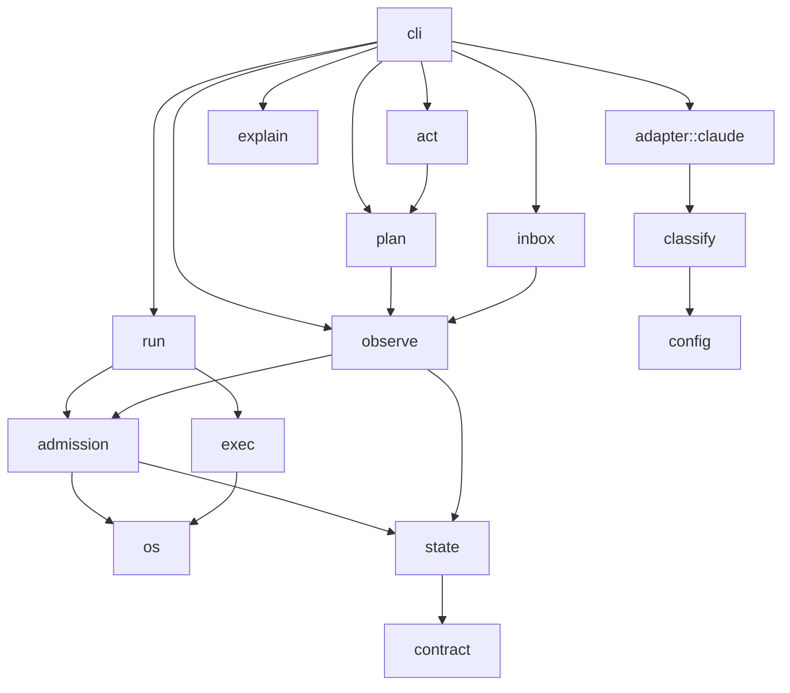
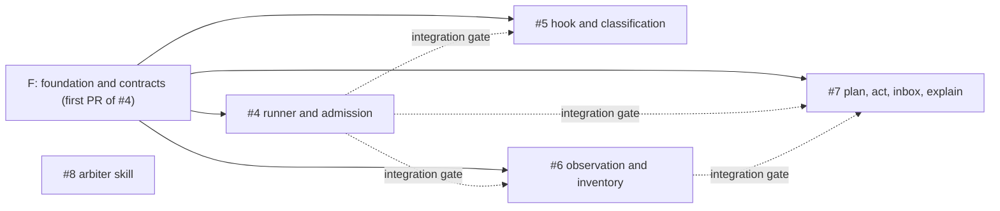

# cardinal phase 0 architecture

This document fixes the contracts that the phase 0 pieces build against: the crate and module layout, configuration, the state directory, the runner, the Claude Code hook, classification, observation, `plan` and `act`, the CLI and its JSON, libraries, tests, and the work split. [design.md](design.md) is the source for principles, non-goals, invariants, purpose-layer conditions G1–G14, and plan-layer claims C1–C21; this document refers to its sections as "design §N" and does not restate them. Where the design turned out to be wrong or incomplete, [section 17](#17-issues-with-the-design) says so and gives the resolution used here.

## Contents

1. [Phase 0 scope](#1-phase-0-scope)
2. [Crate and module layout](#2-crate-and-module-layout)
3. [Configuration](#3-configuration)
4. [State directory](#4-state-directory)
5. [Runner](#5-runner)
6. [Claude Code hook contract](#6-claude-code-hook-contract)
7. [Classification](#7-classification)
8. [Observation](#8-observation)
9. [plan, act, and invariants](#9-plan-act-and-invariants)
10. [Inbox and explain](#10-inbox-and-explain)
11. [CLI and JSON contracts](#11-cli-and-json-contracts)
12. [Libraries](#12-libraries)
13. [Test strategy](#13-test-strategy)
14. [Work split](#14-work-split)
15. [Purpose layer for phase 0](#15-purpose-layer-for-phase-0)
16. [Plan layer for phase 0](#16-plan-layer-for-phase-0)
17. [Issues with the design](#17-issues-with-the-design)

## 1. Phase 0 scope

Phase 0 builds the core (hook adapter, runner, admission and reservations, observation, records, `plan`/`act`/invariants, the inbox, the CLI for the arbiter), the Claude Code adapter, and the first arbiter skill. It is accepted by G4, G5, G10, and G14 (design §12) on macOS and Linux; on Windows the hook does not rewrite (section 5.5).

**Phase 0 admission decides with exactly this:** the resources of every reservation that is live or recovery-needed, plus the new job's resources, compared per resource against the budgets in `host.toml`; a job gets all of its resources or none. There are no sensors, no priority classes, no queue order, and no measured weights. Resource amounts come from the matching classification rule. This is the design's "sensor read failed, decide from reservations alone" case (design §7), made permanent until phase 2.

Phase 0 leaves seams for phase 2 and later but implements none of them:

| Seam | Phase 0 shape | Filled by |
| --- | --- | --- |
| Sensors | `sensor::Sensors` trait; the only implementation returns `Unavailable` | Phase 2 (memory), phase 1 (disk) |
| Priority classes | `Priority` enum with one variant, `Normal`; stored in reservations | Phase 2 |
| Accepted jobs, `wait`, `cancel`, `logs` | Command names and `jobs/` path reserved; lock handoff fixed in [section 5.7](#57-executor-contract-phase-2-seam); not registered in the CLI | Phase 2 |
| Queue tickets | `tickets/` path reserved | Phase 2 |
| Job spec, placement, executor | `exec::Invocation` (local form), `exec::Placement::Local`, and the `Executor` contract of section 5.7 | Phase 2 |
| Measurements | Records carry `measurements: [{kind, …}]`; phase 0 writes only `wall_time` | Phase 2 (C21) |
| Parallelism injection | Not implemented; classification rules reject an `env` key | Phase 2 |
| Classifier and reconciler units | Built-in classifier implements the unit-shaped `Classifier` trait; JSON schemas fixed in [section 7.6](#76-classifier-unit-seam); `act` already honors per-unit `act = false` ([section 9.6](#96-dry-run-and-unit-gating)) | Phase 1+ |
| Disk reserve file | Path reserved ([section 4.12](#412-disk-reserve-file)) | Phase 1 (C11) |
| OS timer, reconcile runner, starting the arbiter | None; `cardinal inbox` runs the recovery pass (section 10.1) | Phase 1 |

## 2. Crate and module layout

### 2.1 One crate

Everything lives in the single crate `crates/cardinal` (library plus the `cardinal` binary). The library target exists so integration tests can call modules directly; it is not a published API. The workspace has one more crate, `crates/test-support` (`cardinal-test-support`), a dev-dependency that holds the spawn API and git fixtures of section 13.3; it does not depend on `cardinal`.

| Option | Verdict |
| --- | --- |
| One crate with modules, layering checked by a test | **Chosen.** One compile unit, one binary, no version coordination. The dependency direction below is enforced by `tests/layering.rs`, which fails when a module imports one it must not |
| Workspace of `cardinal-core`, `cardinal-os`, `cardinal-claude`, `cardinal-cli` | Rejected for now. The compiler would enforce layering, but every contract change would touch several manifests, and no second consumer of the core exists yet. Split when one appears (a unit SDK, a control-plane connector) |

### 2.2 Modules

| Module | Owns | May use |
| --- | --- | --- |
| `contract` | serde types for every JSON document in [section 11](#11-cli-and-json-contracts) and the record, reservation, and run-spec files | std, serde |
| `config` | `host.toml` and `repos/*.toml`: locations, parsing, defaults | `contract` |
| `state` | State paths, atomic writes, lock helpers with deadlines, IDs and keys, JSONL append and read | `contract` |
| `record` | Record appending, rotation, reading | `state`, `contract` |
| `testpoint` | Pause points and failure injection for tests ([section 13.1](#131-deterministic-concurrency)) | std |
| `os` | Platform backends behind one API: process table, start times, parent PID, process working directories, boot time; process-group setup and signals (Unix); `os::child`, which runs a short-lived child in an environment the caller constructs, under an absolute deadline and an output cap, and kills the child's process group (Unix) or Job Object (Windows) at the end of every run; on Unix it takes over SIGCHLD and the termination signals, process-wide state that cardinal, a command line program, owns ([section 8.1](#81-child-processes-for-git-and-gh)) | std, rustix, signal-hook, libc, sysinfo, windows-sys |
| `sensor` | Phase 2 seam: `Sensors` trait, `Unavailable` implementation | `contract` |
| `exec` | `Invocation` (argv; cwd and env by inheritance), `Placement::Local`, `Executor` trait, local executor | `os`, `contract` |
| `admission` | Budget math (pure), reservation store, liveness and the recovery pass, worktree in-use query | `state`, `config`, `os`, `sensor`, `record`, `contract` |
| `run` | The runner: start boundary, fail-open, wait loop, child supervision, release | `admission`, `exec`, `record`, `state`, `config`, `os`, `testpoint` |
| `classify` | Shell tokenizer, stage finder, normalizer, rule matcher, `Classifier` trait, built-in classifier | `config`, `contract` |
| `adapter::claude` | Hook input and output, stage rewriting, session-end snapshot | `classify`, `config`, `record`, `state`, `os` |
| `observe` | git and gh invocation with constructed environments and deadlines, repository and worktree facts, merge evidence, ignored-data classification, disk usage, outlived processes | `config`, `state`, `admission` (read-only queries), `os`, `contract` |
| `plan` | Plan generation, identity binding | `observe`, `admission`, `state`, `record`, `contract` |
| `act` | Plan execution: snapshot, checks, descriptor-relative deletion | `plan`, `observe`, `admission`, `state`, `record`, `contract`, `testpoint`, rustix |
| `inbox` | Inbox store, dedup, refresh (recovery pass and built-in raisers) | `admission`, `observe`, `state`, `record`, `contract` |
| `explain` | Explanation documents | `classify`, `record`, `plan`, `inbox`, `state`, `contract` |
| `cli` | clap definitions and thin handlers that print JSON | everything |

"May use" is read transitively: a module may also use whatever the modules it may use may use, so `run` may use `contract` through `admission`. `testpoint` is open to every module above the foundation. `tests/layering.rs` checks every `crate::` and `super::` path in `src/` against this reading; a glob import of the crate root or an alias of `crate` counts as using every module, and `clippy::wildcard_imports` is denied, so no module comes into scope without a path the test sees.



Two rules matter most and are part of the layering test:

- `admission`, `run`, and `exec` never import `observe`, `inbox`, `plan`, or `act`, and `admission` uses neither `std::net` nor `std::process`. gh lives only in `observe`, and nothing on the admission path raises inbox items (C17, C18). Section 13.5 checks the same at run time.
- `contract`, `state`, `config`, `testpoint`, and `os` import nothing above them, so every work unit can depend on them from day one.

## 3. Configuration

### 3.1 Locations

| | Unix (macOS, Linux) | Windows |
| --- | --- | --- |
| Config dir | `$CARDINAL_CONFIG_DIR`, else `$XDG_CONFIG_HOME/cardinal`, else `$HOME/.config/cardinal` | `$CARDINAL_CONFIG_DIR`, else `%LOCALAPPDATA%\cardinal\config` |
| State dir | `$CARDINAL_STATE_DIR`, else `$XDG_STATE_HOME/cardinal`, else `$HOME/.local/state/cardinal` | `$CARDINAL_STATE_DIR`, else `%LOCALAPPDATA%\cardinal\state` |

macOS uses the XDG locations too, as the design says (design §9) and as most developer CLIs do. Windows uses `%LOCALAPPDATA%` (not roaming) for both because the configuration describes one host. The `CARDINAL_*` overrides exist for tests and for running two independent instances. A relative or missing base directory is an error; before a stage starts, every error fails open.

Files:

```text
<config>/
  host.toml          # one per host; optional
  repos/*.toml       # per-repository profiles; read in file-name order
```

Unknown keys are rejected (`deny_unknown_fields`) so typos surface as `config_invalid` instead of silently changing behavior. A config error never blocks a command: the hook does not rewrite, and the runner fails open.

### 3.2 `host.toml`

```toml
[budget]                 # admission budgets; a resource without a budget is unlimited
cpu = 8                  # default: logical CPUs (std::thread::available_parallelism)
memory_mb = 24000        # default: unset
# any other name is a resource too, e.g. gpu = 1

[admission]
default_resources = { cpu = 4 }  # for rules without `resources`; default: cpu = max(1, logical CPUs / 2)
lock_timeout_ms = 2000           # admission lock deadline
max_wait_ms = 30000              # upper bound of the synchronous wait
wait_fraction = 0.25             # share of the Bash timeout the wait may use

[hook]
enabled = true
runner = "/usr/local/bin/cardinal"  # absolute path written into rewrites; default: the hook's own executable
deadline_ms = 500                   # internal classification deadline

[observe]
git = "git"
gh = "gh"
git_timeout_ms = 10000
gh_timeout_ms = 20000
repos = ["~/src/other"]             # extra main worktrees to inventory (profiles add theirs)
managed = [{ app = "t3code", root = "/path/to/t3code/worktrees" }]  # report-only worktrees

[records]
max_bytes = 8388608
keep = 4

# [unit.<name>] tables (design §5) are parsed from phase 1. In phase 0 the only
# honored key is `act` for callers that identify as a unit (section 9.6).
```

`[hook] runner` must be absolute and consist only of `A–Z a–z 0–9 / . _ + -`; otherwise the hook does not rewrite and records `config_error`. The path is the only configuration value that appears in shell text, and this rule means it never needs quoting.

### 3.3 `repos/*.toml` profiles

```toml
[match]                                  # omit [match] for a generic profile that applies to every repository
paths = ["~/src/app"]                    # main worktree paths; matched through the git common dir
remotes = ["github.com/owner/app"]       # origin URL, normalized to host/owner/name

[git]
base = "origin/main"                     # default: the target of refs/remotes/origin/HEAD

[classify]
wrappers = [["npx"], ["pnpm", "exec"], ["pnpm", "dlx"], ["npm", "exec"], ["bunx"], ["mise", "exec", "--"], ["mise", "x", "--"]]
skip = []                                # command words never rewritten in matching repositories

[[rule]]
id = "test"
commands = ["pnpm test", "pnpm -r test", "vitest", "cargo test", "cargo nextest run"]
except = ["--watch", "-w"]               # any of these words disqualifies a match
class = "test"                           # label for records (phase 2 measurement key)
resources = { cpu = 4, memory_mb = 9000 }

[data]
regenerable = ["node_modules", "target", "fuzz/target", ".DS_Store"]
protected = ["fuzz/corpus", "fuzz/artifacts", "proptest-regressions"]
```

- **Repository identity** is the canonical git common dir. A profile matches when one of `match.paths` has that common dir, or when `git remote get-url origin` normalizes to one of `match.remotes`. Path matching needs no child process and is tried first; remote matching runs git (section 8.1) and only when a rule could match a stage at all.
- **Precedence:** matching profiles in file-name order, then generic profiles in file-name order. The first rule whose pattern matches wins. `[data]` lists and `[classify] skip` are the union of the matching and generic profiles. `[git] base` and `[classify] wrappers` come from the first profile that sets them.
- **Data patterns:** an entry without `/` matches a file or directory with that name at any depth; an entry with `/` matches that worktree-relative path. No globs in phase 0.
- **No tool knowledge in code.** The core ships no default rules, wrappers, or data patterns (design §4). The repository ships `examples/config/` with a starting `host.toml` and a generic profile; the owner copies what they want.

## 4. State directory

### 4.1 Layout

```text
<state>/
  VERSION                     # layout version, "1"
  host-id                     # 16 hex chars, created once
  admission.lock              # empty; exclusive lock = the admission critical section
  live/<job>.lock             # empty; held exclusively by the owning runner for its lifetime
  reservations/<job>.json     # one per reserved job
  worktrees/<key>.lock        # empty; in-use lock (shared = in use, exclusive = being reclaimed)
  sessions/<session>.json     # SessionEnd snapshots awaiting the outlived-process sweep
  inbox/.lock                 # empty; serializes inbox upserts
  inbox/<key-hash>.json       # one per inbox item
  plans/<plan>/plan.json      # immutable after creation
  plans/<plan>/claim          # created once by the act that executes the plan
  plans/<plan>/result.json    # act result
  records/records.jsonl       # current record file
  records/records.<n>.jsonl   # rotated files, n = 1..keep-1
  records/.lock               # empty; appenders shared, rotation exclusive
  tmp/                        # temporary files for atomic writes (same file system)
  jobs/                       # reserved for phase 2 accepted jobs
  tickets/                    # reserved for phase 2 queue tickets
  reserve                     # reserved for the phase 1 disk reserve file
```

| File | Format | Written by | Read by |
| --- | --- | --- | --- |
| `VERSION`, `host-id` | text | first cardinal process that finds them missing: a fully written temp file is hard-linked into place, which fails if another process won, and the loser reads the winner's file | all |
| `reservations/<job>.json` | `cardinal.reservation.v1` | owning runner; the recovery pass deletes others' reservations, only under the admission lock | admission, observe, inbox, plan, act |
| `sessions/<session>.json` | `cardinal.session-snapshot.v1` | `hook claude session-end` | inbox refresh |
| `inbox/<key-hash>.json` | `cardinal.inbox-item.v1` | inbox raise, refresh, resolve | `inbox`, `explain` |
| `plans/<plan>/plan.json` | `cardinal.plan.v1` | `plan` | `act`, `explain` |
| `plans/<plan>/claim` | `{"pid":…,"claimed_ms":…}` | `act` (create-new) | `act`, `explain` |
| `plans/<plan>/result.json` | `cardinal.act-result.v1` | `act` | `act`, `explain` |
| `records/*.jsonl` | one `cardinal.record.v1` object per line | every command | `explain`, `inventory` |

### 4.2 Write discipline

- **Atomic replace:** write to `tmp/<name>.<pid>.<n>`, flush, rename over the target. Readers see the old or the new file, never a mix. Leftover temp files older than one hour are removed by `plan` and `inbox` runs.
- **fsync policy:** reservations, live locks, and records are not fsynced; they are meaningless after a power loss (reservations from an earlier boot are released, section 4.5). Plan claims, act results, and inbox items are fsynced (file, then parent directory on Unix), because losing them could run a plan twice or bring back a resolved item. On Windows, `FlushFileBuffers` on the file only.
- **Exclusive creation for uniqueness:** a job ID is claimed by creating `live/<job>.lock` with `create_new`, a plan ID by creating `plans/<plan>/` with `create_dir`; a collision retries with a new ID.
- **IDs:** 16 lowercase hex characters from a randomly keyed SipHash (`std::hash::RandomState`) of time, PID, and a counter. No RNG crate. The CLI accepts any unique prefix of at least 4 characters.
- **Keys:** worktree keys and inbox key hashes are FNV-1a 64 of the canonical path or key, as 16 hex characters (hand-written, stable across Rust releases unlike `DefaultHasher`). A worktree-key collision only makes two worktrees share an in-use lock (more conservative); inbox files store the full key and probe `-1`, `-2`, … on collision.
- **Times** are integers in milliseconds since the Unix epoch (`*_ms`). Process start times are seconds, as the OS reports them (`*_s`).

### 4.3 Locks

Locks use `std::fs::File::{lock, lock_shared, try_lock, try_lock_shared}` (stable since Rust 1.89): `flock` on Linux and macOS, `LockFileEx` on Windows. The OS drops them when the holder dies, which is what makes liveness detection work without TTLs.

- Lock files are always empty and separate from data files, because Windows locks are mandatory: a locked byte range cannot be read by other processes.
- std opens files close-on-exec and non-inheritable, so a child never inherits the runner's locks. A surviving child therefore cannot keep a dead runner looking alive.
- Waiting with a deadline is a `try_lock` loop with backoff (5 ms doubling to 50 ms). Every acquisition has a deadline; there is no unbounded `lock()`.
- Lock order is always: worktree in-use lock, then admission lock, then inbox or records lock. Nothing takes them in another order.
- `admission.lock`, `worktrees/*.lock`, `inbox/.lock`, and `records/.lock` are never deleted, so no process can lock a file another process has already unlinked. `worktrees/*.lock` grows by one empty file per worktree ever used; phase 1 may prune them under the admission lock.

### 4.4 Admission protocol

The critical section only reads small files and writes one; process probes are a few system calls.

1. Take `admission.lock` exclusively (deadline `lock_timeout_ms`; on timeout, fail open).
2. On the runner's first pass only: create `live/<job>.lock` with `create_new` and take it exclusively. The runner holds it until it exits.
3. Run the **recovery pass**: read every `reservations/*.json` (a file that vanished meanwhile is skipped) and evaluate each one (section 4.5). Delete `stale` ones and their live lock files, and delete live lock files that are free and have no reservation. The pass never signals: `live` and `recovery_needed` reservations stay as they are.
4. Sum the resources of `live` and `recovery_needed` reservations. If, for every resource the new job needs, `sum + need ≤ budget` (resources without a budget always fit), write `reservations/<job>.json` (atomic) with `state: "reserved"` and the runner's group identity (section 5.5).
5. Release `admission.lock`.

The liveness lock is held before the reservation becomes visible, so another admitter can never see the new reservation with a free liveness lock. Live lock files are created and garbage-collected only inside the admission lock, so collection can never delete a file between its creation and its locking. A missing live lock file counts as free. `cardinal inbox` runs the same recovery pass (section 10.1).

### 4.5 Reservation lifecycle and recovery-needed

```text
reserved ──(written immediately before spawn)──> starting ──(after spawn)──> running ──> deleted at release
```

The group identity is fixed before the reservation exists: the runner makes itself a process-group leader, so the PGID is the runner's PID (section 5.5). A reservation's derived state is computed by whoever reads it; it is never stored:

| Condition (evaluated in order) | Derived state |
| --- | --- |
| `try_lock` on `live/<job>.lock` fails (the owner holds it) | `live` |
| `boot_s` differs from the current boot time by more than 2 s | `stale`: no process survives a reboot |
| The group is empty: `kill(-pgid, 0)` fails with `ESRCH`, or a process whose PID equals the PGID has a start time other than the runner's (POSIX does not reuse a PID while a process group with that ID exists, so the job's group must have emptied first) | `stale` |
| Otherwise | `recovery_needed` |

A `recovery_needed` group is **verified** when the recorded child (PID and start time) is alive and still has the recorded PGID; the inbox item shows this with the group's members. **Recovery never signals a group, verified or not:** nothing pins a dead runner's PGID between a check and a signal, so the group could empty and its ID pass to an unrelated group in that window. The reservation keeps counting until the group is empty or the boot changes. PGID reuse by an unrelated group therefore only delays release, and the delay clears itself when that group ends. Only a live runner signals its own group (section 5.5): the group's ID is the runner's PID, so no other group can take it while the runner lives. Nobody, including the owner, can release a non-empty group's reservation (G14). Recovery-needed reservations count as reserved for admission and as in use for their worktree.

### 4.6 Worktree in-use lock

- The worktree of a job is found by walking up from the runner's cwd to the nearest `.git` entry (file or directory); the key is the FNV-1a of that directory's canonical path. A job outside any worktree takes no in-use lock.
- The runner takes `worktrees/<key>.lock` **shared** at acceptance, before admission and before any wait, and holds it until the stage has exited, on every path that runs the stage: admitted, overflow, fail-open, and TTY passthrough (C15). Several jobs can share a worktree.
- **The lock keeps running commands from losing files under them; it does not protect data,** which `act` protects by deleting only what it inspected (section 9.5). When the lock cannot be opened or taken within the wait cap (an `act` holds it, or the state dir is broken), the runner runs the stage anyway (G4) and records `in_use_unprotected`.
- `act` takes the lock **exclusively** with `try_lock` (no waiting) and keeps it until its deletion ends. A worktree is in use when that `try_lock` fails, when a `live` or `recovery_needed` reservation names the worktree key (checked under the admission lock while holding the exclusive lock; this covers a crashed runner, whose shared lock the OS has already dropped), or when a process has its working directory inside the target.

### 4.7 Records

- One JSON object per line, appended with a single `write` on a file opened in append mode (`O_APPEND`; `FILE_APPEND_DATA` on Windows), so concurrent appenders do not interleave.
- An appender holds `records/.lock` **shared** from opening `records.jsonl` until its write is done (waiting at most 1 s for a rotation to finish, else the record is dropped). Rotation and removal take it **exclusively**, so no file is renamed or removed while an appender has it open, and a delayed appender never writes into a file a later rotation has replaced.
- When `records.jsonl` exceeds `max_bytes`, the appender that notices takes the lock exclusively with a 100 ms deadline (on timeout the next append rotates), checks the size again, and renames `records.<keep-2>` → `records.<keep-1>` … `records.jsonl` → `records.1.jsonl`; with `keep = 1` it removes `records.jsonl`.
- Readers skip lines that do not parse. A crash mid-write costs at most the torn line and the line appended after it.
- A record failure, a panic in an append included, is never surfaced to a command and never causes a rerun (C5, C11): the runner loses the record and goes on.

### 4.8 Inbox store

`inbox/<key-hash>.json` holds one item (section 10.1). Upserts take `inbox/.lock` exclusively: an existing item with the same key is updated (`seen` incremented, `evidence` replaced) and is never reopened once `resolved` or `dismissed`.

### 4.9 Plans store

`plans/<plan>/plan.json` is written once. `act` claims a plan by creating `plans/<plan>/claim` with `create_new` and fsyncing it before touching the target, so a plan runs at most once even across a crash or power loss. A claim without `result.json` means the run was interrupted; the plan is never retried, and a new plan inspects the target from scratch. Plan directories older than 30 days are removed by `plan` runs.

### 4.10 Sessions

`hook claude session-end` writes `sessions/<session>.json` with the agent process and its descendants (section 6.6). Inbox refresh deletes it once none of the listed processes is alive.

### 4.11 Crash consistency

| Runner dies … | Left behind | Next reader does |
| --- | --- | --- |
| before its first admission pass | Nothing; its in-use shared lock is dropped by the OS | — |
| while waiting between passes | `live/<job>.lock`, free | The recovery pass deletes it |
| inside the admission lock | Temp file in `tmp/`; lock dropped by the OS | Temp GC |
| at `reserved` | Reservation; its group was the runner alone and is now empty | `stale` |
| at `starting` | Reservation; a child may or may not exist in the group | Empty group: `stale`. Otherwise `recovery_needed`, unverified, until the group is empty |
| at `running` | Reservation with the child's identity | `recovery_needed` (verified while the child lives) until the group is empty, then `stale` |
| after the child exits, before release | Reservation | `recovery_needed` while members remain, then `stale`; records lack `job_finished` |
| during release | Nothing or a free live lock | Recovery pass |

`act` dying leaves a partially deleted target whose remaining entries were all inspected (section 9.5). Power loss: reservations, live locks, and in-use locks are reset by the reboot (`boot_s` check, OS locks). Plans and the inbox survive through fsync.

### 4.12 Disk reserve file

Phase 1 creates `<state>/reserve` with really allocated blocks (written zeros, not `set_len`, which leaves a sparse file), 64 MiB by default, and deletes it when the state volume is full so minimal reclamation can proceed (C11). Phase 0 only reserves the path.

## 5. Runner

### 5.1 Invocation

```text
cardinal run [--spec-b64 SPEC] -- COMMAND [ARG]...
```

- **The stage** arrives as argv after `--`: the stage's own words after the calling shell has expanded them (variables, including ones that are not exported, globs, `~`, quoting), with the stage's redirections already applied to the runner process by that shell. The runner executes the argv directly, without a shell, so expansion, cwd, environment, and redirections are exactly those of the calling shell.
- **`--spec-b64`** is unpadded base64url of a `cardinal.run-spec.v1` JSON document (section 11.3): class, rule, resources, Bash timeout, background flag, session, agent, and tool-use IDs, stage index, and the stage's source text. Everything the runner needs from the hook travels here, so no configuration value is ever spliced into shell text, and base64url contains nothing a shell treats specially. Without a spec (people, tests), `admission.default_resources` applies.

### 5.2 Steps

1. Start watching signals and the parent process (section 5.5). When the signal handlers cannot be set up, the runner takes the in-use lock (step 4) and then runs the stage by TTY passthrough (step 2) or fails open.
2. If stdin is a terminal (**TTY passthrough**): take the in-use lock as in step 4, record `tty_passthrough`, and run the stage as fail-open does.
3. Decode the spec, resolve the state dir, load `host.toml`.
4. Take the worktree in-use lock shared (section 4.6). If that is not possible within the wait cap, continue without it and record `in_use_unprotected`.
5. Set up the process group (section 5.5).
6. Admission (section 4.4). If the budget is full, release the admission lock, sleep (250 ms doubling to 2 s), and retry until the wait cap (section 5.4).
7. Write `starting` (the start boundary, section 5.3), look again for a signal or the parent's exit, spawn the stage, write `running` with the child's PID and start time, append `job_started`.
8. Wait for the child, forwarding signals.
9. Release: delete the reservation when no member of the group other than the runner is left, otherwise leave it for the recovery pass (section 5.5); append `job_finished` (exit status, `waited_ms`, `measurements: [{kind: "wall_time", ms}]`), drop the live lock and the in-use lock, and exit with the child's status or re-raise its signal (section 5.6).

**Fail open** (section 5.3): append `job_fail_open` if records still work, drop the reservation and live lock if taken, restore the original process group, spawn the stage in it, and finish as in step 9; the runner never `exec`s, so the in-use lock stays held until the stage exits. Nothing is printed, except `<command>: <OS error>` with exit 127 (not found) or 126 when the stage cannot be executed, as shells do.

**Cancellation:** a handled signal (section 5.5) or the parent's exit before the spawn, seen during any wait or at the spawn itself on every path, ends the run without starting the stage. The runner appends `job_finished` with `cancelled`, releases what it holds, and dies by that signal, or exits 129 when the parent exited.

### 5.3 Start boundary

- **The stage has started once `spawn()` has returned a child.** Before that, the runner itself runs the stage on every failure it can observe: signal handlers that cannot be set up (step 1), an error in steps 3–7, a failed `spawn()` (the OS guarantees that no child ran), and a panic, which a `catch_unwind` around the whole run turns into fail-open. Every wait before the spawn has a deadline: the admission lock (`lock_timeout_ms`, then fail open), the in-use lock (the wait cap, then unprotected), and the budget (the wait cap, then overflow, section 5.4).
- **After `spawn()` has returned, the runner never runs the stage again.** The runner marks the stage as started the moment `spawn()` returns, before it reads anything about the child. A later error or panic ends in waiting for the child (again, by its PID, when the wait itself panicked) and returning its status when possible, and otherwise in exit 125. A panic while recovering from a panic re-enters recovery, which goes on from what the runner holds; a runner that still cannot get past its panics aborts without unwinding, like a runner that crashed. Once `starting` is written, no path that drops the job, unwinding included, deletes its reservation: the job is then abandoned, and only the recovery pass releases the reservation once the group is empty (section 4.5).
- **The `starting` record**, written immediately before `spawn()`, is the boundary as seen from the state dir: a reservation at `starting` whose runner died may or may not have a child, and recovery treats it as possibly running.
- **Zero-run cases that remain:** the runner killed (for example by SIGKILL) between its start and the spawn; a runner path that is executable but cannot be loaded (`[ -x R ]` passes, the exec fails with a loader error); and a cancellation, by the parent's exit or a signal before the spawn (section 5.2). The first two end the Bash call with a visible non-zero status (137, or 126 with the shell's message), nothing runs twice, and nothing reports success (section 17, item 5).

### 5.4 Wait cap and phase 0 overflow

- Wait cap: `max_wait_ms` if the spec says background; otherwise `min(max_wait_ms, timeout_ms × wait_fraction)`. Phase 2 subtracts the expected run time once measurements exist.
- **When the wait reaches the cap, phase 0 starts the stage anyway, over budget** (admission result `overflow`). This is a phase 0 interim rule; phase 2 replaces it with an accepted job (C4). Alternatives rejected for phase 0: returning an error makes agents retry and adds load; waiting until the Bash timeout gets the command moved to the background by Claude Code with the wait still in front of it.
- **Waits add no output,** because text from the runner would enter the stage's pipes (`2>&1 | jq .`); `job_finished` records `waited_ms` and the admission result for `explain job`. Phase 2's accepted-job reply is the only output cardinal adds to a successful command (design §6).

### 5.5 Child execution

- **Execution:** argv is resolved through `PATH` as `env` does, with inherited stdio, cwd, and environment. The runner never proxies output, so terminal detection, buffering, and pipe behavior are unchanged, and the runner's death cannot break the child's output.
- **Process group:** in step 5 the runner calls `setpgid(0, 0)` and records `pgid` as its own PID; a failure is a pre-start failure. The child inherits the group, whose PGID is thus known before the reservation is written (section 4.5). A runner that already leads its group (`getpgid(0)` equals its PID) does not take that group as its own, because other processes can be in it: a job-control shell makes the first command of a pipeline the leader of the job's group, which the pipeline's other commands join. Step 5 then fails without calling `setpgid`, and the run fails open in that group, where the runner signals only its child (signals below).
- **Signals:** on the admitted path the runner forwards SIGINT, SIGTERM, SIGHUP, and SIGQUIT to the rest of the group. On the fail-open and TTY paths the child shares the caller's group and gets terminal signals itself; the runner ignores SIGINT and SIGQUIT while waiting, as `system()` does, and forwards SIGTERM and SIGHUP. A signal the caller ignores (`SIG_IGN`) gets no handler, so it stays ignored for the stage, as in a direct run. SIGCHLD is the exception: the runner sets it to its default action before it starts any child, because a caller that ignores it would have Linux reap the runner's children, and the runner could neither keep a child's PID reserved nor learn its status. The stage starts with SIGCHLD ignored again (set between `fork` and `exec`) when the caller ignored it. Each handled signal's handler writes to a pipe read by a thread of its own; the runner starts every reader before it installs the first handler, because a handler whose reader never ran would swallow its signal. It sets them up at its start, before any other thread exists, with the handled signals blocked, and unblocks them once every handler is installed: `signal-hook` installs a handler before it publishes the action that handler runs, and drops a signal that arrives in between, while a blocked signal stays pending until it is unblocked. The readers keep the signals blocked, so the handlers run on the runner's other threads. When a reader or a handler cannot be set up, the runner installs none, each signal gets back the disposition it had before the runner unblocks it, and the run fails open (`signal_setup`) with nothing forwarded: the stage shares the caller's group and gets terminal signals itself, and a SIGINT, SIGTERM, SIGHUP, or SIGQUIT that reaches the runner ends it with its default action. A stage that survives the signal then runs on without the in-use lock, which goes with the runner. For the same reason the runner cancels nothing when a SIGHUP comes with its parent's exit (a hangup, or the kernel's orphaned-group SIGHUP to a stopped runner, below); a parent exit without a signal is cancelled as on the other caller-group paths.
- **Job control:** on the fail-open and TTY paths, when the child stops, the runner stops itself with the same signal, so the caller's job control sees the stage stop, and continues the child once it is continued itself. A runner that never stopped itself would hide the stage's stop from the caller's job control. On these paths the runner signals the child by its PID and never signals the caller's group.
- **Parent death:** the runner watches its parent from its start and reads the parent PID itself before the spawn and before its wait ends. If the parent exits before the spawn (the Bash call was cancelled), the runner releases what it holds and exits 129 without starting the stage. After the spawn on the admitted path, it sends SIGTERM to the group, also when the child has exited and only descendants are left, and waits until no member is left. If members remain 5 s later, it records the job, leaves the reservation for the recovery pass, and sends SIGKILL to the whole group, itself included while it is a member; the reservation is released once the group is empty. Only a live runner signals: the group's ID is its PID, so the ID cannot pass to another group while it lives.
- **Parent death in the caller's group:** on the fail-open and TTY paths the runner holds no reservation (TTY passthrough bypasses admission, and fail-open drops what it reserved); what it holds until the child is gone is the in-use lock. After the spawn the child gets SIGTERM, and SIGKILL 5 s later, by its PID, which stays reserved because the runner reaps the child only when its wait ends; the runner waits for it at most 30 s. This cancellation progresses while the runner executes. A runner stopped with its stage (job control above) runs none of its threads, so it sees its parent's exit only once it is continued, and the cancellation waits until then. When the parent's exit leaves the caller's group orphaned, the kernel sends every member SIGHUP and then SIGCONT, which continues the runner; while another member keeps the group from becoming orphaned, nothing does. The kernel's continuation does not cover a runner that found its parent alive just before and stops right after it: the runner then stays stopped with the in-use lock, and the stage, continued by the same SIGCONT, is not guaranteed to stay stopped. In launchd's session on macOS (session ID 1), when a runner that launchd adopted exits, the kernel can send SIGHUP and SIGCONT to a stopped member of the caller's group that is not part of the stage, even one whose parent in another group of the session keeps the group from becoming orphaned; those signals come from the kernel's orphaned-group handling, not from cardinal. cardinal does not cover these cases with a helper process: a signal to the caller's group reaches its unrelated members, a helper in that group is stopped with it, and a helper outside it cannot pin the runner's PID, which could pass to another process between the helper's check and its signal.
- **Normal exit:** when the direct child exits, the runner returns its status at once. It deletes the reservation only when no member of the group other than itself is left: it moves back into the caller's group and asks `kill(-pgid, 0)`, or reads the process table when it cannot move. Otherwise the reservation stays for the recovery pass, which releases it once the group is empty, so the budget and the worktree stay taken while the stage's descendants run. Those members are not killed (the same as running the stage without cardinal) and show up in `inventory`. Processes that leave the group (`setsid`) are not tracked.
- **Windows:** in phase 0 the hook does not rewrite (section 6.3) and `cardinal run` always takes the fail-open path; the argument contract and Job Objects are phase 3 (section 17, item 10).

### 5.6 Exit status and infrastructure failure

| Situation | Exit | Added output |
| --- | --- | --- |
| Child exited with code N | N | none |
| Child killed by signal N | signal N: after releasing, the runner restores N's default disposition and raises it | none |
| Pre-start failure, TTY passthrough | the stage's status or signal | none |
| Runner error after the child started, child status unknown | 125 | `[cardinal] Infrastructure failure after the command started: <reason>. The command was not rerun.` on stderr |
| Runner killed after the child started | set by the killer (137 for SIGKILL) | none; the record has `job_started` without `job_finished`, and `explain job` reports `runner_died` |
| Release or record failure after the child exited | the child's status | none |

125 follows the convention of `env`, `nice`, and `timeout` for "the wrapper itself failed". It can collide with a child's own 125, so the stderr line and the records are the distinguishing signal. The line appears only when the stage's own status is unknown, so it never changes the output of a command whose result is known.

### 5.7 Executor contract (phase 2 seam)

```rust
pub trait Executor {
    /// Sets up the process group; runs before the reservation is written.
    fn prepare(&self) -> Result<GroupIdentity, NotStarted>;
    /// Starts the invocation. `Err` guarantees that nothing started, so the caller may run the stage itself.
    fn start(&self, inv: &Invocation) -> Result<Box<dyn Running>, NotStarted>;
}
pub trait Running {
    fn child(&self) -> ChildIdentity;          // written as `running`
    fn wait(self: Box<Self>) -> ExecOutcome;    // blocks; forwards cancellation
}
pub enum ExecOutcome { Exited(i32), Signaled(i32), InfraFailure(String) }
```

Phase 0 has one implementation, the local executor. The start boundary is the same for every executor: `starting` is written before `start`, and an `Ok` from `start` means the stage may have run. For phase 2's accepted jobs, the accepting runner starts a detached runner, which takes its own live lock and a shared in-use lock and rewrites the reservation's owner to itself before the accepting runner drops its locks and prints the job ID; both hold the locks for that moment, so the job is never unowned.

## 6. Claude Code hook contract

### 6.1 Facts

| Question | Answer | Source |
| --- | --- | --- |
| Is there a tool call ID in `PreToolUse`? | Yes: `tool_use_id`, next to `tool_name` and `tool_input` | [Hooks reference](https://code.claude.com/docs/en/hooks): "PreToolUse hooks receive `tool_name`, `tool_input`, and `tool_use_id`" |
| Session, cwd, mode | Common fields: `session_id`, `transcript_path`, `cwd`, `permission_mode`, `hook_event_name`; in a subagent also `agent_id` and `agent_type`. `permission_mode` takes `default`, `acceptEdits`, `dontAsk`, `auto`, `bypassPermissions` | Hooks reference; values checked against Claude Code 2.1.322 |
| Bash `tool_input` fields | `command`, `description`, `timeout` (ms), `run_in_background` | Hooks reference example input |
| Bash timeout default and maximum | `BASH_DEFAULT_TIMEOUT_MS` default 120000; `BASH_MAX_TIMEOUT_MS` default 600000 (the ceiling is the larger of the two) | [Environment variables](https://code.claude.com/docs/en/env-vars) |
| What happens at the Bash timeout? | A foreground command that reaches its timeout is moved to the background, not stopped, unless it starts with `sleep` or `CLAUDE_CODE_DISABLE_BACKGROUND_TASKS=1` | [Tools reference](https://code.claude.com/docs/en/tools-reference) |
| `updatedInput` semantics | "Replaces the entire input object, so include unchanged fields alongside modified ones." Permission rules and auto-background eligibility are evaluated against the returned input. Combine with `allow` to auto-approve or `ask` to prompt; without `permissionDecision` the normal permission flow applies | Hooks reference |
| How is `if … then … else … fi` matched against permission rules? | Each branch separately, in one-line and multi-line form, after `cd … &&`, inside pipelines and lists, and with two wrapped stages: the outcome equals the original's. Other fallback shapes (`&&`/`\|\|`/`;` chains, `{ …; } \|\| …`, `test -x … && exec …`) prompt even when every part is allowed. `"ask"` always prompts; `"allow"` runs commands the original's rules would not. In `auto` mode the classifier denied a rewritten command whose original stage no rule allowed, while allowing the original | Checked against Claude Code 2.1.322 |
| Do assignment prefixes before the runner match its rule? | No: `FOO=1 R run …` prompts under `Bash(R run:*)`; only known variables such as `LANG` are stripped | Checked against Claude Code 2.1.322 |
| Several hooks returning `updatedInput` | Not documented; hooks run in parallel | Hooks reference |
| Hook timeout | `timeout` in seconds; default 600 for command hooks; a timed-out `PreToolUse` hook is discarded and the call continues through the normal permission flow | Hooks reference |
| Exit codes and output | Exit 2 blocks the tool call; other non-zero exits are non-blocking; exit 0 with empty stdout is success; exit 0 with invalid JSON is a non-blocking error | Hooks reference |
| `SubagentStop` input | `agent_id`, `agent_type`, `agent_transcript_path`, `stop_hook_active`, `last_assistant_message`, plus common fields | Hooks reference |
| `SessionEnd` input | `reason`: `clear`, `resume`, `logout`, `prompt_input_exit`, `other`; default hook timeout 1.5 s | Hooks reference |
| Shell and cwd of Bash commands | The user's shell, with aliases, functions, and options captured from its rc file at session start; a `cd` carries over to later Bash calls while inside the project directory (never in subagents) | Tools reference |
| Windows | The Bash tool runs in Git Bash; without Git Bash, a separate PowerShell tool runs commands | Tools reference; [Troubleshooting install](https://code.claude.com/docs/en/troubleshoot-install) |

### 6.2 Installation

The owner adds this to `~/.claude/settings.json` (never to a repository, G5); `examples/claude/settings.json` ships it:

```json
{
  "hooks": {
    "PreToolUse": [{ "matcher": "Bash", "hooks": [{ "type": "command", "command": "cardinal hook claude pre-tool-use", "timeout": 5 }] }],
    "SubagentStop": [{ "hooks": [{ "type": "command", "command": "cardinal hook claude subagent-stop", "timeout": 5 }] }],
    "SessionEnd": [{ "hooks": [{ "type": "command", "command": "cardinal hook claude session-end", "timeout": 2 }] }]
  },
  "permissions": { "allow": ["Bash(/usr/local/bin/cardinal run:*)"] }
}
```

The explicit `timeout` keeps a stuck hook from stalling Bash calls for the 600 s default. Set `[hook] runner` to a path that survives upgrades (a vanished runner path silently turns every rewrite into the fallback) and name it exactly in the allow rule. cardinal must be the only hook returning `updatedInput` for Bash; the order of several is undefined.

### 6.3 `hook claude pre-tool-use`

1. Read stdin (bounded at 1 MiB) as JSON. Exit 0 with empty stdout, rewriting nothing, if the platform is Windows (section 5.5), `tool_name` is not `Bash`, `tool_input.command` is not a string, `hook.enabled` is false, `permission_mode` is `auto` (section 6.5), or anything fails.
2. Find and classify stages (section 7) within `hook.deadline_ms`, measured from process start. Past the deadline: no rewrite.
3. If at least one stage is classified, rewrite each classified stage (section 6.4) and print:

```json
{"hookSpecificOutput":{"hookEventName":"PreToolUse","updatedInput":{"command":"<rewritten>","description":"<unchanged>","timeout":120000,"run_in_background":false}}}
```

`updatedInput` is the original `tool_input` object with only `command` replaced, kept as a `serde_json::Value` so fields unknown to cardinal survive unchanged. No `permissionDecision` is returned (section 6.5).

4. The effective timeout written into each spec: `tool_input.timeout` if it is a positive number, else `BASH_DEFAULT_TIMEOUT_MS` from the hook's environment (the hook inherits Claude Code's), else 120000; capped at `max(BASH_MAX_TIMEOUT_MS or 600000, default)`. `run_in_background: true` sets the spec's background flag.

The hook writes nothing to the state dir and takes no reservation (C1). It never exits non-zero: panics are caught at the top level and turned into "no rewrite".

### 6.4 Rewritten command

The hook replaces only the span of each classified stage, in place, and leaves every other byte of the command alone. For a stage `S`, the replacement is

```sh
if [ -x R ]; then S'; else S; fi
```

where `R` is the runner path, the `else` branch is the stage as written, and `S'` is `S` with `R run --spec-b64 <spec> --` inserted immediately before its command word. Example:

```sh
# original
cd packages/app && pnpm test 2>&1 | tail -50 || echo failed
# rewritten
cd packages/app && if [ -x /usr/local/bin/cardinal ]; then /usr/local/bin/cardinal run --spec-b64 eyJzY2hlbWEiOi… -- pnpm test 2>&1; else pnpm test 2>&1; fi | tail -50 || echo failed
```

- **Everything else stays in the calling shell:** pipes, `&&`/`||`/`;` lists and their short-circuiting, a leading `cd` and the cwd it leaves for later Bash calls, shell options such as `pipefail` and `errexit`, functions used by other stages, and the command's first word unless its first stage is classified. Claude Code's timeout handling depends only on a leading `sleep`, and a `sleep` stage is never wrapped (section 7.2).
- **Both branches carry the stage's own words,** so variables, globs, `~`, and quoting are expanded by the calling shell either way, and exactly one branch runs. The `if` returns the status of the branch that ran, so pipeline and list semantics are unchanged.
- **`[ -x R ]`** is the fallback test: if the runner path is missing or not executable (uninstalled, moved, upgraded to another path), the `else` branch runs the original stage.
- **Several classified stages** in one command are each wrapped and reserved separately; the spec's stage index tells them apart. Scripts started inside a stage are not controlled separately; their weight is learned for the stage (design §6).
- **One-line form:** a stage span never contains a newline or a comment, so the replacement stays on one line and the rest of the line follows `fi` unchanged.

In bash, zsh, and sh this form gives the original's stdout, stderr, and status for lists, `pipefail`, non-exported variables, globs, and redirections, with the runner present and missing; `tests/rewrite_equivalence.rs` keeps these cases (section 13.5).

### 6.5 Permissions

Claude Code evaluates permission rules against the rewritten command and splits `if … then … else … fi` into its branches for matching (section 6.1). The rewrite therefore returns no `permissionDecision`: with the allow rule for the runner installed, the rewritten command needs approval exactly when the original stage does, and deny rules on the original still match its copy in the `else` branch. Returning `"allow"` would run commands the owner never allowed, and `"ask"` would prompt for every command. The G4 real-host check repeats this for the Claude Code version in use.

**`auto` mode is not rewritten in phase 0,** because the auto-mode classifier may deny a stage's rewritten form while allowing the original; commands in `auto` mode bypass admission. Lifting this needs cardinal to evaluate the owner's permission rules (to rewrite only stages an allow rule covers), or Claude Code to report the original call's permission decision to hooks.

### 6.6 `subagent-stop` and `session-end`

Both read stdin, append one record (`subagent_stopped` or `session_ended`, with `session_id`, `agent_id`, `agent_type`, `reason`, `cwd`), and never stop processes (C9). Both exit 0 whatever happens.

`session-end` also writes `sessions/<session>.json`: the agent process (the nearest ancestor of the hook whose name is not a shell: `sh`, `bash`, `zsh`, `dash`, `cmd.exe`, `powershell.exe`, `pwsh.exe`) and every descendant of it except the hook's own chain, each as PID, start time, name, and the first 256 bytes of the command line. It must finish within the 1.5 s default timeout; one process-table refresh takes milliseconds.

A process outlived its session when it is listed in a snapshot, is still alive with the same start time, and the agent process is gone. The agent check matters because `SessionEnd` with `clear` or `resume` keeps the same agent process running. Processes that detach from the agent before `SessionEnd` (double-forked daemons) are not in the snapshot; phase 1 can add a process-environment marker if the owner needs them.

`SubagentStop` cannot attribute processes to a subagent (nothing in a process identifies the subagent), so it only records.

## 7. Classification

### 7.1 Pipeline

```text
command string ──tokenize──> lists, pipelines, stages with byte spans
each stage ──normalize──> argv ──match rules──> class, rule, resources | unclassified
classified stages ──rewrite spans (last to first, so earlier offsets stay valid)──> rewritten command
```

A stage is one simple command: a pipeline element or a list element, with its own assignment prefixes and redirections. Unclassified stages are left alone: light unknown commands are not limited (design §7), and heavy unknown commands are limited only once a profile names them.

### 7.2 Tokenizer subset and refusals

The hand-written tokenizer accepts a conservative subset of POSIX shell syntax: words with `'…'`, `"…"` (backslash escapes inside), and `\x` escapes; `$NAME` and `${…}` inside words as opaque text; the operators `&&`, `||`, `;`, `|`, `&`, and newlines; redirections (`>`, `>>`, `<`, `2>&1`, `N>file`, `&>`); and `#` comments.

**The whole command is left unrewritten** when a stage span cannot be delimited with certainty or the outer shell could change what a stage means: a here-document, `$(`, backticks, `$((`, `<(`, `>(`, `(`, `)`, `{`, `}`, `[[`, `!`, a keyword in command position (`if then else elif fi for while until do done case esac function select`), a function definition, `eval` or `alias` anywhere in command position, or unbalanced quotes.

**A single stage is left unwrapped** (other stages may still be wrapped) when:

- its command word is a shell builtin, keyword, or precommand modifier (`time`, `command`, `builtin`, `exec`, `noglob`, `nocorrect`, and the rest of the shell's builtins), `sleep`, or in `[classify] skip`;
- it expands shell state (`$?`, `${?}`, `$_`, `$!`, `$-`, `$$`, `PIPESTATUS`, `pipestatus`), some of which the fallback test changes;
- it has assignment prefixes: in front of the runner they defeat its permission rule (section 6.1), and as `env` arguments they would change meaning (`A=one B="$A" cmd`, readonly variables). Phase 0 therefore does not limit stages such as `CI=1 pnpm test`;
- it runs asynchronously (followed by `&`), because its runner would outlive the calling shell;
- its pipeline contains another classified stage, because a stage waiting for admission could block a running one through the pipe.

Not understanding a command can only cause a missed rewrite, never a changed one.

### 7.3 Normalization

Normalization decides the class only; the rewrite always uses the stage's own words. For each stage:

1. Drop leading `NAME=value` assignments.
2. Unwrap shell-level wrappers (POSIX knowledge, built in): `env` (with assignments and `-u NAME` only; other options make it unclassified) and `nice [-n N]`.
3. Unwrap `sh`, `bash`, `zsh`, `dash` with `-c STRING` (optionally `-e`, `-l`): tokenize `STRING`; the stage is classified by its first matching simple command, one level deep.
4. Unwrap tool wrappers from `[classify] wrappers` (profile data, not code): drop the wrapper's words, then words starting with `-` until the first that does not.
5. Replace argv[0] by its base name (`./node_modules/.bin/vitest` → `vitest`), and drop a `+toolchain` word right after `cargo`.

`pnpm exec vitest`, `npx vitest`, `env X=1 vitest`, and `bash -c 'vitest'` all normalize to `["vitest"]`; each stage is still wrapped as written (`R run … -- npx vitest`).

### 7.4 Rule matching and resources

- A pattern is split into words. It matches a normalized argv when it is a prefix of it; the word `*` matches any one word. A match is cancelled if any argv word equals an `except` entry.
- The first matching rule in precedence order (section 3.3) classifies the stage. Each classified stage is its own job with its rule's resources.
- Rules have `id`, `commands`, optional `except`, `class`, optional `resources` (positive integers per resource name). The rule ID in records is `<profile file stem>/<id>`.

### 7.5 Shadowed tools

An alias or function in the owner's rc that shadows a classified tool's name is not applied when the stage runs through the runner, which executes the tool from `PATH`. The owner writes both the rules and the rc, and can keep a shadowed tool out of rewriting with `[classify] skip` (per repository, or in a generic profile for all). Phase 0 does not detect shadowing; a later check could run the owner's shell once and report every rule command word that resolves to an alias or function.

### 7.6 Classifier unit seam

The built-in classifier implements `trait Classifier { fn classify(&self, req: &ClassifyRequest, deadline: Instant) -> ClassifyResponse }`, called once per stage. External classifier units (phase 1+) speak the same types as JSON over stdin and stdout, one request per process:

```ts
// stdin
{ schema: "cardinal.classify-request.v1", command: string, stage: string, argv: string[], cwd: string,
  repo: { common_dir: string, main_worktree: string, remote: string | null } | null,
  tool: { name: "Bash", timeout_ms: number, background: boolean } }
// stdout
{ schema: "cardinal.classify-response.v1",
  decision: "wrap" | "pass",
  class?: string, rule?: string, resources?: { [name: string]: number },
  reason: string }
```

`argv` is the normalized form. Classifiers run in a fixed order; the first `wrap` wins; a unit that misses the deadline, exits non-zero, or prints invalid JSON counts as `pass` (design §5). Units decide the class only; where a stage may be wrapped is decided by section 7.2.

## 8. Observation

### 8.1 Child processes for git and gh

- **Constructed environment for git:** start empty and copy an allowlist: `PATH`, `HOME`, `USER`, `LOGNAME`, `LANG`, `LC_*`, `TMPDIR`, `XDG_CONFIG_HOME`, `GIT_CONFIG_GLOBAL`, `GIT_CONFIG_SYSTEM`, `GIT_CONFIG_NOSYSTEM`, `GH_TOKEN`, `GITHUB_TOKEN`, `GH_HOST`, `GH_CONFIG_DIR`, `SSH_AUTH_SOCK`, and on Windows `SystemRoot`, `SystemDrive`, `ComSpec`, `PATHEXT`, `USERPROFILE`, `APPDATA`, `LOCALAPPDATA`, `ProgramData`, `TEMP`, `TMP`. Every other `GIT_*` (`GIT_DIR`, `GIT_WORK_TREE`, `GIT_INDEX_FILE`, `GIT_COMMON_DIR`, `GIT_OBJECT_DIRECTORY`, `GIT_NAMESPACE`, `GIT_CEILING_DIRECTORIES`, `GIT_CONFIG_PARAMETERS`, `GIT_CONFIG_COUNT`, …) is dropped, so a cardinal process started from a git hook can never act on another repository. Then add `GIT_OPTIONAL_LOCKS=0`, `GIT_TERMINAL_PROMPT=0`, `GH_PROMPT_DISABLED=1`, `GH_NO_UPDATE_NOTIFIER=1`, `NO_COLOR=1`. The `GIT_CONFIG_*` location variables stay because they decide where the owner's configuration lives, and git must read it the way the owner's git does (design §9).
- **Constructed environment for gh:** built the same way from its own allowlist: `PATH`, `HOME`, `USER`, `LOGNAME`, `LANG`, `LC_*`, `TMPDIR`, `XDG_CONFIG_HOME`, `GH_CONFIG_DIR`, the tokens gh authenticates with (`GH_TOKEN`, `GITHUB_TOKEN`, `GH_ENTERPRISE_TOKEN`, `GITHUB_ENTERPRISE_TOKEN`), and the Windows variables above, plus the same added variables. `GH_HOST`, `GH_REPO`, and every `GIT_*` are dropped, so gh asks exactly the host and repository observation names (section 8.2). The caller's `GH_HOST` only decides which origin hosts count as GitHub.
- **Always** `git --no-optional-locks -c core.fsmonitor=false -C <absolute path> …`, so `status` does not refresh and rewrite the index, and a configured filesystem monitor does not start a daemon that writes inside `.git`. Reading a split index still freshens its shared index file, so a worktree that uses one (a `sharedindex.*` file in its git dir or the common dir, or `core.splitIndex` set) is not read with any command that reads the index: its status and tracked files are `unknown`, and the step counts as failed. Every git child runs in that directory, and gh in the directory of the repository or worktree it is asked about, so no child inherits cardinal's working directory. `observe::git` is the one function that runs git this way. Observation never runs `fetch` or anything else that writes to a repository; stale remote-tracking refs only make fewer worktrees look merged.
- **Deadlines and output:** git and gh run through `os::child`; `os::child::git_env` and `os::child::gh_env` build the two environments above, which stay separate. Every child has an absolute deadline (`git_timeout_ms`, `gh_timeout_ms` from its start) and reads at most 256 MiB from each of stdout and stderr. Output is read on threads; on the deadline the fact is `unknown`, and a stream over the cap makes it `unknown` at once. A child that exits while a descendant still holds its output open (a tool that leaves a helper holding its output) ends the same way on every platform: the run waits for end of file until the deadline, so it ends as a timeout, not success. On Unix each child leads its own process group; on Windows it starts suspended, is assigned to its own Job Object, and only then resumes, so every process it starts is in the job. Every end of a run, a normal exit included, kills what is left of the group or the job before the child is reaped (on Unix the child stays unreaped until then, so the group's ID cannot pass to another group; before its first child cardinal sets SIGCHLD to its default action, because with SIGCHLD ignored, as a caller can pass it on across `exec`, the kernel reaps children itself), so no descendant that is still in the child's process group or job outlives the run. A descendant that called `setsid()` has left the group and is not killed; a reader thread blocked on a pipe it holds open outlives a timeout, so `os::child` serves only short-lived processes (CLI commands and the hook), whose exit ends such threads. A cardinal process that is terminated takes its live children along. On Unix a command that runs children first installs handlers for SIGTERM, SIGINT, and SIGHUP (each unless ignored; `os::child::prepare`, or else the first child does) that kill every live child's group and then end the process by the same signal with its default action, so a process that forwards these signals itself does not use `os::child`. Each handler's reader thread starts before any handler is installed; if setting them up fails, every signal gets its previous disposition back, no child starts, and the step fails, as does every later step of the process that runs a child. While the handlers go in, the three signals are blocked on the installing thread, and so on the reader threads it starts: signal-hook installs its OS handler before it publishes the action that handler runs, and a signal in between would reach a handler that does nothing with it. Blocked, the signal stays pending until the handlers are in place (or the previous dispositions are back) and then reaches them. A signal sent to the process meanwhile can still reach another thread that does not block it and be lost there, so `cardinal inventory` installs the handlers before it starts any thread. Resetting SIGCHLD and installing these handlers change process-wide signal state, which cardinal owns: it is a command line program, and its library serves only its own binary and tests (section 2.1). On Windows each child's job kills its processes when its last handle closes, and cardinal holds the only handle, so the processes in it end when cardinal ends, by any means. The child enters its job in the call after the one that creates it suspended; a cardinal ended between the two leaves at worst that child suspended, a process that never ran. Creating it inside its job (`PROC_THREAD_ATTRIBUTE_JOB_LIST`) would need a hand-written `CreateProcessW`, because std does not expose that attribute. A process cardinal starts otherwise (such as a detached runner, section 5.7) is in no such job and outlives it. Spawn failure, non-zero exit (where not meaningful), unparsable output, and timeouts all become `unknown`, never "safe". A failed git or gh step of a worktree or its repository also makes that worktree's `observed` check fail, even when other evidence answers the fact.

### 8.2 Repositories and worktrees

Repositories to observe: the main worktrees of profiles with `match.paths`, plus `[observe] repos`, plus `--repo` arguments. Per repository:

| Fact | Command |
| --- | --- |
| Worktrees | `git worktree list --porcelain -z` (path, HEAD, branch, `locked`, `prunable`) |
| GitHub repository | `git remote get-url origin`, parsed to `HOST/OWNER/NAME` for `github.com` (or the caller's `GH_HOST`); anything else makes PR facts `unknown`. JSON shows `owner/name`; gh always gets `--repo HOST/OWNER/NAME` |
| Base | `[git] base`, else `git symbolic-ref --quiet refs/remotes/origin/HEAD`, then `git rev-parse --verify --quiet <full ref>^{commit}`. The base is always a full ref, never revision syntax (`:path` would read the index): a configured base must pass the ref-name rules of `git check-ref-format` and is looked up as `refs/remotes/<base>`, then `refs/heads/<base>` (as itself when it starts with `refs/`); `origin/HEAD` must point under `refs/remotes/origin/`. Exit 1 (absent) makes merge evidence `unknown`; an invalid name, any other status, a signal, or output that is not such a ref or an object ID is a failed step (section 8.1) |
| Open PRs | `gh pr list --repo HOST/O/N --state open --limit 500 --json number,headRefName,headRefOid,isCrossRepository,url`; exactly 500 results makes it `unknown` |

Per worktree:

| Fact | Command | Value |
| --- | --- | --- |
| HEAD, branch, upstream, dirty, ignored entries | `git status --porcelain=v2 -z --branch --ignore-submodules=all --untracked-files=all --ignored=matching` | `dirty` is any entry other than `!` (ignored). Status never enters a submodule, whose own index could be split (section 8.1); a populated gitlink fails `no_nested_repository` anyway |
| `has_upstream` | `# branch.upstream` header | detached HEAD: `no` |
| `unpushed` | `git rev-list --count HEAD --not --remotes` | `0` → `no`; otherwise `yes`, unless merge evidence is `merged_pr` (the commits exist on GitHub) |
| `base_ancestor` | `git merge-base --is-ancestor HEAD <base>` | exit 0 → `yes`, 1 → `no`, else `unknown` |
| `merged_pr` (only if not a base ancestor) | `gh pr list --repo HOST/O/N --state merged --search <HEAD oid> --json number,headRefOid,mergedAt,url --limit 20` | `yes` if a returned PR has `headRefOid == HEAD`; a full page of 20 without one is `unknown` |
| `open_pr` | from the repository's open PR list | `yes` if a same-repository PR has `headRefName == branch` or `headRefOid == HEAD` |
| Tracked protected data, gitlinks | `git ls-files -z --stage` | a tracked path covered by a protected pattern fails `no_protected`; a gitlink (mode 160000) whose directory has its own `.git` entry fails `no_nested_repository`, with or without `.gitmodules` |

Merge evidence is `base_ancestor` or `merged_pr`, matched on the HEAD object ID, never on the branch name. So commits added after a merged PR, or a reused branch name, give no evidence (C12). Squash merges without a matching head stay without evidence and are left to the arbiter (design §7).

### 8.3 Ignored data

Each `!` entry from `git status` is classified with the profile's `[data]` patterns:

1. `protected` if the entry, a directory it is inside, or anything below it (found by walking the entry) matches a protected pattern. Protected patterns match at any depth, a pattern with `/` as that sequence of components, so `fuzz/corpus` also protects `target/a/b/fuzz/corpus`; every module matches through `config::data_pattern_covers`;
2. else `nested_repository` if a directory at or below the entry has its own `.git` entry;
3. else `regenerable` if the entry is, or is inside, a regenerable match (a regenerable pattern with `/` is worktree-relative);
4. else `unclassifiable`, also when the walk could not read part of the entry.

Walks never follow symbolic links and never cross into a directory that contains its own `.git` entry.

### 8.4 Managed worktrees

A worktree is managed by another app when its path is under a `[observe] managed` root or git lists it as `locked`. The `managed_by` field names the app or `git-lock`. Managed worktrees and everything inside them are only reported (design §4); `act` refuses both plan kinds for them (section 9.2).

### 8.5 Disk usage

`inventory --sizes` walks each worktree and its regenerable entries (threads per worktree, no symlink following). It reports `allocated_bytes` (blocks × 512 on Unix, file length on Windows). Hard links are not accounted for, so a `node_modules` hard-linked from a package store looks larger than what deleting it frees. Without `--sizes`, size fields are `null`.

### 8.6 Processes

`inventory` lists reservations with their derived state and the members of their process groups, and outlived processes from session snapshots (section 6.6). Inventory is read-only: it never deletes stale reservations or signals anything.

## 9. plan, act, and invariants

### 9.1 Plan kinds

| Kind | Target | Effect |
| --- | --- | --- |
| `reclaim_worktree` | A linked worktree (never a main worktree) | Snapshot deletion of the worktree directory (section 9.5); `.git` goes last and only when nothing else remains, followed by `git -C <main> worktree remove <path>` for that worktree's administrative entry. The branch is kept |
| `reclaim_dir` | A regenerable ignored entry inside an observed worktree | Snapshot deletion of the entry |

`git worktree prune` is not used: it would also drop the entry, index included, of every other worktree whose directory is missing at that moment, such as one on an unmounted volume. Caches outside worktrees (phase 1), process stops for outlived processes, and branch deletion are not phase 0 plan kinds. A recovery-needed reservation is never released by a plan; it is released only when its group is empty (section 4.5).

### 9.2 Checks

Each plan carries a list of checks. An **invariant** failing or being `unknown` makes `act` refuse for every caller, including the owner (design §3). A **condition** failing only makes owner approval necessary (section 9.3).

| Check | Kinds | Role | Pass when |
| --- | --- | --- | --- |
| `observed` | both | invariant | Every git and gh fact the plan depends on is known |
| `not_in_use` | both | invariant | Exclusive in-use lock acquired, no live or recovery-needed reservation names the worktree, and no process has its working directory inside the target (section 4.6) |
| `not_managed` | both | invariant | The worktree is not under a managed root and not git-locked (design §4) |
| `clean` | `reclaim_worktree` | invariant | `dirty` is `no` |
| `no_unpushed` | `reclaim_worktree` | invariant | `unpushed` is `no` |
| `no_open_pr` | `reclaim_worktree` | invariant | `open_pr` is `no` |
| `has_upstream` | `reclaim_worktree` | invariant | The branch has an upstream (G6). This also keeps freshly created worktrees, which start clean at the base, from being reclaimed before their first push |
| `regenerable` | `reclaim_dir` | invariant | The target is a `regenerable` ignored entry of a worktree that observation listed |
| `plain_target` | both | invariant | The target is not a symbolic link, not a mount point, and on the same device as its parent |
| `no_protected` | both | invariant | Nothing in the target, descendants included, is protected |
| `no_unclassifiable` | both | invariant | Nothing in the target is unclassifiable ignored data |
| `no_nested_repository` | both | invariant | No directory below the target's root has its own `.git` entry (another worktree, a submodule, a nested clone) |
| `merge_evidence` | `reclaim_worktree` | condition | `base_ancestor` or `merged_pr` is `yes` |

`plan` evaluates every check on the target; `act` evaluates them again at run time, walking the whole target (section 9.5). Plans are created even when invariants fail, with `invariants_ok: false`, so the arbiter sees the reason and an `act` on them demonstrates the refusal (G10).

### 9.3 Approval scope

Approval is needed when a condition fails; otherwise none is needed. This is the design's reclaim scope (design §5): without owner approval, the arbiter can reclaim regenerable data and whole worktrees that meet every reclaim condition. **`act` computes approval from the checks it evaluates at run time**; the `approval` stored in the plan is informational and never widens what `act` may do. `act` executes a plan that needs approval only with `--owner-approved`. The arbiter skill never passes that flag. It is self-regulation, not a security boundary (design §3). Phase 3 replaces the flag with an approval intent bound to the plan ID from the web UI.

### 9.4 Identity binding

A plan stores the target identity: `host_id`, repository common dir, worktree path, worktree root identity (`dev` and `ino` on Unix; creation time where the OS has one), HEAD object ID, branch, and target path. `act` re-reads all of them; any difference makes the plan `expired` (C14). A new worktree created at the same path has a new root identity even if its HEAD and branch are the same.

### 9.5 act procedure

1. Load the plan; a wrong `host_id` gives `expired`.
2. Claim: create `plans/<id>/claim` with `create_new`; fsync. If it exists: `already_executed`.
3. Take the worktree's in-use lock exclusively (`try_lock`), check reservations under the admission lock, and hold the lock until step 7 ends.
4. **Snapshot:** walk the target without following symbolic links or crossing devices and record each entry's `(dev, ino, type, size, mtime)`.
5. **Checks, after the snapshot:** re-observe the target from scratch (section 8), comparing identity (`expired` on a difference), and evaluate every check of section 9.2: the git and gh facts (`clean`, HEAD, branch, `no_unpushed`, …) and, on the snapshot's entries, `plain_target`, `no_protected`, `no_unclassifiable`, `no_nested_repository`, and the process part of `not_in_use`. An invariant not `pass`, or a failed condition without `--owner-approved` (`owner_approval_required`): `rejected`, nothing touched.
6. **Delete bottom-up** after re-reading the identity of section 9.4 (root identity, HEAD, branch) once more; any difference gives `expired` with nothing touched, for every plan kind. Use directory descriptors: open the target root relative to its parent and each directory relative to its own parent, never following links (`openat` with `O_DIRECTORY | O_NOFOLLOW`), and compare each directory's `(dev, ino)` with the snapshot as it is opened; a mismatch skips that subtree. Unlink (`unlinkat`) an entry only if its metadata equals the snapshot, remove a directory only once empty, and list everything left in `skipped_changed`. A worktree's `.git` file is left for step 7.
7. For a worktree, only if nothing was skipped or failed and only `.git` remains: re-read HEAD and branch, and if they equal the plan, unlink `.git`, remove the directory, and run `git -C <main> worktree remove <path>`. Otherwise `.git` stays and the worktree stays connected to git (`partial`, or `expired` on a HEAD or branch change).
8. Write `result.json` (`executed`, or `partial`; fsync), append an `act` record, drop the lock.

On Windows, phase 0 `act` always takes the dry-run path of section 9.6 (no claim, nothing deleted), so repeating it keeps reporting `dry_run`; handle-relative deletion is phase 3.

`act` writes nothing inside the repository. **Data safety rests on the order snapshot, checks, deletion of unchanged entries, not on locks:** a change made before the checks is seen by them, and an entry created, rewritten, or replaced after the snapshot does not match it and survives with its directories, also beside a command that runs without the in-use lock (section 4.6). Still exposed are a rewrite that keeps size and mtime within one timestamp tick, a write between an entry's check and its unlink, and a write through a handle open across the unlink, all to files the checks accepted as regenerable or as tracked files of a clean, pushed worktree. After a crash every remaining entry was inspected. A crash during steps 3–6 leaves a partially deleted worktree that keeps its `.git`, shows its deleted tracked files as changes, and is left to the arbiter or owner. The one exception is a crash inside step 7, after `.git` is unlinked and before the directory is removed: the directory is then empty, no longer a git worktree, and still registered with git (`git worktree list` shows it as prunable); the next inventory reports it as a leftover for the arbiter.

### 9.6 Dry-run and unit gating

- `act --dry-run` performs steps 1 and 3–5 without claiming or deleting. It reports `dry_run` with the checks and the bytes that would be freed when the plan would execute, and otherwise the refusal (`rejected` or `expired`) it would get.
- `act --caller unit:<name>` marks the caller. When `host.toml` has `[unit.<name>] act = false` (the default for any unit), `act` behaves as `--dry-run` and appends a `planned` record (C16). Phase 0 has no units, but the gate is part of `act` now so units cannot bypass it later.

## 10. Inbox and explain

### 10.1 Inbox

In phase 0 items are raised only by the refresh that `cardinal inbox` runs first (skipped with `--no-refresh`); from phase 1, units raise them through the same `inbox::raise` function. The refresh first runs the recovery pass of section 4.4 under the admission lock, so recovery does not depend on another job being admitted. It then raises and clears:

| Kind | Key | Raised when | Cleared (resolved by `cardinal`) when |
| --- | --- | --- | --- |
| `recovery_needed` | `recovery_needed:<job>` | A reservation is `recovery_needed` (evidence: group members, verified or not) | The reservation is gone |
| `outlived_processes` | `outlived:<session>` | A session snapshot has live processes after its agent process ended | None of them is alive |

Statuses are `open`, `escalated` (waiting for the owner), `resolved`, and `dismissed`. Raising a key that exists updates `seen` and evidence of an open or escalated item and leaves resolved and dismissed items alone (C19).

### 10.2 explain

`explain` shows where a decision came from: configuration files and keys, the rule, observations (the exact command and its result), and records. Subjects: `job <id>`, `plan <id>`, `inbox <key>`, and `command [--cwd DIR] -- <string>` (a classification and rewrite trace without running anything).

## 11. CLI and JSON contracts

### 11.1 Conventions

- Every JSON document on stdout is one object with a `schema` field `"cardinal.<name>.v<N>"`. Adding fields keeps `N`; removing or changing a field's meaning bumps it. Readers ignore unknown fields.
- Enums are lowercase `snake_case` strings. Tri-state facts are `"yes" | "no" | "unknown"`.
- Paths are native absolute paths (on Windows without the `\\?\` prefix). Times are `*_ms` (Unix ms) or `*_s` (process start, Unix s).
- Human-readable errors go to stderr; machine-readable ones to stdout as `cardinal.error.v1`.

| Exit code | Meaning (all commands except `run` and `hook`) |
| --- | --- |
| 0 | Success, including an `act --dry-run` that would execute |
| 1 | Error; stdout has `cardinal.error.v1` |
| 2 | Usage error (clap) |
| 3 | `act` did not execute: `rejected`, `expired`, or `already_executed` |

`run` exits as in section 5.6; `hook` always exits 0.

### 11.2 Commands

| Command | Output |
| --- | --- |
| `cardinal run [--spec-b64 SPEC] -- COMMAND [ARG]...` | The stage's own output and status (section 5) |
| `cardinal hook claude pre-tool-use \| subagent-stop \| session-end` | Hook JSON or nothing (section 6) |
| `cardinal inventory [--repo PATH]... [--sizes]` | `cardinal.inventory.v1` |
| `cardinal inbox [--status open\|escalated\|resolved\|dismissed\|all] [--no-refresh]` | `cardinal.inbox.v1` |
| `cardinal inbox resolve KEY --outcome resolved\|escalated\|dismissed [--note TEXT]` | `cardinal.inbox-item.v1` |
| `cardinal plan [--repo PATH]...` | `cardinal.plan-list.v1`: plans for every whole-worktree candidate and every regenerable entry of worktrees that are not candidates |
| `cardinal plan reclaim-worktree PATH \| reclaim-dir PATH` | `cardinal.plan.v1` |
| `cardinal act PLAN [--dry-run] [--owner-approved] [--caller arbiter\|owner\|unit:NAME]` | `cardinal.act-result.v1` (default caller `arbiter`) |
| `cardinal explain job ID \| plan ID \| inbox KEY \| command [--cwd DIR] -- STRING` | `cardinal.explain.v1` |
| `cardinal --version` | text |

### 11.3 Schemas

Types are written in TypeScript notation; `?` marks fields that may be absent, `| null` fields that are present but empty.

```ts
type Tri = "yes" | "no" | "unknown";
type Resources = { [name: string]: number };            // positive integers
type Check = { name: string; role: "invariant" | "condition";
               result: "pass" | "fail" | "unknown"; detail: string };
type GroupIdentity = { kind: "pgid"; pgid: number; leader_start_s: number };  // leader = the runner; phase 3 adds a Job Object kind

// cardinal.error.v1
{ schema; error: { code: "state_unavailable" | "config_invalid" | "not_found" | "ambiguous_id"
                        | "invalid_argument" | "not_implemented" | "internal"; message: string } }

// cardinal.run-spec.v1  (decoded --spec-b64)
{ schema; class: string | null; rule: string | null; resources: Resources;
  timeout_ms: number; background: boolean; stage_index: number; stage: string;
  session_id: string | null; agent_id: string | null; tool_use_id: string | null }

// cardinal.reservation.v1  (reservations/<job>.json)
{ schema; job_id: string; state: "reserved" | "starting" | "running";
  boot_s: number; created_ms: number; updated_ms: number;
  runner: { pid: number; start_s: number };
  group: GroupIdentity;
  child: null | { pid: number; start_s: number };                   // set at `running`
  stop_signal_ms: number | null;                                     // last SIGTERM by recovery
  priority: "normal"; resources: Resources;
  admission: "within_budget" | "overflow";
  class: string | null; rule: string | null;
  worktree: null | { key: string; path: string; protected: boolean };  // false: in_use_unprotected
  session: null | { id: string; agent_id: string | null; tool_use_id: string | null; stage_index: number };
  cwd: string; argv: string[] }                                      // argv truncated to 16 KiB in total

// Reservation as shown by inventory and inbox evidence
type ReservationView = Reservation & {
  derived: "live" | "recovery_needed" | "stale";
  members: { pid: number; start_s: number; name: string }[];
  verified: boolean };

// cardinal.inventory.v1
{ schema; observed_ms: number;
  host: { id: string; hostname: string; os: "macos" | "linux" | "windows"; arch: string; boot_s: number };
  budget: Resources; reserved: Resources;                  // reserved = live + recovery_needed
  reservations: ReservationView[];
  repos: Repo[];
  outlived: { session_id: string; ended_ms: number;
              processes: { pid: number; start_s: number; name: string; command: string }[] }[];
  errors: { scope: string; message: string }[] }

type Repo = {
  common_dir: string; main_worktree: string; profiles: string[];
  github: string | null;                                   // "owner/name"
  base: null | { ref: string; oid: string };
  gh: "ok" | "unknown" | "not_applicable"; gh_error: string | null;
  worktrees: Worktree[] };

type Worktree = {
  path: string; main: boolean; head: string | null; branch: string | null; upstream: string | null;
  managed_by: string | null;                               // app name or "git-lock"
  facts: { dirty: Tri; has_upstream: Tri; unpushed: Tri; open_pr: Tri;
           merge_evidence: "base_ancestor" | "merged_pr" | "none" | "unknown";
           merged_pr: null | { number: number; url: string };
           in_use: { value: boolean; jobs: string[] } };
  ignored: { path: string; class: "regenerable" | "protected" | "unclassifiable" | "nested_repository";
             allocated_bytes: number | null }[];
  reclaim: { candidate: boolean; failed: string[]; unknown: string[] };  // check names
  allocated_bytes: number | null };

// cardinal.plan.v1
{ schema; id: string; created_ms: number; host_id: string;
  kind: "reclaim_worktree" | "reclaim_dir";
  target: { path: string; repo: string; worktree: string; head: string | null; branch: string | null;
            root_id: null | { dev: number; ino: number }; root_created_ms: number | null };
  allocated_bytes: number | null;
  checks: Check[]; invariants_ok: boolean;
  approval: "none" | "owner" }                             // informational; act recomputes it

// cardinal.plan-list.v1
{ schema; plans: Plan[]; errors: { scope: string; message: string }[] }

// cardinal.act-result.v1
{ schema; plan_id: string; caller: string;
  status: "executed" | "partial" | "dry_run" | "rejected" | "expired" | "already_executed";
  reasons: string[];                                       // failing check names, "owner_approval_required", "identity_changed:<field>"
  checks: Check[]; freed_bytes: number | null;
  skipped_changed: string[];                               // entries changed or created since the snapshot
  error: string | null; finished_ms: number }

// cardinal.inbox-item.v1
{ schema; key: string; kind: "recovery_needed" | "outlived_processes";
  status: "open" | "escalated" | "resolved" | "dismissed";
  subject: { job_id?: string; session_id?: string; worktree?: string };
  evidence: object;                                        // the observation that raised it
  created_ms: number; updated_ms: number; seen: number;
  resolution: null | { outcome: "resolved" | "escalated" | "dismissed"; by: string; note: string; at_ms: number } }

// cardinal.inbox.v1
{ schema; items: InboxItem[] }

// cardinal.explain.v1
{ schema; subject: { kind: "job" | "plan" | "inbox" | "command"; id: string };
  summary: string;                                         // e.g. "admitted within budget after 12 s"
  sources: ( { kind: "config"; file: string; key: string; value: unknown }
           | { kind: "rule"; rule: string; pattern: string; normalized_argv: string[] }
           | { kind: "observation"; command: string[]; exit: number | null; result: string }
           | { kind: "record"; record: object } )[];
  rewritten: string | null;                                // for `command`: the rewrite the hook would produce
  outcome: string | null }                                 // e.g. "runner_died", "fail_open:<reason>"

// cardinal.record.v1  (one line in records/*.jsonl)
{ schema; ts_ms: number; host_id: string;
  kind: "job_admitted" | "job_started" | "job_finished" | "job_fail_open" | "job_infra_failure"
      | "job_recovered" | "in_use_unprotected" | "tty_passthrough" | "session_ended" | "subagent_stopped"
      | "plan_created" | "act" | "planned" | "inbox_raised" | "inbox_resolved" | "hook_error" | "config_error";
  job_id?: string; plan_id?: string; inbox_key?: string; session_id?: string;
  data: object }                                           // kind-specific; job_finished.data has exit, signal, waited_ms, admission, measurements

// cardinal.session-snapshot.v1  (sessions/<session>.json)
{ schema; session_id: string; reason: string; ended_ms: number;
  agent: { pid: number; start_s: number; name: string };
  processes: { pid: number; start_s: number; name: string; command: string }[] }
```

### 11.4 Phase 2 placeholders

These names are reserved and not registered in phase 0 (an unregistered command is a clap usage error; nothing pretends to work):

| Command | Contract sketch |
| --- | --- |
| `cardinal wait JOB [--timeout-ms N]` | Blocks until the accepted job ends; prints its output and exits with its status, or prints `cardinal.job.v1` with `--json` |
| `cardinal cancel JOB` | Cancels a waiting or running accepted job |
| `cardinal logs JOB [--follow]` | Streams `jobs/<id>/log` |
| `cardinal exec --stdio` | Executor protocol (design §8): JSON over stdin and stdout |

## 12. Libraries

| Crate | Decision | Reason |
| --- | --- | --- |
| `clap` (derive) | Use | Already in the workspace; subcommands, typed flags, trailing argv |
| `serde`, `serde_json` | Use | Every JSON contract; `Value` keeps unknown hook fields intact |
| `toml` | Use | Configuration (design §9) |
| `sysinfo` (`system` feature only) | Use | Process table, start times, parents, working directories, boot time on all three OSes; memory sensors later come from the same crate |
| `rustix` (`process`, `fs` features) | Use (Unix) | Safe `setpgid`, `getpgid`, `kill_process_group`, `test_kill_process_group`, and `openat`/`statat`/`unlinkat` for deletion that never follows a replaced directory; avoids raw `libc` |
| `signal-hook` | Use (Unix) | Forwarding and re-raising signals without hand-written handlers |
| `libc` | Use (Unix) | `sigaction`, which rustix does not expose: reading a signal's disposition, so an ignored signal gets no handler; putting back the one a failed setup replaced; setting SIGCHLD to its default |
| `base64` | Use | `--spec-b64` encoding |
| `thiserror` | Use | Typed errors where callers branch (before or after the start boundary, config vs state) |
| `dunce` | Use | Canonical Windows paths without `\\?\`, so they compare equal to paths from git |
| `windows-sys` (`Win32_Foundation`, `Win32_Security`, `Win32_System_JobObjects`, `Win32_System_Threading`) | Use (Windows) | Telling an exited process from a running one: Windows lists an exited process until its last handle closes, and sysinfo reports every Windows process as running. `os::child`'s Job Objects: each child starts suspended (std's `creation_flags`), joins a job with the kill-on-close limit, resumes through std's `main_thread_handle`, and the job is terminated at the end of every run, so a timed-out child's whole tree goes, nothing a finished child left behind stays, and the tree ends with cardinal. Preferred over `windows` (design candidate) for its smaller compile |
| `process-wrap` 10 | Skip | Its sync frontend does the suspended start and the job assignment, but creates the job without the kill-on-close limit and exposes no handle to set it, so the children of a terminated cardinal would run on |
| `fs4` | Skip | std has file locks since Rust 1.89 with the same `flock`/`LockFileEx` semantics; the reserve file is written with zeros |
| `jobserver` | Skip (phase 2) | Only needed when cardinal shares a jobserver with Cargo |
| `anyhow` | Skip | Typed errors are needed for JSON error codes anyway |
| `rand`, `uuid`, `getrandom` | Skip | `RandomState` plus exclusive creation gives unique IDs |
| `chrono`, `time`, `jiff` | Skip | All times are integer milliseconds |
| `walkdir`, `ignore` | Skip | `read_dir` recursion is enough; git reports ignored entries |
| `shlex`, `conch-parser`, `brush-parser` | Skip | Splitting words is not enough to find stage spans, and a full grammar accepts constructs whose stages cannot be wrapped safely; the subset tokenizer refuses what it cannot delimit |
| `wait-timeout`, `duct` | Skip | `os::child`, with `try_wait` polling and reader threads, covers deadlines and output caps |
| `tracing`, `log` | Skip | Records and `explain` are the diagnostics; hooks must not write to stderr |
| `schemars` | Skip (phase 1 candidate) | Contract types in `contract` are the source of truth; generated JSON Schema files can follow when external units appear |
| `tempfile` (dev) | Use | Scope roots in the per-run temp dir |
| `assert_cmd` (dev) | Use | Assertions on the output of the real binary; never to start it (section 13.3) |
| `proptest` (dev) | Use | Tokenizer, stage spans, rewrite round trips, JSONL torn tails |
| `rustix` (`process`, and `event` on Linux, test-support) | Use (Unix) | `waitid(WNOWAIT)` and `kill_process_group` for cleanup that signals a group only while its leader is unreaped; `pidfd_open`, `poll`, and `pidfd_send_signal` for the sweep of `run-processes`, which signals a process through a pidfd where the kernel has them. `sysinfo` does not do for the sweep: its start times have one-second resolution, and it holds no pidfd |
| `process-wrap` (`std`, `job-object`, test-support) | Use (Windows) | Starts a child suspended, puts it in a job object, then resumes it, so nothing the child starts escapes the job. Not on Unix: its process-group wrapper reaps the leader before waiting on the group and later signals the group ID, which may be reused by then. `command-group` is its deprecated predecessor |
| cargo-nextest (tool, pinned in `mise.toml`) | Use | Builds an archive of the test binaries, then runs each test in its own process through a target runner (the sandbox), with per-test timeouts and a leak check on inherited output. Its leak check misses children that closed their output and kills nothing, so `scripts/test` keeps its own sweep |
| `sandbox-runtime` (`srt`) | Skip | Same `sandbox-exec` and bubblewrap underneath, but it always denies writes to `.git/hooks`, `.git/config`, and `.gitconfig` inside allowed roots (so `git init` in a fixture fails), keeps `/tmp/claude` writable outside them, and needs Node at run time; the profile in `scripts/test` is a dozen lines |

## 13. Test strategy

### 13.1 Deterministic concurrency

Tests do not rely on starting processes at the same time. The `testpoint` module provides named pause points and failure injection, active only when `CARDINAL_TEST_DIR` is set (one cached environment read otherwise):

- `CARDINAL_TEST_PAUSE=<point>[,<point>]`: at a point the process creates `<dir>/<point>.<pid>.reached` and polls for `<dir>/<point>.release`; after 30 s it aborts so a broken test fails instead of hanging.
- `CARDINAL_TEST_FAIL=<point>`: the process returns an injected error at that point.
- `CARDINAL_TEST_PANIC=<point>[,<point>]`: the process panics at a listed point.

Points: `admission.reserved` (reservation committed, admission lock released), `admission.waiting` (budget full, about to sleep), `inuse.waiting`, `run.watching` (the runner's signal handlers about to be set up), `run.before_starting`, `run.spawning` (admitted path, last cancellation check done, about to spawn), `run.spawned` (the spawn returned, nothing about the child read), `run.after_spawn`, `run.reaped` (the stage's child reaped, its status not read), `act.locked` (exclusive in-use lock taken), `act.snapshotted` (snapshot recorded, checks not run), `act.checked` (checks passed, nothing deleted), `hook.classified`, `record.opened` (shared records lock held, current file open, line not written). **Every contended test waits for the second actor's `.reached` file before releasing the first**, so it proves the second actor actually hit the contended point. Examples:

- Two runners and a budget of one job: pause the first at `admission.reserved`; start the second and wait for its `admission.waiting`; release; assert the second starts only after the first's reservation is gone.
- `act` and a runner: pause `act` at `act.locked`; start a runner in the worktree and wait for its `inuse.waiting`; release; the stage starts after `act` ends, or, with a shorter wait cap, runs and records `in_use_unprotected`. A runner paused at `run.after_spawn` makes `act` `rejected` with `not_in_use`.
- Snapshot deletion of a worktree: editing a tracked file at `act.snapshotted` gives `rejected` (`clean`) with nothing touched. At `act.checked`, edit a tracked file, create a file, and create `fuzz/corpus/seed`: all survive with their directories, are listed in `skipped_changed`, and the worktree keeps its `.git` (`git status` in it still works). At `act.checked`, replace an inspected subdirectory with a symbolic link to protected data: the protected data is intact and the subtree is listed as skipped. At `act.checked`, switch the worktree to another branch with the same tree: `expired` with nothing deleted, both for a worktree plan and for a `reclaim_dir` plan inside it (`act_snapshot::head_change_stops_deletion`). On Windows, `act` twice on the same plan reports `dry_run` both times.
- Two `act` runs on one plan: pause the first at `act.locked`; the second returns `already_executed`.
- Records: pause an appender at `record.opened`; two appends that would each rotate leave `records.jsonl` in place, and after the release the paused record is read back with the others.
- Start boundary: a runner killed at `run.before_starting` runs the stage zero times and the Bash-level status is 137; an injected failure at `run.before_starting` or `run.watching`, a panic at `run.spawning`, or a failed spawn runs it once, after `run.watching` in the caller's group without admission; a runner killed at `run.after_spawn`, or a panic at `run.spawned` or `run.after_spawn`, never reruns it, and a panic returns its status, also when the fail-open after a panic at `run.spawning` panics at `run.spawned`. A panic at `record.opened` on every append loses the records and runs the stage once; with the records lock held until `run.spawned`, every append from the first one after the spawn panics and is lost, and the reservation stays while the stage runs. An injected failure at `run.reaped` leaves the status unknown: exit 125 with one line, and no rerun.
- Parent death: killing the runner's parent at `admission.waiting`, or at `run.before_starting` on the admitted and the fail-open path, leaves the stage unstarted and no reservation behind; killing it at `run.after_spawn` once the direct child has exited stops the descendant it left; with a grandchild that ignores SIGTERM, the reservation stays until the runner's SIGKILL 5 s later has emptied the group, and the recovery pass then releases it. On the fail-open and TTY paths, with the runner stopped with its stage: in a group that another member keeps from becoming orphaned, killing the parent leaves the runner, the stage, and an unrelated stopped member stopped, and SIGCONT to the runner alone makes it end the stage by SIGTERM within the bound and free the in-use lock, with the other member still stopped; when killing the parent orphans the group, the runner, continued by the kernel, ends a stage that ignores SIGHUP by SIGTERM within the bound.
- Signals: a stage killed by SIGTERM gives `bash -c` the same status and message with and without cardinal; a runner that already leads its group fails open in it, and SIGTERM to the runner leaves another member of that group running; a signal the caller ignores stays ignored for the stage on every path, SIGCHLD included, while the runner still learns the stage's status; a signal sent while the stage is stopped reaches it once continued; a stage that stops itself on a terminal stops the runner.

### 13.2 Real process groups

Recovery tests run real children: `cardinal run -- sh -c 'sleep 30 & sleep 30 & wait'`, pause at `run.after_spawn`, SIGKILL the runner by its PID, then assert: the reservation is `recovery_needed` and verified, `act` on the worktree is `rejected` with `not_in_use`, recovery passes leave every member running and keep counting the reservation, and once the test has ended the group (`kill(-pgid, 0)` gives `ESRCH`) the next job is admitted and the reservation released. A runner killed at `run.before_starting` leaves a `stale` reservation, and a stage whose child exited with a descendant left keeps its reservation until the descendant ends. The derived-state function is also tested against a fake process table for the cases a real system cannot produce on demand: a reused PGID with a new leader (released), a reused PGID whose leader has exited (kept, never signalled), and a child that left its descendants behind (kept, never signalled). Every child a test starts is cleaned up by the spawn API (section 13.3); a group the runner made for its stage, by a `GroupGuard`; a grandchild that reported its PID, by a `PidGuard` that checks its start time first.

### 13.3 Spawn API and git fixtures

`cardinal-test-support` is the only way tests start processes and run git, in integration tests and in `#[cfg(test)]` unit tests alike. `clippy.toml` forbids every way the dependencies offer to build or start a process everywhere else: `std::process::Command::{new, spawn, output, status}`, `assert_cmd`'s constructors (its `Command`, the `CommandCargoExt` trait on std's `Command`, and `cargo_bin_cmd!`), and `process-wrap`'s `CommandWrap` entry points; the spawn API and each product spawn site carry `#[expect(clippy::disallowed_methods, reason = "…")]`. A test that needs something the API does not offer gets it as a typed operation added to `cardinal-test-support`, never as a raw `Command` or a way to reach the one inside the API.

- `Scope::new()` creates a root under the temp dir that is outside any repository (it panics otherwise), with `home/` (and the XDG directories inside it), `tmp/`, and a git config that disables signing, hooks, fsmonitor, auto maintenance, credential helpers, and every transport (`protocol.allow=never`, `file` included).
- `Scope::command(program, cwd)` returns a `Command` built with `env_clear()` and the scope's environment: `HOME`, `XDG_*`, `TMPDIR` (Windows: `TEMP`, `TMP`, `USERPROFILE`, `APPDATA`, `LOCALAPPDATA`), and `GIT_CONFIG_GLOBAL` inside the root, `GIT_CONFIG_NOSYSTEM=1`, `GIT_CEILING_DIRECTORIES` at the root's parent, `GIT_TERMINAL_PROMPT=0`, `LC_ALL=C`, fixed commit identity and dates; `PATH`, `CARDINAL_TEST_RUN`, and on Windows the variables programs need to start come from the test process. `cwd` must resolve inside the root, and the `Command` offers no way to change it or to restore the inherited environment. Variables a test needs it sets explicitly with `env`. `get_program`, `get_args`, `get_envs` (the whole constructed environment), and `get_current_dir` read what was built. `cmd` must start with `/D`; `Scope::shell` runs `sh -c` or `cmd /D /C`. On Unix a child holds no descriptor of the test process but the standard streams it is given and the scope's marker (below): between fork and exec the child marks every other descriptor from 3 up close-on-exec (`close_range` on Linux 5.11 and later, otherwise each one up to the highest the test process holds), so one that whatever started the run left open (such as a CI runner's sockets) stops at the test, and the test process's own descriptor flags never change.
- Each child's cleanup slot is registered before it starts. On Unix the child leads a new process group, or with `Command::new_session` a new session (`setsid`) whose group it leads; when it exits (seen with `waitid(WNOWAIT)`, which leaves it unreaped; a stopped child has not exited), when `kill` is called, or when its `Child` or the `Scope` is dropped, the group is sent SIGKILL and then the leader is reaped. The group is signalled only while its leader is unreaped, so its ID cannot belong to anything else. A child started with `Command::join_group(&leader)` runs in the group another unreaped child leads, as a shell without job control runs a command; it is killed and reaped alone, and the group goes with its leader. On Windows the child runs in a job object it joined before it ran (`process-wrap`), and the job is terminated at the same points. A process that leaves its group or job is caught by the sweep of section 13.4.
- On Unix every child holds its scope's marker: `Scope::new` creates `.cardinal-scope` in the root and opens it close-on-exec at the first free descriptor from 200, above the small numbers scripts redirect and shells keep for themselves, and between fork and exec each child clears close-on-exec on it, so the child and its descendants hold it unless they close it. A child also keeps every marker the test process inherited, so the children of a helper carry the scope that started the helper too. The marker is identified by device and inode, not by path. The guards below own exactly the processes that hold it: macOS lists a process's descriptors with `proc_pidinfo(PROC_PIDLISTFDS)` and reads each file's identity with `PROC_PIDFDVNODEPATHINFO`, and Linux reads `/proc/<pid>/fd` after opening the process's pidfd. A process that moved into the root does not hold it, and one that left the root still does. The environment would not do as a marker: macOS hides it for platform binaries such as `/bin/sh` and `/bin/sleep`, even from their owner, and most children are platform binaries. A process that closed every descriptor, the marker with them, is left to the end-of-run sweep (section 13.4), which finds it by the run's sandbox on macOS and the run marker on Linux. Windows has no marker: a job object holds every child, `LeftoverGuard` selects the processes working inside the root, and `PidGuard` goes by start time alone.
- For processes the spawn API does not clean up by itself, and for terminal input, `cardinal-test-support` offers these typed operations: `process::GroupGuard::new(&scope, pgid)` kills by PID every live member of a group that a started process made for itself (`setpgid(0, 0)`), for at most 2 s, and asserts that none is left; `process::LeftoverGuard::new(&scope)` does the same for every process of the scope, for at most 5 s; `process::PidGuard::new(&scope, pid)` kills a process the test did not start, by PID and start time (on Linux through a pidfd it opens when it is made), when dropped or with `kill`; `Child::kill_leader` kills a child alone and leaves its group running; `Command::output_within(limit)` runs a child to completion with one deadline for its exit and the end of its output, kills a child still running then as `Child::kill` does, and fails; `pty::Pty` opens a pseudo-terminal whose slave a child takes as stdin, without becoming anyone's controlling terminal. `Command::copy_env(&other)` gives a command every variable another sets or removes, for a shell that starts the other's program. Each guard signals only processes of its scope: `PidGuard` registers a PID only if its process holds the marker when the guard is made, and every guard reads the start time and the marker again right before the signal (section 13.4), so a process that took over a registered PID, or a group ID that names another group by the time the guard drops (the group emptied and a new process took the ID), is never signalled; start times are compared at the finest resolution the OS reports, microseconds on macOS (`proc_pidinfo`) and clock ticks on Linux (`/proc/<pid>/stat`). A test still drops a group's guard before it reaps the group's leader where it can.
- Helper processes re-run the test binary in a helper mode named by command-line arguments that `support::helper::command` builds; inherited variables never select a mode or a path.
- `Fixture` (a scope with git) offers typed operations only: `init`, `init_bare`, `commit_file`, `add`, `commit`, `worktree_add`, `push`, `remote_add`, `push_remote`, `branch`, `switch`, `detach`, `tag`, `update_ref`, `stash_push`, `config_set`, `config_get`, `rev_parse`, `show_ref`, `for_each_ref`, `log`, `status`. Each builds its own arguments; names must be plain (no leading `-`, no `..`), paths must resolve inside the root with symbolic links followed as the OS would, and `config_set` takes keys of the `branch`, `cardinal`, and `test` sections only. Before git runs, `git rev-parse --absolute-git-dir --git-common-dir` in the directory must name dirs inside the root; "not a git repository" is told apart from any other failure, which panics. `Fixture::push` is the one way to move objects: its target is a `BareRepo`, which only `Fixture::init_bare` creates, and only that call enables the `file` transport. `tests/fixture_guard.rs` covers the refusals (a decoy `.git` file pointing outside, links out of the root, config keys, option-shaped names).
- "Remote" repositories are bare fixtures; GitHub is a fake `gh` (a shell script on Unix, a `.cmd` on Windows) selected with `[observe] gh`, returning canned JSON or failing (exit 1, timeout, invalid JSON).
- Product-side isolation is tested too: observation runs with `GIT_DIR`, `GIT_WORK_TREE`, and `GIT_INDEX_FILE` exported to point at a decoy fixture, and the decoy must be untouched.

### 13.4 Test harness and repository guard

`scripts/test` is the completion check, run as `mise exec -- scripts/test` by humans, the git hooks, every work unit, and CI (on Windows `sh scripts/test`). The test harness, not each test, provides these properties:

- **Constructed environment before any startup file.** The script starts as `sh`, which reads no startup file for a script, and re-executes itself with `env -i` and `bash --noprofile --norc`. Only `PATH`, `CARGO_HOME`, `RUSTUP_HOME`, `RUSTUP_TOOLCHAIN`, `CI`, `CARGO_TERM_COLOR`, and on Windows the variables programs need to start (one list in `scripts/clean-env.sh`, which the guard shares) and those the MSVC linker lookup needs, pass; `HOME`, `BASH_ENV`, `ENV`, `GIT_*`, `GH_*`, `CLAUDE_*`, and `CARDINAL_*` do not. A per-run root `R` comes from `mktemp -d` outside any repository; `HOME` and the XDG directories point inside it from then on.
- **Build, then run confined.** Phase 1 runs `cargo fmt --all --check`, `cargo clippy --all-targets --locked -- -D warnings` (also for `x86_64-pc-windows-msvc` when that target is installed, as `mise.toml` asks), and `cargo nextest archive`. Phase 2 runs the archive with cargo-nextest in a new `env -i` environment (`HOME`, `XDG_*`, temp dir, empty `GIT_CONFIG_GLOBAL` under `R`, `GIT_CONFIG_NOSYSTEM=1`, `GIT_CEILING_DIRECTORIES` at `R`'s parent, `GIT_TERMINAL_PROMPT=0`, `PROPTEST_DISABLE_FAILURE_PERSISTENCE=1`, the run marker), each test in its own process with its package root as working directory and a target runner that confines it and everything it starts: on macOS `sandbox-exec` with a profile that denies every file write outside `R` except `/dev/null`, `/dev/tty`, `/dev/fd/*`, and ptys, and all network except Unix sockets under `R`; on Linux bubblewrap (read-only `/`, a fresh `/dev`, empty file systems over `/tmp`, `/var/tmp`, `/run`, `/var/run` when it is not a link, and `/dev/shm`, the checkout bound back read-only when one of them would hide it, writable `R`, no network, dies with its parent) when it works on the host, otherwise the run says it is unconfined, and a run whose checkout bubblewrap still hides fails before the tests; on Windows the environment and the guard only. A test that writes outside `R` fails on macOS and wherever bubblewrap works. A read-only bind does not stop a connect, so the empty file systems are what keep the host's Unix sockets in those places (agents, the session bus, container daemons) out of reach; a socket elsewhere, such as under the real home directory, stays reachable under bubblewrap.
- **No test outlives the run.** `.config/nextest.toml` kills a test after 5 minutes and fails one whose children still hold its output a second after it ends. After the tests, every process the run started that is still alive is printed, killed, and fails the run, including one that started a new session, closed every descriptor, or forked twice to become a daemon. `run-processes` (a binary of `cardinal-test-support`) lists and kills the run's processes, found by what they cannot shed:
  - On macOS, the sandbox. The profile also denies looking up a Mach service name unique to the run, and `run-processes` finds every process whose sandbox denies that name and allows a second one, which only this run's sandbox does. A process cannot leave its sandbox. The environment would not do here: macOS hides it for platform binaries such as `/bin/sleep`, even from their owner. A process launchd starts on a test's behalf (`launchctl`, `open`, an XPC service) runs outside the sandbox and is not found.
  - On Linux, this user's processes with `CARDINAL_TEST_RUN=<id>` in `/proc/<pid>/environ`; a process that hides its environment and appeared during the run fails the run too.

  A PID is signalled only while it names the process that was found, so a process that exits during the sweep cannot pass the signal to another process given its PID. On Linux `run-processes` opens a pidfd before reading the environment, checks afterwards that the process has not exited, repeats the check right before the kill, and sends SIGKILL through the pidfd. On macOS, which has no pidfd, and on Linux without pidfds (before 5.3, or under an emulator that lacks them, as a container of another architecture may run), it records the process's start time when it finds it and checks membership and the start time again right before `kill`; a process that exits between that check and the signal leaves its PID free, and a new process given that PID in that interval gets the signal. The guards of `cardinal-test-support` (section 13.3) signal the same way: on Linux through a pidfd opened before they read the process's start time and its scope marker again, otherwise by PID right after that read, with the same interval. What they cannot see, a process that closed every descriptor and the scope marker with them, is this sweep's. The process table must list `run-processes` itself, so a table that lists nothing (`proc_listallpids` returns 0 when it fails) or is cut short fails the run rather than reading as "nothing left". Before the tests, a probe started in the tests' confinement proves the scan sees it. The probe reports its PID from inside the confinement, and the check waits for that process rather than the runner that starts it: bubblewrap sets its command to die with it only right before the exec, so a kill during its setup would orphan the command. Once the probe has reported, `run-processes` kills it and its runner, and the run fails if anything of it outlives the kill. The harness signals nothing else: the self-check's socket listener exits by itself once its socket is removed or the harness is gone. Each leftover is printed with its process group and command line and its parent's PID and command line. The sweep runs when the archive run ends and again when the harness exits, not after each test process: until then confinement keeps a leaked process from writing outside `R`, and the run fails if it is still alive at the end. Windows has no sweep: only nextest's leak check applies there.
- **Proptest writes nothing into the checkout.** `PROPTEST_DISABLE_FAILURE_PERSISTENCE` turns off failure persistence for every proptest whose config starts from the default; the sandbox stops a `*.proptest-regressions` file elsewhere. To keep a shrunk case, add the minimal input proptest prints as a plain `#[test]`.
- **Doctests** are off (`doctest = false`): doc comments carry no examples, and nextest does not run them.
- **Repository guard.** `scripts/repo-guard snapshot|verify [--checkout] <worktree> <file>` (and `identify <worktree>`) re-runs itself under `env -i`, so no inherited `GIT_*` or startup file reaches it or git. It first checks that git resolves `<worktree>` to the top level, git dir, and common dir that its `.git` entry names. Where git has semantics of its own, the guard asks git instead of re-implementing them. The state is: the refs with HEAD, `packed-refs`, the worktree list, each `worktrees/<name>/gitdir`, every config entry git sees in the worktree with the file it comes from (`git config --list --show-origin --includes`, so nested and conditional includes and `config.worktree` count) and the content of each such file but the common `config` and of each file an `include.path` or `includeIf.<condition>.path` names, which may hold no entry and so have no origin (git names a file relative to the worktree or as an absolute path in its own form, `C:/...` with Git for Windows; the shell resolves it from the worktree, and a directory it cannot find fails the guard; an include path is resolved as git does, `~/` from `HOME` and a relative path from the including file, and one whose directory is missing is recorded as missing), the hooks directory git resolves (`git rev-parse --git-path hooks`, which follows `core.hooksPath` wherever it is set, relative to the worktree) with contents and modes, `info/`, the stash list, this worktree's git dir (HEAD, index, `sharedindex.*`, `config.worktree`, logs, sockets such as an fsmonitor daemon's), and the reflog of the branch it has checked out, as manifests walked without following symbolic links. Locally, other worktrees of the repository change legitimately, so the branches they have checked out at the snapshot or at the verify (refs, remote-tracking refs, reflogs, `branch.<name>.*` config, `packed-refs` lines), which commit and branch they have checked out (their HEAD, `branch`, and `detached` lines), their git dirs, the objects, and refs outside git's own namespaces are left out: the state marks the lines of each branch, and `verify` drops those of every branch another worktree had checked out at either point from both states, so a worktree that switches branch during the run does not fail it, while a branch another worktree had checked out only in between counts as a change; with `CI=true` the guard compares the whole common git dir (objects by name) and every ref. With `--checkout` or `CI=true` the state also holds the checkout's files as `git status` lists them: each tracked file that differs from the index or HEAD and each untracked file git does not ignore, with its content. `scripts/test` snapshots before phase 2 and verifies after it, with `--checkout` when the tests run unconfined (Linux without bubblewrap, Windows): a test's working directory is its package root inside the checkout, so a relative path lands there. Locally and confined the checkout is not compared, because the tests cannot write to it and the developer may edit files while they run. `tests/repo_guard.rs` snapshots a fixture, makes each kind of change a test that escaped its fixture would make, and asserts `verify` fails; it also shows that exported `GIT_*` variables do not move the guard to another repository.
- **Self-check.** `scripts/test --self-check` runs the canaries of `crates/test-support/canaries` (a separate workspace the normal run never builds) and expects: a raw `Command::new` and the `CommandCargoExt` form fail clippy; a test writing outside `R` fails and leaves nothing (reported as not prevented where there is no confinement); a test cannot connect to a Unix socket a listener holds beside `R`, while the same test run unconfined can and a socket inside `R` works; tests that leave a process with its output closed, one in a new session, one that closed every descriptor, and a double-forked daemon are killed by the sweep, which fails; a process table that lists nothing fails the sweep; and `scripts/test` started with `BASH_ENV`, `ENV`, `GIT_DIR`, `GIT_WORK_TREE`, and `GIT_INDEX_FILE` pointing at a decoy runs no startup file, gives a test none of them, and has the guard inspect this checkout while the decoy stays unchanged.

CI runs `scripts/test`, `scripts/test --self-check`, and `scripts/test` with `BASH_ENV` and decoy `GIT_*` exported, on macOS, Linux (with bubblewrap installed and unprivileged user namespaces allowed), and Windows. `tests/repo_guard.rs` covers the guard; `run-processes` has a unit test that hands the kill a record whose PID names another process, as PID reuse would, and asserts that process survives.

To reproduce the Linux job on another OS, run `scripts/test` in a container:

1. Start `rust:1.100-bookworm` (the Rust version `mise.toml` resolves to) with `--platform linux/amd64` and `--security-opt seccomp=unconfined --security-opt apparmor=unconfined`, which bubblewrap needs for an unprivileged user namespace.
2. Install `bubblewrap` and `procps` with apt, add the `rustfmt` and `clippy` components, and put `cargo-nextest` of the version in `mise.lock` (its release tarball) on `PATH`.
3. Create a user that is not root and give it `CARGO_HOME` and `RUSTUP_HOME`: the sweep looks only at the current user's processes, and root would make the run differ from CI.
4. Copy the tree in without the files git ignores and without macOS metadata (on macOS, `git ls-files -co --exclude-standard -z | COPYFILE_DISABLE=1 tar --no-xattrs --no-mac-metadata --null -T - -cf src.tar`; otherwise `._*` files fail the layering and config tests), then `git init` and commit it there, since the guard needs a repository.
5. As that user, run `CI=true scripts/test` and `CI=true scripts/test --self-check`.

### 13.5 Other rules

- Each integration test gets its own `CARDINAL_STATE_DIR` and `CARDINAL_CONFIG_DIR` inside a scope.
- Runner and admission tests start every child (the runner, shells, helpers) through one scope, in its worktree, shells without startup files (`bash --norc --noprofile`). The runner joins a group that an idle process of the test leads, as under a shell without job control, so it does not lead its own group (section 5.5); a test of a runner that leads its group starts it in a group of its own. Tests of the caller's session start a job-control `bash` (`set -m`) as the leader of a new session, which gives the runner's parent shell a group of its own. Dropping the test environment kills the caller's group, then every process still holding the scope's marker (`LeftoverGuard`), and asserts that none is left.
- G5 and C20 tests list the worktree recursively, including ignored files, before and after hook, run, and act, and use stages that write nothing.
- C6 tests run each input through the real shells (`bash` and `zsh` where installed, `sh` always) once directly and once rewritten, and compare stdout, stderr, exit status, final `pwd` (printed by the outer shell after the command), and `env` output. Inputs include short-circuit lists (`cd missing && cargo test || printf fallback`), `pipefail` and `errexit`, non-exported variables and globs in a stage, redirections, several classified stages, a missing runner path, and stages that must stay unwrapped (section 7.2). Until the real runner exists, a fake runner that executes its argv after `--` stands in.
- The admission path performs no network or arbiter call at run time: `cardinal run` executes with recording fakes for `git`, `gh`, and `claude` first in `PATH` and a recording listener in `HTTP_PROXY`, `HTTPS_PROXY`, and `ALL_PROXY`; the test asserts no fake was invoked, no connection arrived, and the inbox directory is unchanged. It also asserts that the runner holds no socket at `admission.reserved` and `run.after_spawn` (`/proc/<runner>/fd` on Linux, `proc_pidinfo` on macOS). The runner starts with its standard streams only (section 13.3), so a socket it holds is one it opened. The listener runs on Linux, where the tests' confinement gives them a loopback of their own; the macOS sandbox denies the test every TCP socket, and the runner too, so a listener could neither bind nor see a connection there, and the proxy variables name a closed port. There the check rests on the two socket snapshots, which miss a socket the runner opened and closed between them.
- C13 fixtures put protected data deep inside a regenerable directory (`target/a/b/fuzz/corpus/seed`), so a check that stops at the top level fails. Refusal tests pair each refusal with a control that succeeds, including `reclaim_dir` of `node_modules` in a managed worktree (refused) next to the same in an unmanaged one (executed).
- CI runs the whole suite on macOS, Linux, and Windows. Unix-only tests (process groups, signals, zsh, rewriting, deletion) are `#[cfg(unix)]`; on Windows the hook's no-rewrite rule, the fail-open runner, and `act` stopping at `dry_run` are tested; nothing is skipped silently through features.

## 14. Work split

### 14.1 Order



F declares every public function signature named below with bodies that return `cardinal.error.v1` code `not_implemented` (clippy denies `todo!` and `unimplemented!`), so each work unit only fills bodies in modules it owns plus one `match` arm in `cli`. Shared OS process helpers are implemented in F, not declared, because #4, #5, #6, and #7 all need them.

| Work unit | Can start | Completes independently? | Integration gate |
| --- | --- | --- | --- |
| F | Immediately | Yes | — |
| #4 | After F | Yes | — |
| #5 | After F | Yes, with the fake runner of section 13.5 | `tests/rewrite_equivalence.rs` and `tests/hook_claude.rs` against the real runner, after #4 |
| #6 | After F | Yes, with an in-crate fake for reservations and in-use state | `tests/inventory.rs` against real reservations, after #4 |
| #7 | After F | Yes, with in-crate fakes for `observe` and `admission` | `tests/plan_act.rs`, `tests/act_single.rs`, and `tests/inbox.rs` against the real modules, after #4 and #6 |
| #8 | Immediately (content depends only on this document) | Yes | `tests/skill_commands.rs` against the clap definitions, after F |

A work unit is done when its own completion tests pass; its integration gate is a follow-up PR by the same unit once the dependency has merged.

### 14.2 Work units

| Work unit | Owns | Completion tests |
| --- | --- | --- |
| **F** (first PR of #4) | `src/lib.rs`, `src/main.rs`, `src/cli/mod.rs` (all commands and flags of section 11.2), `src/contract/`, `src/config/`, `src/state/`, `src/record.rs`, `src/sensor.rs`, `src/testpoint.rs`, `src/os/mod.rs` with the process table, start times, parent PID, process working directories, and boot time implemented; skeleton `mod.rs` of every other module with signatures: `admission::{list_reservations, in_use, recovery_pass}`, `observe::{inventory, observe_worktree}`, `classify::{find_stages, classify}`, `inbox::raise`, `plan::create`, `act::execute`; `tests/support/`, `scripts/repo-guard`, `scripts/test`, CI and `lefthook.yml` switched to `mise exec -- scripts/test`; `examples/config/` | `tests/records.rs` (torn tails, rotation), `tests/layering.rs` (passes, and fails when a forbidden import is added), `tests/repo_guard.rs`, `tests/fixture_guard.rs`, `tests/os_process.rs` |
| **#4** runner, admission, reservations | `src/admission/`, `src/run/`, `src/exec/`, `src/os/unix.rs` (groups, signals) | `tests/admission_concurrency.rs`, `tests/run_start_boundary.rs`, `tests/run_infra_failure.rs`, `tests/run_wait.rs`, `tests/run_tty.rs`, `tests/run_parent_death.rs`, `tests/run_signals.rs`, `tests/recovery.rs`, `tests/in_use.rs`, `tests/admission_isolation.rs` |
| **#5** Claude Code hook | `src/classify/`, `src/adapter/claude/`, `examples/claude/settings.json` | `tests/hook_claude.rs`, `tests/rewrite_equivalence.rs`, `tests/session_end.rs`, `tests/no_repo_writes.rs`, proptest suites in `classify` |
| **#6** observation, inventory | `src/observe/`, the `inventory` handler | `tests/observe_worktrees.rs`, `tests/observe_env.rs`, `tests/observe_readonly.rs`, `tests/inventory.rs` |
| **#7** plan, act, inbox, explain | `src/plan/`, `src/act/`, `src/inbox/`, `src/explain.rs`, their handlers | `tests/plan_act.rs`, `tests/act_single.rs`, `tests/act_snapshot.rs`, `tests/inbox.rs`, `tests/unit_dry_run.rs`, `tests/explain.rs` |
| **#8** arbiter subagent and skill | `integrations/claude-code/agents/cardinal-arbiter.md`, `integrations/claude-code/skills/cardinal-arbiter/SKILL.md`, install notes in `integrations/claude-code/README.md`, `tests/skill_commands.rs` | `tests/skill_commands.rs` parses every `cardinal …` line in the skill with the clap definitions |

Every work unit's completion command is `mise exec -- scripts/test`.

### 14.3 Arbiter skill v1 (#8) contract

The subagent runs headless, one at a time, and only through the CLI:

1. `cardinal inbox` → for each `open` item, `cardinal explain inbox KEY` and `cardinal inventory`.
2. Reclaim work: `cardinal plan` (or a targeted plan), then `cardinal act PLAN --caller arbiter` for plans with `invariants_ok: true` and `approval: "none"`. Never `--owner-approved`.
3. An inbox item that needs a decision outside the reclaim scope (including `recovery_needed` items whose group is unverified): `cardinal inbox resolve KEY --outcome escalated --note "<what the owner must decide, with the job ID or processes>"`.
4. Plans that need approval, partially deleted worktrees, and leftovers of an interrupted `act` have no inbox item in phase 0, and `inbox resolve` works only on existing keys. They go into the arbiter's final report, each with its plan ID or path and what the owner must decide. An inbox kind for owner approval comes with the web UI (phases 1 and 3).
5. Resolve items it handled with `--outcome resolved` and a note; report refused acts with their `reasons`.

It never edits files in repositories, and never runs `git worktree remove`, `rm`, or `kill` directly. Starting it from an OS timer is phase 1; in phase 0 the owner starts it by hand and reads its report.

## 15. Purpose layer for phase 0

Real-host checks run on macOS with Claude Code and the hook installed as in section 6.2, a scratch state and config dir, and scratch repositories outside the owner's projects. Windows real-host checks are phase 3.

| ID | Condition (design §10) | Check on a real host |
| --- | --- | --- |
| G4 | Before the child starts, a missing, crashed, or unresponsive cardinal, or a runner that cannot start, leaves the command running exactly once with the same result; after start, no rerun and an infrastructure failure | A classified probe prints its args, `pwd`, sorted `env`, writes to stdout and stderr, appends one line to a counter file outside the repository, and exits 7. An agent runs it inside `cd sub && probe 2>&1 \| tail -5 \|\| echo fallback` (a) without the hook, (b) with the runner path not executable, (c) with the state dir unwritable, (d) with `admission.lock` held by another process past `lock_timeout_ms`, (e) with the hook's deadline forced to be missed, (f) with a failure injected before the start boundary. All outputs equal (a), and the counter grows by one each time. Permissions: in `default` mode, with allow rules for the probe and the runner, no rewritten shape of section 6.4 prompts; without a rule for the probe, each prompts exactly as the original does; in `auto` mode nothing is rewritten. After start: SIGKILL the runner of a long probe; the counter shows one start, the exit status is 137, and `cardinal explain job` reports `runner_died`. The accepted zero-run cases (runner killed before the spawn, Bash call cancelled before the spawn) end with no run |
| G5 | No files or instructions are added to target repositories | Snapshot `git status --porcelain --ignored --untracked-files=all` and a recursive listing (ignored files included) of a real worktree; install, run classified commands that write nothing, run `inventory`, `plan`, `act` (reclaiming a sibling worktree and a regenerable directory of this worktree); compare. Also confirm no repository file mentions cardinal |
| G10 | With valid plans, safe operations succeed and only G6/G7 operations are refused | Prepare: a merged clean worktree with `node_modules` (control), the `target/` of a dirty worktree (control), a worktree with `fuzz/corpus`, a `target/` with protected data deep inside, a dirty worktree, a worktree with an unpushed commit, a worktree without upstream, a worktree with a waiting job, and `node_modules` of an app-managed worktree. Ask the arbiter to reclaim all of them. The two controls are reclaimed; each other one is refused with the matching check; the protected worktree's clean `target/` is reclaimable separately |
| G14 | After a runner crash, reservation and in-use state remain until the group stops, then are released | Budget of one job. Start a classified command whose script starts background children; SIGKILL the runner. Immediately: `inventory` shows `recovery_needed` and `in_use`; `act` on that worktree's plan is refused (`not_in_use`). Start another classified command: it waits while the group lives (recovery never signals it). End the group's members by their PIDs; the waiting command then runs. Afterwards `ps -g <pgid>` is empty and the reservation is gone |

## 16. Plan layer for phase 0

Claims from design §11 that phase 0 implements, restated for phase 0, plus new claims A1–A13. EARS, one line each.

| ID | Claim (EARS) | Source | Test |
| --- | --- | --- | --- |
| C1 | When a classified stage reaches the PreToolUse hook, the hook shall rewrite it to run through `cardinal run` and shall not create a reservation. | G14 | `hook_claude::rewrite_takes_no_reservation` |
| C2 | When the runner decides admission, it shall decide inside the admission lock from the live and recovery-needed reservations and the new job's resources against the host budgets, and shall reserve all resources or none. (Sensors: phase 2.) | G1 | `admission_concurrency::*` |
| C5 | If the runner path is not executable, the shell fallback shall run the original stage; if the runner fails in any observable way before `spawn()` returns a child, the runner shall run the stage once; after that, cardinal shall not rerun it and shall report an infrastructure failure; if the hook misses its deadline, the command shall not be rewritten. | G4 | `run_start_boundary::*`, `run_infra_failure::*`, `hook_claude::deadline_no_rewrite`, `rewrite_equivalence::runner_missing` |
| C6 | When the hook rewrites a command, the other Bash input fields shall be unchanged, only classified stages shall be wrapped, and the command shall keep its meaning, including lists, pipelines, shell options, cwd, persisted cwd, environment, and output. (No injection in phase 0.) | G4 | `rewrite_equivalence::*`, `hook_claude::other_fields_preserved`, `run_wait::no_output_added` |
| C8 | When a runner dies, or its stage's direct child exits with group members left, its reservation and in-use state shall count as reserved and in use until its process group is empty or the boot changes. | G14 | `recovery::*` |
| C9 | On SubagentStop and SessionEnd, cardinal shall record the end and shall not stop processes; processes that outlive their session shall appear in the inbox. | G8 | `session_end::*`, `inbox::outlived_processes_raised` |
| C12 | A whole worktree shall be a plan without approval only when it has merge evidence, is clean, has no unpushed commits, no open PR, an upstream, is not in use or managed, contains no protected, unclassifiable, or nested-repository data, and observation succeeded. | G3, G6, G7 | `plan_act::candidates::*` (commits after merged PR, reused branch name, no upstream, gh failure, control) |
| C13 | When `act` runs, it shall inspect the whole target including descendants and shall refuse it if it contains protected or unclassifiable ignored data. | G7, G10 | `plan_act::protected_deep_in_target_refused`, `plan_act::protected_worktree_refused_target_dir_reclaimed` |
| C14 | `act` shall require a plan ID, expire the plan when its identity changed (checked again during deletion), apply the same checks for every caller, and never run a plan twice. | G10 | `plan_act::identity::*`, `act_snapshot::head_change_stops_deletion`, `act_single::*` |
| C15 | The runner shall hold the worktree's in-use lock from acceptance until the stage exits on every path where it can take it, and reclamation shall proceed only with the lock taken exclusively. | G6 | `in_use::waiting_and_running_jobs_block_act`, `in_use::held_on_fail_open_and_tty` |
| C16 | While a unit's `act` is false, `act` called as that unit shall leave the target unchanged and record the planned operation. | G3 | `unit_dry_run::*` |
| C17 | The admission path shall not use the network. | G11 | `layering::admission_has_no_observe_dependency`, `admission_isolation::no_network` |
| C18 | The admission path shall not call the arbiter or wait for it. | G1, G4 | `layering::admission_has_no_inbox_dependency`, `admission_isolation::no_arbiter` |
| C19 | When an item is raised, the inbox shall not duplicate an existing key and shall not reopen resolved or dismissed items. | G8 | `inbox::*` |
| C20 | cardinal shall create no files inside target repositories. | G5 | `no_repo_writes::*`, `act_snapshot::nothing_written_in_repo` |
| A1 | When the wait reaches the wait cap, the phase 0 runner shall start the stage once over budget and record `overflow`. | Phase 0 interim rule: G4, and the seam for C4 | `run_wait::overflow_runs_once` |
| A2 | When cardinal runs git or gh, it shall pass a constructed environment from which repository-location variables inherited from the caller are absent. | G5 | `observe_env::inherited_git_vars_ignored` |
| A3 | Observation shall not write inside any repository, including its `.git` directory. | G5, C20 | `observe_readonly::index_and_refs_unchanged` |
| A4 | When a reservation's runner is dead, cardinal shall release it only when its process group is empty or the boot changed, and recovery shall never signal the group. | G14 | `recovery::crashed_runner_group_is_kept_until_empty`, `recovery::unverified_group_not_signalled`, `recovery::reused_pgid_*`, `recovery::previous_boot_released` |
| A5 | If the hook runs on Windows, fails, reads malformed input, misses its deadline, or sees `permission_mode` `auto`, it shall exit 0 with empty stdout. | G4 | `hook_claude::never_blocks::*`, `hook_claude::auto_mode_not_rewritten`, `hook_claude::windows_not_rewritten` |
| A6 | When `act` runs, it shall compute the need for owner approval from the checks it evaluates, and shall not execute a plan that needs it without `--owner-approved`. | design §5 | `plan_act::approval_recomputed_when_merge_evidence_disappears` |
| A7 | `act` shall refuse a target that is a symbolic link, a mount point, or on another device than its parent, or that contains another repository below its root. | G7 | `plan_act::nested_repository_refused`, `plan_act::mount_point_refused` |
| A8 | `act` shall refuse both plan kinds for a worktree under a managed root or locked by git. | design §4 | `plan_act::managed_worktree_refused`, `plan_act::managed_reclaim_dir_refused` |
| A9 | If the in-use lock cannot be taken within the wait cap, the runner shall run the stage and record `in_use_unprotected`. | G4 | `in_use::unprotected_run_recorded` |
| A10 | When `act` deletes, it shall unlink only entries whose metadata equals the snapshot taken before its checks, descend only into directories whose identity equals the snapshot, remove directories only when empty, and keep a worktree's `.git` unless nothing else remains. | G7 | `act_snapshot::*` |
| A11 | When stdin is a terminal, the runner shall run the stage without a process group or admission, holding the in-use lock, and record `tty_passthrough`. | G4 | `run_tty::passthrough` |
| A12 | If the runner's parent exits, the runner shall not start the stage, or, after the spawn, shall stop the group (on the fail-open and TTY paths, the stage, once the runner is not stopped, unless a signal the runner does not handle ends it first), and the reservation shall remain until the group is empty. | G14 | `run_parent_death::*` |
| A13 | When the stage dies by a signal, the runner shall die by the same signal. | G4 | `run_signals::same_signal_death` |

Out of scope for phase 0: C3 and C4 (phase 2, memory pressure and accepted jobs), C7 (phase 3, WSL), C10 and C11 (phase 1, disk thresholds and the reserve file), C21 (phase 2, measurement kinds).

## 17. Issues with the design

1. **Permission rules see the rewritten command.** Claude Code evaluates permission rules against `updatedInput`, not the original command ([hooks reference](https://code.claude.com/docs/en/hooks)), which design §6 did not account for. In Claude Code 2.1.322 the `if … then … else … fi` form is split per branch, so with an allow rule for the runner the rewritten command needs approval exactly when the original does; other fallback forms and assignment prefixes before the runner prompt, so neither is used, and `auto` mode is not rewritten (sections 6.5, 7.2).
2. **Running the whole command string in a child shell changed its meaning.** Claude Code keeps the Bash tool's working directory across calls and applies aliases, functions, and options captured from the user's rc file ([tools reference](https://code.claude.com/docs/en/tools-reference)). A child shell drops the persisted `cd`, rc options such as `pipefail`, and the short-circuit structure around the heavy command, and changes the command's first word, on which timeout handling depends. Resolution: only classified stages are wrapped, in place (section 6.4); design §6 "Command capture" and C6 now say so. Residual: an rc alias or function shadowing a classified tool (section 7.5).
3. **The Bash timeout does not kill.** design §6 bounds the wait by the Bash tool timeout. Claude Code moves a foreground command that reaches its timeout to the background instead of stopping it ([tools reference](https://code.claude.com/docs/en/tools-reference)), so an overrun costs the agent a background task, not the command. The bound is kept (section 5.4); design §14's first question is answered by section 6.1.
4. **Stopping "the recorded process group" needs an identity that survives a crash.** design §6 says admission or a reconciler stops a dead runner's group before releasing it. A child-led group's PGID is unknown until after the spawn, and a PGID can be reused once its group empties. Resolution: the runner leads the group, so the PGID is recorded before the reservation exists; the reservation is released only when the group is empty or the boot changed; recovery never signals a dead runner's group, because its ID can pass to an unrelated group between a check and a signal (section 4.5). design §6 and C8 now say so.
5. **G4 has zero-run cases.** A runner killed between its start and the spawn, and a runner path that is executable but cannot be loaded, run the stage zero times. They are accepted because they end with a visible non-zero status, never run the stage twice, and never report success; a shell-side fallback on the exit status would run the stage twice after a real failure (section 5.3).
6. **Reclaim safety cannot depend on the in-use lock.** design §7 and C15 tie reclamation to the in-use lock, but G4 requires a stage to run even when its runner cannot take that lock. Resolution: `act` deletes only entries unchanged since its inspection (section 9.5); the lock only keeps running commands from losing files under them.
7. **No accepted jobs in phase 0.** design §6's step for a wait that reaches the cap is an accepted job, which is phase 2. Phase 0 starts the stage over budget instead (A1). This weakens G1 until phase 2, which phase 0 does not claim.
8. **`git status` writes.** Without `--no-optional-locks`, `git status` refreshes and rewrites the index of the worktree it observes. Observation always disables optional locks (A3) so that observing does not change repositories.
9. **"No upstream" is an invariant.** G6 and G10 make a branch without upstream unreclaimable, so `act` refuses it even with owner approval. A worktree whose work was never pushed has to be pushed or removed by hand. This is intended: it also protects freshly created worktrees.
10. **Windows needs its own contract.** Git Bash converts arguments for native programs, Rust does not resolve extensionless `.cmd` shims, and Claude Code on Windows without Git Bash runs a separate PowerShell tool, which design §9 does not name. Phase 0 does not rewrite on Windows; phase 3 defines the contract and adds Job Objects.
11. **Hook defaults are unsafe for cardinal.** Command hooks default to a 600 s timeout, and several hooks returning `updatedInput` have no defined order. The installation sets explicit timeouts and requires cardinal to be the only Bash-rewriting hook (section 6.2).
12. **Process groups do not track processes that leave them.** A tool that calls `setsid` or `setpgid` for its own children takes them out of the job's group; the reservation can be released while they run.
