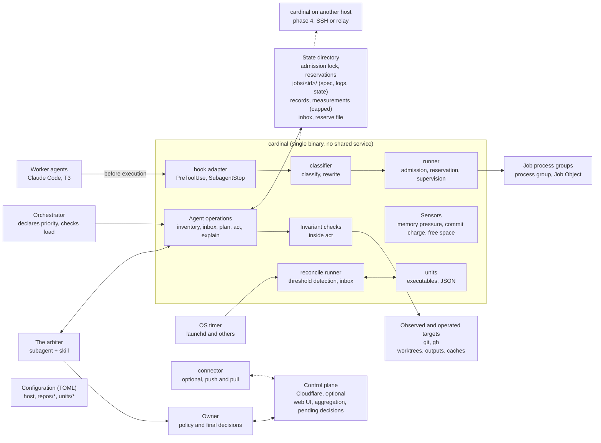

# cardinal design

Coding agents running in parallel compete for local compute resources (CPU, memory, disk, worktrees, build outputs) and leave them behind. `cardinal` takes this problem away from the orchestrator. A small per-host core handles it, together with an arbiter agent that uses the core.

## Contents

1. [Purpose](#1-purpose)
2. [Environment and observed problems](#2-environment-and-observed-problems)
3. [Principles](#3-principles)
4. [Non-goals](#4-non-goals)
5. [Architecture](#5-architecture)
6. [Commands and jobs](#6-commands-and-jobs)
7. [Per-resource handling](#7-per-resource-handling)
8. [Offload seams](#8-offload-seams)
9. [Technology choices and diagram](#9-technology-choices-and-diagram)
10. [Purpose layer](#10-purpose-layer-acceptance-criteria)
11. [Plan layer](#11-plan-layer-claims)
12. [Phases](#12-phases)
13. [Prior art](#13-prior-art)
14. [Open questions](#14-open-questions)

## 1. Purpose

Let the orchestrator focus on orchestration: splitting work, deciding what to run in parallel, and integrating results. Arbitration, such as queuing builds and tests, cleaning up worktrees and build outputs, and dealing with leftover processes, belongs to `cardinal` and the arbiter, not to the orchestrator.

Full automation is not the goal. Parts that are simple to write become automatic code. Parts that would become complex if automated go to the arbiter. The arbiter works through `cardinal` operations, so it cannot break the invariants that `cardinal` enforces (never delete the owner's data). Only decisions that only the owner can make reach the owner.

The aim is smoothness, seamlessness, and no hassle, rather than speed. Worker agents and the owner should barely notice `cardinal`, and work should never stall because resources ran out or piled up.

## 2. Environment and observed problems

### Development environment

| Machine | Typical projects | Stack |
| --- | --- | --- |
| macOS (arm) | TypeScript monorepos on Cloudflare Workers | TypeScript, Cloudflare Workers (vitest on workerd), pnpm, mise |
| Windows (x86) | A Windows-only Rust project whose GPU-less rendering tests use WARP | Rust, cargo-nextest, NixOS on WSL (fuzzing, portable crates), rendering tests on WARP |
| Linux | — | Not a main development target, but easy to provision. The main CI platform |

Go may be added later. The target repositories are public OSS. The control plane assumes a Cloudflare Workers paid plan.

### Observed problems

- **Worktree accumulation** (macOS): dozens of worktrees accumulate, each with about 1 GB of `node_modules`, and together they take a large share of the disk. They come from three sources: an agent app (T3 Code), a worktree CLI (`git wt`), and manual creation. Apart from the main worktree, a few have uncommitted changes, many are already ancestors of `main`, and the rest include worktrees that were probably squash-merged.
- **Memory**: a single workerd process takes gigabytes. A typical package `test` script runs vitest four times in sequence (the root `pnpm test` runs it once in projects mode). Rust is heavy at link time.
- **Disk exhaustion**: fuzzing, property-based testing (PBT), and abandoned Rust build outputs have filled the disk until nothing could run. Fuzz corpora and artifacts and proptest regressions are ignored by git.
- **Windows Rust project**: tests that use WARP consume commit charge. `RUST_TEST_THREADS` is a per-process limit, so under parallel agents the total overflows. Paths must stay under 260 characters. A running exe can hold files open, so a worktree cannot be deleted. The WSL-side `target` stays after the Windows-side worktree is deleted.

## 3. Principles

1. **Prefer simplicity over perfection.** Weights are estimates, reservations are self-imposed, and enforced isolation is not required. Guarantees are stated as "under the configured budget and conditions"; there are no absolute guarantees.
2. **The target is the owner's own resources.** Third-party use, multiple users, and security against malicious units are out of the design. What `cardinal` protects against is accidental deletion of the owner's data.
3. **The unit of arbitration is the host (physical machine).** The host owns the resources. Repositories and tasks borrow them.
4. **Write nothing into repositories.** `cardinal` keeps its configuration, instructions, and scripts outside repositories and creates no files inside them. From a repository it reads only standard facts that mean something to anyone (`mise.toml`, metadata in `Cargo.toml`, and so on).
5. **Fail-open.** If, before the child process starts, `cardinal` turns out to be missing, down, or unresponsive, the command runs exactly once, as it would without `cardinal`. A `cardinal` failure after the child starts is returned as an infrastructure failure, and the command is not rerun. Fail-open execution stays subject to the agent host's authorization: `cardinal` grants no execution rights.
6. **Plug in transparently.** Agent hooks intercept commands. The only thing a worker agent needs to know about `cardinal` is how to collect the result of a job ID returned after a long wait.
7. **Configuration holds only policy and initial profiles.** Command weights are learned from measurements.
8. **Truth comes from observation.** Worktree and process state is read fresh from git, ps, and gh every time, never from the creating tool's registry. A failed observation means "unknown", which is never treated as safe.
9. **Separate code from judgment.** Fixed procedures and invariants live in code (the core and units). Judgments that would become complex if automated live in the arbiter (and the skill that holds its instructions). No agent sits on a synchronous path.
10. **The core enforces invariants.** The core decides what must not be deleted at the time an operation executes. No caller (unit, arbiter, or owner approval) can lift that check.
11. **Promote judgments.** When the arbiter keeps making the same judgment, move it into a unit and automate it. When a unit grows too many branches, move it back to judgment.
12. **Build the core solid and minimal** (extensible by design). Individual features are added as units or skills. The core works with zero units.
13. **Local is the source of truth; the cloud is optional.** Each host's core holds the truth about its resources and runs its work. The cloud control plane only views, decides, and dispatches. The core behaves the same without the cloud and offline.

## 4. Non-goals

| Excluded | Reason or alternative |
| --- | --- |
| Knowledge of build tools or repositories (in the core) | Lives in units and per-repository profiles |
| Deletion criteria (in the core) | Live in units and host configuration. The core holds only invariants |
| Dependence on a specific agent | Lives in adapters (starting with Claude Code hooks) |
| A general workflow engine, orchestration decisions | Scope is limited to arbitrating local resources and cleaning up |
| Creating worktrees | Left to existing tools (T3 Code, `git wt`). `cardinal` only observes and reclaims |
| Operations that change the creating app's state | Worktrees created by T3 Code are only reported |
| General suspend and resume of running jobs | Stopping a job does not give back memory or commit charge. Idle jobs are handled through start conditions and OS priority |
| Enforced resource isolation (cgroups, Job Object limits) | Not required. Used optionally where the OS supports it |
| Security boundaries, signing, permission models | Unneeded because only the owner's resources are involved. The control plane is protected only by Cloudflare Access and per-host tokens |
| Exact resource accounting, exact wait-time predictions | Estimated weights and sensor values are enough |
| Controlling cross-host resources (v1) | Only the seam is prepared (section 7) |

## 5. Architecture

### Roles

| Role | Responsibilities |
| --- | --- |
| The core and units (code) | Classifying and rewriting commands, admission and reservation, job supervision, observation, records, invariant checks, threshold detection, obvious reclamation (once promoted) |
| The arbiter (judgment) | Pending decisions, worktrees whose merge status is ambiguous, valuable data (for example, proposing corpus minimization), OS-specific cleanup (WSL virtual disks), investigating anomalies (processes that outlive their session, sudden disk growth), revisiting weights and classification |
| The owner (web UI) | Policy (how much may be deleted, where work may be sent), decisions only the owner can make |

Pending decisions go to the arbiter first. The orchestrator receives only information that affects its plan (for example, "the slots are full and there will be a wait"). An OS timer and new inbox entries trigger the arbiter. It runs headless, one instance at a time, and only when there are unprocessed items. The arbiter's own commands do not trigger the arbiter.

### Local and cloud

| Layer | Location | Responsibilities | Resident processes |
| --- | --- | --- | --- |
| The core | Each host | Classification, admission and reservation, job supervision, invariant checks, sensors. Source of truth for host resources | No shared service. A supervising process (runner) runs per job |
| Connector (optional) | Each host | Pushes state to the control plane, pulls intents from it | Pushes and pulls at job end and on an OS timer. Resident only on hosts that accept offloaded jobs |
| Control plane (optional) | Cloudflare | Web UI, aggregation across hosts, answering pending decisions, dispatch, history | Workers and a Durable Object |

- **Push**: snapshots (`inventory`), records, and pending decisions.
- **Pull**: hosts fetch owner approvals and offloaded jobs themselves (this works behind NAT).
- **The cloud never operates directly**: the control plane only places an intent bound to a specific plan ("approve reclamation for plan P"). Each host's `act` executes it through the invariant checks.
- **Why arbitration itself is not online**: admission would depend on network latency and connectivity, which breaks fail-open. Actual memory and disk state can only be read accurately on the host. Each machine sits behind NAT.

Pending decisions collect in the control plane, so a single arbiter can see every host. Operations still go through each host's core. The web UI shows, per host, an overview (memory pressure, disk breakdown), the worktree list (state, PR, whether it is a reclamation candidate), running jobs, reservations and waits, pending decisions (approve or reject), a timeline of records, absent hosts and stale snapshots, expired approvals, and rejection reasons.

### Three axes

| Axis | Unit | Contents |
| --- | --- | --- |
| Resource owner | Host (physical machine) | CPU, memory, and disk budgets, WARP and GPU, ports, shared caches (pnpm store, sccache, cargo registry) |
| Consumer identity | Repository / task (session) / job | Identified from hook input (session, cwd, tool call ID) and recorded in reservations and outputs. Used for fair allocation, reclamation order, and aggregation |
| Execution environment | Partitions within a host: native, WSL, container VM | Share the host's budget. Admission is decided in exactly one place per host (WSL asks the Windows side). A VM's memory limit is treated as a smaller slot inside it |

### The core

- **hook adapter**: called from agent hooks. It only classifies a command and rewrites it to run through the runner; it takes no reservation. Adding units does not change the hook configuration.
- **runner**: owns admission, reservation, waiting, child process supervision, and measurement, from acquiring the reservation until it confirms the child has exited (section 6).
- **Reservation**: inside the host-wide admission lock, the runner checks existing reservations and sensors, decides, and adds a reservation. A reservation whose owning runner has died is recovery-needed: it keeps counting as reserved and in use until the recorded process group is confirmed stopped.
- **Observation**: reads the state of worktrees, outputs, processes, and PRs from git, ps, and gh.
- **Operations and invariants**: reclamation and stopping happen only through `plan` and `act`. `act` checks the invariants right before execution (section 7).
- **The inbox**: holds what units could not decide, with evidence. The same item is not added twice, and resolved items do not come back.
- **Records**: decisions, operations, and measurements go to an append-only log with a size limit and rotation. A broken trailing line is skipped on read.
- **Dry-run and reclamation without approval**: a new unit starts by reporting only. Whether it may actually operate is switched per unit in host configuration. Without owner approval, the arbiter may reclaim only regenerable data (caches, `target/`, `node_modules`) and whole worktrees that meet every reclamation condition (section 7). Everything else needs owner approval. Both paths pass the invariant checks, so they only ever cover data whose deletion loses nothing.

### Unit kinds

| Kind | When it runs | Examples |
| --- | --- | --- |
| classifier (synchronous) | Inside the hook | Command class, initial weight, execution requirements |
| reconciler (asynchronous) | On events and OS timers | Disk threshold detection and reclamation, detecting leftover processes, adding inbox entries |
| placement / executor | Inside the runner | Always local in v1. Only the seam exists (section 8) |

When several classifiers are registered, they are evaluated in a fixed order. If one does not respond within its deadline, the command is not rewritten (fail-open).

### Operations for the arbiter

The core's CLI returns JSON.

| Operation | Contents |
| --- | --- |
| `inventory` | Current host resources: disk breakdown (worktrees, outputs, caches, with provenance), reservations, running jobs, processes that outlived their session |
| `inbox` | Pending decisions with the observations behind them |
| `plan` | Proposes operations. Each plan has an ID and is bound to the target identity (host, repository, worktree, HEAD, path). It includes the amount freed and the invariant check results |
| `act` | Executes a plan by ID. If the target identity has changed, the plan expires. If an invariant applies, `act` refuses and returns the reason. The same plan never runs twice |
| `explain` | Shows which configuration, unit, and observation a decision came from |

### Unit shape and configuration

A unit is an executable that exchanges JSON over stdin and stdout and is registered by a manifest. Any language works. Units can be tested by replaying recorded events, so the arbiter can write a unit, check it in dry-run, and then enable it.

```toml
[unit.disk-reclaim]
kind = "reconciler"
on = ["disk.low", "pr.merged", "timer:1h"]
exec = "units/disk-reclaim"
act = false        # report only until set to true
```

| Layer | Decides |
| --- | --- |
| Host configuration | Total resources, priority classes, disk thresholds, unit enablement and `act`, offload targets |
| Per-repository profile (in personal configuration) | Command classification and initial weights, execution requirements (`requires`), classification of protected data and regenerable directories |
| Task declarations | Priority, declared by the orchestrator |

## 6. Commands and jobs

### The flow of one command

1. A worker agent tries to run a command with Bash.
2. The `PreToolUse` hook classifies each stage of it (each simple command in its pipelines and lists). If no stage is in scope, or classification does not respond within its deadline, the command runs unchanged.
3. For each stage in scope, the hook rewrites that stage, in place, to run through `cardinal run` (`updatedInput`). The rest of the command stays in the calling shell, so its meaning, including cwd, environment variables, and shell state, does not change (the only change is injecting parallelism settings, section 7). The rewrite keeps every Bash tool input field other than `command` unchanged. Each rewritten stage carries a shell fallback that runs the original stage if the runner cannot start. The rewrite grants no execution rights: the agent host still decides whether the rewritten command may run, and may ask for approval where the original needed none.
4. From acceptance until completion or cancellation, the runner holds the worktree's in-use lock. The worktree is not reclaimed while the job waits.
5. The runner decides on a reservation inside the admission lock.
   - If resources are free, it reserves them and starts the child process.
   - If not, it waits inside the runner. The maximum synchronous wait is kept shorter than the Bash tool timeout minus the expected run time. The wait is recorded and shown by `explain`; nothing is added to the command's output.
   - If the wait is expected to exceed the maximum synchronous wait, or the actual wait reaches it, the runner registers the command as an accepted job and returns the job ID and how to collect the result **as normal output**. Apart from reporting its own failure (G4), this reply is the only output `cardinal` adds to a command. The job runs as soon as resources free up. A retry with the same tool call ID binds to the same job, so it never runs twice.
6. The runner supervises the child process group. When it exits, the runner releases the reservation and the in-use lock and records measurements (duration, peak memory, disk growth).
7. Pushing to the control plane happens after execution, and failures are ignored.

```text
[cardinal] Busy; accepted as job 7f3a (3rd in queue).
It runs as soon as resources free up. Collect the result with `cardinal wait 7f3a`.
Do not rerun the same command. Continue with other work while you wait.
```

### Failures and lifetimes

- **Failure before the child starts**: if the runner cannot start, the shell fallback runs the original stage unchanged. If the runner fails to reserve or record, the runner runs the original stage unchanged (fail-open).
- **Failure after the child starts**: a command that may already have run is not rerun; the failure is returned as an infrastructure failure. A recording failure is never a reason to rerun either.
- **Runner crash**: the reservation and in-use lock become recovery-needed. Admission and reclamation keep counting them as reserved and in use until the recorded process group is confirmed stopped. On Windows, the Job Object's `KILL_ON_JOB_CLOSE` stops the children immediately. On Unix, nothing signals the leftover process group once its runner is gone: the group's ID can pass to an unrelated group between a check and a signal. The reservation is kept until the group has ended on its own or the boot changed, and the inbox shows the group's members so the owner or the arbiter can stop them.
- **Session end**: `SubagentStop` and `SessionEnd` do not stop processes; they record that the session ended, because background processes (such as a dev server) may have been left running on purpose. Processes that outlive their session go to the inbox, and the arbiter handles them.
- **Queue tickets**: each ticket is valid only while its owning process is alive. Tickets whose owner has died are skipped.

### Command capture

Capture is based on the hook rewriting each classified stage of the command in place, and each such stage is reserved as one job; the rest of the command stays in the calling shell. Executions launched inside a script that a stage starts (for example, a test script that runs vitest four times) are not controlled individually; they are learned as part of that stage's weight. There are no shims on `PATH`. The resolution order of mise, rustup, and pnpm and `node_modules/.bin` easily bypass them, and reserving both the outer and inner command can make a job wait on itself. Finer control is added later, and only for tools where measurements show it is needed. Classification treats variant spellings (`pnpm exec vitest`, `npx vitest`, `env X=1 cargo test`, `bash -c '…'`) as the same command.

## 7. Per-resource handling

### Admission

- Inside the admission lock, the runner looks at existing reservations, sensor values, and the new job's estimate together, decides, and adds a reservation. Jobs arriving at the same time cannot all see the same low reading and all be admitted.
- Reservations count the part that has not yet appeared in sensor readings (start-up ramp) and are not double-counted against usage that sensors already show.
- Total resources are shared across classes, and priority sets the admission order. Even `high` has a physical cap. A job that needs several resources gets all of them or none.
- Once a warning line is reached, new `normal` and `idle` jobs stop, and they resume only after the reading drops below a release line lower than the warning line. If a sensor read fails, admission decides from reservations alone.
- A heavy command with no measurements starts from a conservative default (low concurrency). A light unknown command is not limited. Measurements are keyed by repository, command class, and toolchain, and an incomplete measurement does not abruptly lower a weight.
- Load that bypasses `cardinal` (builds started by hand, rust-analyzer in an editor, browsers) shows up in sensor values as background load.

### Priority classes

| Class | Examples | Handling |
| --- | --- | --- |
| high | Runs a human is waiting for, verification during integration | Highest priority, but never above the physical cap |
| normal | Subagent builds and tests | Allocated fairly across tasks |
| idle | Fuzzing, long PBT runs, cache warming | Starts only when resources are free and runs at lowered OS priority. Keeps its reservation while running |

### CPU and parallelism

Reservations are per command. Adapters inject each tool's parallelism settings.

| | Rust | Node.js/TS | Go (future) |
| --- | --- | --- | --- |
| jobserver | Supported (Cargo is a client). Sharing requires passing the jobserver connection; `CARGO_BUILD_JOBS` alone does not share | Not supported | Not supported |
| Injected settings | `CARGO_BUILD_JOBS`, `NEXTEST_TEST_THREADS` | `--maxWorkers`, `NODE_OPTIONS` | `GOMAXPROCS`, `GOFLAGS=-p=N` |
| When injection does not reach | — | If a script runs the tool several times internally, the whole stage is treated as a heavy job | — |

### Memory measurement

Measurements carry a kind, and values of different kinds are never mixed when learning. Windows uses the Job Object's peak (the whole process group). Unix coarsely samples the sum over the process group while the job runs and takes the maximum (rusage's maximum RSS is a single-process value, so it is not used).

### Disk

Disk is a resource on par with CPU and memory. When it runs out, `cardinal` itself stops, and space does not come back when processes exit.

1. **Budget before execution**: a heavy job reserves its expected growth, estimated from measurements, before it starts. If there is not enough, it waits.
2. **Threshold reclamation**: below the warning line, regenerable data is reclaimed in reclamation order until free space rises above the recovery line. Data in use and protected data are skipped. Data is in use while a job holds its worktree's in-use lock, which keeps cooperating jobs and reclamation apart, or while a process `cardinal` can see uses it (working directories, open files); a user it cannot see, such as a file watcher or another user's process, can lose what it reads or writes in regenerable data, which a rebuild restores. Below the critical line, admission of heavy jobs stops and the owner is notified. Exhaustion time is predicted from the growth rate, and throttling starts before the disk fills. A local snapshot keeps the blocks it references, so while one exists reclamation frees nothing; the owner thins or deletes snapshots (`tmutil`), and `cardinal` never does.
3. **Protecting `cardinal` itself from exhaustion**: a reserve file with actually allocated space sits on the volume that holds the state. When that volume fills up, `cardinal` deletes the reserve to write what recovering a reclamation needs, and drops records it cannot write. Logs and job output rotate with a size limit.
4. **Provenance**: which worktree, branch, and PR an output belongs to is inferred from its path and used in reclamation decisions.

| Source | Nature | Handling |
| --- | --- | --- |
| Reclaimable worktrees (conditions below) | Regenerable | First in reclamation order |
| Known regenerable directories inside a worktree, such as `target/` and `node_modules` | Regenerable | Reclaimable even when the whole worktree is not |
| Outputs of non-current toolchains, old incremental data, fuzzing builds | Regenerable | Removed oldest first |
| Caches such as the pnpm store and sccache | Cache | Capped and trimmed by LRU |
| Fuzz corpora, crash reproducers, PBT regressions | Protected data | Never deleted. When a corpus exceeds its cap, propose minimization (`cargo fuzz cmin`) |
| Ignored data that cannot be classified | Unknown | Never deleted. Becomes a pending decision |

### Worktree reclamation conditions

A whole worktree becomes a reclamation candidate only when all of the following hold. If any condition fails or cannot be determined, only its known regenerable directories are candidates.

- There is evidence that the current HEAD has been merged: it is an ancestor of the base, the head of a merged PR equals the current HEAD, or the arbiter judged a squash merge and every file the branch changed is identical in the base.
- No uncommitted changes, no unpushed commits, no open PR.
- Not in use (no in-use lock held by an accepted, running, or recovery-needed job).
- The worktree contains no protected data and no unclassifiable ignored data.
- Observation by git and gh succeeded (a failure means "unknown").
- The worktree is not managed by its creating app (T3 Code). Such worktrees are only reported, and so are worktrees that containers or VMs use, whose processes `cardinal` cannot see; host configuration lists both as managed.

`act` inspects the whole deletion target (including descendants) and also refuses to delete a parent that contains protected data.

### Cross-host resources

Some resources belong to an account rather than a machine: the GitHub API rate limit (shared by every host and agent), CI minutes, and deployment exclusivity. v1 does not control them and only prepares the seam. When they are controlled, a Durable Object holds them, with two distinct modes: estimated budgets (if the control plane is unreachable, each host self-limits with a conservative default) and strict exclusion (if the control plane is unreachable, new acquisitions wait). In both modes, admission for local resources never goes to the network.

### Per-OS mechanisms

| | macOS | Windows | Linux |
| --- | --- | --- | --- |
| Memory signal | `kern.memorystatus_vm_pressure_level` | Commit charge (`CommitTotal` / `CommitLimit` from `GetPerformanceInfo`; values are in pages, so multiply by `PageSize`) | PSI (`/proc/pressure/memory`) |
| Disk signal | Important-usage capacity of the target volume (accounts for local snapshots and purgeable space) | Free space. Deleting inside a regular dynamic WSL VHD does not return space to Windows; use the sparse setting or compact it while idle | Free space |
| Process management | Process groups | Job Object (`KILL_ON_JOB_CLOSE`) | Process groups |
| Lowering priority | `taskpolicy -b` | Priority class | `nice` |
| Cheap copies | APFS `clonefile` | Block cloning on Dev Drive (ReFS) | reflink (btrfs/xfs) |

## 8. Offload seams

v1 does not implement offloading to other machines. It fixes only the seams that would require a major rework if added later.

| Fixed in v1 | Shape in v1 |
| --- | --- |
| Two representations | A local invocation (the stage's argv as expanded by the calling shell, cwd, and environment as they are) is kept separate from a portable job spec (argv, repository identity, cwd relative to the repository, allowed environment variables, input tree hash, required resources, wanted outputs). Only portable invocations are converted from local ones. Whether the input includes uncommitted or untracked files is explicit, never silently replaced by HEAD |
| Execution flow | placement → admission and reservation on the chosen host → executor. The executing host holds the reservation. placement always returns local |
| Asynchronous jobs | Job ID, `wait`, `cancel`, log subscription. Local jobs use the same shape |
| Result shape | Exit code, logs, list of outputs, and whether the failure came from infrastructure or the command |
| Resource unit | Always the host (v1 is local only) |
| Execution requirements | `requires: {os, arch, tools, warp…}` and an environment fingerprint (hash of `mise.lock`, toolchain, OS/arch) |
| Transport | The protocol is independent of the connection (local child process, SSH stdio, control plane relay) |

Every machine runs the same `cardinal` as a peer, and offloading only means sending a job to another host's executor. The route is SSH or a relay through the control plane's Durable Object (input trees and outputs go through R2). CI is treated as another kind of executor. The seam is tested with a loopback executor that runs with a different root, a different process, and different local paths.

Not built in v1: file transfer, machine discovery, cross-machine scheduling, cache sharing.

## 9. Technology choices and diagram

### Diagram

Dashed edges are optional or later parts (connector, control plane, other hosts).



### Technology choices

| Item | Choice | Reason | Alternatives considered |
| --- | --- | --- | --- |
| Implementation language | Rust (single binary) | The same implementation ships as a single executable for each of macOS, Windows, and Linux. It starts on every hook call, so start-up must be fast. The maintainers' main language | Go (equivalent, but not the current main language), TypeScript (slow start, depends on Node) |
| Process model | No shared service. CLI, a runner per job, a state directory, OS timers. Connector is optional | Fail-open follows naturally, and no service management is needed. A resident component crashing does not affect local arbitration | A resident daemon (simpler if fair queues, suspend and resume, or many waiters become necessary) |
| Admission and reservation | A host-wide admission lock (short critical section) and per-job reservation files (including the process group identity). A file lock held by the owning runner (`flock`, `LockFileEx`) shows that the runner is alive | When a runner dies, the OS releases its lock, so recovery-needed is detected without a TTL. Concurrent jobs are decided together | Per-class slot files (cannot handle totals across classes or concurrent admission), SQLite |
| Queue | Ticket files. Each ticket's validity is also shown by the lock held by the ticket's owning process | Keeps order without a resident process, and dead tickets do not block the queue | — |
| Job supervision | The runner starts and supervises the child process group. Process groups on Unix, Job Object (`KILL_ON_JOB_CLOSE`) on Windows | Stopping and peak memory measurement happen in the same place | pueue as the executor (has a parallelism limit but cannot see memory pressure) |
| Asynchronous jobs | `jobs/<id>/` holds the spec, logs, and state; a detached runner executes the job | `wait`, `cancel`, and log subscription work with files alone | — |
| WSL | The CLI inside WSL calls the Windows-side CLI through interop to request admission. On failure it fails open and records that the reservation is not shared | Admission is decided in exactly one place per host | Locking the same path from Windows and WSL (mutual exclusion is not guaranteed) |
| Executor protocol | JSON over stdio (`cardinal exec --stdio`). A child process locally; SSH or the control plane relay remotely | One protocol covers loopback and remote | HTTP, gRPC (need a resident process) |
| Records | JSONL (rotated at a size limit, broken trailing lines skipped). State lives in the XDG state directory, or `%LOCALAPPDATA%` on Windows | Append-only, so simple and hard to corrupt | SQLite (if aggregate queries become heavy) |
| Configuration | TOML (`host.toml`, `repos/*.toml`, `units/*.toml`) | Consistent with Rust and mise tooling | — |
| Observation | Calls the git and gh CLIs | Same results as the owner's git configuration (worktrees with relative paths, and so on) | libgit2 (configuration interpretation can differ) |
| Sensors | Each OS's standard signals (table in section 7). The `sysinfo` crate for shared parts | Keeps OS differences inside adapters | — |
| Agent entry point | Claude Code hooks (`updatedInput` from `PreToolUse`, `SubagentStop`, `SessionEnd`), configured in the user-level Claude Code `settings.json` | Lives in personal configuration, so repositories stay untouched. `updatedInput` replaces the whole input, so fields other than `command` are returned unchanged | Shims on `PATH` (section 6) |
| The arbiter | A Claude Code subagent definition and skill in user-level configuration. Started headless, one at a time, by an OS timer and new inbox entries | The judgment side is easy to change as instructions. Does not depend on a resident thread or the orchestrator | A resident thread, invocation by the orchestrator |
| Units | Any executable. JSON over stdio | Any language, and agents can write them | WASM plugins, dynamic libraries (excessive) |
| Control plane | Cloudflare Workers (API and static assets for the UI), one Durable Object (per fleet; host list, pending decisions, intents, and queues in SQLite storage; the UI and connectors connect with WebSocket hibernation), R2 (logs, offload inputs and outputs), Cron Triggers (mark hosts that stopped pushing as absent) | Expected to fit within the Workers paid plan. Same platform as the Workers projects it serves | A self-hosted server (needs operations), making one host the parent (the whole fleet becomes invisible when that host stops) |
| Authentication | Cloudflare Access for the UI, tokens for host API calls | Per principle 2, nothing more is built | — |
| Main crates | `clap`, `serde` and `serde_json`, `toml`, `sysinfo`, `fs4`, `jobserver`, `windows`, `rustix` | — | — |

## 10. Purpose layer (acceptance criteria)

These are the conditions agreed with the owner. Protection conditions are verified with a control case that must be processed placed alongside.

| ID | Condition (EARS) | Verification on real systems |
| --- | --- | --- |
| G1 | When several subagents start heavy tests at the same time under the budget in host configuration, `cardinal` keeps concurrent execution within the budget without instructions from the orchestrator, and completes all of them. | Set a small budget and start the `test` script of a package that runs vitest four times in sequence from four agents at once. Count concurrent executions from process start records independent of `cardinal`, and confirm that all complete. Prompts and AGENTS.md do not mention `cardinal` |
| G2 | When free disk space drops below the warning line while reclaimable outputs exist, `cardinal` reclaims them before space runs out and stops once free space rises above the recovery line. | Place reclaimable data on a test volume and push it past the warning line with a separate source of growth. Confirm that reclamation runs before ENOSPC and stops with enough free space |
| G3 | When a worktree meets every reclamation condition (section 7), `cardinal` and the arbiter reclaim it without help from the owner or the orchestrator (in dry-run, they report it). | Prepare a normally merged, a squash-merged, and an unmerged worktree. Confirm that only the merged ones are reclaimed and the unmerged one remains |
| G4 | When, before the child process starts, `cardinal` turns out to be missing, crashes, does not respond, or the runner cannot start after the rewrite, the command runs exactly once with the same result as without `cardinal`. When `cardinal` fails after the child starts, the command is not rerun and is returned as an infrastructure failure. | In each pre-start state, compare stdout, stderr, exit code, cwd, and environment variables with a run without `cardinal`, and confirm the command ran once. Stop the runner right after start and confirm the command is not rerun and the failure is distinguishable as infrastructure |
| G5 | `cardinal` works without adding files or instructions to target repositories. | After installation, execution, reclamation, and `act`, confirm that the repository contains no files from `cardinal` (tracked, untracked, or ignored) |
| G6 | When a worktree has uncommitted changes, unpushed commits, an open PR, a branch without upstream, a failed observation, or is in use (including an accepted job that is waiting), `cardinal` does not reclaim it, and still reclaims reclaimable worktrees present at the same time. | Line up worktrees in each state next to a reclaimable control and run reclamation. Include a clean worktree whose job is waiting because the budget is full |
| G7 | When protected data (fuzz corpora, crash reproducers, PBT regressions) exists, `cardinal` deletes neither it nor the worktree containing it, and still reclaims regenerable directories present at the same time. | Place a worktree containing protected data and a control cache, and run reclamation under disk pressure |
| G8 | When a unit finds a state it cannot decide automatically, the arbiter resolves what it can, and only decisions that only the owner can make reach the owner. | Prepare a case the arbiter can resolve (deciding a squash merge) and a case that needs the owner (a closed PR with uncommitted changes) |
| G9 | When offloading to another machine is added, it is added without changing the shape of job specs, classifiers, or units. | Tests pass, with existing units unchanged, using a loopback executor that runs with a different root, a different process, and different local paths |
| G10 | When the arbiter works through `cardinal` operations with valid plans, safe operations succeed and only operations that hit G6 or G7 are refused. | Instruct the arbiter to perform both a safe reclamation and a reclamation that includes protected data |
| G11 | When the control plane is unreachable, each host's admission, reclamation, and recording of pending decisions behave the same as when it is reachable. | Repeat the G1, G2, and G4 verifications with the network disconnected, and confirm pending decisions remain locally |
| G12 | When the owner opens the web UI, resource status and pending decisions for every host are visible in one place, and pending decisions can be answered there. | Two hosts' states appear side by side, and a reclamation approved in the UI runs on the next cycle. Absent hosts, stale snapshots, expired approvals, and rejection reasons are shown distinctly |
| G13 | When a command would wait a long time, it runs exactly once as an accepted job, and the worker agent can collect the result. | With the budget full, submit a command, confirm a job ID is returned, the job runs once after resources free up, and `wait` returns the result. A wait expected to be short that drags on also returns a job ID when it reaches the maximum synchronous wait. Also check retries with the same tool call and cancellation |
| G14 | When a runner crashes, the job's reservation and in-use state remain until its process group stops, and are released after it stops. | Kill a running runner and try admission and reclamation; confirm they are treated as reserved and in use. End the group's remaining members, then confirm no children remain and the next job is admitted |

## 11. Plan layer (claims)

Hypotheses derived from the purpose layer. Test names are filled in during implementation.

| ID | Claim (EARS) | Derived from | Test (planned) |
| --- | --- | --- | --- |
| C1 | When a classified command reaches the hook, the hook only rewrites the command to run through the runner and takes no reservation. | G1, G14 | No reservation exists after the hook exits, and one exists after the runner starts |
| C2 | The runner decides on existing reservations, sensor values, and the new job's estimate together inside the admission lock and adds a reservation. A job that needs several resources gets all of them or none. | G1 | Submit N jobs at once; independent start records show concurrency within the budget. Totals are not exceeded across classes |
| C3 | While memory pressure is at or above the warning line, the runner admits no new `normal` or `idle` jobs, and resumes only after it drops below the release line. If a sensor read fails, it decides from reservations alone. | G1 | Replace raw sensor values and check admission per class, release, and read failure |
| C4 | When the wait is expected to exceed the maximum synchronous wait, or the actual wait reaches it, the runner registers the command as an accepted job and returns the job ID as normal output. A retry with the same tool call ID binds to the same job. | G13 | No double execution across run-after-free, cancellation, and retry. A job ID is returned by the maximum synchronous wait even when the estimate is unknown or wrong and the wait drags on |
| C5 | On a failure before the child starts, the shell prefix runs the original command unchanged if the runner cannot start, and the runner runs it unchanged if reservation or recording fails. On a failure after the child starts, the command is not rerun and is returned as an infrastructure failure. When the hook does not respond within its deadline, the command is not rewritten. | G4 | Compare execution count and results with a missing runner binary, reservation failure, recording failure, runner crash right after the child starts, and a delayed hook |
| C6 | When the hook rewrites a command, Bash tool input fields other than `command` do not change, only classified stages are wrapped, and the command keeps its meaning, including cwd, environment variables, and shell state. The only exception is injecting parallelism settings (section 7). | G4 | Compare inputs containing redirects, `cd &&`, `&&`/`\|\|` lists, pipelines with `pipefail`, environment variable prefixes, and timeouts. Environment variables other than the injected settings do not change |
| C7 | Commands inside WSL go through Windows-side admission. If the request fails, they fail open and record that the reservation is not shared. | G1 | Submit from Windows and WSL at once; the combined total stays within the budget. The record on request failure |
| C8 | When a runner crashes, its reservation and in-use lock become recovery-needed and count as reserved and in use until the recorded process group is confirmed stopped. On Windows the Job Object stops the process group; on Unix the group is never signalled once its runner is gone, and the reservation is released after the group has ended. | G14 | Right after killing the runner, new admissions and reclamations are held. Once the group's members have ended, no children remain and the reservation is released |
| C9 | On `SubagentStop` and `SessionEnd`, `cardinal` does not stop processes and records that the session ended. Processes that outlive their session go to the inbox. | G8 | A background dev server remains and appears in the inbox |
| C10 | When free disk space drops below the warning line, a reconciler reclaims in reclamation order and stops above the recovery line. Data in use and protected data are skipped. | G2 | Data disappears in order, reclamation stops with enough free space, and data in use and protected data remain |
| C11 | When the volume holding the state fills up, `cardinal` deletes the reserve file to write what recovering a reclamation needs, completes minimal reclamation, and drops records it cannot write. A recording failure is not a reason to rerun a command. While a local snapshot keeps the freed blocks, neither the reserve nor reclamation frees space until the owner thins or deletes it. | G2 | Fill the state volume too, and check that reclamation completes, that it resumes after a mid-way failure, and the command's execution count |
| C12 | A whole worktree is a reclamation candidate only when there is evidence that its current HEAD has been merged, it has no uncommitted changes, unpushed commits, or open PR, it is not in use, it contains no protected data or unclassifiable ignored data, and observation succeeded. | G3, G6, G7 | Not a candidate when there are commits after a merged PR, a reused branch name, no upstream, or a gh failure. The control becomes a candidate |
| C13 | `act` inspects the whole deletion target (including descendants) and refuses the deletion if it contains protected data or unclassifiable ignored data. | G7, G10 | Deleting a worktree with protected data is refused, while deleting the same worktree's `target/` succeeds |
| C14 | `act` requires a plan ID and expires the plan if the target identity bound to it (host, repository, worktree, HEAD, path) has changed. The same check applies regardless of caller (unit, arbiter, control plane intent), and the same plan never runs twice. | G10, G12 | Nothing runs when, after approval, a different worktree is created at the same path, HEAD advances while clean, or the intent is redelivered |
| C15 | The runner holds the worktree's in-use lock from job acceptance until completion or cancellation, and reclamation proceeds only when it can take the in-use lock, which keeps cooperating jobs and reclamation apart. Users that hold no lock are found only as far as their processes show them (section 7). | G6 | Clean worktrees with a waiting job and with a running job are both left unreclaimed |
| C16 | While a unit's `act` is false, target data does not change and the planned operations are recorded. | G3 | Target data is identical before and after dry-run, and the record contains the planned operations |
| C17 | Local admission never goes to the network. | G11 | Observe `cardinal`'s own network connection attempts, distinguish them from the child command's traffic, and confirm there are none on the admission path |
| C18 | The admission path never calls the arbiter or waits for its response. | G1, G4 | With pending decisions present, stopping the arbiter does not change admission latency |
| C19 | When a unit cannot decide automatically, it adds the item to the inbox with the observations behind it. The same item is not added twice, and resolved items do not come back. | G8 | Re-notification creates no duplicates, and resolved items do not reappear |
| C20 | `cardinal` creates no files inside target repositories. | G5 | Check after execution, reclamation, and `act`, distinguishing writes made by the child command itself |
| C21 | Measurements are recorded with a kind, and values of different kinds are never mixed when learning weights. | G1 | For a job that runs several workerd processes at once, the Unix sampled sum is recorded as larger than the single-process maximum |

## 12. Phases

| Phase | Contents | Conditions verified |
| --- | --- | --- |
| 0 | The core (hook adapter, runner, admission and reservation, observation, records, `plan`, report-only `act`, and invariants, the inbox, the CLI for the arbiter), the Claude Code adapter, the first version of the arbiter's skill | G4, G5, G10, G14 |
| 1 | The arbiter reports reclaimable worktrees and regenerable data, and the owner removes worktrees; `act` gains race-free deletion of regenerable directories on the volume that holds the state, run by the owner and, under disk pressure, by `disk-reclaim` where the host grants them. Executing whole worktrees, and with it G3's execution part, comes in a later phase. On the code side, threshold detection, inbox entries, and starting the arbiter. Start on macOS against a real TypeScript monorepo's data. A read-only web UI (push only) | G2, G3 (report), G6, G7, G8 |
| 2 | Admission for heavy commands (memory, priority classes, recorded measurements), accepted jobs and `wait`, job specs, the loopback executor | G1, G9, G13 |
| 3 | Promote judgments the arbiter keeps repeating into units (for example, reclaiming merged, clean worktrees). Windows support (Job Object, commit charge, WSL admission requests and virtual disks). Answering pending decisions from the web UI | G1–G8, G13, G14 also on Windows; G12 |
| 4 | More executors (SSH hosts, control plane relay and a resident connector, CI). Control of cross-host resources | G9, G11 |

## 13. Prior art

There is open source software for the individual pieces, but no system was found that combines parallelism, reservations, worktree lifetime, disk, and offloading and ties them to the agent lifecycle.

| Area | Examples | What to borrow |
| --- | --- | --- |
| Reports of the same problem | [agents-manager #90](https://github.com/Eden-Sun/agents-manager/issues/90), [dot-agent-deck #863](https://github.com/vfarcic/dot-agent-deck/issues/863), [provenant #2197](https://github.com/mblauberg/provenant/issues/2197), [agent-orchestrator #3921](https://github.com/OrchestratorInc/agent-orchestrator/issues/3921) | A host-wide semaphore. Sharing `CARGO_TARGET_DIR` only serializes through lock waits. Reserve per command, not per agent |
| Parallelism tokens | jobserver ([Cargo](https://doc.rust-lang.org/cargo/reference/build-scripts.html), make, ninja ≥1.13), [Gentoo's system-wide jobserver](https://blogs.gentoo.org/mgorny/2025/11/30/one-jobserver-to-rule-them-all/), [GHC/cabal semaphores](https://www.well-typed.com/blog/2023/08/reducing-haskell-parallel-build-times/), [pueue](https://github.com/Nukesor/pueue/wiki/Groups) | Tools without jobserver support cannot be controlled |
| Reservations and TTLs | [MCP Agent Mail](https://github.com/Dicklesworthstone/mcp_agent_mail_rust) (file reservations and build slots), [Claim Plane](https://arxiv.org/pdf/2607.21909) | Mechanisms that reclaim reservations from crashed agents. Advisory reservations are practical |
| Worktrees and ports | [Emdash](https://emdash.com/docs/project-config), Conductor, Worktrunk, [agent-worktree](https://github.com/nekocode/agent-worktree) | setup/teardown lifecycle, port allocation |
| Isolation | [dagger/container-use](https://github.com/dagger/container-use) | Isolates, but does not allocate host resources |
| Offloading | [gatehaul](https://github.com/camilbenameur/gatehaul), [remote-dev](https://github.com/hnewcity/remote-dev), [BuildBuddy Remote Bazel](https://www.buildbuddy.io/blog/remote-bazel-with-agents/), [Stim #5529](https://github.com/appandflow/stim/issues/5529) | Asynchronous run/wait/log, choosing hosts by OS or RAM requirements, `local \| auto \| remote` placement with fallback to local on failure |

## 14. Open questions

- How the Claude Code Bash tool's timeout and background execution combine with the runner's maximum synchronous wait and with collecting accepted jobs. Whether the tool call ID is available in hook input.
- Job Objects, commit charge, latency of admission requests from WSL to the Windows side, and WARP load on real Windows hardware.
- Important-usage capacity on macOS, and how local snapshots and purgeable space are actually reclaimed.
- Whether Cloudflare usage, together with existing apps on the same account, fits within the paid plan.
- Whether the problem sizes in section 2 (disk taken by accumulated worktrees, workerd memory per process) reproduce, and whether every existing worktree is classified correctly.
